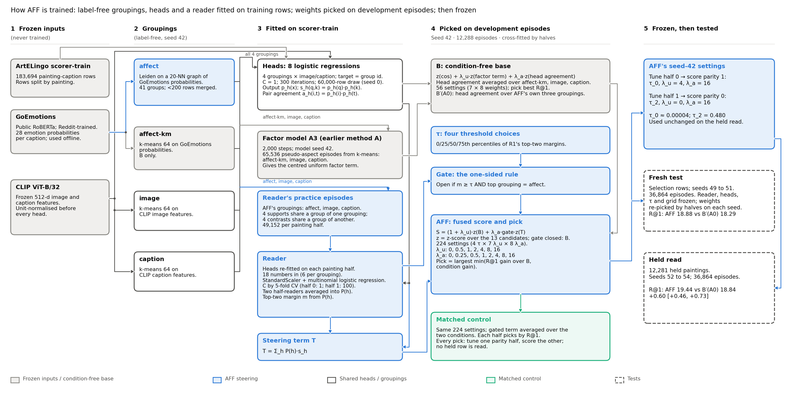

# AFF model card

> **Date:** 2026-10-13 (Amsterdam). **Method:** AFF, one-sided affect steering, CoSiR v2.
> **Status:** the current best method. Its held read on ArtELingo is GO (round 6). Round 9 tests it on other backbones.
> Every number comes from a file listed in §8. Lines marked "Our reading:" are our interpretation and decide nothing.
> The dates in auto-report file names are sequence numbers.

## Summary

AFF ranks captions for an image, or images for a caption, by how alike they are in one respect that four example pairs
show. On 36,864 held episodes it reached 19.44 R@1, against 18.84 for B′(A0): +0.60 [+0.46, +0.73] R@1 points. B′(A0) is
the strongest pre-registered score that ignores the examples' respect. AFF has two branches. A condition-free base, B, is
always on. A label-free steering term is added only when a learned reader is confident that the support pairs share the
affect grouping. Every part sits on frozen CLIP ViT-B/32 features and is fitted without evaluation labels. Its limits:
the gain is on the two emotion pairs only, style × genre is a loss, and its margins over B′(A1) and over its parent R1
are not established.

## 1. Task and interface

AFF scores one aspect episode at a time and returns 13 scores, one per candidate. An **aspect** is a respect in which
items can be alike (emotion, style, genre); a **value** is one setting of it (sad, Baroque, landscape). An **aspect
episode** has:

- a **query**: one painting's image (AFF then ranks captions) or one viewer's caption (AFF then ranks images);
- **4 support pairs**: each an image of one painting and a caption of another, which share a value of aspect A; the
  four pairs show four different values, none of them the query's;
- **4 contrast pairs**, built the same way for a second aspect B;
- **13 candidates** in the other modality: the target p_A shares the query's value of A, p_B shares its value of B,
  and 11 negatives share neither. A third aspect, where labelled, differs from the query for all 13.

The aspect is never named. In **condition a** the target is p_A. **Condition b** swaps supports and contrasts, so the
target becomes p_B. Each episode gives four rankings: two conditions times two directions (image to caption, caption
to image).

*Table 1. What AFF takes in and puts out, per ranking.*

| | Content |
|---|---|
| input | the query, the 8 example items (4 support pairs, 4 contrast pairs) and the 13 candidates, each a 512-d CLIP ViT-B/32 feature |
| output | 13 scores; a higher score means "more alike to the query in the respect the supports show" |
| fixed parts used at test time | 8 heads, the factor model, the reader, and two frozen settings of the fused score (§4) |

*Table 2. How a ranking is measured.*

| Measure | Meaning |
|---|---|
| R@1 | the target ranks strictly first, in percent (chance 7.7%); differences in R@1 points |
| other-aspect rate | the other aspect's candidate ranks first |
| condition gain | R@1 minus the other-aspect rate; exactly 0 for any scorer that ignores the condition |
| either rate | R@1 plus the other-aspect rate |

From the table, R@1 = (either rate + condition gain) / 2. A scorer can raise R@1 in two ways. It can find candidates
that share some aspect more often, or it can choose the shown aspect more often. Intervals are 95% bootstrap intervals
over anchor paintings (5,000 resamples), with every fitted part held fixed.

The 4 + 4 + 13 shape came from the project's common protocol (CVPR plan §5.1). It was inherited, and we never varied it
on aspect episodes.

## 2. AFF in two figures

*Figure 1. Training. Every learned part is fitted on the scorer-train rows, without evaluation labels. The fusion
settings are then picked on development episodes (seed 42). The held read reused those two settings unchanged; the
fresh test kept the reader, heads, thresholds and grid frozen and re-picked the weights on each seed (§6.3).*

*Figure 2. Inference. Grey: the condition-free base B, always on. Blue: the steering branch, added only when the gate
opens.*

## 3. Parts of AFF

AFF has nine parts: every learned part is fitted on training rows, and every setting is picked on development episodes.
Table 3 gives each part with the evidence that kept it; the subsections give the detail. All development numbers are on seed-42 episodes (12,288 episodes, 4,602 anchor paintings).

*Table 3. The parts of AFF.*

| Part | What it is | Fitted on | Kept because (comparator) |
|---|---|---|---|
| frozen inputs | CLIP ViT-B/32 features; GoEmotions caption probabilities | never trained by us | fixed backbone of the line |
| groupings (4) | label-free partitions of the training rows: affect (Leiden), affect-km, image, caption | scorer-train rows, seed 42 | Leiden beat k-means on the same GoEmotions scores |
| heads (8) | logistic regressions that place an image or caption in a grouping | 60,000 scorer-train rows | needed to place any new item |
| factor model (A3) | two small encoders to 32 shared non-negative factors | scorer-train rows, 2,000 steps, seed 42 | its centred term is the strongest condition-free term |
| B | cosine + centred factor term + averaged grouping score | weights picked on seed 42 | lifts R@1 from 12.96 to 18.34 |
| reader | a classifier: which grouping do the supports share? | practice episodes on scorer-train rows | equals the largest-difference rule and gives probabilities |
| steering term T | the reader's probability-weighted grouping score | no own weights | hedges when the reader is unsure |
| gate and one-sided rule | open only if the reader is confident and picks affect | threshold from seed-42 margins | gate +0.44 against +0.39 without it; one-sided +0.70 |
| fused score | (1 + λ_u)·z(B) + λ_a·gate·z(T) | 224 settings, cross-fitted on seed 42 | §4 |

### 3.1 Frozen inputs

Two encoders are frozen and never trained by us. **CLIP ViT-B/32** gives one 512-d feature per image and per caption.
Features are unit-normalised before every head. **GoEmotions** is a public RoBERTa-base classifier
(`SamLowe/roberta-base-go_emotions`), fine-tuned on Reddit comments and never trained on ArtELingo. It gives each
caption 28 emotion probabilities. AFF uses it only offline, to build the two affect groupings.

### 3.2 Groupings

A **grouping** is a label-free partition of the 183,694 scorer-train rows; a **group** is one of its cells. AFF uses four.

*Table 4. The four groupings (all seed 42).*

| Grouping | Built how | Groups | Used in |
|---|---|---|---|
| affect | Leiden communities (modularity, resolution 1.0) on a 20-nearest-neighbour union graph of the 28 GoEmotions probabilities; groups under 200 rows merged | 41 | reader, steering term, B′(A0) |
| affect-km | k-means on the same 28 probabilities | 64 | B only |
| image | k-means on CLIP image features | 64 | B, B′(A0), reader, steering term |
| caption | k-means on CLIP caption features | 64 | B, B′(A0), reader, steering term |

**What they are for.** Each grouping stands in for an unknown aspect. If the support pairs share a group of one grouping
and the contrast pairs do not, that grouping likely tracks the shown aspect. The affect groupings rest on GoEmotions,
whose categories name 6 of the 8 evaluation emotions (§5).

**Why Leiden for affect.** At the same 41 groups, Leiden beat k-means on the same GoEmotions probabilities. The reader of
that time (a rule) gained +0.35 [+0.15, +0.57] R@1 over its matched control with Leiden, against +0.16 [0.00, +0.33] with
k-means. Told the right grouping from the labels, the margins were +1.64 against +1.10. Leiden's groups were more
emotion-coherent (pair lift 2.71 against 2.04). A sweep of 9 Leiden settings found Leiden ahead of k-means on the told
margin at every matched group count. AFF kept the default setting (41 groups); the sweep's best cell (31 groups) was
not adopted.

### 3.3 Heads

A **head** places any image or caption in a grouping, since a grouping exists only for training rows. There is one head
per grouping and modality: 8 in all, 6 for AFF's three groupings and 2 for affect-km inside B.

- **Model:** `LogisticRegression(C=1, max_iter=300)` (scikit-learn, lbfgs) on unit-normalised CLIP features.
- **Rows:** a random draw of 60,000 scorer-train rows (draw seed 0). The target is the row's group id; no human label.
- **Output:** a posterior p_h(x) over the groups of grouping h.

Two scores come from the heads. The **grouping score** of candidate k for query q is s_h(q, k) = p_h(q)·p_h(k). The
**pair agreement** of an example pair is a_h(i, t) = p_h(i)·p_h(t), for its image i and caption t.

*Table 5. Held-out placement accuracy of the heads (10,000 scorer-train rows not used for fitting).*

| Grouping | Image head | Caption head |
|---|---|---|
| affect (Leiden, 41 groups) | 9.81% | 35.72% |
| image (k-means, 64) | 92.7% | 22.9% |
| caption (k-means, 64) | 21.6% | 89.7% |

Each grouping is placed well from the modality it was built from and poorly from the other. We found no record that the
draw size or C was tuned. Round 5 tried a more accurate affect caption head (from GoEmotions probabilities, 86.17%).
Its two variants lost to AFF on development episodes, by 169 and 134 of 49,152 rankings, so the CLIP head stays.

### 3.4 Factor model

The **factor model** (checkpoint A3, from the earlier "method A" line) maps each item to a code of 32 non-negative
**factors** shared by images and captions. Two small encoders, one per modality, read frozen CLIP features.

- **Training data:** scorer-train CLIP features only, 2,000 steps, model seed 42.
- **Training episodes:** a bank of 65,536 pseudo-aspect episodes built from the three k-means groupings (affect-km,
  image, caption). These copy the aspect-episode shape with groups in place of labels.
- **Losses:** a ranking loss through a differentiable factor-weighting rule, in both directions (weight 3); a swap term
  that exchanges supports and contrasts (weight 1); a pair-agreement and a decorrelation term that keep codes cross-modal.
- **Pick:** A3 had the best mean of R@1 and condition gain among six training runs on seed-42 episodes.

As a conditioned method, method A failed: on fresh episodes it was −2.96 [−3.29, −2.64] R@1 below its own condition-free
control. AFF keeps only one condition-free term from it.

**The centred uniform factor term** (T_N1u). For a query q and candidate k, it is the mean over the 32 factors of
(q's code minus the mean code of the episode's 8 example items in q's modality) times (k's code minus the mean code of
the 13 candidates). In plain words, it removes what the episode's example items share, then compares what remains.
Both conditions use the same 8 items, so the term uses the examples but ignores which of them are supports.

**Why it is in B.** Alone it reached 17.95 R@1 on development episodes, against 12.96 for cosine. Centring on 8 random
items gave 16.85, and on the global mean 17.14. So about 0.8 of the 1.4-point lift needs the episode's own examples.

Our reading: the examples never show the query's values, so subtracting them also pushes down candidates that look like
the wrong values.

### 3.5 B, the condition-free base

**B** is the project's best score that ignores the condition. It is AFF's base and is always on:
B = z(cosine) + β_f·z(factor term) + β_h·z(averaged grouping score). The averaged grouping score is the mean of s_h over
affect-km, image and caption. The z-score is per ranking (§4). The code calls β_f and β_h λ_u and λ_a; we rename them
here to keep them apart from AFF's own weights.

*Table 6. B's weights, picked on development episodes from 56 settings (β_f in 0 to 16, β_h in 0 to 16), each parity
half by highest R@1.*

| Score | Groupings in its averaged term | Tune half 0 (β_f, β_h) | Tune half 1 | Development R@1 |
|---|---|---|---|---|
| B (AFF's base) | affect-km, image, caption | (16, 8) | (8, 2) | 18.34 |
| B′(A0) (the bar) | affect, image, caption | (16, 16) | (16, 8) | 18.44 |

**Why a strong base.** Without it, the first reader chose the aspect (condition gain 4.41) but lost R@1 against the same
heads averaged (16.51 against 16.96), because it found fewer aspect-sharing candidates. B lifts R@1 from cosine's 12.96
to 18.34.

**B and the bar differ by one grouping.** AFF's base uses affect-km, while the bar **B′(A0)** uses AFF's own three
groupings. B′(A0) credits any condition-free value of AFF's groupings to the comparator, so AFF's margin over it measures
only what reading the condition adds. On held paintings the two are close (B 18.81, B′(A0) 18.84).

### 3.6 Reader

The **reader** says which grouping the support pairs share, as a probability P(h) over AFF's three groupings.

- **Input:** 18 numbers per episode and condition, 6 per grouping: S (mean support-pair agreement), C (mean
  contrast-pair agreement), Δ = S − C, the spread of the 4 support agreements, the spread of the 4 contrast agreements,
  and the share of support pairs whose image and caption fall in the same top group.
- **Model:** a StandardScaler and a multinomial logistic regression. Two copies ("half-readers") are fitted, one per
  painting half of the scorer-train rows. Their probabilities are averaged.
- **Training data:** **practice episodes**. On each half the heads are fitted again, and a bank of episodes is drawn
  whose supports share a group of one grouping and whose contrasts share a group of another. The answer is known by
  construction, so no label is needed: 16,384 episodes per pair of groupings, 49,152 per half.
- **Settings:** C by 5-fold cross-validation on the bank: 1.0 on half 0, 100.0 on half 1. Log losses were flat for C ≥ 1.

A swap of supports and contrasts flips every Δ (Δ in condition b = −Δ in condition a). So evidence for a grouping in
condition a is evidence against it in condition b.

**Why a learned reader.** On development episodes it matched a rule that picks the grouping with the largest Δ (both
+0.31 R@1 over B′(A0)). It was kept because it gives probabilities, which the gate and the steering term need. It
recovered the practice episodes' grouping 79.71% and 79.08% of the time (chance 33.3%). On development episodes it
picked the told grouping only 51.3% of the time. The two numbers measure different things, but a label-free check
also showed that development episodes differ from practice episodes.

### 3.7 Steering term T

The **steering term** is T = Σ_h P(h)·s_h: the grouping scores of the three groupings, weighted by the reader's
probabilities. It has no weights of its own. Unlike B it depends on the condition.

**Why a weighted term.** A hard pick scores with one grouping and misses about half the time. The weighted term moves
less where the reader is unsure. On development episodes the cross-fit could then give it larger weights, and its
condition gain rose from +0.93 (hard pick) to +2.11.

### 3.8 Gate and the one-sided rule

The **gate** decides, per episode and condition, whether T enters the score.

- **Top-two margin** m: the largest P(h) minus the second-largest.
- **R1's gate** (AFF's parent, the **gated reader**): open when m ≥ τ.
- **AFF's gate:** open when m ≥ τ **and** the reader's top grouping is affect. This is the **one-sided rule**.

Since Δ flips between conditions, an affect pick in one condition makes one in the other less likely. AFF's gate
therefore opens mostly on one side. On held episodes it opened in 78.76% of condition-a values and 30.23% of
condition-b values at τ_0, and in 58.74% and 11.80% at τ_2 (all three pairs pooled).

**Why a gate.** On development episodes the gated reader gained +0.44 R@1 over its matched control, against +0.39 for
the same reader without the gate. At the median threshold the gate removes the least confident half of the steering.
The cross-fit can then weight the rest more heavily. It was still short of the +0.5 development bar.

**Why one-sided, and why affect.** The gated reader's margin sat almost all on the emotion side of the two emotion pairs.
Steering with the image or caption grouping never paid. So the one-sided rule keeps only affect picks. On development
episodes AFF reached +0.70 [+0.46, +0.94] over B′(A0), against +0.48 for R1, and AFF minus R1 was +0.22 [+0.06, +0.37].

The recorded label-free reason: affect is the grouping least redundant with B. Its grouping score correlates 0.35 to 0.38
with B over the 13 candidates, against 0.62 to 0.71 for image and caption. This reason was stated after affect was seen
to pay, so it explains the choice and does not protect it.

## 4. The fused score, symbol by symbol

AFF's score is the condition-free base plus the gated steering term, each z-scored per ranking:

**S = (1 + λ_u)·z(B) + λ_a·gate·z(T)**

*Table 7. The symbols.*

| Symbol | Meaning |
|---|---|
| z(·) | z-score over the 13 candidates of one ranking (population standard deviation; a constant row becomes zeros); taken before the gate |
| B | the condition-free base (§3.5) |
| T | the steering term (§3.7) |
| gate | 1 if AFF's gate is open for this episode and condition, else 0 (§3.8) |
| λ_u | extra weight on z(B), in {0, 0.5, 1, 2, 4, 8, 16} |
| λ_a | weight on the gated term, in {0, 0.25, 0.5, 1, 2, 4, 8, 16} |
| τ | gate threshold, one of τ_0 to τ_3 |

**Why z-scores.** B is a sum of z-scores, while T is a product of posteriors with a much smaller range. The z-score puts
both on one scale per ranking, so the weights mean the same thing in every episode.

**Only the ratio matters.** A positive factor does not change a ranking. So when the gate is open, S ranks the
candidates as z(B) + (λ_a / (1 + λ_u))·z(T) does. When the gate is closed, S = (1 + λ_u)·z(B), and AFF gives B's ranking.
So the 224 settings hold fewer distinct rankings than their count suggests. The two-weight grid was inherited from
round 1.

**The thresholds.** τ_0 to τ_3 are the 0th, 25th, 50th and 75th percentiles of R1's top-two margins on the 24,576
development condition values. They were fixed before AFF existed.

| τ_0 | τ_1 | τ_2 | τ_3 |
|---|---|---|---|
| 0.00004 (open almost always) | 0.217 | 0.480 | 0.750 |

**The grid.** One setting is a triple (τ, λ_u, λ_a): 4 × 7 × 8 = 224 settings.

**The pick criterion.** Each tune half picks the setting with the largest min(R@1 gain over B's own ranking, condition
gain), counted as integer hits on that half. The minimum stops a setting from winning on one measure by losing on the
other. A setting that raises the condition gain but loses R@1 scores low, and so does one that raises R@1 with no gain.
Ties go to the lowest setting number.

**Cross-fitting.** The development episodes are split into two halves by episode index parity. The setting picked on one
half scores the other half. So no setting scores the episodes it was picked on.

*Table 8. AFF's two frozen settings (picked on development episodes, used unchanged on held episodes).*

| Picked on | Scores | Setting (cell) | τ | λ_u | λ_a | Steering weight / base weight when open |
|---|---|---|---|---|---|---|
| half 0 | parity-1 episodes | 39 | τ_0 | 4 | 16 | 16 / 5 = 3.2 |
| half 1 | parity-0 episodes | 119 | τ_2 | 0 | 16 | 16 / 1 = 16 |

In practice, half the episodes steer on almost every affect pick, at 3.2 times B's weight. The other half steer only on
confident affect picks (m ≥ 0.480), at 16 times B's weight. On held episodes the gate opened in 54.50% of condition
values at τ_0 and 35.27% at τ_2.

Our reading: when the gate is open, the steering term mostly decides the ranking. When it is closed, B decides alone.

**The matched control.** The **matched control** is AFF with only the condition removed. Its gated term is replaced by
the average of the gated term over the two conditions, so it is the same under both. It keeps every ingredient, its own
gates included, and picks from the same 224 settings by highest R@1 on each half. Its frozen settings are cells 149
(τ_2, 4, 4) and 10 (τ_0, 0.5, 0.5).

It exists because of the project's rule C2 (a conditioned score must beat its matched control). By R@1 = (either rate +
condition gain) / 2, any condition-free addition can raise R@1. Only a control with the same additions shows what the
condition itself adds.

## 5. Data, splits and seeds

No part of AFF saw a held row before the held read, and no part uses evaluation labels. AFF uses ArtELingo (English part): WikiArt paintings with captions written by viewers. A **row** is one painting with one
caption. The rows are split once, by painting, so no painting appears in two splits.

*Table 9. Splits and what each part saw.*

| Split | Paintings | Rows | Used for |
|---|---|---|---|
| scorer-train | 36,518 | 183,694 | groupings, heads, factor model, reader practice episodes |
| selection | 6,451 | 32,413 | development episodes (seed 42): τ, B's weights, the 224-setting pick, the factor-model pick; fresh episodes (seeds 49 to 51) |
| held | 12,281 | 61,744 | held episodes (seeds 52 to 54), read once with every setting frozen |

A validation split holds the remaining paintings and is not used here.

*Table 10. Episode seeds. One seed draws 12,288 episodes, 4,096 per aspect pair.*

| Seeds | Rows | Role | Anchor paintings |
|---|---|---|---|
| 42 | selection | development: every pick; reused many times | 4,602 |
| 49, 50, 51 | selection | fresh test (round 3), 36,864 episodes | 5,195 |
| 52, 53, 54 | held | held read (round 6), 36,864 episodes | 9,519 |

The seed of the factor model, of k-means and of Leiden is 42; the head draw uses seed 0.

**Labels.** The emotion, style and genre labels only build the episodes and score them. GoEmotions
brings outside labels from Reddit; its 28 categories name 6 of the 8 evaluation emotions.

## 6. Results

### 6.1 Held read

AFF passed all seven pre-registered checks on the held paintings, with a Holm correction across them. The sample is
36,864 episodes on 9,519 anchor paintings, seeds 52 to 54.

*Table 11. Held paintings, pooled over three aspect pairs. R@1 in percent; differences in R@1 points.*

| Scorer | What it is | R@1 | Condition gain | AFF minus it, R@1 |
|---|---|---|---|---|
| **AFF** | | **19.44** | **3.06** | |
| cosine | CLIP image and caption cosine | 13.25 | 0 | +6.19 [+5.96, +6.40] |
| RCA | a metric fitted on the episode's example pairs, fused with cosine | 13.54 | 0.14 | +5.89 [+5.67, +6.11] |
| B | AFF's base | 18.81 | 0 | +0.63 [+0.51, +0.75] |
| B′(A0) | B on AFF's own groupings, the pre-registered bar | 18.84 | 0 | **+0.60 [+0.46, +0.73]** |
| matched control | AFF with only the condition removed | 18.80 | 0 | +0.63 [+0.50, +0.76] |
| B′(A1) (secondary) | B′ plus a CSD style grouping; strongest condition-free score | 19.30 | 0 | +0.14 [−0.03, +0.30] |
| R1 (secondary) | the gated reader without the one-sided rule | 19.41 | 2.87 | +0.02 [−0.06, +0.11] |

AFF's condition gain was +3.06 [+2.87, +3.25] above the condition-free scores and +2.92 [+2.70, +3.14] above RCA's.
When the target paintings are also resampled, the B′(A0) interval widens to [+0.40, +0.79], still above 0.

### 6.2 Per aspect pair

The pooled margin rests on the two emotion pairs; style × genre is a loss on fresh and held episodes alike.

*Table 12. AFF minus B′(A0) per aspect pair, R@1 points (12,288 episodes per pair in each read; descriptive).*

| Pair | Fresh | Held | Held condition gain over the matched control |
|---|---|---|---|
| emotion × style | +0.81 [+0.58, +1.04] | +0.59 [+0.35, +0.83] | +0.86 [+0.56, +1.15] |
| emotion × genre | +1.54 [+1.30, +1.79] | +1.64 [+1.40, +1.90] | +6.05 [+5.68, +6.41] |
| style × genre | −0.58 [−0.79, −0.36] | −0.43 [−0.65, −0.21] | +2.28 [+1.96, +2.59] |

### 6.3 Fresh test

The fresh test agreed with the held read. On 36,864 fresh episodes (seeds 49 to 51), AFF reached 18.88 R@1 against
18.29 for B′(A0): +0.59 [+0.46, +0.73]. Its picks were not frozen from seed 42. The method's cross-fit picked new
settings on each fresh seed's own halves. With the seed-42 settings frozen instead, as in the held read, the margin
was +0.59 [+0.46, +0.72].

## 7. Limits and known weaknesses

AFF's claim is a small pooled margin on one backbone and one dataset, and nine limits travel with it.

1. **Style × genre is a loss.** On held episodes AFF scored 20.99 R@1 there, against 21.42 for B′(A0) (round 6
   `descriptive.json`). No grouping tracks style apart from genre. Yet in that pair's style conditions the reader picked affect in 77.6% of rankings (fresh
   episodes), and steering then moved first places to negatives.
2. **The margin over B′(A1) is not established:** +0.14 [−0.03, +0.30] on held episodes.
3. **The one-sided rule adds nothing measurable on held data:** AFF minus R1 was +0.02 [−0.06, +0.11]. On fresh
   episodes a random one-sided gate, which opens each condition as often as AFF, matched AFF. Our reading: the gain
   comes from steering one side. We do not claim that AFF reads emotion.
4. **The affect reason came after the fact.** The redundancy reason (§3.8) was stated after affect was seen to pay.
5. **Selection.** The development value +0.70 was the best of about 50 label-free variants on seed 42, so it is inflated.
   Only the fresh and held tests protect AFF.
6. **The affect image head is weak.** It places only 9.81% of held-out images correctly in the 41 affect groups.
7. **Most of the gain over cosine comes from the condition-free base.** B is 5.56 points above cosine on held episodes,
   and AFF adds 0.63 over B (our arithmetic from Table 11).
8. **Scope.** One backbone (CLIP ViT-B/32) and one dataset (ArtELingo) so far. Round 9 tests other backbones.
9. **The episode shape is untested.** We never varied the 4 support pairs, 4 contrast pairs or 13 candidates.

## 8. Sources

- Fact sheet: `docs/reports/assets/2026-10-13_aff_model_card/training_facts.md`
- Stage report: `docs/reports/stage/2026-10-12_affect_steering_line.md` (§2, §3, §4, §7)
- Round 3 rule and report: `src/test/20261121_round3_affect_gate/DECISION_RULE.md` (§3, §5);
  `docs/reports/auto/v2/2026-11-21_round3_affect_gate.md`
- Round 6 rule, report and picks: `src/test/20261125_artelingo_held_test/DECISION_RULE.md` (§4, §5);
  `docs/reports/auto/v2/2026-11-25_artelingo_held_test.md`; `src/test/20261125_artelingo_held_test/results/picks_seed42.json`
- Reader: `docs/reports/auto/v2/2026-11-18_reader_fix_csd.md`
- Factor term: `docs/reports/auto/v2/2026-11-08_new_method_quick_checks.md`; `src/eval/aspect_quick_checks.py`
- Groupings: `docs/reports/auto/v2/2026-11-12_partition_quality_leiden_communities.md`
- GoEmotions caption head: `docs/reports/auto/v2/2026-11-23_idea3_goemotions.md`
- Factor model: `src/test/20261101_aspect_factor_gonogo/PREREGISTRATION.md` §3;
  `docs/reports/auto/v2/2026-11-01_aspect_factor_gonogo.md`; CVPR plan
  `docs/superpowers/specs/2026-10-02-cosir-v2-cvpr-publication-plan-design.md` §5.1, §6, Appendix A
- Terms: `GLOSSARY.md`; rule C2: `docs/superpowers/constitution.md`
