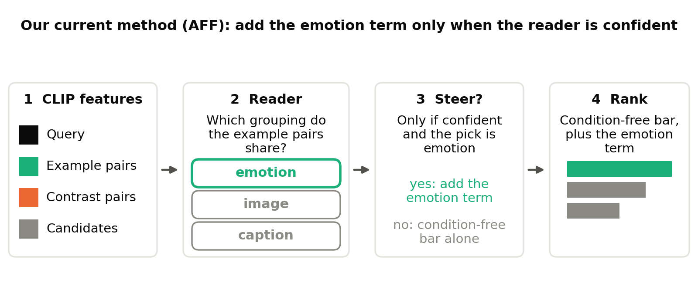

# Weekly report, 8 to 14 October 2026: one-sided affect steering passed on held paintings, but its gain is emotion's alone, and the paper now tests its scope

> Draft v1, written 2026-10-14 09:00. CoSiR v2, main branch. Covers 8 to 14 October, with the steps of 7 October that
> the [previous weekly report](../../../../../../docs/reports/weekly/2026-10-07_aspect_task_to_affect_steering.md) left open as a lead-in (it ended on 7
> October with idea 3 and the fine-tuned CLIP comparator in progress). Every number comes from the report linked in its
> section. Lines marked **Verdict (reference)** are our reading of the results; they decide nothing.

## Summary

- **AFF held on paintings it never saw.** On 36,864 episodes from the held paintings, one-sided affect steering (AFF)
  passed all seven pre-registered checks. It beat the strongest pre-registered condition-free score B′(A0) by +0.60
  [+0.46, +0.73] R@1 points (§1).
- **Its parts beyond the gated reader add nothing measurable on held data.** AFF beat the gated reader R1 by only +0.02
  [−0.06, +0.11], and it still lost on style × genre (§1).
- **A style route can fix style × genre in principle, but no label-free grouping does.** Told the true styles, the
  score gained +3.92 on style × genre; the best label-free style grouping reached about a tenth of that (§2).
- **Learned groupings did not help either.** No learned grouping and no fixed encoder beat AFF on development episodes;
  the closest, DINOv2, missed narrowly and is parked (§3).
- **AFF's whole lead sits in the episodes whose example pairs show emotion.** There it gains +2.88 over B′(A0); on
  style it ties, on genre it loses. It needs at least 3 example pairs. The style source matches style and genre about
  equally (§4).
- **The paper now tests AFF's scope.** AFF runs as a fixed recipe on two more backbones and a second language. The
  first new held read, on SigLIP 2, gave a preliminary GO on 14 October: +0.51 [+0.36, +0.66] over B′(A0). The Qwen
  read has no result yet (§5).
- **The main limit.** Every result above rests on one dataset and one backbone, and AFF's gain comes from an outside
  emotion classifier, not from reading the condition in general (§4.5).

## Idea and contributions

### Background

Image and text models such as CLIP reduce the match between an image and a caption to one number. That number is
fixed: it cannot say that two things are alike *in one respect* and unlike in another, the way two paintings can share
a mood but not a style. Work on *conditional similarity* lets the respect vary. Early methods learn one mask or subspace
per respect from labelled examples (conditional similarity networks); later ones infer the respects from labelled
triplets without condition labels, on images only (SCE-Net, DiscoverNet); recent ones take the respect as a text phrase,
either with a fine-tuned CLIP (GeneCIS) or on a frozen vision and language encoder (CLAY, CRL). All of them need a name
for the respect or supervision tied to it, and nearly all compare images with images.

### The problem: conditional similarity between images and captions

CoSiR asks for a similarity between an image and a caption that depends on a condition: are these two alike *in this
respect*? The use cases are users who hold examples of a relation but cannot or will not name it: a designer whose mood
board pairs images with captions that "go together", a searcher who marks image and caption pairs that match, or a
curator who wants more captions written the way a set of examples is written.

### Our approach: show the respect by examples

The condition is given by a few example image and caption pairs that agree in the wanted respect, plus a few contrast
pairs that agree in a different one. Three rules make this a test of reading the respect rather than copying it:

- the respect is never named;
- the examples never show the query's own value (if the query is sad, the examples show other feelings);
- each example pair joins an image of one artwork with a caption of another, so the pairs carry the respect, not an
  identity.

The system must not use the human labels it is evaluated on. It may use any label-free signal in the data and external
models, which must be stated.

### The setup at a glance

*Figure 1. The task in one picture. A user gives a query, four example pairs that are alike in one respect and four
contrast pairs that are alike in another; the system ranks candidates of the other modality by agreement with the query
in the shown respect. Swapping examples and contrasts should swap which candidate comes first.*

The system receives a query (a painting or a caption), the example pairs and the contrast pairs, and ranks 13
candidates of the other modality. One candidate shares the query's value of the shown respect (the target) and one
shares its value of the contrasted respect (a distractor); the rest share neither. Every episode is scored in both
directions and under both conditions (examples and contrasts swapped). The formal definitions are in §2 of last
week's report.

### Data

The main benchmark is **ArtELingo** (English part): WikiArt paintings with captions written by viewers, 308,723 image
and caption rows over 61,402 paintings. Each caption carries the emotion its writer felt; each painting has an art
style and, for about 81% of paintings, a genre. We score three respects (8 emotions, 23 styles, 10 genres) and so three
respect pairs: emotion × style, emotion × genre and style × genre. The paintings are split once: 36,518 for training,
6,451 for development and fresh test episodes, and 12,281 held back for the paper's final test. This week the held
paintings were read for AFF (§1). The scope runs of §5 add two backbones, **ArtELingo-28** (746 paintings with
captions in other languages, machine-translated to English), and the CUB birds and SemArt paintings datasets.

### Our method so far

Our current best method is still **one-sided affect steering (AFF)**. It starts from a strong score that uses the
examples but ignores which respect they show, and adds a second score only when a label-free *reader* is confident that
the example pairs share the *affect* grouping, a clustering of the captions by an external emotion classifier
(GoEmotions). On the held paintings AFF ranked the right candidate first in 19.44% of rankings, against 18.84% for the
strongest pre-registered condition-free score and 13.25% for plain CLIP. All of the gain sits where the example pairs
show emotion (§4.1).

*Terms.* A respect is called an **aspect** (emotion, style, genre) and its setting a **value** (a particular emotion,
style or genre).

### Goal (the plan's target, not yet reached)

A method that reads the respect from the examples and, on the held data of several datasets and backbones, beats the
backbone alone, the best metric learned from the example pairs and its own score with the condition removed, on both
R@1 and condition gain, without using labels of the evaluated respects. The target venue is CVPR: abstract 10
November, paper 16 November; results enter the paper body by 6 November.

### Novelty

- **The task.** To our knowledge, no paper defines a cross-modal similarity whose respect is fixed at test time only by
  value-disjoint, cross-item image and caption examples, with contrast pairs on another respect. Each neighbour has one
  property: per-query weights from a few examples, on images only (Contextual Visual Similarity); metrics learned from
  pairs (Xing, RCA, KISSME); a relation defined by one example pair (MARS); a respect named in text, image to image
  (GeneCIS, CLAY, CRL); respects discovered without labels, on images (SCE-Net, DiscoverNet).
- **What we do not claim as new:** inferring a notion of similarity from examples, test-time reweighting, retrieval by
  an example relation, label-free condition discovery, and distant emotion supervision (EmotionCLIP).
- **The protocol.** Condition gain (zero for any scorer that ignores the condition) and matched controls separate
  reading the condition from merely finding related candidates.

### Contributions

*Table 1. The plan's three contributions: what we have on 14 October, and what a full success would add. Changes since
last week are in the middle column.*

| Contribution | What we have now | What a full success would add |
|---|---|---|
| **C1. Task, benchmark and protocol** | as last week, plus one held read of aspect episodes on ArtELingo (36,864 episodes), a k-shot check, and the external comparators (fine-tuned CLIP, an in-context MLLM, a describe-then-score MLLM) on held paintings | released episode files, splits and evaluation code for ArtELingo, CUB, SemArt; held reads on several backbones |
| **C2. Method** | AFF passed its held read: +0.60 [+0.46, +0.73] R@1 over B′(A0), condition gain +3.06; not shown over B′(A1) or R1; loses on style × genre; needs at least 3 example pairs | AFF passing on a second and third backbone (r9: SigLIP 2 preliminary GO, +0.51 [+0.36, +0.66]; Qwen not yet read) and holding on other datasets; a style route that works without labels |
| **C3. Analysis** | the gain split by the aspect the example pairs show; the style source matches style and genre equally; told ceilings for a style route | the same analysis across backbones and annotation protocols, and whether showing by examples beats naming the aspect (K3) |

> Sources: CVPR plan [§3, §4](../../../superpowers/specs/2026-10-02-cosir-v2-cvpr-publication-plan-design.md#3-problem-definition-approved),
> [stage report](../../stage/2026-10-12_affect_steering_line.md) §3, [AFF model card](../../stage/2026-10-13_aff_model_card.md) §6 and §7.

## How we got here

Last week ended on 7 October with AFF passing a fresh test on the development paintings and two side steps still
running. Both closed on 7 October. **Idea 3**, placing captions in the affect grouping by their own GoEmotions
probabilities, placed them far better (86% against 36%), but both variants stayed below the +0.5 development bar
(+0.36 and +0.43 over B′(A0)) and lost to AFF. **A fine-tuned CLIP** (three label-free variants) reached about 15.0
R@1 on fresh episodes, 3.2 points below B′(A0): a reported baseline, not the bar. On 9 October the user chose the held test
with AFF frozen.

<!-- FIGURE NEEDED: the week as a timeline, one row per day from 7 to 14 October (Amsterdam time); markers for the held read (10 Oct), its GO (11 Oct), round 7 (12 Oct), round 8 (12 to 13 Oct), the r9 spec (13 Oct 15:05), the paper review (13 Oct), the k-shot and Leiden checks and the r9 build close (14 Oct), and the first r9 held read start (14 Oct 08:23); colour by outcome (worked, failed, in progress), black diamonds for the user's decisions. -->

*Figure 2. The week, one row per day.*

The rest of the report follows five questions: does AFF hold on held paintings (§1); can a style route fix style ×
genre (§2); can learned groupings do it (§3); where does AFF's gain come from and is it general (§4); and what does the
paper need (§5). §6 is the go/no-go checklist, §7 the status and open decisions.

**Terms used throughout** (full definitions in the glossary):

- **R@1**: the share of rankings in which the right candidate comes first, in percent; differences are in R@1 points.
- **Aspect episode**: 4 example pairs (supports) show an unnamed aspect through values the query does not have, 4
  contrast pairs show another aspect, and 13 candidates are ranked.
- **Condition gain**: how much more often the shown aspect's candidate comes first than the other aspect's; exactly 0
  for a scorer that ignores the condition.
- **Matched control**: the same score with only the condition removed.
- **B, B′(A0), B′(A1)**: condition-free scores that use the examples but ignore which aspect they show. B′(A0) is the
  pre-registered bar; B′(A1) adds a CSD style grouping and is the strongest condition-free score.
- **R1**: the gated reader, AFF without the rule that it steers only on affect picks.
- **Development episodes**: the reused draw of 12,288 episodes (seed 42) on which every setting was picked.
  **Held paintings**: the paintings reserved for the paper's final test; each read is logged.
- **Told**: given the right grouping from the evaluation labels; a ceiling, not a method.

## 1. Does AFF hold on paintings it never saw? Yes, on the pooled claim

AFF passed all seven pre-registered checks on the held paintings (round 6, run 10 October, read 11 October). The sample
was 36,864 episodes on 9,519 anchor paintings (seeds 52 to 54), with every weight frozen on development episodes and a
Holm correction across the seven checks.

*Table 2. AFF on the held paintings, pooled over the three aspect pairs. The first block is the pre-registered verdict;
the rest is descriptive.*

| Scorer | R@1 | Condition gain | AFF minus it, R@1 |
|---|---|---|---|
| **AFF** | **19.44** | **3.06 [2.87, 3.25]** | |
| *pre-registered checks* | | | |
| cosine (CLIP) | 13.25 | 0 | +6.19 [+5.96, +6.40] |
| RCA (a metric fitted on the example pairs) | 13.54 | 0.14 | +5.89 [+5.67, +6.11] |
| B | 18.81 | 0 | +0.63 [+0.51, +0.75] |
| **B′(A0), the pre-registered bar** | **18.84** | 0 | **+0.60 [+0.46, +0.73]** |
| matched control | 18.80 | 0 | +0.63 [+0.50, +0.76] |
| *secondary checks* | | | |
| B′(A1), the strongest condition-free score | 19.30 | 0 | +0.14 [−0.03, +0.30] |
| R1, AFF without the affect restriction | 19.41 | 2.87 | +0.02 [−0.06, +0.11] |
| *external comparators (reported)* | | | |
| fine-tuned CLIP, best of three (LoRA) | 15.80 | 0 | +3.64 |
| in-context MLLM, Qwen3-VL-8B (seed 52 only) | 14.50 | 0.12 [−0.17, 0.39] | +4.94 [+4.56, +5.33] |
| describe-then-score MLLM | 13.06 | 0.08 [−0.04, 0.20] | +6.38 [+6.15, +6.59] |

The condition-gain checks also passed: +3.06 [+2.87, +3.25] above the condition-free scores and +2.92 [+2.70, +3.14]
above RCA. When the target paintings were resampled as well, the margin over B′(A0) widened to +0.60 [+0.40, +0.79],
still above 0. The held read repeated the fresh test of 6 October (+0.59 [+0.46, +0.73]) almost exactly.

*Figure 3. R@1 and condition gain on the held paintings for every comparator. The pre-registered bars sit about 0.6
points below AFF; B′(A1) and R1 are within noise of it.*

**Two things are not established.** The first is a margin over B′(A1). The second is that the one-sided affect rule
matters: R1 alone also cleared all seven checks, and its lead over AFF shrank from +0.20 on fresh episodes to +0.02 on
held paintings. The external comparators sit far below: no MLLM came near AFF on R@1 or condition gain.

**Style × genre still loses.** Per aspect pair on held paintings, AFF minus B′(A0) was:

- emotion × style: +0.59 [+0.35, +0.83];
- emotion × genre: +1.64 [+1.40, +1.90];
- style × genre: −0.43 [−0.65, −0.21] (and −1.24 against B′(A1)).

*Figure 4. AFF minus B′(A0) per aspect pair, fresh episodes and held paintings.*

After the read the user set the ArtELingo paper as the fallback and aimed at a larger method paper, starting with
style × genre (§2).

> Sources: [stage report](../../stage/2026-10-12_affect_steering_line.md) §3.1, §3.2, §3.4, §5.2;
> [AFF model card](../../stage/2026-10-13_aff_model_card.md) §6; [round 6 report](../../auto/v2/2026-11-25_artelingo_held_test.md);
> direction log, 2026-10-11.

**Verdict (reference).** AFF's pooled claim on ArtELingo with CLIP holds on new paintings. It is thin for reviewers: a
small margin, no margin over the strongest condition-free score, no measurable value of the affect rule over R1, and a
loss on one of three pairs.

## 2. Can a style route fix style × genre? Only when told the styles (failed branch)

A style grouping could fix style × genre if it tracked style: told the true styles, the score gained +3.92 there. No
label-free style grouping we built came near that, so design L (round 7, 12 October) ended with no pick.

**Idea.** AFF loses on style × genre because none of its groupings tracks style apart from genre. The style encoder
CSD groups paintings by something close to style, but its groups also follow content. Design L removed the content
part from a style source, then gave the result to the reader as a fourth grouping.

**Setting and method.** We built six label-free style groupings:

- CSD style vectors with the content directions projected out (two variants);
- CSD's nearest-neighbour graph with the edges inside one content group removed or halved (two variants);
- CLIP image token statistics with the image embedding regressed or projected out (two variants).

Each grouping was scored in two ways: by R1 and by an extended AFF that may also steer on the style grouping. That gave
12 candidate scorers, all on the 12,288 development episodes. A ceiling check came first: the same pipeline told the
true styles, scored against its matched control on style × genre (4,096 episodes). A candidate passed only if it beat
the strongest condition-free score by at least +0.5 pooled, did not lose to its matched control on style × genre, and
lost at most 0.3 to AFF on each emotion pair.

*Table 3. Round 7 on development episodes, R@1 points.*

| Measure | Value | Bar |
|---|---|---|
| told true styles, style × genre, over the matched control | +3.92 [+3.35, +4.49] | prior +0.9; clear |
| best candidate, pooled margin over the strongest comparator (R1 on halved-edge CSD) | +0.25 [+0.05, +0.46] | at least +0.5 |
| AFF itself on the same margin | +0.33 | |
| candidates against AFF on emotion × genre | −0.93 to −1.61 | at least −0.3 |
| candidates passing all three conditions | 0 of 12 | |

*Figure 5. Style × genre on development episodes: the told ceiling against the label-free candidates and random-grouping
controls.*

**Result.** The ceiling was far above the prior, but the best label-free grouping reached about a tenth of it on style
× genre (+0.38). Every candidate also lost too much on emotion × genre. The removal step is part of the reason: it
removed style together with content (§4.4). The user read the result as "genre and style are entangled so close that
they cannot be set apart from CSD", and asked for a better grouping source (§3).

> Sources: [round 7 report](../../auto/v2/2026-11-26_design_l_style_source.md), results brief and "Groupings";
> direction log, 2026-10-12.

## 3. Can learned groupings do it? No (failed branch)

No learned grouping and no fixed encoder beat AFF on development episodes (round 8, 12 to 13 October). AFF stays the
current best; the closest candidate, a DINOv2 grouping, missed narrowly and is parked.

**Idea.** Instead of cutting content out of CSD, learn a grouping on frozen CLIP features that ignores content by
construction, and test fixed image encoders as other style sources.

**Setting and method.** Two tracks, both on the 12,288 development episodes, each new grouping placed as AFF's fourth
grouping in CSD's place (17 groups; images take the grouping's own assignment, captions keep the CLIP caption head):

- **Main line.** A contrastive head on frozen CLIP whose negatives come from the query's own content group (100, 67 or
  33% of negatives). Its positives were either flipped and cropped views of the same painting, or the nearest CLIP
  neighbour outside the content group. Beside it, fair clustering (FCMI), which penalises agreement with content, at
  six weights; and a CSD-neighbour head. 20 scorers were scored.
- **Encoder screen.** Groupings from three fixed encoders: ALADIN (a style encoder trained on StyleBabel), DINOv2-L and
  SigLIP 2.

Each grouping was scored by R1 and by extended AFF. A pass needed a pooled lower bound above 0 against AFF itself, and
at most about 0.3 lost to AFF on each emotion pair.

*Table 4. Round 8, R@1 points against AFF on development episodes.*

| Scorer | Against AFF, pooled | Pass |
|---|---|---|
| best of the main line (extended AFF on fair clustering, weight 0.20) | −0.47 [−0.65, −0.29] | no |
| worst of the main line | −0.80 [−1.03, −0.57] | no |
| R1 on DINOv2 | +0.29 [−0.01, +0.59]; emotion × style about −0.38 | no |
| R1 on SigLIP 2 | +0.06 [−0.26, +0.38] | no |
| R1 on ALADIN | −0.30 [−0.55, −0.04] | no |

**Result.** Every one of the 20 main-line scorers had its upper bound below 0. The three largest fair-clustering weights
hit the 60-minute time cap and were not scored; the completed weights show no trend towards a pass. DINOv2's lead sat
on style × genre, where it was level with its own matched control (−0.07 [−0.43, +0.30]), so it did not show better
style separation. The user read it as "learned groupings on frozen CLIP failed with basically no hope" and kept DINOv2
as "worth a little digging", later parked.

> Sources: [round 8 report](../../auto/v2/2026-11-29_learned_grouping.md), results brief and Results; direction log,
> 2026-10-13 and "Parked ideas".

**Verdict (reference).** Both failed branches point to the same limit: no label-free source we have separates style
from genre. The reader and the gate were not the limit.

## 4. Where does AFF's gain come from, and is it general? From emotion only, and not yet

AFF's whole lead over the condition-free bar sits in the episodes whose example pairs show emotion. On style it ties,
on genre it loses, and it needs at least 3 example pairs. Its style source cannot help, because it matches style and
genre about equally.

### 4.1 The design, in one picture

*Figure 6. AFF in four steps. Frozen CLIP features feed a reader that guesses which grouping the example pairs share;
AFF adds the emotion term only when the reader is confident and picks emotion; otherwise it ranks by the
condition-free bar alone.*

AFF is unchanged since last week, where its parts are described one by one. The base B fuses CLIP cosine, a factor
term centred on the example items and agreement on three label-free groupings. The reader is trained on practice
episodes built from those groupings, so no evaluation label enters. The affect grouping comes from the GoEmotions
classifier run over the captions; it is the only emotion signal AFF has.

### 4.2 The gain sits in the emotion episodes

Split by the aspect the example pairs show, AFF beats B′(A0) by +2.88 where they show emotion and does not beat it
elsewhere. The split pools each aspect over its two aspect pairs (8,192 episodes each) on the development episodes,
with 4 example pairs.

*Table 5. AFF by the aspect the example pairs show, development episodes, R@1 points.*

| Example pairs show | AFF | B′(A0) | AFF − B′(A0) | AFF − matched control |
|---|---|---|---|---|
| emotion | 14.12 | 11.24 | +2.88 [+2.40, +3.38] | +2.44 [+2.00, +2.88] |
| style | 11.18 | 11.27 | −0.09 [−0.46, +0.28] | −0.25 [−0.58, +0.09] |
| genre | 32.10 | 32.79 | −0.69 [−1.07, −0.31] | +0.04 [−0.31, +0.39] |

*Table 6. AFF − B′(A0) per aspect pair and shown aspect, development episodes, 4 example pairs, R@1 points.*

| Aspect pair | Pairs show the first aspect | Pairs show the second aspect |
|---|---|---|
| emotion × style | emotion: +2.03 [+1.34, +2.70] | style: −0.07 [−0.53, +0.39] |
| emotion × genre | emotion: +3.74 [+3.07, +4.40] | genre: −0.83 [−1.38, −0.29] |
| style × genre | style: −0.11 [−0.69, +0.48] | genre: −0.55 [−1.08, −0.02] |

<!-- FIGURE NEEDED: AFF − B′(A0) by the aspect the example pairs show (emotion, style, genre), development episodes, 4 pairs; three bars with 95% intervals, emotion in AFF's colour; title "AFF's lead is in the emotion episodes". Data: src/test/20261203_kshot_supports/results/ks_by_condition.txt, k=4 rows. -->

AFF's gate opens only when the reader picks affect, so its only move is to steer towards emotion. On style and genre
episodes its best outcome is a tie with its base. The emotion gain pays because the condition-free score is weakest
there: it puts the emotion target first about 11% of the time, against about 33% for a genre target. Genre, the easy
aspect for the base, costs most when AFF steers wrongly.

The same split against every comparator shows the pattern again (Table 7). Where the example pairs show emotion, AFF
beats every condition-free score by about 2.4 to 3.2 points and R1 by +0.48. Where they show style or genre, it ties
or loses against the condition-free scores and ties R1.

*Table 7. AFF minus each comparator, development episodes, 4 example pairs, R@1 points.*

| AFF minus … | All episodes | Pairs show emotion | Pairs show style | Pairs show genre |
|---|---|---|---|---|
| cosine | +6.17 [+5.80, +6.55] | +4.78 [+4.15, +5.39] | +1.69 [+1.13, +2.26] | +12.05 [+11.21, +12.89] |
| RCA | +5.76 [+5.38, +6.13] | +4.41 [+3.80, +5.02] | +1.62 [+1.06, +2.17] | +11.24 [+10.41, +12.03] |
| B | +0.80 [+0.58, +1.01] | +3.16 [+2.68, +3.64] | +0.05 [−0.29, +0.39] | −0.82 [−1.06, −0.59] |
| B′(A0) | +0.70 [+0.46, +0.94] | +2.88 [+2.40, +3.38] | −0.09 [−0.46, +0.28] | −0.69 [−1.07, −0.31] |
| B′(A1) | +0.33 [+0.05, +0.62] | +3.22 [+2.68, +3.76] | −1.10 [−1.55, −0.66] | −1.12 [−1.68, −0.57] |
| matched control | +0.74 [+0.52, +0.96] | +2.44 [+2.00, +2.88] | −0.25 [−0.58, +0.09] | +0.04 [−0.31, +0.39] |
| R1 | +0.22 [+0.06, +0.37] | +0.48 [+0.28, +0.68] | −0.02 [−0.23, +0.20] | +0.19 [−0.18, +0.54] |

These are development numbers, on the seed every setting was picked on, so their levels carry some optimism. On held
paintings the pooled leads shrank: over B′(A0) from +0.70 to +0.60, over B′(A1) from +0.33 to +0.14, over R1 from +0.22
to +0.02 (§1). Per pair, the held numbers in §1 show the same pattern as here.

### 4.3 AFF needs at least 3 example pairs

With fewer example pairs, AFF as it is keeps its margin at 3, loses most of it at 2 and falls below the bar at 1. We
kept every setting frozen and used the first k support and k contrast pairs of each development episode.

*Table 8. AFF with k example pairs, development episodes, R@1 points.*

| Example pairs | AFF − B′(A0) | AFF's condition gain | Pairs show emotion | Pairs show genre |
|---|---|---|---|---|
| 4 (as designed) | +0.70 [+0.46, +0.94] | +3.11 [+2.78, +3.46] | +2.88 [+2.40, +3.38] | −0.69 [−1.07, −0.31] |
| 3 | +0.63 [+0.40, +0.87] | +3.10 [+2.77, +3.43] | +2.92 [+2.44, +3.42] | −1.06 [−1.45, −0.67] |
| 2 | +0.19 [−0.06, +0.44] | +2.58 [+2.24, +2.92] | +2.58 [+2.09, +3.07] | −1.84 [−2.27, −1.42] |
| 1 | −1.73 [−2.05, −1.41] | +1.99 [+1.66, +2.31] | +4.41 [+3.83, +5.02] | −8.44 [−9.11, −7.73] |

<!-- FIGURE NEEDED: AFF − B′(A0) against the number of example pairs (1 to 4), one line per shown aspect (emotion, style, genre) plus the pooled line, with 95% intervals; zero line marked; title "The emotion gain needs no pairs; the pairs tell AFF when not to steer". Data: ks_by_condition.txt and the k-shot report's first table. -->

The emotion gain does not need the pairs: it is largest at 1 pair. The pairs mostly tell AFF when *not* to steer. At 1
pair the gate opened in 62% of second conditions, against 30% at 4 pairs, so AFF steered towards emotion on the wrong
side and genre paid for it. The reader and gate were fitted for 4 pairs, so this check mixes less evidence with a
reader that no longer fits; the user chose not to re-fit them.

### 4.4 Why style and genre fail: the style source does not separate them

Raw CSD style groups agree with the true styles and the true genres about equally, and removing their content part
removes both. AMI (adjusted mutual information, 0 for unrelated groups and 1 for identical ones) of each grouping with
the labels:

*Figure 7. Agreement of three groupings with the true style labels and the true genre labels. Raw CSD groups score 0.34
on style and 0.33 on genre; with the content part projected out, 0.10 and 0.08.*

The true styles themselves agree with genre at 0.22 and with content at 0.32, so style is partly tied to content in
this data. A removal step therefore fights style's own link to content. The graph cuts kept CSD's style agreement (0.32
and 0.33) but removed little genre (0.27 and 0.31). Every label-free source tried so far mixes style and genre: CLIP
k-means and Leiden groupings, CSD, the learned groupings of §3, DINOv2 and SigLIP 2.

> Sources: [round 7 report](../../auto/v2/2026-11-26_design_l_style_source.md), "Groupings"; direction log, 2026-10-12.

### 4.5 The Leiden groupings side check: a tie, kept as a record

Rebuilding AFF on Leiden image and caption groupings (64 groups) tied the k-means version on the bar margin, so AFF's
recipe did not change. Leiden communities are groups found by a graph-clustering method on a nearest-neighbour graph;
AFF's affect grouping already uses them, its image and caption groupings use k-means.

*Table 9. AFF on Leiden against k-means groupings, development episodes, R@1 points.*

| AFF result | Leiden at 64 | k-means | Leiden minus k-means |
|---|---|---|---|
| margin over its own B′(A0) | +0.50 [+0.30, +0.71] | +0.70 [+0.46, +0.94] | −0.20 [−0.44, +0.05] |
| AFF's own R@1 | 18.58 | 19.14 | −0.56 [−0.80, −0.30] |

The bar margin differs within the noise. AFF's own R@1 is lower on Leiden because the weaker Leiden groupings also lower
B and B′(A0). A second variant in the same check used one grouping for every aspect: painting-level communities from an earlier
line of work, retrained on the training paintings (20 communities). It failed its screen (−0.27 [−0.48, −0.07] over
its matched control). The user read the grouping method as not the main
issue, "given big issue exposed just now" (the labels question, §7), and kept Leiden as a record that it "can also do
the job".

> Sources: [k-shot report](../../auto/v2/2026-12-03_kshot_supports.md), results brief and Analysis;
> `src/test/20261203_kshot_supports/results/ks_by_condition.txt` and `ks_big_table.txt`;
> [Leiden report](../../auto/v2/2026-12-04_leiden_groupings.md), results brief; direction log, 2026-10-14 (both entries).

### 4.6 What the result covers, and what it does not

*Table 10. What AFF's evidence covers on 14 October.*

| | Covered | Not covered |
|---|---|---|
| Data | ArtELingo held paintings, one read | other datasets (CUB, SemArt probes run, not read); a second language (ArtELingo-28, in r9) |
| Backbones | CLIP ViT-B/32; SigLIP 2 (preliminary GO, 14 October) | Qwen3-VL-Embedding-2B (r9 held read not yet run) |
| Aspects | emotion, where the example pairs show it | style and genre: a tie and a loss |
| Episode shape | 3 or 4 example pairs | 1 or 2 pairs (below or at the bar); more than 4 pairs untested |
| Mechanism | steering one side pays; a random one-sided gate matched AFF on fresh episodes | that AFF reads the condition in general |

**Our reading.** AFF depends on its feature source more than we thought. Its gain is the GoEmotions classifier's emotion
signal, applied on the side where the condition-free score is weakest. Every result of this week rests on learning
without aspect labels. That choice sets the baselines (condition-free scores built from label-free groupings), the
training target and method (practice episodes from label-free groupings), and how the condition is used (a gate that
can only steer towards affect). The told ceilings show what labels would buy; whether to use them is the user's open
question (§7).

**Verdict (reference).** AFF's gain is real but narrow: it is emotion's, from an outside emotion classifier, and it
needs 3 or more example pairs. It is not yet evidence that a label-free method reads an unnamed aspect in general.

## 5. What does the paper need? Scope, which r9 now tests

The paper needs AFF to hold beyond one encoder and one dataset. After round 8 the user wrote that AFF "depends too much
on the selected encoder and selected dataset. Reviewers will easily attack this point." Round 9 (r9) tests that scope
with AFF as a fixed recipe; its build closed on 14 October and the run is in progress. The first held read, on SigLIP
2, gave GO under the rule (preliminary); the Qwen read has no result yet.

### 5.1 The r9 plan

The spec was approved on 13 October at 15:05. "Fixed recipe" means that every part above the encoder is re-fitted on
the new backbone by the same automatic seed-42 pick; no new tuning.

*Table 11. The r9 reads.*

| Step | What | Held read | Bar |
|---|---|---|---|
| 3 | AFF on Qwen3-VL-Embedding-2B, ArtELingo held paintings | H6 | round 6's seven checks |
| 3 | AFF on SigLIP 2, ArtELingo held paintings | H7 | round 6's seven checks |
| 4 | ArtELingo-28 language check on CLIP, Qwen and SigLIP 2 (746 paintings, translated to English) | H8 to H10 | two levels: a small claim (beats B′(A0) on R@1 and its control on condition gain), then the full seven checks |
| 5 | CLIP AFF probes on the CUB and SemArt development splits | none | exploration; no gain expected |

Stage 3 (the CUB, SemArt and Affection reads) gets its own decision chat about 17 October. Affection (85,007 photos
with ArtEmis-style explanations) is dropped if no data comes by 24 October. Every held read must start by 18 October.

### 5.2 Status of the run

- **Build:** closed and merged on 14 October at 04:17; the full test suite passed (2,246 tests) and the regression
  stage passed.
- **SigLIP 2:** its recipe first stopped on a k-means group of one row. A restart rule (refit with the next seed when a
  group has under 100 rows) was merged as the agent default in night mode; CLIP and Qwen refit byte-equal. The user can
  still drop SigLIP 2 from the claim.
- **Stage 2:** ready for Qwen and SigLIP 2 (14 October, 06:03 and 07:10).
- **Pre-reads:** the ArtELingo-28 pre-reads for CLIP (H8, 07:44) and SigLIP 2 (H10, 08:18) passed, and so did the
  SigLIP 2 held pre-read (H7, 08:18).
- **Held read H7 (SigLIP 2):** logged in the held ledger before launch, run on round 6's held episodes (seeds 52 to
  54), finished at 08:55. The independent re-derivation agreed (166 numbers compared, 0 differences), and the rule
  gave **GO: all seven checks pass** (Table 12). This is preliminary: it is the rule's output, before its auto report
  and before the user's reading.
- **Held read H6 (Qwen3-VL-Embedding-2B):** no result yet; its pre-read was running at 08:57.
- **Probes:** CUB and SemArt probe outputs exist and have not been read; stage 3's chat reads them.

*Table 12. SigLIP 2 held read H7, the rule's output (preliminary), pooled over three aspect pairs, with CLIP's held read
for comparison. R@1 points; condition gain in points.*

| AFF minus … | SigLIP 2 (H7) | CLIP (round 6) |
|---|---|---|
| cosine, R@1 | +6.59 [+6.36, +6.82] | +6.19 [+5.96, +6.40] |
| RCA, R@1 | +5.94 [+5.71, +6.16] | +5.89 [+5.67, +6.11] |
| B, R@1 | +0.85 [+0.73, +0.98] | +0.63 [+0.51, +0.75] |
| **B′(A0), R@1** | **+0.51 [+0.36, +0.66]** | **+0.60 [+0.46, +0.73]** |
| matched control, R@1 | +0.83 [+0.70, +0.96] | +0.63 [+0.50, +0.76] |
| condition gain over the condition-free scores | +3.35 [+3.15, +3.54] | +3.06 [+2.87, +3.25] |
| condition gain over RCA | +3.27 [+3.04, +3.49] | +2.92 [+2.70, +3.14] |

The claim this read licenses, as written in the rule, is pooled over three aspect pairs on one dataset: not each pair
and not a margin size. Its per-pair numbers and the secondary comparators (B′(A1), R1) come with its auto report.

### 5.3 The paper draft

Draft v1 was reviewed by ARS (an automated review pipeline of LLM personas, one model family, no human reviewer):
**Major Revision**, one repairable block on methodology rigour, no critical issue. It lists 11 required and 28
suggested items. A fact check found all 11 premises right and 4 reviewer errors.

The required items in short: the headline against B′(A1); the mechanism against R1 (+0.02); a result beyond ArtELingo
and CLIP in the body; an upper reference; emotion as a caption property, with viewer agreement; 8 pages; the held-read
count; training-seed spread; a pre-registration record; the MLLM scope; and an ablation of B. The user has five
decisions open on the review. Dates: results into the paper body by 6 November, abstract 10 November, paper 16
November.

> Sources: [r9 spec](../../../superpowers/specs/2026-10-13-r9-aff-scope-design.md) §3, §4, §9;
> [r9 run handoff](../../../superpowers/handoffs/2026-10-14-r9-run-handoff.md) §3, §4; the r9 run log
> (`src/test/20261202_r9_scope/20261202_r9_scope_log.md`, entries to 08:57) and `results/held_verdict_H7.json`; held ledger row H7;
> [paper R1 handoff](../../../superpowers/handoffs/2026-10-13-paper-r1-4-handoff.md) §3, §4; direction log, 2026-10-13.

## 6. Go/no-go checklist

The plan's go/no-go was moved to Friday 16 October (plan revision 4): an ArtELingo-centred paper first, the full method
paper when time and results allow. Status on 14 October:

*Table 13. Go/no-go items and their status.*

| Item | Kind | Status | Where |
|---|---|---|---|
| task, protocol and baselines on ArtELingo | required | done | §1 |
| ArtELingo held read for AFF (CLIP) | required | met (GO, 7 of 7 checks) | §1 |
| margin over the strongest condition-free score B′(A1) | reported (secondary) | not established | §1 |
| value of the affect rule over R1 | reported (secondary) | not established | §1 |
| same gains on a second backbone (K4) | required | SigLIP 2: GO, preliminary; Qwen: not yet read | §5.2 |
| a second language (ArtELingo-28) | reported | in progress (H8 pre-read passed) | §5.2 |
| CUB and SemArt held tests | required | probes run, not read; stage 3 decides about 17 October | §5.1 |
| positive on every aspect pair | reported, not required | not met (style × genre −0.43) | §1 |
| a label-free fix for style × genre | reported | not met (rounds 7 and 8) | §2, §3 |
| works with fewer than 3 example pairs | reported | not met | §4.3 |
| against a fine-tuned CLIP and in-context MLLMs | reported comparators | done (AFF far ahead) | §1 |
| examples against names, per aspect (K3) | reported | open | |
| paper draft through review | decision | v1 reviewed (Major Revision); five decisions open | §5.3 |

*Table 14. The paper options and what each still needs.*

| Option | Source | Still needs |
|---|---|---|
| method paper | plan, branch 1 | AFF passing H6 (H7 passed, preliminary), and the CUB and SemArt reads; the review's required items |
| ArtELingo-centred paper (the fallback) | readiness memo; user, 11 October | the review's required items; r9 results as scope evidence |
| benchmark and analysis paper | plan, branch 3 | the release and the analysis; no method needs to pass |

> Sources: CVPR plan [§4](../../../superpowers/specs/2026-10-02-cosir-v2-cvpr-publication-plan-design.md#4-contributions-and-claims-approved);
> direction log, 2026-10-07 and 2026-10-11.

## 7. Status at the end of the week

- **Current best:** AFF on CLIP, frozen; its fixed recipe (k-means image and caption groupings) is unchanged.
- **In progress:** the r9 held reads (H7 done, GO preliminary; H6 and H8 to H10 to follow, all by 18 October); the paper's
  revision after review.
- **Not started:** the CUB, SemArt and Affection reads (stage 3, decided about 17 October).
- **Parked:** the DINOv2 grouping; Leiden groupings in AFF; fair clustering with a longer time cap; more than 4 example
  pairs and a re-fit at 1 or 2 pairs.
- **Open decisions (the user's):**
  - **Are aspect labels needed in training to separate style from genre?** Every label-free source tried mixes them,
    while told true styles gain +3.92 on style × genre. The affect grouping already rests on an outside labelled
    classifier (GoEmotions), and CSD, trained with style tags, still mixes style and genre. The options:
    1. state it as a paper finding only;
    2. a small screen of a style head trained on the training paintings' style and genre labels, as AFF's style
       route, on development episodes (a few hours);
    3. labels in training as a new idea, in its own loop.

    *Our recommendation:* option 2, then option 1 or 3 on its result.
  - SigLIP 2: keep it in the claim with the restart rule (taken as the agent default overnight), or report that the
    fixed recipe did not run on it unchanged.
  - The five decisions on the paper review, among them the headline wording, which required items to run, and
    whether any new held read is needed.

## Glossary

| Plain name | Meaning | Name in the full reports |
|---|---|---|
| aspect episode | examples show an unnamed aspect through values the query lacks; 4 support, 4 contrast pairs, 13 candidates | aspect episode |
| condition gain | R@1 minus the other aspect's first-place rate; 0 for any condition-free scorer | condition gain |
| matched control | the same score with only the condition removed | matched counterpart |
| condition-free bar | the best score that uses the examples but ignores the aspect | B; B′(A0) (pre-registered); B′(A1) (adds CSD) |
| affect grouping | Leiden communities of GoEmotions caption probabilities (41 groups) | affect |
| reader | picks the grouping the support pairs share | reader |
| gated reader | the reader used only when confident, on any grouping | R1 |
| one-sided affect steering | the gated reader, steering only on affect picks | AFF |
| told | given the right grouping from the labels; a ceiling | told oracle |
| extended AFF | AFF that may also steer on a fourth (style) grouping | X-AFF |
| development episodes | the reused draw of 12,288 episodes on which settings were picked | seed 42 |
| held paintings | paintings reserved for the paper's final test; each read logged | held split; reads H1 to H10 |
| fixed recipe | AFF re-fitted on a new backbone by the same automatic pick, with no new tuning | fixed recipe (r9) |
| AMI | adjusted mutual information between two groupings; 0 unrelated, 1 identical | AMI |
| design L | round 7: label-free style groupings with the content part removed | design L, V1 to V6 |
| fair clustering | clustering that penalises agreement with a content grouping | FCMI |
| Leiden communities | groups found by the Leiden graph-clustering method on a nearest-neighbour graph | Leiden |
| ArtELingo-28 | ArtELingo paintings with captions in other languages, translated to English | A28 |
| ARS | an automated review pipeline of LLM personas (one model family, no human reviewer) | ARS |
| K3, K4 | the plan's claims "examples beat names" and "holds on a second backbone" | K3, K4 |

## Sources

- Stage report, 2 to 12 October: [one-sided affect steering on ArtELingo](../../stage/2026-10-12_affect_steering_line.md)
- [AFF model card](../../stage/2026-10-13_aff_model_card.md) (13 October)
- Auto reports: [idea 3](../../auto/v2/2026-11-23_idea3_goemotions.md) and
  [fine-tuned CLIP](../../auto/v2/2026-11-24_clip_lightweight_ft.md) (7 October);
  [round 6, held read](../../auto/v2/2026-11-25_artelingo_held_test.md) (10 to 11 October);
  [round 7, design L](../../auto/v2/2026-11-26_design_l_style_source.md) (12 October);
  [round 8, learned groupings](../../auto/v2/2026-11-29_learned_grouping.md) (13 October);
  [k-shot check](../../auto/v2/2026-12-03_kshot_supports.md) and [Leiden groupings](../../auto/v2/2026-12-04_leiden_groupings.md) (14 October).
  Their file names carry sequence numbers, not real dates.
- k-shot split by aspect and against every comparator: `src/test/20261203_kshot_supports/results/ks_by_condition.txt`,
  `ks_big_table.txt`
- SigLIP 2 held read H7, the rule's output: `src/test/20261202_r9_scope/results/held_verdict_H7.json`
- [r9 spec](../../../superpowers/specs/2026-10-13-r9-aff-scope-design.md);
  [r9 run handoff](../../../superpowers/handoffs/2026-10-14-r9-run-handoff.md);
  r9 run log `src/test/20261202_r9_scope/20261202_r9_scope_log.md`; held ledger `docs/superpowers/held_ledger.md`
- [Paper R1 handoff](../../../superpowers/handoffs/2026-10-13-paper-r1-4-handoff.md)
- [Direction log](../../../superpowers/direction_log.md), entries 2026-10-07 to 2026-10-14
- Previous week: [weekly report, 1 to 7 October](../../../../../../docs/reports/weekly/2026-10-07_aspect_task_to_affect_steering.md)
