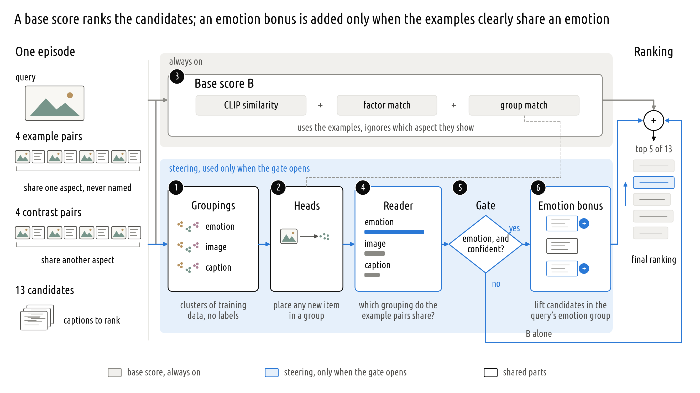
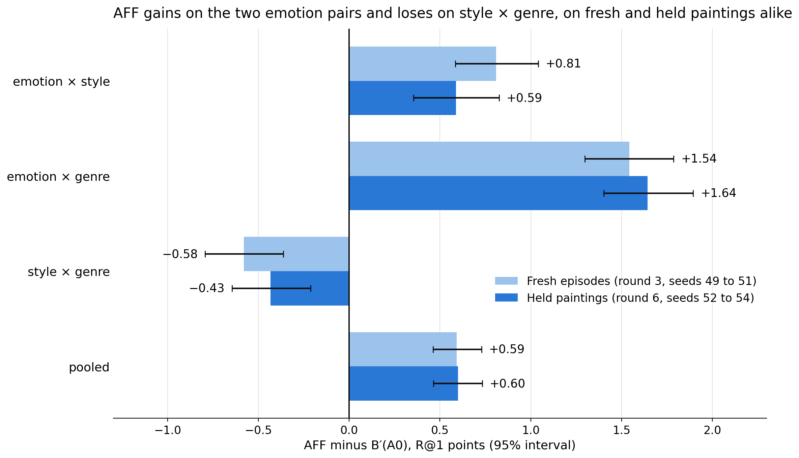
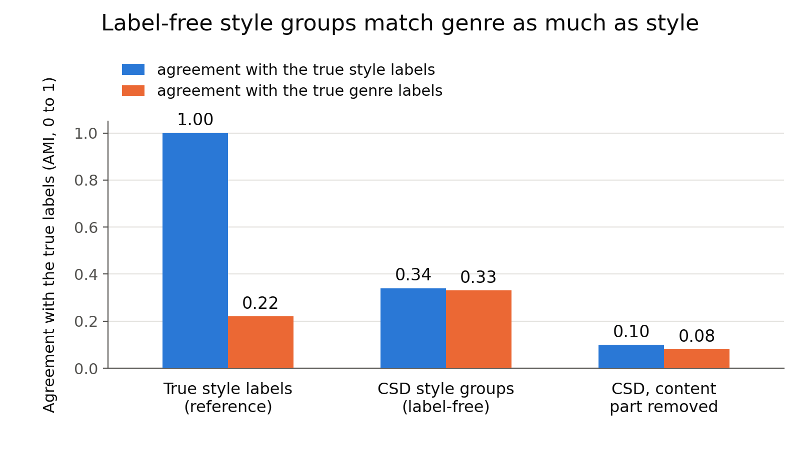

# CoSiR weekly report, 14 October 2026

CoSiR v2: similarity in a respect shown by examples

One-sided affect steering: its design, its gain, and where the gain comes from

Notes: This deck follows last week's deck (docs/reports/weekly/2026-10-07_aspect_task_to_affect_steering_slides.md), which gives the task, the data and the background. It has three parts: the method and its current gain; where the gain comes from; the experiments now running. This week has no written weekly report. The numbers come from the AFF model card (docs/reports/stage/2026-10-13_aff_model_card.md), the outside-view card on where the gain comes from (docs/reports/stage/2026-10-14_aff_scope_limits.html), the held-read report (docs/reports/auto/v2/2026-11-25_artelingo_held_test.md), the k-shot report (docs/reports/auto/v2/2026-12-03_kshot_supports.md) and the round 9 run log (src/test/20261202_r9_scope/). Abbreviations are avoided in the text; the figures use the short names AFF (one-sided affect steering), B, B′(A0), B′(A1) and R1.

---

## Method of one-sided affect steering: design

- One episode: a query painting, 4 example pairs that share an aspect that is never named (the condition), 4 contrast pairs that share another aspect, and 13 captions to rank
- Grey: a base score that always ranks the candidates. Blue: an emotion bonus, added only when the gate opens
- The numbers 1 to 6 are explained on the next slide

Notes: All features are frozen CLIP ViT-B/32 features. The query can be a painting or a caption; the figure shows a painting. Each example pair joins a painting with a caption written for another painting, so a pair carries the shared aspect, not an identity. The examples never show the query's own value: if the query is sad, the example pairs share another feeling. No evaluation label enters a fitted part (groupings, heads, factor model, reader); the labels only build and score the episodes, and the development episodes pick the settings.

---

## Method of one-sided affect steering: the blocks

1. **Groupings.** Clusters of the training images and captions, made without labels; each stands in for an unknown aspect. Emotion: an outside emotion classifier (GoEmotions) scores each caption, and similar scores form 41 groups. Image and caption: 64 clusters of CLIP features each
2. **Heads.** Small classifiers on CLIP features that place any new image or caption in the groups of a grouping
3. **Base score B** = CLIP similarity + factor match + group match. Factor match: an earlier model of ours codes each item as 32 factors; we remove what the 8 example and contrast items share, then compare. Group match: do query and candidate fall in the same groups? B uses the examples but never asks which aspect they show
4. **Reader.** Per grouping: do the image and caption of each example pair fall in the same group, more than in the contrast pairs? A small classifier turns this into a probability per grouping
5. **Gate.** Opens only when the reader's top grouping is emotion and it leads the second by a margin: the one-sided rule
6. **Emotion bonus.** The query and candidate group match, weighted by the reader's probabilities, so mostly the emotion match. It enters with a large weight; when the gate is closed, B ranks alone

Notes: (1) The emotion groups are Leiden communities of GoEmotions' 28 emotion scores over the training captions; GoEmotions is a public text classifier trained on Reddit comments, never on our data. A fourth grouping, k-means on the same emotion scores (64 groups), is used only inside B. (2) Each head is a logistic regression; its output is a probability over the groups, and two items match in a grouping when the dot product of their group probabilities is high. (3) B = z(cosine) + β_f·z(factor match) + β_h·z(group match), each z-scored over the 13 candidates. The factor match subtracts the mean code of the episode's 8 example items (4 example and 4 contrast pairs, the query's modality) from the query's code, and the mean code of the 13 candidates from each candidate's code, then takes the mean product over the 32 factors. Because examples and contrasts enter alike, it is condition-free: swapping them leaves it unchanged. On development episodes the factor match alone lifts R@1 from 12.96 (cosine) to 17.95, and B reaches 18.34. (4) Example pairs join a painting and a caption of different paintings, so the image and caption of a pair are chosen to share a value of the shown aspect, not an identity. Six numbers per grouping (support agreement, contrast agreement, their difference, two spreads, a same-group share) give 18 inputs. (5) Swapping examples and contrasts flips the reader's evidence, so the gate opens mostly on one side of an episode: on held episodes in 79% of first conditions and 30% of second ones at the lower threshold. (6) The fused score is S = (1 + λu)·z(B) + λa·gate·z(T), T = Σ P(grouping)·group match; when the gate opens, the bonus weighs 3.2 or 16 times B, depending on the frozen setting.

---

## Method of one-sided affect steering: training

**Practice episodes** are built from the groupings themselves: the 4 example pairs share a group of one grouping, and the 4 contrast pairs share a group of another. The right answer is known by construction, so no human label is needed.

| Part | Fitted on | Objective |
|---|---|---|
| 4 groupings | training rows | clustering, no labels: Leiden and k-means on GoEmotions scores; k-means on CLIP image and caption features |
| 8 heads (place any item in a grouping) | training rows | logistic regression; log loss on the row's group |
| factor model (32 factors shared by images and captions) | practice episodes | ranking loss in both directions (weight 3); swap loss with examples and contrasts exchanged (weight 1); pair-agreement and decorrelation terms |
| reader | practice episodes | logistic regression on 18 agreement numbers; log loss on which grouping the example pairs share |
| B's two weights; gate threshold and two fusion weights | development episodes | B: best R@1; then the best min(R@1 gain over B, condition gain), cross-fitted by halves |

- Every learned part is fitted on training rows; only the factor-model checkpoint, the weights and the gate threshold are picked on development episodes, then frozen for the held read

Notes: Sizes: 183,694 training rows; the heads use a draw of 60,000 of them; the factor model trains for 2,000 steps on 65,536 practice episodes; the reader is fitted twice, once per painting half of the training rows, on 49,152 practice episodes each, and the two are averaged; 12,288 development episodes; B's weights from 56 settings, AFF's from 224. The reader's 18 numbers are 6 per grouping: mean support-pair agreement, mean contrast-pair agreement, their difference, the spread of each, and the share of support pairs whose image and caption fall in the same group. It recovers the practice episodes' grouping about 80% of the time (chance 33%), but on development episodes it picks the right aspect's grouping only 51% of the time. The factor model comes from an earlier line ("method A"); as a conditioned model it failed (2.96 R@1 points below its own condition-free control on fresh episodes), so only its centred term stays inside B: alone it scores 17.95 R@1 against 12.96 for cosine. The two frozen settings: half 0 opens the gate on almost every emotion pick and weights steering 3.2 times B; half 1 opens it only on confident picks (top-two margin at least 0.48) and weights steering 16 times B. The pick rule takes the minimum of the two gains, so a setting cannot win on one measure by losing the other.

---

## Setting of the comparison: true baselines and our own scores

| Kind | Score | What it is |
|---|---|---|
| True baselines (published methods, run by us on the same episodes) | CLIP cosine | the backbone alone |
| | RCA | a classic metric learned from the episode's example pairs |
| | fine-tuned CLIP | CLIP tuned on ArtELingo image and caption pairs without labels: linear probe, last block, low-rank adapters |
| | in-context MLLM | Qwen3-VL-8B given the whole episode in one prompt |
| | describe-then-score | Qwen3-VL-8B names what the examples share; frozen CLIP scores the candidates by that phrase |
| Our condition-free scores: the same ranking whichever aspect the example pairs show | B | AFF's base score |
| | B′(A0) | B built on AFF's own three groupings: the bar AFF had to beat, fixed in advance |
| | B′(A1) | B′(A0) plus a style grouping from CSD, a style encoder: our strongest condition-free score |
| | matched control | AFF with only the condition removed |
| Our score that reads the condition | R1 | AFF without the one-sided rule: it steers on any grouping the reader picks |

- Our scores reuse AFF's own parts, so a margin over them shows what reading the condition adds
- Condition gain: how much more often the shown aspect's candidate comes first than the other aspect's. It is exactly 0 for every condition-free score

Notes: B′(A0) is a strong bar we built ourselves, not a published method: it uses the examples and AFF's groupings, so it takes credit for everything AFF gains without reading the condition. The matched control follows the project rule that a conditioned score must beat the same score with only the condition removed. R@1 is the share of rankings in which the right candidate comes first; differences are in R@1 points.

---

## Method of one-sided affect steering: one example against B

The query is a sad Baroque painting. Two of its 13 candidate captions: X is sad but not Baroque, Y is Baroque but not sad. The aspect pair is emotion × style.

| | Condition a | Condition b: example and contrast pairs swapped |
|---|---|---|
| Example pairs | each pair agrees in emotion (one pair shows fear, one contentment, …) | each pair agrees in style (one pair Impressionist, one Cubist, …) |
| Contrast pairs | each pair agrees in style | each pair agrees in emotion |
| Target | X: the query's emotion | Y: the query's style |
| B | the same scores as in condition b | the same scores as in condition a |
| Reader | top grouping: emotion | top grouping: not emotion, since the contrast pairs agree in emotion |
| Gate | opens | stays closed |
| One-sided affect steering | B plus a large emotion bonus: X moves to first | B alone |

- B is right in at most one of the two conditions, so its condition gain is 0
- One-sided affect steering changes only condition a. Where B put Y first, it now puts X first and is right in both conditions
- In condition b it ranks exactly as B does: this is the one-sided rule
- The risk: when the example pairs show style or genre and the reader still picks emotion, the bonus lifts the wrong candidate. This causes the loss on genre episodes (Part 2)

Notes: An illustration, not data: the painting, the captions and the values are made up. The example pairs never show the query's own value, so in condition a no pair is sad, and in condition b no pair is Baroque. The reader compares, per grouping, how often the image and caption of each example pair fall in the same group with the same share for the contrast pairs; in condition b the contrast pairs agree in emotion, so the emotion evidence is negative and the gate stays closed. Condition gain compares the same target under both conditions: for X, how often X comes first in condition a minus how often it comes first in condition b. The matched control averages the emotion bonus over the two conditions, so it gives X the same lift in both: it is also condition-free, so it too is right in at most one of the two conditions.

---

## Test of one-sided affect steering on held paintings

Left: top-1 accuracy (R@1). Right: condition gain. Top block: true baselines; middle: our condition-free scores; bottom: our scores that read the condition.

- One read of paintings never used in tuning: 36,864 episodes; all seven checks fixed in advance passed
- Against true baselines: 19.44 R@1 against 15.80 for the best fine-tuned CLIP and 13.25 for CLIP alone
- Against our bar B′(A0): +0.60 [+0.46, +0.73]; condition gain +3.06, where every true baseline is near 0
- Not shown, since the interval includes 0: a margin over B′(A1) (+0.14 [−0.03, +0.30]) and over R1 (+0.02 [−0.06, +0.11])

Notes: The seven checks: AFF beats cosine, RCA, B, B′(A0) and the matched control on R@1, and the condition-free scores and RCA on condition gain, with a Holm correction. Episodes came from seeds 52 to 54 on the 12,281 held paintings; the in-context MLLM ran on seed 52 only. The held read repeated the earlier fresh test (new seeds 49 to 51 on development paintings, weights re-picked per seed) almost exactly (+0.59 [+0.46, +0.73]). R1 also cleared all seven checks; AFF's lead over R1 was +0.20 on the fresh test and +0.02 on held paintings, so the value of the one-sided rule over R1 is not shown. Disclosures: AFF was found among about 50 label-free variants on development episodes, and about 10 more were read there later; the held paintings had earlier reads in the old value task; 24 held rows have a training image at CLIP cosine of at least 0.99.

---

## Analysis of the held gain by aspect pair

Each bar is the R@1 margin of one-sided affect steering over our bar B′(A0); light bars are fresh development seeds, dark bars the held paintings.

- The gain sits on the two aspect pairs that contain emotion: +0.59 and +1.64 on held paintings
- Style × genre is a loss: −0.43 against B′(A0), and −1.24 against B′(A1)
- Fresh and held episodes show the same pattern

Notes: Held intervals: emotion × style +0.59 [+0.35, +0.83], emotion × genre +1.64 [+1.40, +1.90], style × genre −0.43 [−0.65, −0.21]. The test fixed in advance is on the margin pooled over the three aspect pairs, and that passed; the per-pair margins were not part of the test, and the loss on style × genre is reported beside it. The next part asks why.

---

## Analysis of where the gain comes from

R@1 margin of one-sided affect steering over B′(A0), development episodes (seed 42, 12,288 episodes, settings frozen for 4 pairs), split by the aspect the example pairs show:

| Example pairs | All episodes | Pairs show emotion | Pairs show style | Pairs show genre |
|---|---|---|---|---|
| 4 (as designed) | +0.70 | +2.88 | −0.09 | −0.69 |
| 3 | +0.63 | +2.92 | +0.04 | −1.06 |
| 2 | +0.19 | +2.58 | −0.17 | −1.84 |
| 1 | −1.73 | +4.41 | −1.15 | −8.44 |

- All of the lead is in the emotion episodes; style ties, genre loses
- The emotion signal is outside knowledge: the GoEmotions classifier, not something learned from our data
- A control gate that opens at random, as often as the real gate on each side, scored the same. So most of the gain comes from steering towards emotion on the right side
- With 3 pairs the lead stays; with 1 pair it falls below the bar. Fewer pairs lose on genre, not on emotion: the pairs mainly stop wrong steering

Notes: Intervals for 4 pairs: all +0.70 [+0.46, +0.94]; emotion +2.88 [+2.40, +3.38]; style −0.09 [−0.46, +0.28]; genre −0.69 [−1.07, −0.31]. With 2 pairs the pooled interval includes 0 (+0.19 [−0.06, +0.44]); with 1 pair it is −1.73 [−2.05, −1.41]. The random gate was tested on fresh episodes (seeds 49 to 51): AFF minus it −0.04 [−0.14, +0.05]. It is told which side is which, so it is a control, not a method. With 1 pair the reader is confident but often wrong: at the lower gate threshold the gate opens in 62% of rankings under the swapped condition, against 30% with 4 pairs, so the method steers towards emotion on the wrong side and genre pays. The reader and all settings were fitted with 4 pairs and left unchanged, so a drop has two causes: less evidence and settings made for 4 pairs. These are development numbers (the seed every setting was picked on), so their levels are a little optimistic; on held paintings the pooled margin was +0.60.

---

## Analysis of style and genre

Agreement (AMI, 0 for none, 1 for identical) of three groupings with the true style labels and the true genre labels. All results on this slide are on development episodes (seed 42), with no held read.

- Given the true style labels (an upper limit, not a method), the score gains +3.92 on style × genre over its matched control
- The best of 12 label-free style scorers gained +0.25 over our strongest condition-free score; the bar fixed in advance was +0.5
- None of 20 scorers on groupings learned from CLIP features passed, and none of three other image encoders
- CSD's groups match style (0.34) and genre (0.33) about equally; removing the content part removes both

Notes: "Told" means given the right grouping from the evaluation labels: an upper limit, not a method. The 12 style scorers came from six label-free groupings (CSD with content directions removed, CSD's neighbour graph with content edges cut, CLIP token statistics with the image embedding removed), each scored in two ways (R1, and AFF that may also steer on the style grouping). The learned groupings used a contrastive head whose negatives come from the query's own content group, and fair clustering that penalises agreement with content; the three encoders were ALADIN, DINOv2 and SigLIP 2. DINOv2 came closest: not clearly different from AFF (+0.29 [−0.01, +0.59], so its lower bound missed 0), and it also lost too much on emotion × style. The true style labels agree with the true genre labels at only 0.22, so style and genre are separable in the labels; no label-free source we tried separates them.

---

## Discussion of learning without aspect labels

- The method is not general in the usual sense: its gain depends on the feature source. It works where an outside encoder supplies the emotion grouping, not for style or genre
- All of this rests on one choice: we learn without aspect labels. That choice has three consequences:
  - Baselines: without labels, we compare with condition-free scores on the same CLIP features. With labels, the baselines would also include supervised methods, such as conditional similarity networks
  - Training target and method: without labels, the groups come from clustering or from outside models trained on other data. With labels, we could train a model per aspect, for example a style model trained to ignore genre
  - How the condition is used: without labels, the condition arrives only as example pairs, and the reader must guess it. With labels, the aspect could be named or learned directly
- Open question: should training use aspect labels?

Notes: The emotion grouping already rests on an outside labelled classifier (GoEmotions), and CSD was trained with style tags from LAION, yet it still mixes style and genre. The told ceilings show what labels could buy (+3.92 on style × genre). This question is open for the meeting.

---

## Experiment on two more backbones

The same method as a fixed recipe on two more encoders: every part that uses the encoder is re-fitted by the same automatic pick, with no new tuning. Same held episodes, same seven checks.

| Margin of one-sided affect steering over … | CLIP | SigLIP 2 | Qwen3-VL-Embedding-2B |
|---|---|---|---|
| our bar B′(A0), R@1 | +0.60 | +0.51 | +0.63 |
| its matched control, R@1 | +0.63 | +0.83 | +0.78 |
| the encoder alone (cosine), R@1 | +6.19 | +6.59 | +4.82 |
| condition gain over the condition-free scores | +3.06 | +3.35 | +2.79 |
| seven checks | all pass | all pass | all pass |

- Both new encoders passed all seven checks: over B′(A0), +0.51 on SigLIP 2 and +0.63 on Qwen3-VL-Embedding-2B. Preliminary: the decision rule's output, before the round report
- SigLIP 2 needed one fix: a k-means grouping produced a group of 1 row, so groups under 100 rows now trigger a refit with the next seed. Whether SigLIP 2 stays in the claim with this fix is open

Notes: SigLIP 2 is so400m/14-384. Re-fitted per encoder: the image and caption groupings, the heads, the factor model, the reader and the settings; the two GoEmotions groupings come from the captions alone and stay as they are. Intervals for SigLIP 2: B′(A0) +0.51 [+0.36, +0.66]; matched control +0.83 [+0.70, +0.96]; cosine +6.59 [+6.36, +6.82]; condition gain +3.35 [+3.15, +3.54]. Intervals for Qwen3-VL-Embedding-2B: B′(A0) +0.63 [+0.49, +0.76]; matched control +0.78 [+0.65, +0.90]; cosine +4.82 [+4.61, +5.03]; condition gain +2.79 [+2.61, +2.97]. For SigLIP 2, an independent re-computation agreed on all 166 numbers it compared. The prior, written before any number: a positive margin over B′(A0) on both new backbones, likely +0.2 to +0.6, since a stronger encoder lifts B as well. The refit rule changed nothing for CLIP and Qwen (their groupings refit byte-equal); whether SigLIP 2 stays in the claim with this rule is still to decide. The per-pair numbers and the stronger comparators (B′(A1), R1) come with the round report. 

---

## Plan for more datasets

| Dataset | What it is | Aspects | Status |
|---|---|---|---|
| ArtELingo-28 | 746 paintings with captions in 27 other languages, translated to English | emotion, style, genre | CLIP: no pass (inconclusive); Qwen and SigLIP 2: reads running |
| CUB | bird photos, 10 captions each | primary colour, bill shape, wing colour | CLIP probes on development species run, not yet read |
| SemArt | paintings with catalogue descriptions | type, school, timeframe | CLIP probes on the official validation split run, not yet read |
| Affection | 85,007 photos with emotion explanations | emotion, object category | waits for the data |

- ArtELingo-28 tests other languages on the same paintings domain, with a two-level test: first a small claim (beats B′(A0) on R@1 and its matched control on condition gain), then the full seven checks
- CUB and SemArt test other domains; their held reads get their own decision after the probes are read
- Affection is dropped if its data does not arrive in time

Notes: ArtELingo-28 uses 746 paintings (248 of our held paintings plus 498 new); its English rows are left out because 88% copy our captions; the other languages are translated with NLLB and pooled, with per-language numbers reported as description. It runs on CLIP, Qwen3-VL-Embedding-2B and SigLIP 2 whatever the backbone verdicts. CLIP's ArtELingo-28 read did not pass its first level: the condition gain passed (+3.23 [+2.97, +3.51]), but the R@1 margin over B′(A0) did not (+0.06 [−0.10, +0.23]), so the rule calls it inconclusive. Like the backbone results, this is the rule's output before the round report. CUB's held read would use the 50 unseen species of the standard zero-shot split; SemArt's the official test split (1,069 paintings). Affection's second aspect would come from a COCO-category join, after a feasibility check. Dates: the round 9 reads (the two backbones and ArtELingo-28) start by 18 October; the CUB, SemArt and Affection reads get their own decision, about 17 October; Affection is dropped if no data comes by 24 October. The CUB probe ran with a relaxed episode build (no third aspect; at least 10 images per value), since its value pools are small. Results enter the paper body by 6 November; CVPR abstract 10 November, paper 16 November.
