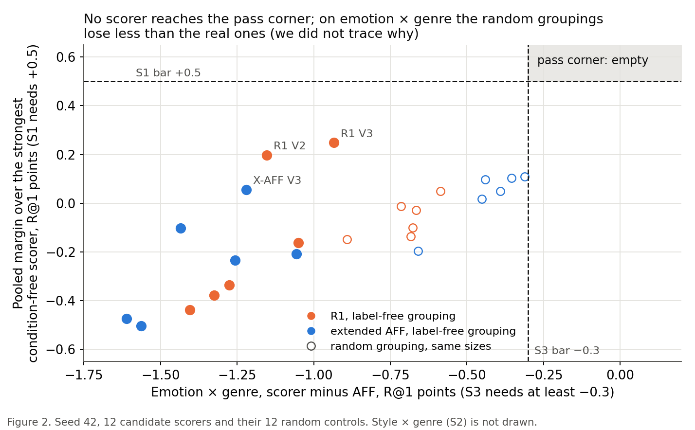

# Design L found no label-free style grouping that passes the gate, so Friday is a no-go and the paper stays with AFF

> 12 October 2026. Full report: [Design L, round 7](../reports/auto/v2/2026-11-26_design_l_style_source.md)
> (its file name carries CoSiR's sequence-number date).

**One decision is yours: do the results stand on a small agent fix (L3)?**

- The decision rule says: when a case is not covered, stop the run and let you decide.
- This happened at step L3, which removes content from the CSD style vectors. The rule's own check failed on them.
- The run did not stop. It sent you a phone note (05:55) and went on with a small agent fix.
- The ceiling check and the gate both used that fix. You decide whether they stand on it.
- Keep the fix, or drop the two affected groupings (V1 and V4): the result cannot change. This is certain.
- Use a rank-63 projector instead: that needs a rerun of V1 and V4. A change is very unlikely.

## Summary

- Design L tried to fix AFF's loss on style × genre with label-free style groupings that have their content part removed.
- The ceiling check passed clearly: a grouping built from the true style labels gains +3.92 R@1 points on style × genre.
- The seed-42 gate found no passing scorer among 12 candidates, so design L ends for this round's verdict.
- The Friday verdict is NO-GO: the paper is the ArtELingo paper with AFF, and AFF stays the current best.
- A "promising" lead exists (three scorers), but it is weak evidence, and the dig budget for it is none before Friday.
- Everything ran on development seed 42 only, so no claim is licensed.

## How we got here

CoSiR ranks captions for a painting under an aspect that is never named, such as emotion, style or genre. AFF (affect steering) is our best method. In round 6, its test on held-out paintings passed. It gained +0.60 R@1 points over a scorer that ignores the examples ([spec](../superpowers/specs/2026-10-12-r7-design-l-design.md), background).

AFF loses on style × genre. This is an episode type: the example pairs share one aspect, and style and genre are the two aspects in play. Our hypothesis is that the style grouping is the cause. CSD, our style encoder, groups paintings by genre as much as by style.

Design L asked one question. Suppose we remove the genre-like content from a label-free style grouping. Does a reader that steers by it then beat AFF and the strongest condition-free scorers on new episodes? The **reader** is the model that guesses which grouping the example pairs share. The decision rule was fixed before any code ran.

**R@1** is the share of rankings with the right candidate first, in points. The **Friday verdict** is the go or no-go on Friday 16 October 2026 for the method paper. Design L could only give a go by passing the gate.

## 1. The ceiling check and the L3 problem

**Problem.** Before spending hours on label-free groupings, we needed to know whether a style grouping can help at all, even a perfect one.

**Idea.** The **ceiling check** builds one grouping from the 27 true style labels. We tell the scorer which aspect each example shows (the **told route**: the grouping is given, not picked by a reader). This bounds what any label-free grouping could give.

The check stops design L if the gain on style × genre is under +0.5 R@1 points, or if its interval touches 0. We had guessed about +0.9.

**Did it work.** Yes, far above our guess. The gain is +3.92 [+3.35, +4.49] points over the matched control on style × genre. This is in the CLEAR zone (its bar was +1.0). The ceiling uses the told route. It shows what a good grouping is worth, not what our reader can reach.

**The L3 problem.** The rule removes the content part of the CSD vectors by a projection. It then checks that the content is gone. On the CSD vectors, that check failed.

The cause is rounding noise. It left one extra direction in the projector. The run used a small agent fix and went on (see the top of this report). The fix removes one arbitrary extra direction from V1 and V4.

It hardly matters for the result. V1 and V4 are far below the bar on every check that decides it. The numbers are in the full report.

*Figure 1. Fused minus matched counterpart on style × genre, seed 42, R@1 points with 95% intervals. The first row is the ceiling. The grey row is a reference (extended AFF on raw CSD), not a candidate. The other two rows are label-free candidates (section 2). The hollow dots are random groupings.*

> Full report: Flag and Deviations (L3), Results (K1).

## 2. The seed-42 gate

**Problem.** We needed a label-free grouping that carries style apart from genre, and a way to pick one without reading fresh seeds.

**Idea.** We built six groupings, V1 to V6, in two families.

- Four come from CSD. V1 removes the content part by projection. V2 and V3 use a graph cut. V4 uses a projection and then a cut.
- Two come from CLIP token statistics (V5, V6).

Each grouping got a reader and two scorers: R1, and extended AFF (AFF whose gate also opens on the new grouping). That gives 12 candidate scorers. Each grouping also got a random control with the same group sizes. A candidate had to pass three checks on seed 42:

- **S1:** a pooled margin of at least +0.5 over the strongest condition-free scorer.
- **S2:** style × genre at or above its matched control.
- **S3:** emotion × style and emotion × genre each within 0.3 points of AFF.

**Did it work.** No. Not one candidate passes.

- S1 fails all 12. The best is +0.25 [+0.05, +0.46]. AFF itself has only +0.33 over B′(A1), the strongest condition-free scorer. So S1 asks for about +0.17 more than AFF has.
- S3 on emotion × genre fails all 12. They lose between 0.93 and 1.61 points to AFF.
- S2 passes for 5 of 12.

S1 and S3 each fail every scorer, so the result holds if either were dropped.

**Key evidence.** The pass corner of the plot is empty. The random controls sit nearer to it on S3 than the real groupings do. We did not trace why.

*Figure 2. Seed 42. Each filled point is a candidate scorer, each hollow point its random control. The two dashed lines are the bars of S1 and S3.*

> Full report: Results (the gate table), Analysis ("Where the candidates lose").

## 3. What the numbers say about the style source

**Problem.** A gate that fails could mean the idea is wrong or the groupings are poor.

**Idea.** We read the descriptive numbers after the verdict. They decide nothing. They compare against raw CSD (reference), an off-the-shelf non-redundant clustering (NrKmeans, reference) and the random controls.

**Did it work.** Partly, as a weak signal and not as a pass. Three scorers meet the "promising" conditions. These are: style × genre at least +0.3 above AFF, at or above the matched control, and a pooled margin above 0. Pooled means over all three aspect pairs.

| Scorer | Style × genre, scorer minus AFF | Style × genre, scorer minus matched control | Pooled margin over best condition-free scorer [95%] |
|---|---|---|---|
| R1 on V2 | +0.82 | +0.09 | +0.20 [−0.01, +0.41] |
| R1 on V3 | +0.78 | +0.23 | +0.25 [+0.05, +0.46] |
| extended AFF on V3 | +0.71 | +0.38 | +0.05 [−0.16, +0.27] |

All three lose 0.93 to 1.22 points to AFF on emotion × genre. Pooled against AFF (12,288 episodes), the three scorers score:

- R1 on V2: −0.03
- R1 on V3: −0.08
- extended AFF on V3: −0.28 [−0.53, −0.02]

The two R1 scorers are at AFF's level. Extended AFF on V3 is a little below it.

Read this flag with five cautions:

- **The references meet the conditions too.** Raw CSD and NrKmeans meet them, but only with extended AFF. R1 on raw CSD and R1 on NrKmeans fail S2. Our reading: the flag does not show that removing content helped.
- **Random controls score higher.** They beat the candidates on the margin and gain over the counterpart. Our reading: those two numbers do not measure style content. We did not trace why.
- **S2 is weak evidence.** It is the only statistic that points the right way: 5 of 12 candidates pass, against 1 of 12 random controls. But the ranges overlap, and the intervals are about ±0.3. S2 is a point check.
- **Selection.** Seed 42 was used for about 60 earlier variants. We read "promising" among 12 candidates plus 16 reference and control scorers. Seed-42 margins are inflated.
- **Not re-derived.** The re-derivation covers V1 to V6 only. The control and reference numbers rest on the pipeline's own output.

**Key evidence.** The two cuts of CSD (V2, V3) kept CSD's style content and removed little genre. Their agreement with the true styles is 0.32 and 0.33, against 0.34 for raw CSD. (The agreement is AMI: 0 is chance, 1 is identical.)

The two projections (V1, V4) lowered the agreement with the true styles (0.10 and 0.07). They lowered the agreement with the true genres too (0.08 and 0.05). So they removed style together with the genre part. The token-statistics groupings carry little style (0.04 and 0.10).

> Full report: Results ("Promising"), Analysis (groupings, random controls).

Our advice (open after giving your reading)

This is our view; you decide.

We are sure of the verdict under the rule. No candidate is near S1's bar or S3's. A style grouping can matter: the ceiling is +3.92. The label-free groupings reach about a tenth of it (best +0.38 against +3.92, both style × genre minus the matched control). The reader must also pick the grouping.

We do not know which of the two limits the result. One hint says the grouping does. In round 1, the told route with raw CSD gained +0.13 [−0.35, +0.60] on style × genre. That is the same scale as the candidates, but it is a different setup. Treat it as a hint only.

The "promising" flag is weak evidence. S2 is consistent with a small real effect, but the ranges overlap. The raw-CSD and NrKmeans references with extended AFF meet the same conditions. The random controls match or beat the candidates on several statistics.

We recommend taking the NO-GO: write the ArtELingo paper with AFF, and park design L with the "promising" note. If a later loop picks design L again, first run the told route with V3 (CPU only, seed 42). It would separate grouping quality from reader quality.

For L3, we would keep the fix. It meets the rule's own check, and keeping it or dropping V1 and V4 leaves the result as it is. This is our view; you decide whether the results stand on it.

## Next

- **Where things stand.** Design L ended at the seed-42 gate by the committed rule (the ceiling check CLEAR, the gate n = 0). The Friday verdict is NO-GO, AFF stays the current best, and no fresh seed was built (seeds 55 and later stay free). Your L3 decision decides whether this stands on the fix.
- **Your decision, L3:** keep the fix, drop V1 and V4 (with their controls), or use a rank-63 projector. The first two leave the result as it is. The third needs a rerun of V1 and V4 and is very unlikely to change it.
- **Your decision, design L:** "design L ends" means it ends for this round's verdict. It resumes only if you choose, and it needs a new spec and rule. The leads are the cuts V2 and V3, or a wider screen of style encoders (parked). It needs a few days of CPU work. Any test on held-out paintings is a new one.

## Glossary

- **AFF:** affect steering, our current best method (full report: AFF).
- **Extended AFF:** AFF whose gate also opens when the reader picks the new style grouping.
- **R1:** the reader's weighted grouping term, added to the score when the reader is confident (AFF adds it only for the affect grouping).
- **Ceiling check:** a run with the true style labels given to the scorer (the told route); it bounds what a label-free grouping could give.
- **Style × genre:** an episode type where the example pairs share one aspect, and style and genre are the two aspects in play. Emotion × style and emotion × genre work the same way.
- **V1 to V6:** the six label-free style groupings; **Z1 to Z6** are their random controls with the same group sizes.
- **CSD:** the style encoder behind V1 to V4; **raw CSD** is its plain grouping (a reference).
- **Matched control:** a scorer's identical score with only the condition removed; **condition-free scorer:** a scorer that ignores the examples.
- **Content grouping:** the reader's CLIP image grouping (64 groups); design L cuts the style groupings across it.
- **S1 to S3:** the three gate checks; **n:** the number of families with a pick (rule §6), here 0; **FV:** the Friday verdict.
- **Promising:** the spec's flag for a no-pass run that still shows a lead.
