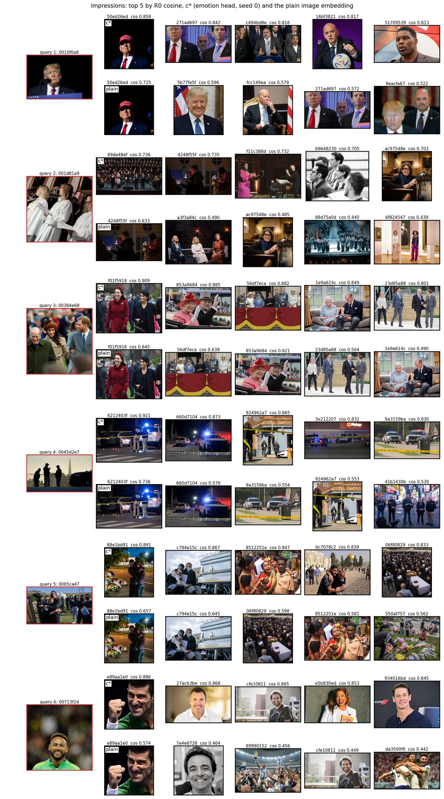

# Frozen c* on Affection photos: above the plain image, below its teacher (fails); the ArtELingo CRL bars pass

> 2026-10-31 (sequence name 12-31) · Spec: [design](../../../superpowers/specs/2026-10-30-affection-confirmation-design.md) · Decision rule: inline in the spec (§6 with §3.4 and §3.5) @ e576c77, no amendments · Run log: [round log](../../../../src/test/20261030_affection_confirmation/20261030_affection_confirmation_log.md) · Previous round: [12-29](2026-12-29_retrieval.md)

## Results brief

**What we tried.** We tested frozen c*, heads trained on paintings, on Affection photos and against CRL ([spec](../../../superpowers/specs/2026-10-30-affection-confirmation-design.md)). A read-out compares saved features; each arm picks one on validation.

**Outcome against the bar.** The photo confirmation fails: c* beats the plain Qwen image but falls below the instructed Qwen image, its teacher.

|Photo task|c* minus plain [95%]|c* minus teacher [95%]|
|---|---|---|
|Clustering AMI|+0.0343 [+0.0298, +0.0387]; WIN|-0.0282 [-0.0333, -0.0233]; BELOW|
|Retrieval mAP|+0.0304 [+0.0293, +0.0315]; WIN|-0.0190 [-0.0205, -0.0176]; BELOW|

The ArtELingo clustering WIN over the teacher does not repeat. Each ArtELingo CRL bar passes: emotion, style and genre. Affection CRL is LEVEL; its WIN bar fails.

**What it does not show.** This covers one photo dataset, emotion only, with heads trained on paintings and frozen. Plurality labels have 22.6% ties, broken alphabetically. The feature scope is Qwen3-VL-Embedding-2B only. The ArtELingo CRL bar was set after r11's descriptive held CRL numbers were seen.

**Options for next.**

1. Train c* on photos too: extract the instructed emotion view, with artwork wording, for Affection's 72,255 train images. This costs about one local GPU hour at the measured rate, then graph construction, DAS6 retraining, and this protocol again. This medium loop tests whether the gap comes from heads that never saw photos. It changes c* before the 2026-11-10 freeze, or goes to r13 after it.
2. Keep c* frozen and report Affection as transfer: above the plain image, below the teacher. Claim the ArtELingo CRL bar. No compute.
3. Test frozen c* on PolyArt, a second painting dataset, once its link arrives. This costs about three hours of run time once the data is in. It tells whether the gap comes from photos or from any new dataset.

**Your reading.**

Our reading and recommendation (open after writing yours)

**Our reading:** c* transfers only in part. It keeps 54.9% of the teacher's AMI gain over plain on photos. It keeps 61.5% of the mAP gain. On paintings, it keeps all the retrieval gain (103.4%, point values).
The gap spans many seed ranges and persists for untied images, every source, plain cosine and graded nDCG. The CRL rows follow the same line: c* far ahead on paintings, LEVEL on photos.

Our confidence is high: independent re-derivation agrees and teacher gaps have wide margins. Painting-only head training could explain the gap; this run does not test that hypothesis.

**Our recommendation:** our view is option 2 now, for the abstract of 2026-11-10. Make option 1 r13's first question after the freeze. Take option 3 when the PolyArt link arrives.

## What ran

No arm trained on Affection; c* stays frozen.

|Stage|Type|Role|
|---|---|---|
|0a|regression check|Store, extraction, labels and earlier-round replays|
|0b|measurement|Commit validation ranges before test|
|1|sweep|Commit read-outs, wordings and CRL versions before held|
|2|confirmation|Affection clustering and retrieval|
|3|claim test|CRL bars on both datasets|
|4|descriptive|Impressions figure only|

|Data|Test / held|Validation|Role|
|---|---|---|---|
|Affection|8,501 photos|4,251 photos|Emotion; train untouched by evaluation|
|ArtELingo|12,281 paintings; genre on 9,949|6,152 paintings|Three CRL bars|

c* and PercepT core use seeds 0 to 4.

Clustering: MiniBatchKMeans, 20 clusters, three states, mean AMI; 2,000 paired draws over images then seeds.

Retrieval: all other split images as gallery, AP per query; 10,000 joint draws over queries and seeds.
nDCG uses emotion-distribution overlap. Differences are c* minus comparator; intervals are 95%.

WIN means lower bound > 0; otherwise LEVEL means lower bound > −r; otherwise BELOW.
r is c*'s validation maximum minus minimum over model seeds.

Code: build merged at `fd6a4b5`; run from main `989c2aa`, locally.
Queue: 00:57–03:33, all exits 0. GPU: about 51 minutes, heavy; FI drew about 280–340 W.
Saturday: no working-hours limit.

Every stage 0a gate passed:

|Gate|Key evidence|
|---|---|
|Store|Old hashes/rows unchanged; FI counts, keys, finite/unit rows and merge pass|
|Labels|Both splits' nine class counts match; validation 907 ties, test 1,917|
|Instructed extractor, 200 paintings|Minimum cosine 0.999817; maximum absolute difference 0.003784|
|Default extractor, 200 photos (100 FI)|Minimum cosine 0.999211; maximum absolute difference 0.008026|
|Earlier-round replays|r10 clustering, r11 sweep/retrieval: max absolute difference 0; seven picks match|
|c* inference|All 15 heads: maximum absolute difference 0.000061, bar 0.001|
|PercepT loader|Seed-0 hash equal; own-reading AMI 0.0874 equal|
|CLIP extraction, 200 paintings|Minimum cosine 1; maximum absolute difference 0|
|CRL|Three CLIP-vector hashes equal; text parity passes cosine ≥ 0.999|

Ranges: `8ab72ce`; picks: `2109864`, before held scores.

|Validation range|r|
|---|---|
|Affection AMI|0.00343|
|Affection mAP, plain cosine|0.00101|
|Affection nDCG, plain cosine|0.00034|

Picks use cross-fit validation mAP; scores are gains over plain cosine in seed ranges.
ArtELingo retains r11's c* and CLIP CRL picks; Qwen CRL picks anew.

|Data|Arm|Pick|Score (r)|Validation mAP: emotion / style / genre|
|---|---|---|---|---|
|Affection|c*|center+k10|+9.70|0.2858|
|Affection|plain Qwen|center+k10|+6.59|0.2516|
|Affection|teacher, artwork|center+k10|+7.23|0.3044|
|Affection|teacher, photo|center+k10|+6.82|0.2995|
|Affection|CLIP L/14|center+k10|+18.10|0.2676|
|Affection|PercepT core|center+k0|+4.17|0.2438|
|Affection|crl_clip_painting|center+k10|+9.60|0.2802|
|Affection|crl_clip_photo|center+k10|+9.92|0.2784|
|Affection|crl_qwen_painting|center+k10|+23.39|0.2751|
|Affection|crl_qwen_photo|center+k10|+22.78|0.2783|
|ArtELingo|c*|center+k10|+5.43|0.2730 / 0.3253 / 0.6257|
|ArtELingo|crl_clip_painting|none+k10|+3.99|0.2600 / 0.2873 / 0.5089|
|ArtELingo|crl_qwen_painting|center+k10|+9.78|0.2691 / 0.2294 / 0.4835|

center means validation-mean subtraction; k10 means ten-neighbour average query expansion; k0 means none.
Read-outs fit on validation; cross-fit halves fit and score each other.

|Pick|Artwork score|Photo score|Selected|
|---|---|---|---|
|Teacher clustering (AMI)|0.1719|0.1629|artwork|
|Teacher retrieval (mAP)|0.3044|0.2995|artwork|

|CRL version|Affection score (r)|ArtELingo score (r)|
|---|---|---|
|clip_painting|277.33|148.71|
|clip_photo|275.52|—|
|qwen_painting|272.32|140.00|
|qwen_photo|275.49|—|

Teacher: artwork for both tasks, by AMI or picked mAP.
CRL: CLIP painting on both datasets, by mean mAP/r; ties within 0.001 r follow the rule.

C13 agrees within 1e-6 on labels, ranges, picks, criteria, intervals and outcomes:

|Stage|0b|1|2|3|
|---|---|---|---|---|
|Values checked|79|636|224|226|
|Disagreements|0|0|0|0|

## Results

Photo confirmation fails; each ArtELingo CRL claim passes.
Read-outs shown were picked on validation.

|ID|Stage|Data|Aspect|Comparator|c* number|Comparator number|Difference [95%]|r|Outcome|Bar|Pass|
|---|---|---|---|---|---|---|---|---|---|---|---|
|SC1|2|Affection test|emotion AMI|plain Qwen|0.1384|0.1041|+0.0343 [+0.0298, +0.0387]|0.00343|WIN|WIN|yes|
|SC2|2|Affection test|emotion mAP|plain Qwen|0.2755 (center+k10)|0.2452 (center+k10)|+0.0304 [+0.0293, +0.0315]|0.00101|WIN|WIN|yes|
|SC3|2|Affection test|emotion AMI|teacher, artwork|0.1384|0.1666|-0.0282 [-0.0333, -0.0233]|0.00343|BELOW|LEVEL or WIN|no|
|SC4|2|Affection test|emotion mAP|teacher, artwork|0.2755 (center+k10)|0.2945 (center+k10)|-0.0190 [-0.0205, -0.0176]|0.00101|BELOW|LEVEL or WIN|no|
|SC5|3|ArtELingo held|emotion mAP|CRL, CLIP painting|0.2691 (center+k10)|0.2554 (none+k10)|+0.0137 [+0.0124, +0.0149]|0.00141|WIN|WIN|yes|
|SC6|3|ArtELingo held|style mAP|CRL, CLIP painting|0.3235 (center+k10)|0.2816 (none+k10)|+0.0418 [+0.0392, +0.0444]|0.00223|WIN|WIN|yes|
|SC7|3|ArtELingo held|genre mAP|CRL, CLIP painting|0.6151 (center+k10)|0.5033 (none+k10)|+0.1118 [+0.1087, +0.1149]|0.00382|WIN|WIN|yes|
|SC8|3|Affection test|emotion mAP|CRL, CLIP painting|0.2755 (center+k10)|0.2739 (center+k10)|+0.0016 [-0.0001, +0.0032]|0.00101|LEVEL|WIN|no|

**Verdict under the rule:** stage 2 **fails**: both plain-image comparisons WIN; both teacher comparisons are BELOW.
**The ArtELingo clustering WIN over the teacher repeats: no.**
The photo CRL row stays: LEVEL fails its WIN bar and gives no claim.
The spec's “holds” and “qualified” sentences are not licensed.

The CRL sentence is licensed for each aspect:

> “c* retrieves by \<aspect> better than our re-implementation of CRL, with the stronger of its CLIP L/14 and Qwen versions picked on validation, on held \<dataset>.”

Here, \<aspect> is emotion, style or genre, and \<dataset> is ArtELingo.
**Selection disclosure:** these bars followed r11's descriptive held CRL numbers: c* led by about 10–30 seed ranges.
Only Qwen CRL is new; c* and CLIP CRL repeat r11.
Not licensed: Affection CRL, style or genre on photos, Impressions, PercepT's published numbers, or claims against CLIP L/14.

## Analysis

Diagnostics decide nothing. The order stays teacher > c* > plain.
Retained gain = (c* minus plain) / (teacher minus plain), point values only.

|Data / metric|c*|Plain|Teacher|Teacher gain retained|
|---|---|---|---|---|
|Affection AMI|0.1384|0.1041|0.1666|54.9%|
|Affection picked mAP|0.2755|0.2452|0.2945|61.5%|
|ArtELingo emotion picked mAP|0.2691|0.2483|0.2684|103.4%|

Painting mAP: [12-29 stage 5](2026-12-29_retrieval.md), unrounded JSON.

|Affection diagnostic|c*|Plain|Teacher|
|---|---|---|---|
|Plain-cosine mAP|0.2670|0.2383|0.2884|
|Plain-cosine nDCG|0.9315|0.9250|0.9372|
|Picked-transform nDCG|0.9310|0.9253|0.9366|

nDCG uses cosine after each transform, without query expansion.
Untied: 6,584 photos, partitions refit, queries/gallery restricted; read-outs and r fixed. Outcomes stay:

|Comparison|Untied difference [95%]|Outcome|
|---|---|---|
|AMI vs plain|+0.0471 [+0.0415, +0.0529]|WIN|
|mAP vs plain|+0.0364 [+0.0350, +0.0379]|WIN|
|AMI vs teacher|-0.0314 [-0.0381, -0.0248]|BELOW|
|mAP vs teacher|-0.0318 [-0.0339, -0.0297]|BELOW|

Every source has teacher > c* > plain; none carries the order. All sources share the test gallery.
The gap to the teacher is largest on FI (`you_aaai_affective`, -0.0360) and Emotional Machines (-0.0249), about -0.011 on the other three.

|Source|Queries|c* mAP|Teacher mAP|Plain mAP|
|---|---|---|---|---|
|coco_affective|2,308|0.2688|0.2795|0.2423|
|emotional_machines_affective|1,013|0.2885|0.3134|0.2516|
|flickr30k_affective|1,375|0.2675|0.2788|0.2394|
|visual_genome_affective|1,671|0.2690|0.2806|0.2428|
|you_aaai_affective|2,134|0.2869|0.3229|0.2508|

Contentment, excitement and sadness carry most of the query-weighted deficit; c* leads on amusement, awe and disgust.

|Class|Queries|c* AP|Teacher AP|Difference|
|---|---|---|---|---|
|amusement|1,651|0.2845|0.2732|+0.0113|
|anger|81|0.0255|0.0377|-0.0122|
|awe|1,460|0.2826|0.2785|+0.0042|
|contentment|2,626|0.3454|0.3784|-0.0330|
|disgust|351|0.1985|0.1975|+0.0010|
|excitement|1,185|0.2656|0.2989|-0.0333|
|fear|448|0.1511|0.1605|-0.0094|
|sadness|501|0.1822|0.2872|-0.1050|
|something else|198|0.0377|0.0526|-0.0149|

Using held seed spreads changes no criterion outcome; committed r stays fixed.

|Metric|Held spread|Committed r|Teacher difference / r|
|---|---|---|---|
|AMI|0.00488|0.00343|-8.22|
|mAP, picked|0.00085|0.00101|-18.83|
|mAP, plain cosine|0.00096|0.00101|—|

c*'s emotion head leads on emotion labels (plain cosine):

|Head|Emotion mAP|
|---|---|
|emotion|0.2670|
|style|0.2310|
|genre|0.2485|

Unpicked photo wording trails artwork on test. CLIP photo CRL exceeds picked CLIP painting on photo test mAP.
Qwen CRL exceeds picked CLIP CRL on held painting emotion. Neither changes picks or verdicts.

|Data|Arm / wording|Picked?|AMI|Picked mAP: emotion / style / genre|
|---|---|---|---|---|
|Affection|teacher, photo|no|0.1581|0.2897|
|Affection|crl_clip_photo|no|0.1278|0.2744|
|Affection|crl_qwen_painting|no|0.1073|0.2655|
|Affection|crl_qwen_photo|no|0.1137|0.2678|
|ArtELingo|crl_qwen_painting|no|—|0.2659 / 0.2284 / 0.4840|

Unpicked read-outs have validation rows in `diag/diag.json`, but no test scores.
CLIP L/14 and PercepT core are descriptive:

|Arm / reading|Affection AMI|Plain-cosine mAP|Picked mAP|
|---|---|---|---|
|CLIP L/14|0.1127|0.2410|0.2581|
|PercepT core (20 clusters)|0.0784|0.2345|0.2386|
|PercepT core, own (argmax)|0.0870|—|—|
|PercepT published|0.1800|—|—|
|Published simpler variant h|0.2100|—|—|
|Published simpler variant h_concat|0.2500|—|—|

Published rows use another protocol; no comparison is licensed.
Chance mAP from class shares is 0.1907.

Our reading: the prior fits plain-image wins, teacher deficits and painting CRL wins; its surprise, below plain, did not occur.
Photo wording lost to artwork; the open photo CRL question ended LEVEL.

One image per photo ID; first six IDs query the other 816; top five by plain cosine of c*'s seed-0 emotion head and plain image.

c* and the plain image share many top-5 images.
Cosine scales differ across rows; those values cannot be compared. The figure decides nothing and supports no claim.

## Deviations

There were no rule deviations or amendments; the build's readings are recorded in the [round log](../../../../src/test/20261030_affection_confirmation/20261030_affection_confirmation_log.md#readings-settled-in-the-build-agent-defaults-reviewers-agreed).
Build readings cover score units, guards, seed draws, smoke, unpicked rows and Impressions counts.

Impressions: 822 photo IDs against 827 in the spec; six queries, 816 gallery images.
The run took 2 h 36 min against the handoff's 5–8 h estimate.
Instructed extraction ran at about 19.4 images/s against the assumed 10.2 images/s.

Selection (§8): Affection tried two wordings, up to 25 read-outs per arm and four CRL versions.
ArtELingo selected c* among about 60 configurations; CRL bars followed r11's descriptive held numbers.
Selection inflates validation scores. Only held numbers are results; ranges and picks froze before held scoring.

## Files and storage

Storage decisions wait for the next wrap-up; nothing was deleted.

- Outputs: `/data/SSD2/cosir_r12/20261030_affection_confirmation/outputs/`, 0.72 GB on `/data/SSD2`.
  Key files: `stage0a/gates.json`, `stage0b/ranges.json`, `stage1/picks.json`, `stage1/scores.json`, `stage2/verdict.json`, `stage3/verdict.json`, `diag/diag.json`, `vh/{0b,1,2,3}.json`, `stage4/impressions.json`, per-query arrays, `step_seconds.txt`, and `queue_status.txt`.
- The Affection store is now 2.4 GB with FI. Evaluation did not read train; default FI extraction completed the store.
- `.scratch/pending_deletions.md` holds the store before FI, `qwen3vl_emb_2b_pre_fi/` (1.8 GB), and FI-only extraction, `qwen3vl_emb_2b_fi/` (626 MB).
  Decision: next wrap-up.
