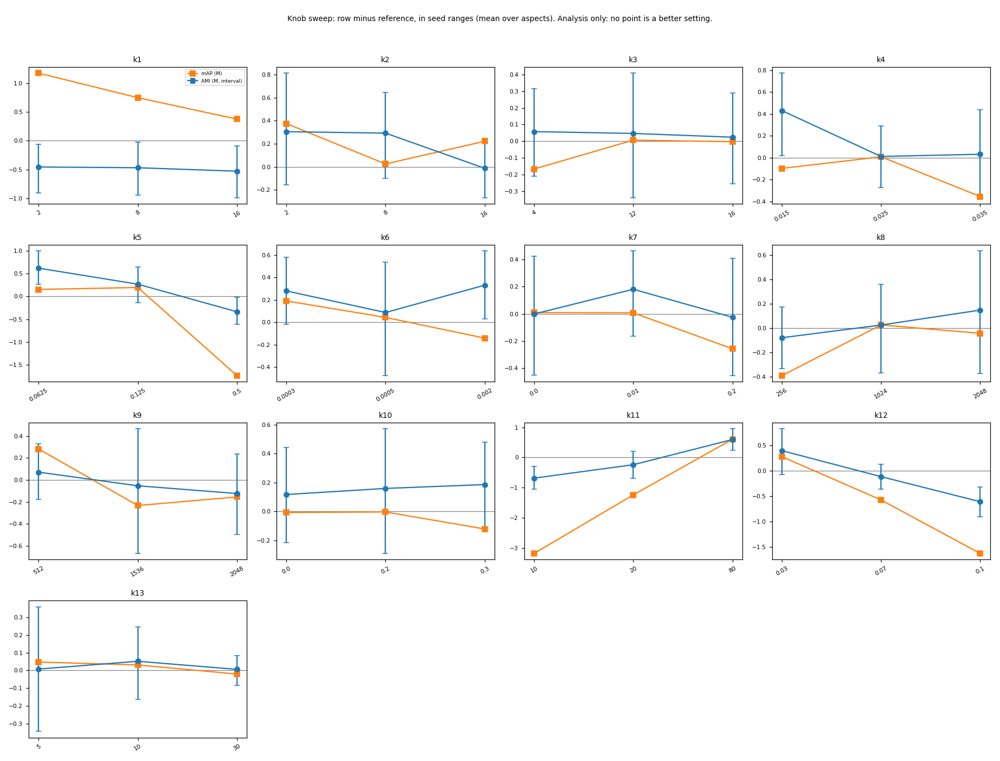

# Backbones sweep: c* holds on three more encoders and the frozen photo model beats its teacher on EmoSet; one teacher cell is below

> 2026-11-02 (sequence name 2027-01-02) · Spec: [design](../../../superpowers/specs/2026-11-02-backbones-sweep-design.md) · Decision rule: [§6 with §3.4 and §3.5](../../../superpowers/specs/2026-11-02-backbones-sweep-design.md#6-success-criteria) @ c1377ff (approval commit), no amendments · Run log: [round log](../../../../src/test/20261102_backbones_sweep/bs_run_log.md) · Previous: [r13](2027-01-01_photo_finetune.md)

## Results brief

**What we tried.** We trained c* (our paintings model) and its photo fine-tune on three more image encoders: SigLIP 2, SigLIP 1 and CLIP L/14 ([spec](../../../superpowers/specs/2026-11-02-backbones-sweep-design.md)). We tested the frozen Qwen photo model on a second photo set, EmoSet. We also swept c*'s settings and parts, as analysis only.

**Outcome against the bar.** Both claim tests **hold, GO**. On each encoder, c* is a WIN over the plain image in all six painting cells and over PercepT in clustering. Each photo model is a WIN over its plain image on Affection. On EmoSet, the photo model is a WIN over plain Qwen and over the teacher in both tasks:

|EmoSet task|Photo model|Teacher|Difference [95%]|
|---|---|---|---|
|AMI|0.4571|0.4390|+0.0181 [+0.0121, +0.0242]|
|mAP|0.4838|0.4519|+0.0320 [+0.0295, +0.0347]|

Against the Qwen teacher, 18 of 24 encoder cells are WIN and 5 are LEVEL. One is BELOW: CLIP L/14 emotion retrieval on paintings, -0.0013 [-0.0023, -0.0003]. It licenses no claim. Part b decides nothing.

**What it does not show.**
- These are claim tests on fixed data and seeds.
- We picked the three encoders because they passed an earlier held emotion test on the same ArtELingo held paintings.
- The Affection test photos were already scored in r12 and r13. EmoSet is the only test set that shaped nothing before.
- A LEVEL teacher cell licenses only "level with or better than the teacher".
- EmoSet is one more photo set, emotion only. With its 368 near-copies kept, the AMI gain over plain Qwen falls from +0.0653 to +0.0390.
- The EmoSet gain over the teacher is not uniform across emotions: on amusement, the photo model's AP is below the teacher's (0.3203 against 0.3471; diagnostic, not a claim cell).
- Part b names no better setting.

**Options for next.**

1. Freeze and write: no compute. The claims set the CVPR abstract (due 2026-11-10) and the paper (due 2026-11-16).
2. PolyArt test, when the user's link comes: data preparation and one scoring round. It tests c* on another art source.
3. A fourth encoder that no held test picked: about one encoder of part a (10 runs on DAS6, about 1 h of CPU scoring). It tells whether the encoder pick shaped the result.

**Your reading.** <left for the user>

Our reading and recommendation (open after writing yours)

**Our reading:** the recipe carries over to three encoders of two families, within the limit of the encoder pick. The EmoSet result is the strongest evidence so far for the photo claim, since that set shaped nothing. The one BELOW cell is small: its point value is inside one seed range (0.00169), but its interval is not.

**Our recommendation:** freeze c*, the photo model and the claims, and write for the deadlines. Use the part b sheets as the paper's ablation and analysis.

## What ran

All claim paths passed checks; analysis selected nothing.

|Stage|Type|What ran|
|---|---|---|
|0|regression check|26/26 gates passed; stores, training, exports, replays, near-copies|
|1|sweep, validation only|Part a; ranges/read-outs frozen before held|
|2|sweep, validation only|EmoSet ranges/read-outs/wording frozen before test|
|3|claim tests, parts a and c|Cells; re-derivation before verdict, compare after|
|4|ablation, part b|Knob/photo sweeps; stored ablations; no selection|
|5|descriptive|Twelve diagnostics after verdict|

|Evaluation set|Items|Role|
|---|---|---|
|ArtELingo held|12,281 (genre queries 9,949)|Three aspects|
|Affection test|8,501|Emotion|
|EmoSet validation|5,905; 135 near-copies removed; 5,770 kept|Picks and ranges|
|EmoSet test|17,716; 368 near-copies removed; 17,348 kept|Emotion claim|

- **Data and seeds:** validation sets stopping, ranges and read-outs; held and test sets carry the claims. A near-copy is a default-Qwen cosine of 0.85 or more to any of the 72,255 Affection train photos; EmoSet keys follow sha256 order (D17). Seeds: claims 0 to 4; knob sweep 1 to 3; photo sweep 0 to 2; ablation 0 to 4. EmoSet validation picked centering plus ten-neighbour expansion and the artwork teacher wording in both tasks.
- **Statistics:** AMI with 20 clusters; 95% bootstrap intervals (2,000 clustering and 10,000 retrieval draws). WIN: lower bound above zero; LEVEL: lower bound above minus the model's own validation seed range; else BELOW.
- **Terms:** recipe, the training loss terms c* keeps and their weights; buddy terms, the losses on the instructed graphs (graphs of related paintings built from instructed Qwen features); relational term, a genre loss that makes each painting's pattern of similarities to other paintings copy the teacher's; content correction, the step that removes image content from the emotion and style features before their graphs are built; matched PercepT, PercepT trained on the same encoder's image features; read-out, how stored embeddings are compared for retrieval; claim test, a test whose verdict licenses a claim sentence.
- **Code:** reviewed `4519762`; launches `5f28b2b`, `c5d7673`, `317ec92`, retry `91d79c3`; folder `src/test/20261102_backbones_sweep/`. Node402 (A6000) trained all runs and scored the two sweeps; the local 3090 extracted stores and ran the GPU checks; the local CPU exported and scored the rest.

## Results

Encoder and EmoSet claims hold; one teacher cell licenses no claim.

Source: `stage3/outcomes.json`; cells and verdicts agree. Rows SC1 to SC3 give the smallest of the three aspect differences, with its aspect.

|ID|Measured|Number|Compared against|Bar|Outcome|
|---|---|---|---|---|---|
|SC1|SigLIP 2, AMI, smallest of 3 (emotion)|+0.0477 [+0.0439, +0.0514]; 3/3 WIN|Plain image|All WIN|pass|
|SC2|SigLIP 2, mAP, smallest of 3 (emotion)|+0.0249 [+0.0238, +0.0260]; 3/3 WIN|Plain image|All WIN|pass|
|SC3|SigLIP 2, AMI, smallest of 3 (emotion)|+0.0253 [+0.0198, +0.0267]; 3/3 WIN|Matched PercepT|All WIN|pass|
|SC4|SigLIP 2, Affection AMI|0.1924; +0.0782 [+0.0724, +0.0845]|Frozen image 0.1142|WIN|WIN|
|SC5|SigLIP 2, Affection mAP|0.3227; +0.0711 [+0.0673, +0.0749]|Frozen image 0.2515|WIN|WIN|
|SC1|SigLIP 1, AMI, smallest of 3 (emotion)|+0.0399 [+0.0363, +0.0434]; 3/3 WIN|Plain image|All WIN|pass|
|SC2|SigLIP 1, mAP, smallest of 3 (emotion)|+0.0236 [+0.0225, +0.0247]; 3/3 WIN|Plain image|All WIN|pass|
|SC3|SigLIP 1, AMI, smallest of 3 (emotion)|+0.0250 [+0.0195, +0.0264]; 3/3 WIN|Matched PercepT|All WIN|pass|
|SC4|SigLIP 1, Affection AMI|0.1928; +0.0728 [+0.0668, +0.0787]|Frozen image 0.1200|WIN|WIN|
|SC5|SigLIP 1, Affection mAP|0.3234; +0.0688 [+0.0652, +0.0722]|Frozen image 0.2545|WIN|WIN|
|SC1|CLIP L/14, AMI, smallest of 3 (emotion)|+0.0377 [+0.0343, +0.0411]; 3/3 WIN|Plain image|All WIN|pass|
|SC2|CLIP L/14, mAP, smallest of 3 (emotion)|+0.0192 [+0.0181, +0.0203]; 3/3 WIN|Plain image|All WIN|pass|
|SC3|CLIP L/14, AMI, smallest of 3 (emotion)|+0.0243 [+0.0192, +0.0252]; 3/3 WIN|Matched PercepT|All WIN|pass|
|SC4|CLIP L/14, Affection AMI|0.1941; +0.0815 [+0.0746, +0.0880]|Frozen image 0.1127|WIN|WIN|
|SC5|CLIP L/14, Affection mAP|0.3221; +0.0640 [+0.0605, +0.0671]|Frozen image 0.2581|WIN|WIN|
|SC7|EmoSet AMI|0.4571; +0.0653 [+0.0589, +0.0719]|Plain Qwen 0.3918|WIN|WIN|
|SC8|EmoSet mAP|0.4838; +0.0975 [+0.0948, +0.1004]|Plain Qwen 0.3864|WIN|WIN|
|SC9|EmoSet AMI|0.4571; +0.0181 [+0.0121, +0.0242]|Teacher 0.4390|WIN|WIN|
|SC10|EmoSet mAP|0.4838; +0.0320 [+0.0295, +0.0347]|Teacher 0.4519|WIN|WIN|

Teacher cells: **18 WIN, 5 LEVEL, 1 BELOW**, licensing 23 claims. All LEVEL/BELOW cells follow, on ArtELingo held.

|ID|Encoder, aspect, task|Model / teacher|Difference [95%]|Own range|Outcome|
|---|---|---|---|---|---|
|SC6|SigLIP 2, emotion, mAP|0.2692 / 0.2684|+0.0008 [-0.0001, +0.0017]|0.00151|LEVEL|
|SC6|SigLIP 2, genre, AMI|0.5084 / 0.5062|+0.0022 [-0.0040, +0.0091]|0.00695|LEVEL|
|SC6|SigLIP 1, emotion, mAP|0.2688 / 0.2684|+0.0004 [-0.0005, +0.0013]|0.00216|LEVEL|
|SC6|SigLIP 1, genre, AMI|0.5065 / 0.5062|+0.0003 [-0.0049, +0.0057]|0.01150|LEVEL|
|SC6|CLIP L/14, emotion, mAP|0.2671 / 0.2684|-0.0013 [-0.0023, -0.0003]|0.00169|BELOW|
|SC6|CLIP L/14, genre, AMI|0.5010 / 0.5062|-0.0052 [-0.0103, -0.0000]|0.01593|LEVEL|

Own range: the model's own validation seed range for that metric (`records/stage1_<enc>.json`); it sets the LEVEL margin.

**Verdict under the rule:** part a paintings and photos **holds, GO** for each encoder; part c **holds, GO**. Part b has no verdict.

**Licensed sentences, spec §6**, combined across encoders:

> On 12,281 held ArtELingo paintings, c*'s recipe with each of SigLIP 2, SigLIP 1 and CLIP L/14 as its only image input at test (Qwen3-VL-Embedding-2B's instructed graphs, captions and teacher at training) clusters and retrieves paintings by emotion, style and genre better than that encoder's plain image, and clusters them better than PercepT on that image (AMI with 20 clusters; mAP with read-outs picked on validation; 5 seeds). These three encoders passed an earlier held emotion test.

> On 8,501 held Affection photos, the same model on each of these encoders, fine-tuned on Affection's unlabeled train photos with the settings picked for Qwen, clusters and retrieves photos by emotion better than that encoder's plain image.

> c* on each tested encoder is level with or better than the Qwen image instructed for each aspect in clustering and retrieval on ArtELingo held, except CLIP L/14 emotion retrieval, which licenses no claim. Each encoder's photo model is level with or better than the Qwen image instructed for emotion in clustering and retrieval on Affection test.

> On 17,348 EmoSet-118K test photos (photos with a near-copy in Affection's train set removed), the photo model (c*, trained on ArtELingo paintings, then fine-tuned on Affection's unlabeled train photos; frozen; never trained on EmoSet) clusters and retrieves photos by emotion better than the plain Qwen3-VL-Embedding-2B image and better than the Qwen image instructed for emotion (AMI with 20 clusters; mAP; wording and read-outs picked on EmoSet validation by the rule fixed in r12; 5 seeds).

Claims exclude untested encoders, training without Qwen views, further photo sets and other EmoSet attributes.

## Analysis

All twelve diagnostics are **ok**, none partial or not run. Sources: `diag/<item>.json` and `.md`; no decisions.

|Diagnostic|Status|Result and limit|
|---|---|---|
|Plain cosine|ok|Photo/teacher/plain EmoSet mAP: 0.4583/0.4313/0.3519.|
|EmoSet class-count clusters|ok|Eight-cluster AMI, photo/teacher/plain: 0.4403/0.3942/0.3492.|
|EmoSet per-class AP|ok|At the picked read-out, photo above teacher in every class but amusement, 0.3203 versus 0.3471; at plain cosine also below on awe.|
|Photo minus frozen c*|ok|EmoSet AMI +0.0098 [+0.0054, +0.0143]; picked mAP +0.0425 [+0.0395, +0.0452].|
|Teacher gain share|ok|Photo model gain over plain Qwen as a share of the teacher's gain, EmoSet: 138.3% (AMI), 148.8% (mAP).|
|Held seed spreads|ok|Held spreads differ from validation ranges both ways: SigLIP 2 genre AMI 0.0167 versus 0.0070; SigLIP 2 style 0.0073 versus 0.0160.|
|EmoSet range beside test spread|ok|AMI test 0.0151 versus range 0.0173; mAP test 0.0067 versus range 0.0069.|
|Uncut EmoSet|ok|All four lower bounds stay positive. Photo minus plain AMI falls to +0.0390 [+0.0318, +0.0464] (cut set +0.0653); the other three move by 0.0010 at most. Removed test photos: 368, the largest classes amusement (85) and awe (77).|
|Node versus local GPU|ok|AMI node minus 3090: emotion -0.0017, style +0.0008, genre +0.0024. No gate.|
|Knob curves|ok|Complete; aspect/task effects below.|
|Photo training length|ok|Complete; effects below.|
|Strongest PercepT|ok|Max AMI: emotion Qwen 0.0874; style CLIP L/14 matched 0.2306; genre SigLIP 2 matched 0.4558. The item has no retrieval rows.|

Part b names no better setting. Sheets complete: knob 39/39, photo 14/14, ablation 8/8. References use the same machines.

On ArtELingo validation, setting the buddy terms' temperature to 0.1 changes style AMI by -0.0163 [-0.0220, -0.0102] against c* on node402 (seeds 1 to 3).

On ArtELingo held, removing instructed graphs from c* changes style AMI by -0.1903 [-0.1959, -0.1822] against c* on the same 3090 (seeds 0 to 4). Removing the relational term changes genre AMI by -0.0440 [-0.0512, -0.0372].

On ArtELingo held, removing the relational term changes genre mAP (centering plus ten-neighbour expansion) by -0.1175 [-0.1214, -0.1134] against c* on the same 3090 (seeds 0 to 4).

On Affection validation, changing content correction to off changes emotion AMI by -0.0320 [-0.0391, -0.0247] against the photo model on node402 (seeds 0 to 2).

**Knob effects vary by aspect and task.** Row minus same-machine c*; no selection.

|Panel|Plain knob name|c* value|
|---|---|---|
|k1|Emotion relational weight|0|
|k2|Style relational weight|0|
|k3|Genre relational weight|8|
|k4|Relational teacher temperature|0.02|
|k5|Direct teacher weight|0.25|
|k6|Learning rate|0.001|
|k7|Weight decay|0.05|
|k8|Batch in graph pairs|512|
|k9|Shared trunk width|1024|
|k10|Dropout|0.1|
|k11|Graph neighbour count|40|
|k12|Buddy temperature|0.05|
|k13|Stopping patience, epochs|15|

The y unit divides effects by aspect seed ranges below: zero is the reference, one is one range. c* values: curves JSON; names: inherited grid.

| Unit | Emotion | Style | Genre |
|---|---|---|---|
| AMI range | 0.0046 | 0.0082 | 0.0128 |
| mAP range | 0.0014 | 0.0022 | 0.0038 |

On Affection validation, fixed training lengths change emotion scores (mAP at r13's read-out) by the amounts below against the node402 photo model, seeds 0 to 2. Reference: AMI 0.1915, mAP 0.3281.

|Fixed training|AMI change [95%]|mAP change [95%]|
|---|---|---|
|2 epochs|-0.0009 [-0.0051, +0.0035]|+0.0013 [+0.0003, +0.0023]|
|5 epochs|+0.0027 [-0.0041, +0.0089]|+0.0032 [+0.0022, +0.0043]|
|20 epochs|+0.0067 [+0.0014, +0.0127]|+0.0056 [+0.0042, +0.0071]|

Our reading: on held paintings, the largest style effect comes from removing the instructed graphs (-0.1903) and the largest genre effect from removing the relational term (-0.0440). Removing the buddy terms (-0.1512) or content correction (-0.0752) also cuts style AMI, so no single part carries style.

## Deviations

Final checks agree. Times: Amsterdam, 2026-11-02. Details: log and [change log](../../../../.claude/20261102_log.md).

|Item|Time|Deviation or report note|
|---|---|---|
|C13 compare|10:58 to 11:01|Compare-only fixes: matched_M2/M2, teacher_artwork/teacher_emotion_focus, stage 2 and outcomes layout. Derive untouched. Final 2,768 items, 0 mismatches.|
|Diagnostics import order|11:47 to 11:59|Photo minus c* and uncut EmoSet failed alone. Context now loads first. Fix logged 11:50; reruns passed.|
|k11=20|14:56 to 15:26|Added missing ct_full_d2_graphs input and retry-failed path. Three node402 units reran; failed_attempt1.json kept. Part b enters no verdict.|
|Part b spot re-derivation|15:50 to 16:43|One Codex fix round restored frozen r11 cross-fit validation mAP; one adapter fix read knob layout. Rows drawn with default_rng(14) before any sheet: knob k2=16, k11=80; photo lr=0.003; ablation content_correction, relational. Final 429 items, 0 mismatches.|
|Prep pull|07:50; 15:05 to 15:07|Concurrent writes prevented first pull verification. Pulled again, verified.|
|F5|First handoff, 07:30|Paintings gate failure also blocks photo teacher claims. By design, not fixed; gates passed.|
|N8|First handoff, 07:30|Export retry and matched rerun have no code. By design, not fixed; replay gates passed.|
|N9|First handoff, 07:30|In the photo-sweep sheet only, mAP differences are cross-fit and intervals pooled bootstrap, so some intervals are not centred on the point. By design, not fixed.|
|Node sync|07:28; 08:33; 08:52|Marker check skipped on purpose (`--allow-any-branch`); log-only commits synced later because the launch refused the older node commit.|
|N10|First handoff, 07:30|Handoff says no teacher plain-cosine rows; EmoSet has them, ArtELingo/Affection do not. Not fixed.|
|Agent defaults|Run chats|Local CPU exports; run-chat adapter fixes; default_rng(14) spot draw; missing-input retry; frozen cross-fit validation mAP.|

**File disagreements:** both later handoffs say 17 WIN, 6 LEVEL, 1 BELOW teacher cells; final files give 18 WIN, 5 LEVEL, 1 BELOW. The handoff's missing-teacher-row note differs from the EmoSet diagnostic. Final cells and verdict files agree.

## Files and storage

Keep the outputs: the report rests on them. Nothing was deleted.

- **Outputs:** `/data/SSD2/cosir_r14/20261102_backbones_sweep/outputs/` (12 GB), keep: the report rests on it.
- **Records:** [picks, near-copies, verdicts and checks](../../../../src/test/20261102_backbones_sweep/records/).
- **Figure:** [unchanged copy](../../assets/2027-01-02_backbones_sweep/knob_curves.png) of `outputs/diag/knob_curves.png`.
- **Storage:** the outputs folder stays. The node402 copies (4.6 GB results, job folders), the smoke pull and the stage 0 check trainings are listed on `.scratch/pending_deletions.md` (2026-11-02, r14 run 4) for the next storage summary.
