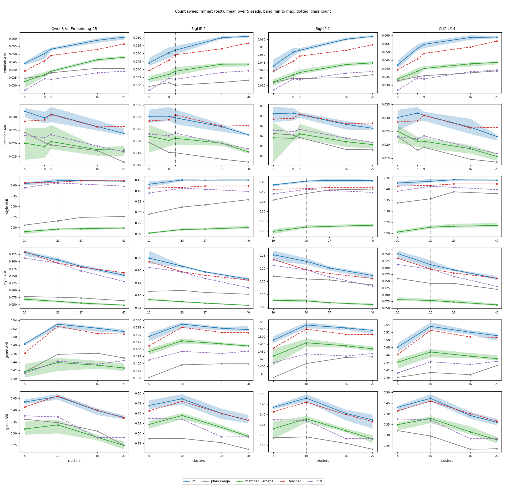

# New scores: all plain-image class-count cells WIN; teacher and CRL claims depend on the metric

> 2026-11-04 (sequence name 2027-01-04) · [Spec](../../../superpowers/specs/2026-11-03-new-scores-design.md) · Decision rule: [§6 with §3.4 and §3.5](../../../superpowers/specs/2026-11-03-new-scores-design.md#6-success-criteria) · [Run log](../../../../src/test/20261103_new_scores/20261103_new_scores_log.md)

## Results brief

**What we tried.** We scored saved outputs again, with no training, on four encoders and four test sets
([spec](../../../superpowers/specs/2026-11-03-new-scores-design.md)). Earlier claims used AMI at 20 clusters and mAP.
This round adds NMI, ARI and ACC at the class count, CRL on c*'s own encoder, PercepT in retrieval, and retrieval where
the query names no aspect ("untold").

**Outcome against the bar.** There is no overall verdict: each of the 412 metric cells is its own claim, and 398 give a
claim. The independent re-derivation matched every cell (largest difference 3.5e-14). WIN means the 95% interval of the
difference is above 0. LEVEL means not WIN, with the lower bound within the seed range r below 0. BELOW means further below.

|Comparison|Cells|WIN|LEVEL|BELOW|Claims|
|---|---:|---:|---:|---:|---:|
|c* / plain image, clustering|96|96|0|0|96|
|c* / PercepT, clustering|96|93|3|0|93|
|c* / teacher, clustering on paintings|96|68|23|5|91|
|Photo model / plain image and teacher|40|38|2|0|40|
|c* / CRL, clustering (CLIP L/14)|30|26|3|1|26|
|c* / CRL, retrieval (CLIP L/14)|6|6|0|0|6|
|Untold c* / plain image, retrieval|24|22|1|1|22|
|c* / PercepT, retrieval|24|24|0|0|24|

- Example: ArtELingo emotion on Qwen, AMI 0.1024 for c* against 0.0696 for the plain image.
- Against the teacher on paintings, AMI and NMI WIN in 46 of 48 cells; ARI and ACC WIN in 22 of 48.
- All 5 teacher BELOW cells are emotion, in ARI or ACC. Example: ArtELingo emotion ARI on Qwen, 0.0605 against 0.0726.

**What it does not show.** We cannot say that c* beats the teacher in all four metrics. LEVEL does not mean "no
difference": 8 LEVEL cells have the whole interval below 0, because r is large there. BELOW does not always mean a clear
loss: 2 BELOW cells have an interval that reaches 0. The 412 cells have no multiplicity correction. Other cluster counts
give point values only. Some test values were seen before these bars ("Selection disclosure" below). MMArt shares most
artists with the training paintings (r15).

**Options for next.**

1. Put these cells in the paper tables now. No compute. It gives every paper claim the standard metrics before the
   abstract (2026-11-10) and the paper (2026-11-16).
2. Intervals at the other cluster counts, with a new spec or an amendment. About 8 CPU slot-hours (our estimate from this
   run, not measured). It could turn the point values of the sweep into claims across counts.
3. Go on with the planned loops, beside r18 (outside methods) and r19 (more encoders), which are still running: the qualitative figure (r20, CPU minutes and design work), head variants (r21, about
   2 h GPU), text queries (r22, under 1 h GPU). r21 could tell if another head closes the emotion gap to the teacher.

**Your reading.** "I think results overall good, ARI and ACC on teacher seems worth digging more cause half not win."

Our reading and recommendation (open after yours)

**Our reading.** c*'s gains hold at the class count against the plain image in all four metrics, against PercepT in AMI,
NMI and ARI, and against CRL in AMI and NMI. They hold in retrieval against both. Against the teacher, c* wins 46 of 48 AMI and NMI cells (MMArt genre on Qwen is LEVEL in both), but ARI and ACC
are mixed, and emotion is the weak aspect. Contentment, a large class, has lower AP than the teacher on every encoder and both sets. This
may matter for ARI and ACC, but we did not test it. Untold emotion beat our prior: 8 of 8 WIN against an expected 50%.
Untold mAP is below told mAP in all 24 cells, by 0.05 to 0.09 in style and genre; this is a diagnostic, with no claim. We
are sure of the numbers. We are less sure what a single LEVEL or BELOW cell means, because r changes a lot between encoders.

**Our recommendation.** Our view: option 1. Write teacher claims by metric: "better than" where the cell is a WIN, and no
sentence across all four metrics. Cite families, not single near-tie cells. Take option 2 only if the paper needs a claim
across counts.

## What ran

Saved outputs only; no training or GPU. Not run: nothing. Stage 3 ran in full.

|Stage|Type|Record|
|---|---|---|
|0|Regression check|All gates passed|
|1|Validation sweep|Ranges and picks committed at c0ed42d8 before new test values|
|2|Claim test|412 decided cells|
|3|Descriptive|Sweeps, per-class AP, told/untold, cross-encoder CRL, raw retrieval, spreads|

Encoders: Qwen, SigLIP 2, SigLIP 1, CLIP L/14; five candidate seeds. Clustering: three states, 2,000 joint row/seed draws. Retrieval: 10,000 draws; PercepT seeds drawn separately, told/untold seeds shared. Read-outs: maps and query expansion picked on validation.

|Test population|Rows|Class count: emotion / style / genre|
|---|---:|---|
|ArtELingo held|12,281|9 / 27 / 10|
|MMArt test|16,384|9 / 20 / 10|
|Affection test|8,501|9 / — / —|
|EmoSet test|17,348|8 / — / —|

Labels are masked after clustering; retrieval uses labelled rows (ArtELingo genre 9,949; MMArt emotion/genre 16,218/13,420). EmoSet sweeps cover Qwen only, the photo family's scope; the earlier backbone round has the other three encoders.

Code: 8cf743b2, diagnostic fix bd8717c2; local CPU through the shared queue. [Status, picks and ranges](../../../../src/test/20261103_new_scores/records/) retain the checks and selection record.

## Results

Each metric cell is its own claim; there is no overall verdict. WIN: lower bound > zero; otherwise LEVEL: lower bound > −r; otherwise BELOW. Here r is the seed range the rule names for that cell, from validation: the candidate's range in clustering, told c*'s recorded plain-cosine mAP range in retrieval (`r_source` in the verdicts). 

All 412 cells have no multiplicity correction; the paper cites families, per the spec. C13: 22,615 items, none failed/missing, maximum absolute difference 3.52e-14 ([certificate](../../../../src/test/20261103_new_scores/records/c13.json)).

Claims = `meets_bar`; Strict = `bar_met`.

|Family|Comparison|Metric|Cells|WIN|LEVEL|BELOW|Claims|Strict|
|---|---|---|---:|---:|---:|---:|---:|---:|
|SC1|c* / plain image, class count|AMI|24|24|0|0|24|same|
|SC1||NMI|24|24|0|0|24|same|
|SC1||ARI|24|24|0|0|24|same|
|SC1||ACC|24|24|0|0|24|same|
|SC2|c* / matched PercepT, k-means at class count|AMI|24|24|0|0|24|same|
|SC2||NMI|24|24|0|0|24|same|
|SC2||ARI|24|24|0|0|24|same|
|SC2||ACC|24|21|3|0|21|same|
|SC3|c* / Qwen teacher, paintings, class count|AMI|24|23|1|0|24|same|
|SC3||NMI|24|23|1|0|24|same|
|SC3||ARI|24|11|10|3|21|18|
|SC3||ACC|24|11|11|2|22|20|
|SC4|Photo model / plain image and teacher, class count|AMI|10|10|0|0|10|same|
|SC4||NMI|10|10|0|0|10|same|
|SC4||ARI|10|9|1|0|10|same|
|SC4||ACC|10|9|1|0|10|same|
|SC5|c* / CRL, both CLIP L/14, clustering|AMI (20 and class count)|12|12|0|0|12|same|
|SC5||NMI|6|6|0|0|6|same|
|SC5||ARI|6|5|1|0|5|same|
|SC5||ACC|6|3|2|1|3|same|
|SC6|c* / CRL, both CLIP L/14, retrieval|mAP|6|6|0|0|6|same|
|SC7|Untold c* (joined heads, no aspect named) / plain image|mAP|24|22|1|1|22|same|
|SC8|Told c* (aspect head) / PercepT topic probabilities|mAP|24|24|0|0|24|same|

[Verdicts](../../../../src/test/20261103_new_scores/records/verdicts.json) give values and licensed sentences; the [non-WIN table](../../../../src/test/20261103_new_scores/ns_nonwin_cells.md) lists all 39 exceptions.

Five teacher cells with a WIN bar at LEVEL license “level with or better than”, explaining 398 claims versus 393 strict matches. Untold and PercepT retrieval sentences add “On <set>,” to the rule's template to tell cells apart.

## Analysis

Our reading: teacher and CRL claims need metric-specific wording.

**Priors.** Shares count WIN cells; plain-image shares include photos. Teacher retention is separate.

|Prior from the spec|Observed share|
|---|---|
|Plain image: AMI and NMI 85%; ARI 75%; ACC 65%|Each metric: 29/29, 100.0%|
|Matched PercepT clustering: 75%|93/96, 96.9%|
|Teacher keeps its AMI-at-20 outcome: 70%|51/84, 60.7%, same outcome word (AMI 16/21, NMI 16/21, ARI 10/21, ACC 9/21); 64/84 if a move between WIN and LEVEL counts as kept. ArtELingo Qwen's 12 cells: not computed, their AMI-at-20 outcomes are not in the r14 or r15 records (older rounds not checked)|
|CRL clustering: 85%|26/30, 86.7%|
|CRL retrieval: 90%|6/6, 100.0%|
|PercepT retrieval: 90%|24/24, 100.0%|
|Untold emotion: 50%|8/8, 100.0%|
|Untold style and genre: 80% each|Each: 7/8, 87.5%|

The named surprise did not occur: no plain-image ACC/ARI BELOW where AMI wins.

**Against the teacher.** BELOW cells are painting emotion only.

|Set|WIN|LEVEL|BELOW|
|---|---:|---:|---:|
|ArtELingo|33|13|2|
|MMArt|35|10|3|
|Affection|14|2|0|
|EmoSet|4|0|0|

|Aspect or metric, all sets|WIN|LEVEL|BELOW|
|---|---:|---:|---:|
|Emotion|34|13|5|
|Style|30|2|0|
|Genre|22|10|0|
|AMI (NMI has the same counts)|28|1|0|
|ARI|15|11|3|
|ACC|15|12|2|

BELOW: ArtELingo emotion ARI on Qwen and SigLIP 1; MMArt emotion ARI on SigLIP 1 and emotion ACC on SigLIP 1 and CLIP L/14. Our reading: AMI advantages do not imply ARI or ACC advantages.

**Reading the outcome words.** Eight cells are LEVEL under the rule although the whole interval is below zero, since r is larger than the gap: seven teacher, one CRL. Two are BELOW with intervals reaching zero:

|Comparison|d [95% interval]|r|
|---|---|---:|
|MMArt SigLIP 1 emotion ARI / teacher|-0.0002 [-0.0021, +0.0017]|0.0015|
|MMArt CLIP L/14 style ACC / CRL|-0.0023 [-0.0138, +0.0074]|0.0081|

A small r or wide interval can produce BELOW. LEVEL does not mean “no difference”; BELOW does not mean “clearly lower”. ArtELingo emotion ARI r ranges from 0.0074 (SigLIP 1) to 0.0293 (SigLIP 2). The spec warns that class-count ranges from five seeds are small.

**Against CRL on the same encoder.** All twelve AMI cells WIN, including six twenty-cluster cells (on MMArt style the class count is 20, so one pair is the same measurement); all six retrieval cells WIN. The ArtELingo retrieval values of CRL and of c* on CLIP L/14 were seen before these bars. Four class-count cells miss the WIN bar: ArtELingo emotion ARI and both sets' emotion ACC are LEVEL; MMArt style ACC is BELOW. CRL has no stored partitions, so its clustering route is proved only by this run and the independent re-derivation.

The guard decided CRL's MMArt pick: centering plus ten-neighbour expansion scored best (13.7 seed ranges) but lost 3.0 emotion ranges. No map plus ten-neighbour expansion was picked, as for ArtELingo CRL.

**Against PercepT.** AMI, NMI and ARI all WIN. ACC is LEVEL for ArtELingo SigLIP 1 emotion and MMArt SigLIP 2/CLIP L/14 emotion. Retrieval: 24/24 WIN. PercepT's class-count k-means reading is weaker than the earlier backbone bar's larger own-topic/k-means reading.

**Untold retrieval.** Against plain images: emotion 8/8 WIN; style and genre each 7/8 WIN. ArtELingo SigLIP 1 style is BELOW; Qwen genre is LEVEL. All untold-minus-told intervals are below zero. mAP loss without an aspect:

|Aspect|Smallest to largest loss|
|---|---:|
|Emotion|0.0037 to 0.0088|
|Style|0.0513 to 0.0757|
|Genre|0.0732 to 0.0908|

**Count sweep.** At non-class counts, c* has a lower point value against each comparator as follows. Qwen teacher and CLIP L/14 CRL rows also serve the other encoders.

|Comparator|Lower point value / comparisons|
|---|---:|
|Plain image|0/200|
|PercepT|0/160|
|Teacher|45/200|
|CRL|9/160|

The nine lower point value cases against CRL are ArtELingo ARI: emotion at five/eight clusters on every encoder, plus CLIP L/14 style at ten. The 160 CRL comparisons set c* on each encoder against CRL on CLIP L/14; on the same encoder it is 3 of 40, and CRL on other encoders stays unlicensed. None against plain images or PercepT. Counts include twenty clusters when different from the class count; no outcome word applies.

Other sweeps: [ArtELingo](../../assets/2027-01-04_new_scores/sweep_artelingo.png), [Affection](../../assets/2027-01-04_new_scores/sweep_affection.png), [EmoSet](../../assets/2027-01-04_new_scores/sweep_emoset.png).

**Emotion per class.** Contentment AP is lower on every encoder, both sets. Table: c* minus teacher point ranges across encoders; class sizes beside. JSON retains intervals.

|Class|ArtELingo size; AP difference range|MMArt size; AP difference range|
|---|---|---|
|Amusement|1,818; +0.0276 to +0.0316|868; +0.0094 to +0.0119|
|Anger|153; -0.0017 to +0.0000|413; -0.0011 to -0.0002|
|Awe|2,448; +0.0013 to +0.0042|1,273; -0.0010 to -0.0000|
|Contentment|4,244; -0.0246 to -0.0209|3,395; -0.0147 to -0.0130|
|Disgust|356; +0.0043 to +0.0081|1,392; +0.0072 to +0.0083|
|Excitement|543; -0.0022 to +0.0032|633; -0.0019 to +0.0010|
|Fear|967; +0.0073 to +0.0226|2,844; +0.0029 to +0.0070|
|Sadness|1,021; +0.0098 to +0.0152|4,437; -0.0004 to +0.0008|
|Something else|731; +0.0049 to +0.0065|963; +0.0010 to +0.0014|

Contentment intervals are below zero on every encoder. ACC and ARI weigh large classes; per-class AP does not establish the cause of clustering differences.

**Qwen c* against CRL on CLIP L/14, MMArt test.** All sixteen clustering intervals have positive lower bounds. Class-count AMI:

|Aspect|AMI difference [95% interval]|
|---|---|
|Emotion|+0.0194 [+0.0169, +0.0218]|
|Style|+0.0106 [+0.0037, +0.0175]|
|Genre|+0.0882 [+0.0807, +0.0959]|

Retrieval:

|Aspect|mAP difference [95% interval]|
|---|---|
|Emotion|+0.0091 [+0.0085, +0.0099]|
|Style|+0.0371 [+0.0346, +0.0396]|
|Genre|+0.1115 [+0.1089, +0.1142]|

Rerun: see Deviations. No outcome word or claim applies.

**Raw retrieval and seed spread.** The 16 new retrieval arms keep their plain-cosine (R0) rows beside the picked read-outs. Example, untold Qwen, ArtELingo emotion:

|Split|R0 mAP|mAP at the pick|
|---|---:|---:|
|Validation|0.2650|0.2643|
|Held|0.2606|0.2603|

Test spread / validation range:

|Set|Median|Minimum to maximum|
|---|---:|---:|
|ArtELingo|0.72|0.20 to 2.64|
|MMArt|0.96|0.49 to 4.00|
|Affection|1.16|0.85 to 3.12|
|EmoSet|1.17|0.83 to 1.33|

Our reading: the validation range is a rough guide to test spread, so a LEVEL or BELOW near the limit is not firm.

**Selection disclosure.** Seen before the bars: main-arm test AMI at twenty clusters/mAP; MMArt and EmoSet class-count AMI; CRL and CLIP L/14 c* ArtELingo mAP; Qwen PercepT ArtELingo mAP. Unseen: NMI, ARI, ACC, CRL clustering, MMArt CRL, other PercepT retrieval and untold retrieval. Validation carried earlier sweeps/picks and new read-out selection; test selected nothing.

## How much this changes the paper draft

- **Related work: small.** The closing paragraph of §2.3 “Distillation of embedding models” claims a student that exceeds its teacher in clustering by the aspect named. That claim must now name the metric: AMI and NMI WIN in 46 of 48 painting cells, ARI and ACC in 22 of 48. §2.1 describes CRL but gives no result; a new sentence there can cite the CRL claims (26/30 clustering, 6/6 retrieval).
- **Method: small.** In “Inference”, add class-count evaluation and joined-head untold retrieval. In “Relation to PercepT”, name its k-means reading. No architecture change; four standard metrics enter evaluation.
- **Experiments: large.** The combined draft has no experiment section yet. Add tables for 412 cells and 398 claims, sweep figures and per-class AP. Show the teacher's five BELOW cells and CRL's four missed clustering bars.

## Deviations

Photo sets moved last for a possible time cut; all ran. The run chose to go on past 11:00 if needed, but stage 3 ended at 08:53 and the one rerun at 09:02.

Start estimate: end near 13:30; revised estimate: 11:30. Actual full-stage end: 08:53, from a 00:22 start; stage 3 took about 1 h 53 min. Total CPU slot-hours: not computed.

Re-derivation review found compare gaps: outcome numbers, licensed sentences, summaries, status/smoke flags. A Claude worker fixed comparison/certification because Codex had no room. Re-review passed; derive fingerprint unchanged. Residual notes remain in the log.

The cross-encoder CRL diagnostic skipped MMArt style's class-count row with its twenty-cluster duplicate. Fix bd8717c2 added a test; rerun added four style rows. The controller checked old emotion/genre rows returned identical values. No verdict reads this step.

Earlier MMArt class-count plain rows were normalised twice. This round uses its twenty-cluster form: tiny differences at nine/ten clusters can occur; the twenty-cluster repeat agrees.

Stage zero's painting replay first normalised rows twice in this build, moving one teacher cell (1.3e-5 on the comparator value, up to 2.7e-5 on d and the upper bound). Fix 86c3cc0 corrected it; real cells were never affected. See [build handoff, section 3](../../../superpowers/handoffs/2026-11-03-r17-build3-handoff.md#3-where-things-stand) and the log.

|Review note|Limit|
|---|---|
|Ticket 06, photo replay|Checks file hash against sidecar, not row order; value match within 1e-9 is the evidence|
|Ticket 06, class-count replay|Does not replay PercepT's own argmax reading, independent of cluster count|
|Ticket 06, a_partitions and d_*|Report 2,000 draws although they draw nothing|

## Files and storage

Round (`R`): [round folder](../../../../src/test/20261103_new_scores/). Diagnostics (`S`): `/data/SSD2/cosir_r17/20261103_new_scores/outputs/stage3`; sweeps, per-class AP, told/untold, raw retrieval and spread tables.

Storage: `/data/SSD2/cosir_r17/20261103_new_scores`, about 183 MB (`du -sh`: 183M), versus about 2 GB expected. Nothing deleted. Would remove: `c13_smoke/` and `c13_round_smoke/` there. Keep final records, outputs and full re-derivation evidence.
