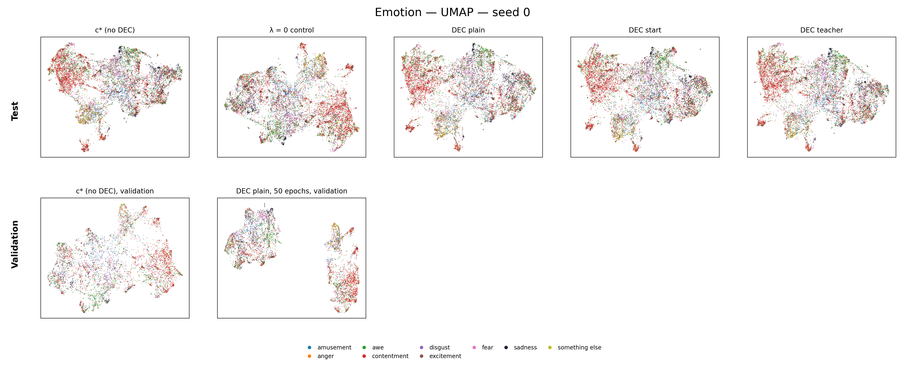
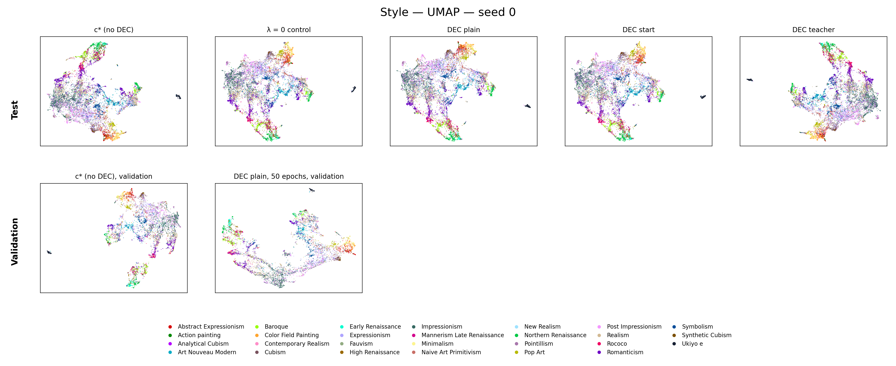
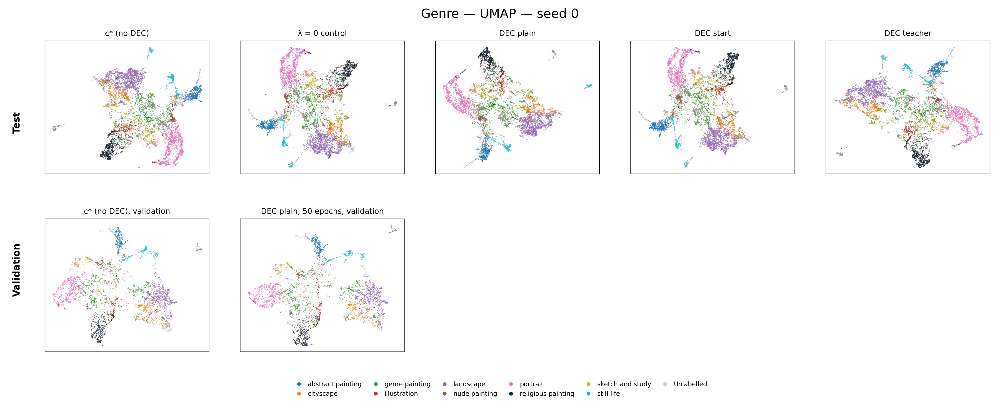
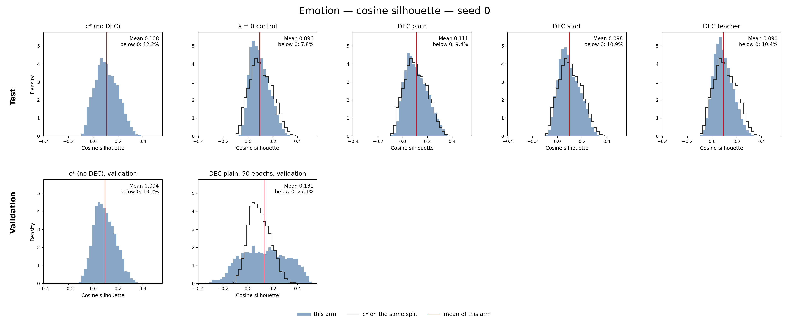
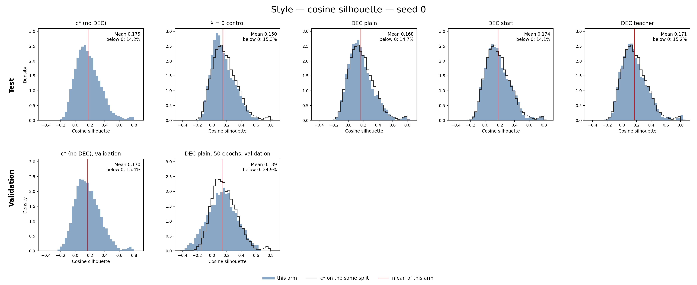
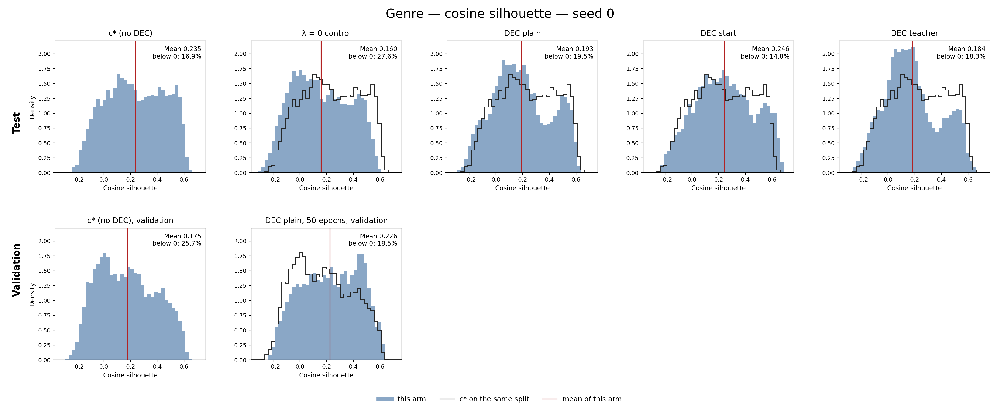

# DEC on the heads of c*: small style gains, with no clear emotion change

> 2027-01-17 (sequence date) · Run: 2026-11-11 to 2026-11-13 · Spec: [r21 design](../../../superpowers/specs/2026-11-11-r21-dec-heads-design.md) · Decision rule: none (descriptive) · [Run log](../../../../src/test/20261111_r21_dec_heads/20261111_r21_dec_heads_log.md)

## Results brief

**What we tried.** We added PercepT’s deep embedded clustering (DEC) loss to each aspect head of c*: plain, start pull, teacher pull (a pull toward the clusters of the instructed Qwen3 image). Validation picked settings; five seeds compared each form with saved c* on test. The λ = 0 control separates DEC from the later kept epoch with the same recipe and zero DEC weight.

**The level reached.** All cells reported; no claim ladder. AMI: adjusted mutual information; mAP: mean average precision. AMI below uses class counts.

| Form | Emotion AMI / mAP | Style AMI / mAP | Genre AMI / mAP |
|---|---|---|---|
| Plain | no clear change / no clear change | raises / raises | no clear change / raises |
| Start pull | no clear change / no clear change | raises / raises | no clear change / raises |
| Teacher pull | no clear change / no clear change | raises / raises | raises / raises |
| λ = 0 control | no clear change / lowers | no clear change / no clear change | no clear change / no clear change |

**What it does not show.** DEC acts at λ = 10; λ = 1 is weak. Balance dominates when on; the long stop rule adds training. Byte-identical DEC-off measures no seed noise. About 13 settings used validation seed 0; the plain pick was close. Plain DEC without the balance term empties some of its own training clusters by the last DEC epoch; the scored k-means clusters do not collapse (largest validation share 0.18 at most).

Internal test scores partly measure DEC’s loss, using each arm’s partition; PercepT scores all ArtELingo. Most emotion states keep the first DEC epoch. Long validation uses one seed without intervals. Sidecar shares describe the last epoch, not the kept state.

**Options for next.**

- **a. Add DEC arm minus λ = 0**, paired by seed with the same bootstrap and an interval. Cost: small code change, about 1 h CPU. This supplies the missing interval between rows. Open since 2026-11-13 02:10; the user has not decided.
- **b. Close the DEC line:** keep DEC out of the main recipe; record the small style gain as an ablation row. Cost: report work; documents the tested addition.
- **c. Search for DEC that keeps AMI while clusters tighten:** change λ, stop rule, or balance. Cost: new GPU runs, stage 1 again; tests whether another setting avoids AMI loss.

**Your reading.** Left for the user.

Our reading and recommendation (open after writing yours)

**Our reading.** The control stays at c*’s level on all AMI and style/genre mAP; emotion mAP falls slightly and clusters loosen. We attribute style AMI/mAP and genre mAP gains to DEC rather than the later epoch. Style AMI gains are small beside c* at 0.4109: plain +0.0077, start +0.0062, teacher +0.0078.

Style is fairly sure: all forms’ intervals exceed zero; the control covers zero. Style AMI intervals overlap the control at the edges for start/teacher, not plain; mAP intervals do not overlap. Option a supplies the missing paired contrast interval. Genre AMI is weaker: only teacher raises it. Long DEC tightens much more by CHI but lowers all AMI; style silhouette falls. That check uses one validation seed without intervals.

**Choices that could change a verdict.** One λ = 0 arm (2026-11-12 20:33) is “maybe”. We expect no change: only centres/pull targets differ, acting through the zeroed term without torch random draws. Not run per form; not recomputed.

Build choices marked “maybe” (eval-pass targets, balance form/weight, centre optimizer, off-sphere centres, tie band, gate edges) could change DEC’s effect size. Training alternatives need new runs; saved scores cannot recompute them. Numerical edges are checked below.

**Our recommendation.** Our view is b. Add a only if the paper will cite the size of the DEC effect.

## What ran

c* stays the model: one shared trunk with emotion, style and genre heads on frozen Qwen3-VL-Embedding-2B image features, trained with an alignment term that pulls each head toward the instructed Qwen3 image of its aspect (the teacher).

- **Stages/types:** regression, validation sweep, test ablation; matched zero-weight control.
- **Data and seeds:** ArtELingo, Qwen3-VL-Embedding-2B; validation seed 0 chose settings. Test: 12,281 paintings (9,949 genre-labelled), seeds 0 to 4; 2,000 AMI and 10,000 mAP bootstrap draws. Intervals are 95%, paired by seed, without correction across cells.
- **Code:** `7704f331`, zero-weight support `7fe3fd3c`; local GPU. Report: saved results only.

Picks: λ = 10, five warm-up epochs, balance off; c* validation-loss stop among DEC epochs only.

## Results

All cells are reported; no claim ladder.

| ID | Measured | Number / source | Comparator | Criterion | Level reached |
|---|---|---|---|---|---|
| SC1 | Validation sweep/picks | [Sheet](/data/SSD2/cosir_r21/20261111_dec_heads/scores/stage1_sheet.md); below | c*, validation seed 0 | every cell reported | reported |
| SC2 | Test AMI, class count | Below | saved c* | every cell reported | reported |
| SC3 | Test mAP | Below | saved c* | every cell reported | reported |
| SC4 | AMI at 20; DEC-off | Below; rerun zero | saved c* | every cell reported | reported |

Stage 1: eight plain plus five form/balance settings; [picks](/data/SSD2/cosir_r21/20261111_dec_heads/scores/stage1_picks.json), no extra tie-break.

| Validation pick | Mean AMI change | Mean mAP |
|---|---:|---:|
| Plain | +0.0020 | 0.3930 |
| Start pull | +0.0059 | 0.3937 |
| Teacher pull | +0.0027 | 0.3958 |
| Plain with balance, close alternative | +0.0035 | 0.3929 |

Arm minus saved c*, change [interval] word. AMI averages k-means states; class counts: emotion 9, style 27, genre 10. Image-to-image label mAP: cosine, query excluded.

| Saved c* level | AMI at class count | AMI at 20 | mAP |
|---|---:|---:|---:|
| Emotion | 0.1024 | 0.1066 | 0.2642 |
| Style | 0.4109 | 0.4066 | 0.3110 |
| Genre | 0.5101 | 0.5001 | 0.5896 |

| Form / aspect | AMI at class count | AMI at 20 | mAP |
|---|---|---|---|
| Plain / Emotion | +0.0012 [-0.0021, +0.0045] no clear change | +0.0007 [-0.0011, +0.0027] no clear change | +0.0002 [-0.0006, +0.0010] no clear change |
| Plain / Style | +0.0077 [+0.0046, +0.0107] raises | +0.0099 [+0.0063, +0.0130] raises | +0.0092 [+0.0068, +0.0117] raises |
| Plain / Genre | +0.0058 [-0.0035, +0.0136] no clear change | -0.0007 [-0.0061, +0.0040] no clear change | +0.0037 [+0.0007, +0.0072] raises |
| Start pull / Emotion | +0.0014 [-0.0024, +0.0061] no clear change | +0.0010 [-0.0009, +0.0031] no clear change | +0.0001 [-0.0006, +0.0009] no clear change |
| Start pull / Style | +0.0062 [+0.0017, +0.0106] raises | +0.0080 [+0.0020, +0.0128] raises | +0.0083 [+0.0051, +0.0115] raises |
| Start pull / Genre | +0.0069 [-0.0063, +0.0204] no clear change | -0.0042 [-0.0080, -0.0006] lowers | +0.0056 [+0.0051, +0.0064] raises |
| Teacher pull / Emotion | -0.0012 [-0.0042, +0.0017] no clear change | +0.0000 [-0.0022, +0.0020] no clear change | -0.0008 [-0.0019, +0.0001] no clear change |
| Teacher pull / Style | +0.0078 [+0.0037, +0.0111] raises | +0.0068 [+0.0024, +0.0110] raises | +0.0072 [+0.0042, +0.0092] raises |
| Teacher pull / Genre | +0.0050 [+0.0020, +0.0086] raises | +0.0017 [-0.0045, +0.0079] no clear change | +0.0048 [+0.0039, +0.0058] raises |
| λ = 0 control / Emotion | -0.0014 [-0.0050, +0.0018] no clear change | -0.0004 [-0.0022, +0.0015] no clear change | -0.0012 [-0.0021, -0.0004] lowers |
| λ = 0 control / Style | +0.0015 [-0.0016, +0.0043] no clear change | +0.0010 [-0.0029, +0.0051] no clear change | +0.0003 [-0.0009, +0.0016] no clear change |
| λ = 0 control / Genre | -0.0022 [-0.0137, +0.0080] no clear change | +0.0002 [-0.0049, +0.0054] no clear change | +0.0002 [-0.0005, +0.0010] no clear change |

DEC-off equals saved c* byte for byte: every cell is +0.0000 [+0.0000, +0.0000], “no clear change”. It measures no seed noise and misses DEC’s shifted dropout stream.

Source files under the run folder: `scores/stage2_table.md` is the complete four-arm record; `stage2_lam0.md` adds the control, old arms unchanged. Both independent re-derivations PASS (`d16/compare.json`, `d16/lam0/compare.json`). The extension’s incomplete flag means non-paper-facing.

## Agent choices checked

The folded brief covers the shared-control choice. [Decision lines](../../../../src/test/20261111_r21_dec_heads/decisions.md).

The “yes” line flags weak DEC; λ = 10 gradients qualify it. Both plain candidates are inside the 0.002 band; mAP picks balance off. Strict/inclusive edges leave pick/gate outcomes unchanged. Batch, stop/shared-trunk timing and centre alternatives need new training; not recomputed.

## Analysis

SI: cosine silhouette; DBI: Davies-Bouldin index; CHI: Calinski-Harabasz index. Higher SI/CHI or lower DBI means tighter. Test scores use unit rows, each arm’s own class-count k-means partition, state 0; DBI/CHI use Euclidean distance. They partly measure DEC’s loss. PercepT scores all ArtELingo (SI 0.97); its space/distance/partition were unstated in the logged paper read. Compare matched splits/dimensions only.

SI / DBI / CHI [levels and changes](/data/SSD2/cosir_r21/20261111_dec_heads/scores/internal_join_lam0.txt):

| Source | Emotion | Style | Genre |
|---|---|---|---|
| Saved c* | 0.1048 / 3.289 / 516 | 0.1736 / 2.301 / 500 | 0.2139 / 2.563 / 880 |
| Plain form | 0.1048 / 3.299 / 527 | 0.1772 / 2.289 / 677 | 0.2222 / 2.515 / 1027 |
| Start pull | 0.0962 / 3.379 / 486 | 0.1777 / 2.344 / 562 | 0.2361 / 2.468 / 1049 |
| Teacher pull | 0.0996 / 3.405 / 482 | 0.1686 / 2.421 / 506 | 0.2128 / 2.596 / 1001 |
| λ = 0 control | 0.0959 / 3.426 / 469 | 0.1537 / 2.499 / 396 | 0.1876 / 2.616 / 850 |

Parentheses count seeds tighter; AMI intervals/words are above. CHI levels: integers; changes: one decimal.

| Aspect / form | ΔSI (tighter) | ΔDBI (tighter) | ΔCHI (tighter) | ΔAMI |
|---|---:|---:|---:|---:|
| Emotion / Plain | +0.0000 (2/5) | +0.0094 (3/5) | +11.7 (3/5) | +0.0012 |
| Emotion / Start pull | -0.0086 (1/5) | +0.0899 (1/5) | -30.0 (1/5) | +0.0014 |
| Emotion / Teacher pull | -0.0053 (2/5) | +0.1159 (0/5) | -33.4 (1/5) | -0.0012 |
| Emotion / λ = 0 control | -0.0089 (1/5) | +0.1365 (1/5) | -46.9 (1/5) | -0.0014 |
| Style / Plain | +0.0035 (2/5) | -0.0113 (2/5) | +176.6 (4/5) | +0.0077 |
| Style / Start pull | +0.0041 (2/5) | +0.0431 (2/5) | +61.1 (3/5) | +0.0062 |
| Style / Teacher pull | -0.0050 (1/5) | +0.1204 (1/5) | +5.2 (2/5) | +0.0078 |
| Style / λ = 0 control | -0.0200 (0/5) | +0.1987 (0/5) | -104.0 (0/5) | +0.0015 |
| Genre / Plain | +0.0083 (3/5) | -0.0477 (3/5) | +146.9 (5/5) | +0.0058 |
| Genre / Start pull | +0.0221 (4/5) | -0.0942 (4/5) | +168.5 (5/5) | +0.0069 |
| Genre / Teacher pull | -0.0012 (2/5) | +0.0334 (3/5) | +120.5 (5/5) | +0.0050 |
| Genre / λ = 0 control | -0.0263 (1/5) | +0.0532 (2/5) | -30.3 (1/5) | -0.0022 |

| Aspect | Spearman ΔSI with ΔAMI | ΔDBI with ΔAMI | ΔCHI with ΔAMI |
|---|---:|---:|---:|
| Emotion | +0.52 | -0.56 | +0.39 |
| Style | +0.28 | -0.60 | +0.68 |
| Genre | +0.34 | -0.58 | +0.31 |

Correlations exclude the control: three forms’ arm-seed pairs; no test made.

**Our reading.** Genre CHI rises in every seed; only teacher raises AMI. Teacher raises style AMI while SI/DBI loosen; the control loosens throughout.

[Validation](/data/SSD2/cosir_r21/20261111_dec_heads/scores/val_internal.txt), one seed, no interval: c* → plain DEC, λ = 10, warm-up five epochs.

| Aspect | SI | DBI | CHI | AMI | ΔAMI |
|---|---|---|---|---|---:|
| Emotion | 0.0937 → 0.1310 | 3.336 → 2.973 | 261 → 1384 | 0.1010 → 0.0935 | -0.0074 |
| Style | 0.1695 → 0.1386 | 2.272 → 2.317 | 278 → 640 | 0.4206 → 0.4022 | -0.0183 |
| Genre | 0.1754 → 0.2263 | 2.598 → 2.544 | 438 → 617 | 0.5298 → 0.5141 | -0.0157 |

**Our reading.** Long DEC raises CHI but lowers all AMI; style SI/DBI loosen. Shorter warm-up agrees. Most emotion runs keep the first DEC epoch (6), which helps explain small test changes.

Gradient and collapse checks below use emotion / style / genre.

| Diagnostic | Values | Meaning |
|---|---|---|
| DEC gradient / c* gradient, λ = 1 | 0.017 / 0.075 / 0.023 | small |
| Same, λ = 10 | 0.17 / 0.75 / 0.23 | acts at the selected weight |
| Balance gradient / c* gradient, λ = 1 | 6.3 / 45 / 27 | dominates when on |
| Long plain DEC's largest training cluster shares | 0.53 / 0.25 / 0.38 | smallest shares all 0.00 |

Plain balance-off arms have empty DEC clusters; pulls/balance prevent this. Shares describe the last training epoch, not the kept partition. Long DEC keeps epoch 55 after 50 DEC epochs, c* losses active; c* keeps 4 / 1 / 18 after 19 / 16 / 33 epochs run. This mixes DEC with longer training; the control matches only the short rule.

Figures: seed 0 test arms, plus c*/long DEC on validation. Uniform Manifold Approximation and Projection (UMAP) fits panels separately: true-label colours, unlabelled grey; no shared axes. Histograms show per-painting cosine silhouette; black outlines show c* on that split.

Emotion UMAP: mixed labels on test in every arm; long DEC on validation splits the paintings into two separated groups, labels still mixed inside them.

Style UMAP: label-coloured regions surround mixed central areas.

Genre UMAP: label regions across arms; unlabelled paintings are grey.

Emotion silhouette: overlapping test distributions; long DEC broadens validation in both directions.

Style silhouette: control shifts left on test; long DEC shifts validation left.

Genre silhouette: control loses much of c*’s high-silhouette group; long DEC shifts validation right.

## Deviations

Post-spec additions are diagnostics; they decide nothing.

- **Internal scores:** user, 2026-11-12 19:44: test only; corrected “CBI” to DBI. Agent kept unit rows/existing partition.
- **Matched control:** user requested code at 2026-11-12 20:29; authorized runs at 2026-11-13 01:59. Parser now accepts finite non-negative λ. Agent chose one control for all forms (“maybe”) to diagnose epoch/dropout effects.
- **Validation check and figures:** user approved both at 2026-11-12 20:45. Agent chose separate UMAP fits and the diagnostic partition: exploratory, no new rule.
- **Bugs/take-backs:** fixed gradient-leak gate coverage, pairing/provenance guards and last-epoch-share notes. Worktree import clashes passed on main. Figures needed tail-range/colour fixes. Larger λ was withdrawn. Exact DEC-off cannot estimate noise; the later-state confound prompted the control.
- **Timing/device:** user, 2026-11-11: run in daytime, keep local after device-shift discussion.

## Claim review

Controller (Claude), 2026-11-13 04:11, against the score files, not this report's text.

- **Brief words:** all 24 words of the brief table (3 forms and the control × 3 aspects × AMI, mAP) equal `scores/stage2_lam0.json`.
- **Style AMI:** c* 0.4109; changes +0.0077, +0.0062, +0.0078 and the control's +0.0015 equal the seed mean of arm minus c* recomputed from the per-seed AMI in the same file (|diff| < 1e-6). The four old arms in `stage2_lam0.json` equal `stage2_table.json` (max |diff| 0).
- **Overlap:** the plain form's style AMI interval (low end +0.0046) clears the control's (high end +0.0043); start and teacher overlap it. No style mAP interval overlaps the control's.
- **Stage 1 picks and gradients:** the four validation rows equal `stage1_sheet.md`; the gradient ratios equal the 2026-11-11 run handoff, section 0. Both re-derivations read PASS.
- **Edges ("maybe" lines):** no interval end touches zero (the closest, teacher emotion mAP high end, is +0.0001), so the strict word rule changes no word. The plain tie (+0.0035 against +0.0020) sits 0.0015 inside the 0.002 band, away from its edge. Gate 0c compared DEC-off, which equals c* byte for byte, so its edges cannot bind. The one-control choice (2026-11-12 20:33) and the training-side "maybe" lines are handled in the folded block.
- **Fixed in the draft:** "Plain DEC clusters collapse" was too strong for the scored state (the empty clusters are DEC's own training assignments at the last DEC epoch); the emotion UMAP caption now says what the panel shows; the teacher pull is described at first use.

## Files and storage

- **Outputs:** [run folder](/data/SSD2/cosir_r21/20261111_dec_heads/): **12G** (`du -sh` now), including the control (earlier: 9.9 GB). Scores: `scores/`; figures: `figures/`; six PNG copies here.
- **Storage: decided at the wrap-up.** Deleted nothing. Would remove merged r21 build/zero-weight worktrees, branches and temporary build/review scratch outputs listed in the handoffs. Keep run outputs pending that decision.
