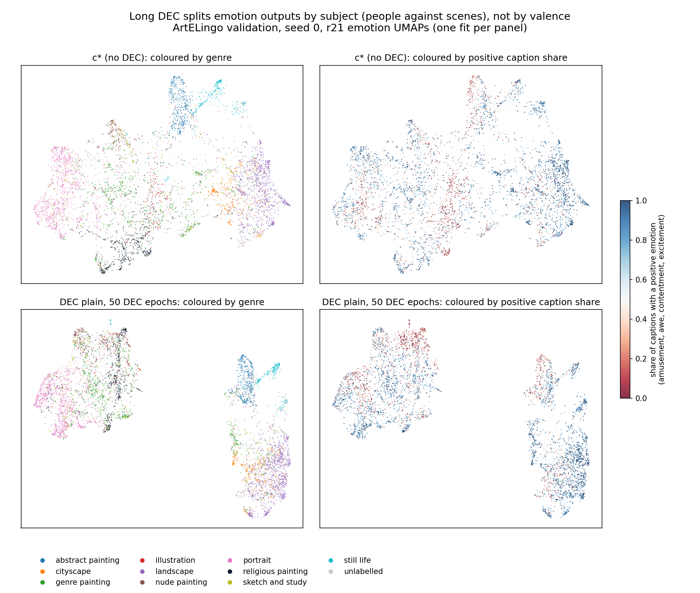
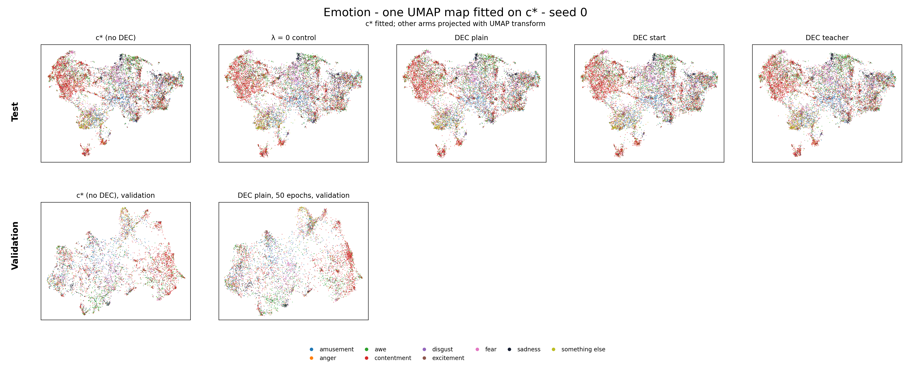

# Long DEC's two emotion groups split paintings mainly by subject; valence follows only in part

> 2027-01-20 (sequence date) · Run: 2026-11-14 02:47 to 02:52 · Spec: none (design in chat, the run log's "Design") · Decision rule: none (descriptive) · [Run log](../../../../src/test/20261113_r30_dec_followup/20261113_r30_dec_followup_log.md)

## Results brief

**What we tried.** [r21](2027-01-17_dec_heads.md) (run 2026-11-11 to 2026-11-13) added DEC (deep embedded clustering, PercepT's clustering loss) to c*'s heads.
Its long run on validation (long DEC: 50 DEC epochs) showed two big emotion groups.
The user asked: are they positive against negative emotions?
We split each arm's emotion head into two groups with k-means (the k = 2 groups) and compared them with a valence label from the captions.
We also fitted one UMAP map on c* per aspect and projected each arm into it.

**The level reached.** Descriptive, no claim ladder. The guess does not hold as stated: the two groups split by subject.
One group holds paintings of people, the other landscapes, abstracts, cities and objects.

- Valence AMI (adjusted mutual information) of long DEC's k = 2 groups: 0.0459, against 0.0402 for c*'s.
- Genre AMI of the same groups: 0.3255, against 0.3136 for c*'s.
- Both groups are mostly positive: mean positive caption share 0.563 (people) and 0.700 (the other group).
- The two islands of long DEC's emotion map (r21's own UMAP) are the k = 2 groups: AMI 0.8785.
- On the shared map, the four test arms land almost where c* is.

**What it does not show.** One seed (0), no intervals. Long DEC exists only on validation.
The test arms are r21's picked settings with the normal stop rule.
UMAP transform placement can make a large change look smaller, so the islands check uses the 2,048-dimensional head space.
c*'s map has no island gap.

**Options for next.**

a. Nothing more: the DEC line stays closed. Cost: none.

b. One sentence in the paper's ablation text: long DEC splits the emotion head by subject, which explains why DEC does not help emotion.
Cost: a sentence. It tells the reader why.

c. k = 2 on the instructed Qwen3 emotion image and on plain Qwen3 (the instructed embedding: Qwen3's image embedding under the emotion instruction).
Cost: saved features, a few CPU minutes. It tells whether the subject axis comes from the instructed embedding.

**Your reading.** Left for the user.

Our reading and recommendation (open after writing yours)

**Our reading.** The main axis is subject: paintings of people against landscapes, abstracts, cities and objects.
It already exists in c*. Long DEC pulls the two halves apart into islands.
Valence follows the split only in part: paintings of people carry more negative captions.
This fits r21: long DEC lowers emotion AMI because it sharpens a subject axis.

**Choices that could change a verdict.** The summary AMIs average three k-means states.
Under state 0 alone, valence AMI is 0.0430 (c*) against 0.0459 (long DEC), genre AMI 0.3010 against 0.3255: the reading holds (recomputed).
k-means on raw rows and ties counted in the valence AMI are not checked; we expect neither to bring valence AMI near genre AMI.

**Our recommendation.** Our view is a, plus b if the paper's ablation text discusses DEC on emotion.

## What ran

c* is CoSiR's aspect adapter: a shared trunk with emotion, style and genre heads on frozen Qwen3 image features.
Long DEC is plain DEC, λ = 10, 50 DEC epochs, validation, seed 0 (`dec-plain_l10_w5_S1`).

1. Shared UMAP map: fit on c* per aspect and split, every other arm placed with UMAP transform.
2. Valence check: k-means with k = 2 on unit rows of the emotion head, three k-means states.
3. Islands add-on (agent exploration): compare the islands of r21's long-DEC emotion map with the k = 2 groups.

- **Data and seeds:** ArtELingo validation: 6,152 paintings for c* and long DEC, 4,960 genre-labelled.
  Test: 12,281 paintings, 9,949 genre-labelled, for c*, the λ = 0 control and three DEC forms. Model seed 0 throughout.
- **Code:** the [round folder](../../../../src/test/20261113_r30_dec_followup/)'s scripts on saved r21 outputs, local CPU through the queue.
  The islands add-on ran locally outside the queue (about 1 minute).

Positive caption share: the share of a painting's captions with amusement, awe, contentment or excitement.
Negative caption share: anger, disgust, fear or sadness. Other: "something else".
The valence label is the largest of the three shares. A tie of the top two is left out of the valence AMI.

## Results

Genre agreement is far above valence agreement in every arm.
Sources: [valence.json](/data/SSD2/cosir_r21/20261111_dec_heads/r30_followup/valence.json) and [islands.json](/data/SSD2/cosir_r21/20261111_dec_heads/r30_followup/islands.json).
AMIs average k-means states 0 to 2; the share gap and the group table use state 0.
Valence ties leave 5,497 validation paintings and 10,916 test paintings for the valence AMI.

| Split / arm | Valence AMI | Emotion AMI (9 classes) | Style AMI (27) | Genre AMI (10) | Positive share gap |
|---|---:|---:|---:|---:|---:|
| Validation c* | 0.0402 | 0.0392 | 0.0622 | 0.3136 | 0.152 |
| Validation long DEC | 0.0459 | 0.0377 | 0.0751 | 0.3255 | 0.137 |
| Test c* | 0.0389 | 0.0423 | 0.0592 | 0.3079 | 0.146 |
| Test, four arms (range) | 0.0388 to 0.0399 | 0.0403 to 0.0416 | 0.0552 to 0.0605 | 0.3047 to 0.3112 | 0.140 to 0.150 |

The two validation groups, state 0. Genre shares use the genre-labelled paintings; caption shares average over all members.

| Group | Long DEC size | Long DEC top genres | Positive / negative | c* size | c* top genres | Positive / negative |
|---|---:|---|---|---:|---|---|
| People | 3,362 | portrait 0.39, genre painting 0.22, religious painting 0.19 | 0.563 / 0.330 | 3,658 | portrait 0.36, genre painting 0.21, religious painting 0.17 | 0.564 / 0.323 |
| Other subjects | 2,790 | landscape 0.43, abstract 0.17, cityscape 0.15, still life 0.09 | 0.700 / 0.182 | 2,494 | landscape 0.47, cityscape 0.17, abstract 0.14, genre painting 0.08 | 0.716 / 0.176 |

**Level reached:** descriptive, no level.

## Agent choices checked

The choice of k-means state does not change the reading. No decisions.md exists; the run log's Build section lists four choices.

| Validation arm | Valence AMI, state 0 | Genre AMI, state 0 |
|---|---:|---:|
| c* | 0.0430 | 0.3010 |
| Long DEC | 0.0459 | 0.3255 |

- Mean over states against state 0: recomputed above from the per-state values in valence.json. Long DEC's valence AMI stays near c*'s and far below the genre AMI.
- UMAP on r21's loaded rows: it cannot change an AMI, which uses the head space.
- k-means on unit rows: as r21's scoring. Raw rows are not checked.
- Ties within 1e-12 left out of the valence AMI (655 of 6,152 validation paintings): another tie rule is not checked.

## Analysis

**Our reading:** subject explains the split better than valence.
Long DEC's people group is portraits, genre paintings and religious paintings; the other group is landscapes, abstracts, cityscapes and still lifes.
Both groups have more positive than negative captions. c*'s k = 2 groups have the same make-up (table above).

The islands match the k = 2 groups at AMI 0.8785, with sizes 3,363 / 2,789 against 3,362 / 2,790.
Their closest sampled points are 5.7 UMAP units apart in long DEC's map; the code samples distances, so this is no exact minimum.
c*'s map has no gap. Its k = 2 groups and a two-way k-means of its map agree at AMI 0.5717.

*r21's own map fits (one per panel): long DEC pulls apart subject groups that already exist in c*; positive caption shares mix in both.*

*Shared emotion map: the test arms land almost where c* is; transform placement can hide changes.*

## Deviations

The islands check and its figure are agent exploration, outside the design shown to the user.
At build, valence ties got a 1e-12 tolerance (equal caption counts can differ in the last bit). Otherwise none.

## Claim review

Claude, 2026-11-14 03:05, after the Codex draft. Numbers of the results brief recomputed from the result files:

| Brief value | Recomputed | File |
|---|---|---|
| Valence AMI, long DEC / c*, validation: 0.0459 / 0.0402 | 0.04588 / 0.04016 | `valence.json`, `splits.val.arms.*.ami.valence.mean` |
| Genre AMI, long DEC / c*, validation: 0.3255 / 0.3136 | 0.32550 / 0.31362 | `valence.json`, `...ami.genre.mean` |
| Mean positive caption share, people / other group: 0.563 / 0.700 | 0.5633 / 0.7002 | `islands.json`, `dec-plain_l10_w5_S1.groups.kmeans[*].mean_pos` |
| Islands against k = 2 groups: AMI 0.8785 | 0.87851 | `islands.json`, `kmeans_vs_islands_ami` |
| Test, four arms: valence AMI 0.0388 to 0.0399 | 0.0388, 0.0394, 0.0399, 0.0389 | `valence.json`, `splits.held.arms.*` |

All match at the precision shown. The state-0 values in the folded block (0.0430, 0.0459, 0.3010, 0.3255) match the `states[0]` entries.
No decisions.md exists for this small loop; the four build choices of the run log are checked above, and the one recomputed is in the folded block.

## Files and storage

- **Outputs:** [r30_followup/](/data/SSD2/cosir_r21/20261111_dec_heads/r30_followup/) (12 MB, kept: this report cites it).
  Figures: `docs/reports/assets/2027-01-20_dec_emotion_split/` (`islands_emotion.png`, `shared_umap_emotion.png`, `shared_umap_style.png`, `shared_umap_genre.png`, `r21_umap_emotion.png`).
- **Storage:** nothing of 1 GB or more, so no disk ledger rows. The build smoke (1.9 MB, in the r30 decide chat's scratchpad) and three `/tmp/r30_*.log` smoke logs go to the storage summary.
