# Stage report, 2 to 12 October 2026: one-sided affect steering passes its held test on ArtELingo; its margin over the strongest condition-free score is not established, and style × genre stays a loss

> Written 12 October 2026 (Amsterdam). CoSiR v2, main branch. Covers the aspect-episode task from its start on
> 2 October to round 7 on 12 October, with the background needed to read it alone. Previous stage report:
> [2 to 4 October](2026-10-04_aspect_conditioned_similarity_methods.md); last weekly report:
> [1 to 7 October](../weekly/2026-10-07_aspect_task_to_affect_steering.md), which this report updates and extends.
> Every number comes from the report linked in its section. Lines marked **Our reading** are our interpretation; they
> decide nothing. A page with the same claims, for a first read: [HTML page](2026-10-12_affect_steering_line.html).
> File names of the auto reports carry sequence numbers, not dates: they run ahead of the calendar (for example
> `2026-11-25_artelingo_held_test.md` was written on 10 October 2026).

## Summary

- **The task.** A system must rank images or captions by how alike they are to a query *in one respect*, and the
  respect is shown only by four example pairs, never named. We built this task, its benchmark on ArtELingo paintings
  and a protocol that separates reading the respect from finding generally related candidates (§2).
- **The method.** One-sided affect steering (AFF) adds a label-free affect term to a strong score that ignores the
  respect, and only when a learned reader is confident that the examples share the affect grouping (§4).
- **The result.** On 36,864 episodes from paintings never used to build it, AFF reached 19.44 R@1 against 18.84 for
  B′(A0), the strongest condition-free score among the seven pre-registered checks: +0.60 [+0.46, +0.73] R@1 points.
  This interval resamples anchor paintings; resampling the target paintings too widens it to [+0.40, +0.79]. The
  stronger B′(A1) (19.30) was a secondary check. All seven pre-registered checks passed with a Holm correction (§3.1).
- **The external baselines are far behind.** CLIP cosine scored 13.25, a fine-tuned CLIP at most 15.80 and an
  in-context Qwen3-VL-8B 14.50; neither the in-context model nor a describe-then-score pipeline chose the shown respect
  reliably (§3.1, §5).
- **The limits.** The gain sits on the two pairs that involve emotion; AFF is below B′(A0) on style × genre (−0.43 on held
  paintings), and also below its matched control and B′(A1) there. Its margin over the strongest condition-free score (+0.14) and over its own parent without the affect
  restriction (+0.02) are not established (§3, §7).
- **After the held test.** We made three attempts to improve AFF (vetoes on its gate, a better caption placement,
  style groupings without content). None both passed its development bar and beat AFF, so AFF stays the current best
  (§6).

**Where to find the important parts.** The main comparison table is in §3.1; the method in one figure is §4.1; the MLLM
experiments are §5; the limits are §7.

## 1. Background

### 1.1 The problem: similarity in one respect, between images and captions

Image and text models such as CLIP reduce the match between an image and a caption to one fixed number. That number
cannot say that two things are alike *in one respect* and unlike in another, the way two paintings can share a mood
but not a style. Work on *conditional similarity* lets the respect vary:

- early methods learn one mask or subspace per respect from labelled examples (conditional similarity networks);
- later ones infer the respects from labelled triplets without condition labels, on images only (SCE-Net,
  DiscoverNet);
- recent ones take the respect as a text phrase, with a fine-tuned CLIP (GeneCIS, a benchmark and baseline for text-conditioned image similarity) or on a frozen vision and language
  encoder (CLAY, CRL).

All of them need a name for the respect or supervision tied to it, and nearly all compare images with images.

CoSiR asks for a similarity between an image and a caption that depends on a condition: are these two alike *in this
respect*? The use cases are users who hold examples of a relation but cannot or will not name it: a designer whose mood
board pairs images with captions that "go together", or a curator who wants more captions written the way a set of
examples is written.

### 1.2 Our approach: show the respect by examples

The condition is given by four example image and caption pairs that agree in the wanted respect, plus four contrast
pairs that agree in a different one (Figure 1). Three rules make this a test of reading the respect rather than
copying it:

- the respect is never named;
- the examples never show the query's own value: if the query is sad, the examples show other feelings, so the system
  must work out *which respect* the examples share and apply it to the query;
- each example pair joins an image of one painting with a caption of another, so the pairs carry the respect, not an
  identity.

The system must not use the human labels it is evaluated on. It may use any label-free signal in the data and any
external model, which we state.

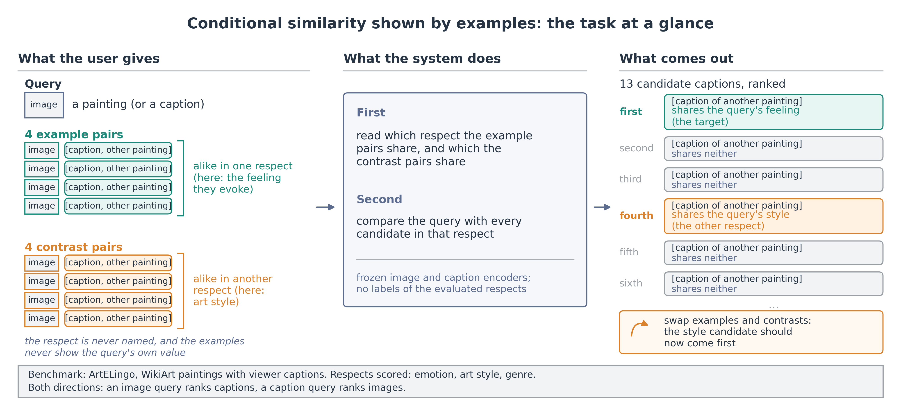

*Figure 1. The task in one picture. Swapping examples and contrasts should swap which candidate comes first.*

**Terms.** We call a respect an **aspect** (emotion, style, genre) and its setting a **value** (a particular emotion,
style or genre).

**Novelty, to our knowledge.** Literature checks on 2 and 9 October found no paper that fixes the aspect of a
cross-modal similarity only by value-disjoint, cross-item image and caption examples with contrast pairs on another
aspect. Each neighbour has one of these properties: per-query weights from a few examples, on images only (Contextual
Visual Similarity); metrics learned from pairs (Xing, RCA, KISSME); a relation shown by one example pair (MARS); an
aspect named in text (GeneCIS, CLAY, CRL, TPIPS, SteerViT); examples for text only (RICE, BGE-EN-ICL). We do not claim
as new the inference of a notion of similarity from examples, test-time reweighting, label-free condition discovery or
distant emotion supervision (EmotionCLIP). AFF's parts all have prior art; their combination, to our knowledge, does
not.

> Sources: [CVPR literature review](../literature/2026-10-21_cvpr_literature_review.md),
> [novelty check](../literature/2026-10-24_aspect_task_novelty_check.md),
> [held-claim literature check](../literature/2026-11-25_held_claim_check.md).

### 1.3 Where this line of work began

The present task is the third form of the CoSiR question (Figure 2).

1. From June to September, earlier CoSiR lines (conditional "buddies", topic prototypes) learned conditioned scores
   with their own pipelines. They are archived and not used here.
2. On 28 September we rebuilt CoSiR (v2) on frozen CLIP ViT-B/32 features: a conditioned score is a cheap function of
   fixed image and caption features and a few example pairs.
3. Until 2 October the examples showed one *value* ("sad, like these"). On 2 October a check with simple baselines
   showed that such examples give the answer away: a prototype of the examples that never looked at the query scored
   22.83 R@1, above our best trained model's 21.22. We then reframed the task: the examples show an *aspect* through
   values the query does not have (§2). Everything in this report uses that task.

The methods that failed on the reframed task (metrics learned from the example pairs, trained shared factors, and
in-context MLLMs) are listed in Appendix A; their condition-free parts survive inside the comparator B (§2.4), and the
MLLMs are reported in §5.

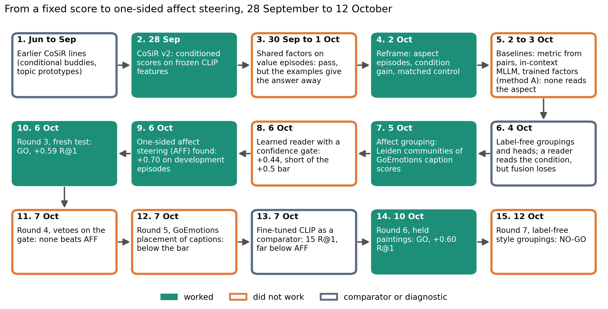

*Figure 2. From a fixed score to one-sided affect steering, in date order. Filled: worked; outlined orange: did not
work; outlined slate: comparator or diagnostic.*

> Sources: [support-set baseline spike](../auto/v2/2026-10-22_support_baseline_spike.md), weekly report
> [§1](../weekly/2026-10-07_aspect_task_to_affect_steering.md#1-the-factor-line-what-the-last-results-showed-and-why-it-stopped).

## 2. The setting

### 2.1 The task: an aspect episode

An **aspect episode** is one ranking problem (Figure 3):

- a **query**: one painting's image (ranking captions) or one viewer's caption (ranking images);
- **4 support pairs**: each an image of one painting with a caption of another, the two agreeing on a value of aspect
  A; the four pairs show four different values, none of them the query's;
- **4 contrast pairs**, built the same way for a second aspect B;
- **13 candidates** in the other modality: p_A shares the query's value of A, p_B its value of B, and 11 negatives share
  neither.

The aspect is never named. Swapping supports and contrasts makes p_B the target; we call the two settings **condition
a** and **condition b**. Each episode is scored four times: two conditions and two directions (image query, caption
query).

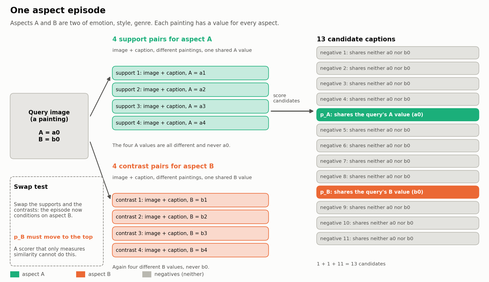

*Figure 3. One aspect episode. Teal: support pairs (aspect A); orange: contrast pairs (aspect B); grey: negatives.*

Figure 4 shows a real episode from the development paintings.

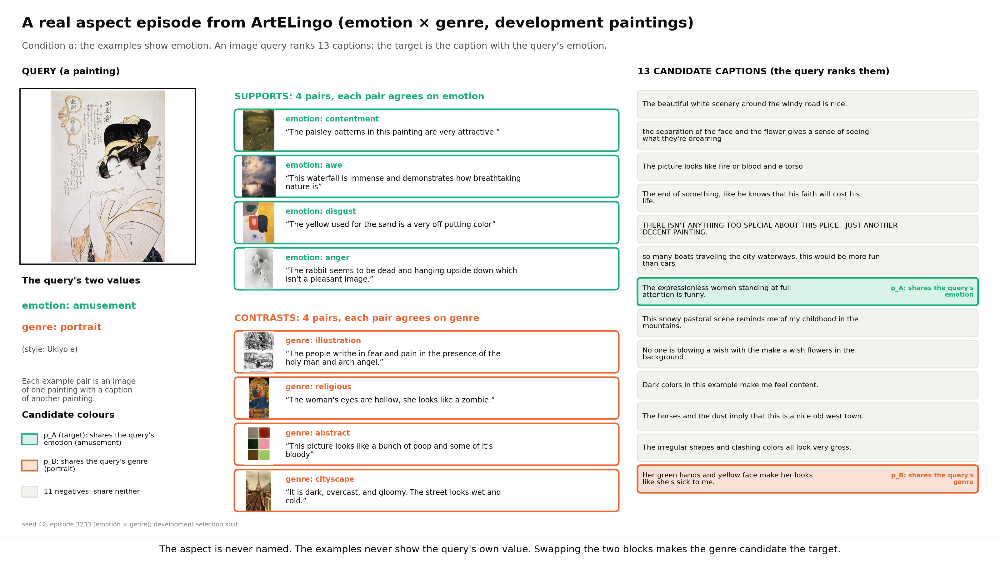

*Figure 4. A real emotion × genre episode, condition a: the support pairs share an emotion, the contrast pairs a
genre, and neither block shows the query's own values.*

### 2.2 Data

The benchmark is **ArtELingo** (English part): WikiArt paintings with captions written by viewers, 308,723 image and
caption rows over 61,402 paintings. Each caption carries the emotion its writer felt (8 values); each painting has an
art style (23 values) and, for about 81% of paintings, a genre (10 values). This gives three **aspect pairs**: emotion
× style, emotion × genre and style × genre. Emotion is labelled per viewer, style and genre per painting.

The paintings are split once:

| Split | Paintings | Used for |
|---|---|---|
| training | 36,518 | fitting every learned part; no evaluation label is used |
| development | 6,451 | development episodes (seed 42) and fresh test episodes (seeds 43 to 51) |
| held | 12,281 | the paper's final test, read once (seeds 52 to 54) |

A validation split, not used here, holds the remaining paintings.

One **episode seed** draws 12,288 episodes (4,096 per aspect pair). **Development episodes** (seed 42) are reused to
choose methods. **Fresh episodes** are new draws from the development paintings, each used for one test. **Held
episodes** come from the held paintings, which nothing in AFF was fitted, chosen or tuned on.

### 2.3 How a result is measured

Each ranking gives:

| Measure | Meaning |
|---|---|
| R@1 | the target ranks first, in percent (chance 7.7%); differences in R@1 points |
| other-aspect rate | the other aspect's candidate ranks first |
| **condition gain** | R@1 minus the other-aspect rate; exactly 0 for any scorer that ignores the condition |
| **either rate** | R@1 plus the other-aspect rate: a candidate that shares *some* aspect ranks first |
| swap success | p_A is above p_B under condition a *and* p_B is above p_A under condition b |

From the first four, **R@1 = (either rate + condition gain) / 2**. A scorer can raise R@1 in two ways: find
aspect-sharing candidates more often, or choose the shown aspect more often. A scorer that reads the condition gains
only if its condition gain grows more than it loses in either rate. This identity explains most results below.

Intervals are 95% bootstrap intervals over anchor paintings (5,000 resamples); fitted models are held fixed.

### 2.4 The comparators

We compare each method with external baselines and with the strongest scores we could build that ignore the condition.

| Comparator | What it is | Reads the condition? |
|---|---|---|
| cosine | CLIP ViT-B/32 image and caption cosine | no |
| RCA and eight other pair metrics | metrics fitted on the episode's own example pairs (relevant component analysis, KISSME, Xing's metric, per-query weights, a probe, a cache of the examples), fused with cosine | yes, in principle |
| fine-tuned CLIP | CLIP fine-tuned on ArtELingo image and caption pairs, label-free: linear probe, last block, LoRA | no |
| in-context MLLM | Qwen3-VL-8B given the whole episode in one prompt (§5) | yes |
| describe-then-score (DTS) | Qwen3-VL-8B says in a phrase what the supports share and the contrasts lack; CRL turns the phrase into a text basis on frozen CLIP (§5) | yes |
| **B** | the best condition-free score before AFF: cosine, a factor term centred on the episode's 8 example items, and grouping heads averaged; it uses the examples but ignores which aspect they show | no |
| **B′(A0)** | B rebuilt on AFF's own three groupings | no |
| **B′(A1)** | B′ with a style grouping from the pretrained CSD style encoder added; the strongest condition-free score | no |
| **matched control** | AFF with only the condition removed: its steering term is averaged over the two conditions | no |
| R1 | AFF's parent: the same gated reader, steering whatever grouping it picks | yes |

B′(A1) was not among the seven pre-registered checks of the held read; it was tested as a secondary check (round 6
spec).

Two rules hold for every method. It must beat its **matched control**, the same score with *only* the condition
removed. And it must beat the **condition-free bar**: B and B′ rebuilt on its own groupings. Without these rules a score
that ignores the condition looks strong: B reaches 18.34 R@1 on development episodes against cosine's 12.96.

### 2.5 The protocol

Every test follows a decision rule committed before its episodes are built.

1. **Development bar.** On development episodes, a method needs a margin of at least +0.5 R@1 over the strongest of B,
   B′ rebuilt on the method's groupings and its matched control (for designs that use the CSD grouping, B′(A1)), with a lower bound above 0, to earn a test.
2. **Fresh test.** Three never-used seeds; GO needs seven checks with lower bounds above 0: five R@1 checks (against
   cosine, RCA, B, B′(A0), the matched control) and two condition-gain checks (against the condition-free scores and
   against RCA).
3. **Held read.** The same seven checks on the held paintings with every weight frozen, a Holm correction across them,
   and a budget of one main read and one reserve read.

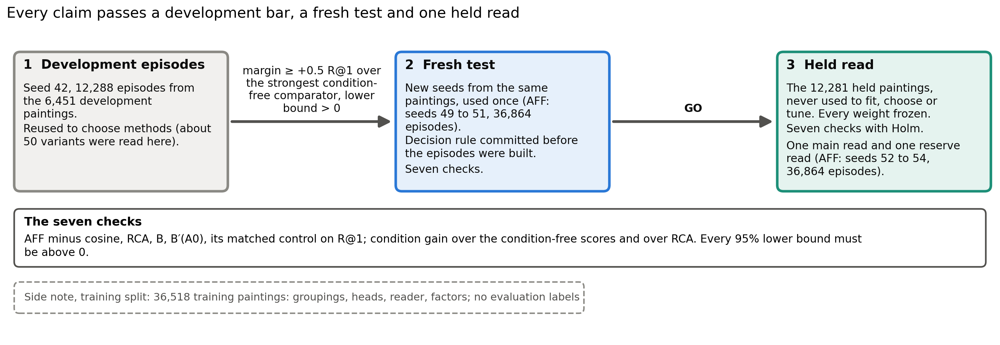

*Figure 5. How a result earns a claim: a development bar, a fresh test and one held read.*

### 2.6 What the data allow

Emotion is carried mainly by the captions and style by the images, so a cross-modal match is limited by the weaker side
(Figure 6). Four frozen backbones barely move the weak side (emotion read from images 35.1 to 36.6%, style read from
captions 25.4 to 26.3%). The task is learnable: label probes told the aspect reached 23.09 R@1 on emotion × style
episodes, against CLIP's 11.13.

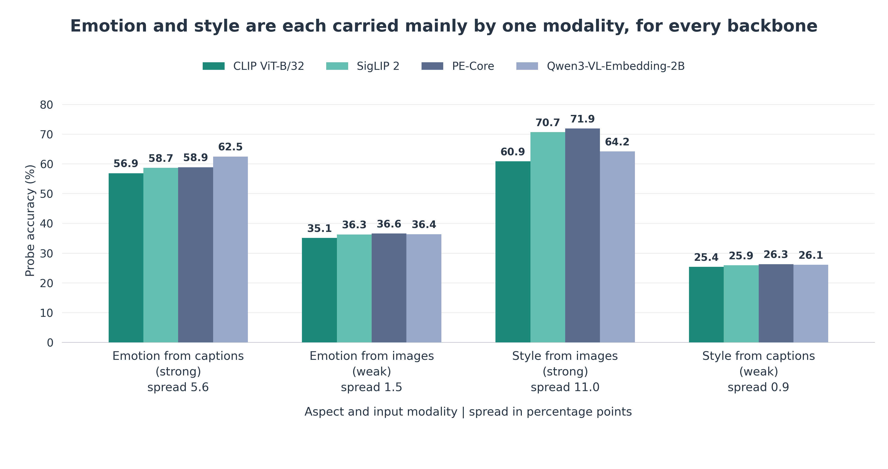

*Figure 6. Probe accuracy for each aspect read from each modality, for four frozen backbones.*

> Sources: [E1 baselines](../auto/v2/2026-10-30_aspect_baselines.md), [backbone check](../auto/v2/2026-10-25_backbone_check.md),
> [aspect-episode spike](../auto/v2/2026-10-23_aspect_episode_spike.md),
> [CVPR plan](../../superpowers/specs/2026-10-02-cosir-v2-cvpr-publication-plan-design.md) §3 and §10.

## 3. Main results

### 3.1 On held paintings, AFF passes its seven pre-registered checks

AFF passed all seven checks of its held read (round 6, 10 October): 36,864 episodes on 9,519 anchor paintings, every
weight frozen on development episodes, Holm across the seven checks. Table 1 adds every other comparator we ran on the
same episodes.

*Table 1. All comparators on the held paintings, pooled over seeds 52 to 54 and the three aspect pairs. R@1 in percent,
condition gain in points. The first block is the pre-registered verdict; the rest is descriptive.*

| Scorer | R@1 | Condition gain | AFF minus it, R@1 |
|---|---|---|---|
| **AFF** | **19.44** | **3.06 [2.87, 3.25]** | |
| *pre-registered checks* | | | |
| cosine (CLIP) | 13.25 | 0 | +6.19 [+5.96, +6.40] |
| RCA | 13.54 | 0.14 | +5.89 [+5.67, +6.11] |
| B | 18.81 | 0 | +0.63 [+0.51, +0.75] |
| B′(A0) | 18.84 | 0 | **+0.60 [+0.46, +0.73]** |
| matched control | 18.80 | 0 | +0.63 [+0.50, +0.76] |
| *secondary checks (after the GO)* | | | |
| B′(A1), the strongest condition-free score | 19.30 | 0 | +0.14 [−0.03, +0.30] |
| R1, AFF without the affect restriction | 19.41 | 2.87 | +0.02 [−0.06, +0.11] |
| *external comparators (reported)* | | | |
| fine-tuned CLIP, linear probe / last block / LoRA | 15.45 / 15.32 / 15.80 | 0 | +3.99 / +4.11 / +3.64 |
| in-context MLLM, Qwen3-VL-8B (seed 52 only, 12,288 episodes) | 14.50 | 0.12 [−0.17, 0.39] | +4.94 [+4.56, +5.33] |
| describe-then-score (DTS) | 13.06 | 0.08 [−0.04, 0.20] | +6.38 [+6.15, +6.59] |
| the eight other pair metrics | 12.99 to 13.21 | −0.04 to 0.19 | +6.23 to +6.44 |

The condition-gain checks also passed: AFF's gain was +3.06 [+2.87, +3.25] above the condition-free scores (whose gain
is 0) and +2.92 [+2.70, +3.14] above RCA's.

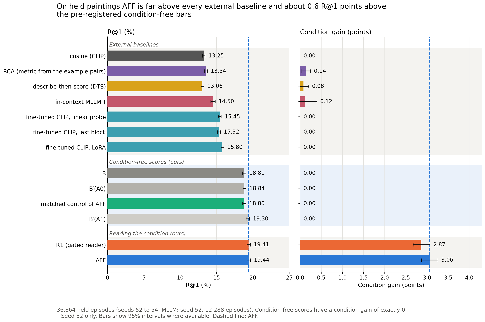

*Figure 7. R@1 and condition gain on the held paintings for every comparator. The pre-registered condition-free bars
sit about 0.6 R@1 points below AFF; B′(A1) and R1 are within noise of it.*

The claim this read licenses, as written before the read: AFF beats cosine, RCA, B, B′(A0) and its matched control on
R@1, and its condition gain exceeds theirs and RCA's, pooled over three aspect pairs, on paintings never used to fit,
select or tune it. No per-pair margin, no other dataset or backbone.

The size is small in R@1 (+0.60, about 3% relative) and large in condition gain (+3.06). The interval above clusters on
anchor paintings only. When the two target paintings are resampled too, it widens by a factor of 1.39 to 1.45, and the
margin over B′(A0) becomes +0.60 [+0.40, +0.79]; every lower bound of the seven checks stays above 0.

**Two things are not established.** A margin over B′(A1), the strongest condition-free score (+0.14 [−0.03, +0.30]);
and that the affect restriction matters on held paintings, since R1 alone also clears all seven checks and AFF minus R1
is +0.02 [−0.06, +0.11].

> Source: [round 6, ArtELingo held test](../auto/v2/2026-11-25_artelingo_held_test.md) (results, analysis).

### 3.2 The fresh test and the held read agree

The held read repeated, on new paintings, the result of the fresh test four days earlier (round 3, 6 October; seeds
49 to 51, 36,864 episodes on 5,195 anchor paintings of the development split). In the fresh test the blend weights were
fitted anew on each seed, as the method defines; in the held read they were frozen.

*Table 2. AFF minus each comparator, R@1 points, fresh episodes and held paintings.*

| AFF minus … | Fresh (round 3) | Held (round 6) |
|---|---|---|
| cosine | +5.84 [+5.61, +6.07] | +6.19 [+5.96, +6.40] |
| RCA | +5.72 [+5.50, +5.95] | +5.89 [+5.67, +6.11] |
| B | +0.81 [+0.69, +0.93] | +0.63 [+0.51, +0.75] |
| B′(A0) | +0.59 [+0.46, +0.73] | +0.60 [+0.46, +0.73] |
| matched control | +0.80 [+0.67, +0.92] | +0.63 [+0.50, +0.76] |
| condition gain over the condition-free scores | +3.32 [+3.13, +3.52] | +3.06 [+2.87, +3.25] |
| R1 (secondary) | +0.20 [+0.09, +0.31] | +0.02 [−0.06, +0.11] |

On the fresh episodes AFF scored 18.88 R@1 against 18.29 for B′(A0), 18.07 for B and 13.04 for cosine. All seven checks
also passed on each fresh seed alone (margins over B′(A0) +0.70, +0.45, +0.62) and on each held seed alone (+0.60,
+0.61, +0.58). The held seeds draw on nearly the same paintings, so their agreement is not an independent replication.

The one change between the two reads is AFF's lead over R1. It was +0.20 on fresh episodes and +0.02 on held paintings.
On fresh episodes it already shrank to +0.09 [+0.01, +0.18] when the development blend weights were reused unchanged
(descriptive), the setting the held read used.

**Our reading.** The pooled margin over the pre-registered bar is stable at about +0.6 R@1 across two reads. The
specific value of the affect restriction is not: what carries AFF is the gated reader with a strong condition-free
score below it, and §3.5 shows why.

> Sources: [round 3 report](../auto/v2/2026-11-21_round3_affect_gate.md) §3 to §6, round 6 report (analysis).

### 3.3 Finding versus choosing: why the comparators fall where they do

By R@1 = (either rate + condition gain) / 2, every scorer sits somewhere on a plane of finding (either rate) and
choosing (condition gain), shown in Figure 8.

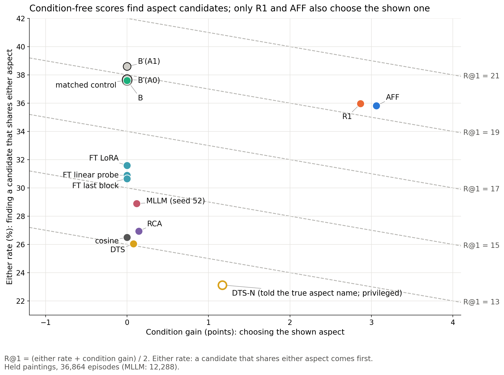

*Figure 8. Either rate against condition gain on the held paintings. Dashed lines are equal R@1.*

- **The condition-free scores** (B, B′, the fine-tuned CLIPs) sit at a gain of exactly 0. Their R@1 comes only from
  finding candidates that share some aspect with the query. In our reading, B finds them far more often than cosine because it uses the
  example items, which a cosine never sees.
- **The in-context MLLM** finds aspect-sharing candidates a little more often than cosine (either rate about 2.4 points
  higher on seed 52); **DTS** finds them about as often as cosine; both stay near 0 on choosing.
- **R1 and AFF** keep most of B's finding and add a condition gain of about 3 points.

A method that reads the condition pays for it in either rate: when it moves the shown aspect's candidate up, it also
moves some aspect-sharing candidates down. On fresh episodes AFF gave up about 0.52 points of either rate for each
point of condition gain (round 3 report). Our reading: AFF gains in R@1 because it spends that cost mostly where B is weakest (§3.4).

### 3.4 The gain sits on the two emotion pairs

AFF's pooled margin rests on emotion × style and emotion × genre. On style × genre it is below B′(A0), on fresh and held
paintings alike (Figure 9).


*Figure 9. AFF minus B′(A0) per aspect pair, R@1 points, fresh episodes (round 3) and held paintings (round 6).*

*Table 3. AFF minus B′(A0) per aspect pair, R@1 points (12,288 episodes per pair in each read; descriptive).*

| Pair | Fresh | Held | Condition gain, held (AFF minus its matched control, whose gain is 0) |
|---|---|---|---|
| emotion × style | +0.81 [+0.58, +1.04] | +0.59 [+0.35, +0.83] | +0.86 [+0.56, +1.15] |
| emotion × genre | +1.54 [+1.30, +1.79] | +1.64 [+1.40, +1.90] | +6.05 [+5.68, +6.41] |
| style × genre | −0.58 [−0.79, −0.36] | −0.43 [−0.65, −0.21] | +2.28 [+1.96, +2.59] |

The pairs differ in how first places moved (fresh episodes):

- **Emotion × style:** AFF moved first places to the emotion target mostly from negatives, so its either rate rose.
- **Emotion × genre:** it took 4.6 points of first place from the other aspect's candidate and gained 1.5 R@1.
- **Style × genre:** it also took first places from the other candidate (3.3 points), but they went to negatives, not
  to the target. There condition a shows style, and the reader picked affect in 77.6% of that pair's
  condition-a rankings. The affect grouping is not built to carry style.

On development episodes the condition-free score puts the emotion target first only 10 to 13% of the time, against
32 to 33% for a genre target. So steering towards emotion pays where B is weakest. On held paintings AFF is also below B′(A1) on style ×
genre by −1.24.

> Sources: round 3 report [§7](../auto/v2/2026-11-21_round3_affect_gate.md#7-per-aspect-pair), round 6 report
> (analysis), [brainstorm](../auto/v2/2026-11-20_r1_levers_brainstorm.md) §2.

### 3.5 What carries the gain: steering one side

A **random one-sided gate** keeps R1's steering on random episodes and opens each condition as often as AFF does
(80.6% of condition a, 29.7% of condition b on fresh episodes). It knows which condition is which, which no method may,
so it is a mechanism control, not a method. It matched AFF: AFF minus its two draws was −0.04 [−0.14, +0.05] and +0.03
[−0.08, +0.13] (Figure 10).

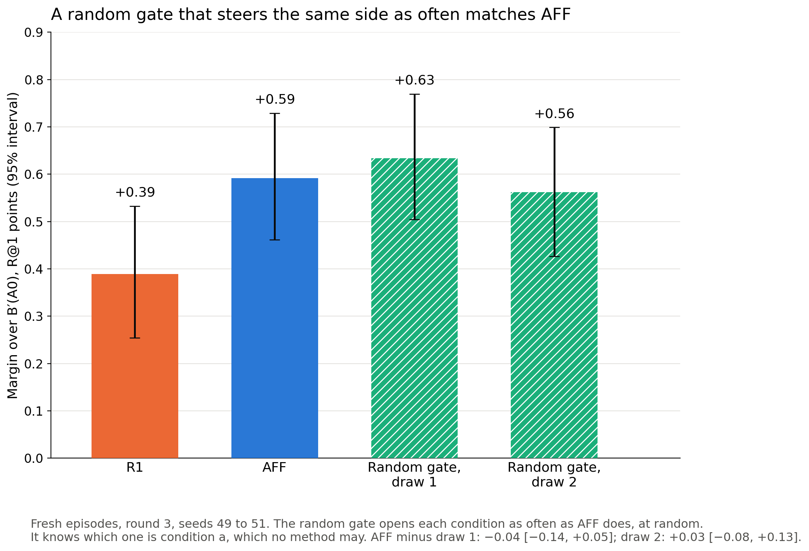

*Figure 10. Margin over B′(A0) on the fresh episodes for R1, AFF and two draws of the random one-sided gate.*

**Our reading.** On fresh episodes, AFF's choice of which episodes to steer within a side added nothing we could
measure over the random gate (both intervals are about ±0.1 wide), so the gain comes mostly from steering one side. We
have no such control on held paintings. AFF finds that side without labels. A label-free diagnostic, run after the verdict, shows what its affect pick follows.

*Table 4. How often the reader picked affect in condition a, split by whether both visual groupings (image and caption)
agree more on the contrasts than on the supports (fresh episodes, pooled).*

| Pair | Contrasts agree more on both visual groupings | Otherwise |
|---|---|---|
| emotion × style | 95.1% | 57.0% |
| emotion × genre | 96.1% | 60.7% |
| style × genre | 93.4% | 50.2% |

**Our reading** (not tested further). AFF's affect pick behaves like a visual-contrast rule. It fires when both visual
groupings agree more on the contrasts than on the supports. In the emotion pairs that is the emotion side, where steering pays; in
style × genre it is the style side, where it costs. AFF is in effect a label-free side detector. We do not claim that it
reads emotion from the examples.

> Source: round 3 report [§8](../auto/v2/2026-11-21_round3_affect_gate.md#8-mechanism-the-random-share-control).

## 4. The method: one-sided affect steering

### 4.1 The design

AFF has a condition-free base that is always on and a steering branch that is added only when its gate opens
(Figure 11). Nothing in it uses evaluation labels.

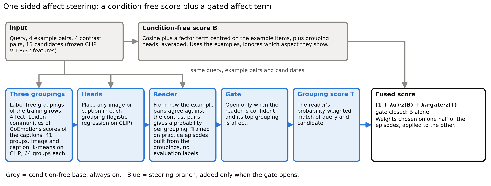

*Figure 11. One-sided affect steering. Grey: the condition-free base; blue: the steering branch.*

1. **Features.** The query, the 8 example pairs and the 13 candidates are frozen CLIP ViT-B/32 features (512
   dimensions).
2. **Condition-free base B.** CLIP cosine, a factor term centred on the episode's 8 example items, and the head
   agreement averaged over the groupings, fused with weights fitted on half of the episodes.
3. **Groupings.** Three label-free partitions of the 183,694 training rows. **Affect:** Leiden communities (a graph
   clustering method) of a 20-nearest-neighbour graph on each caption's 28 GoEmotions emotion probabilities, 41 groups;
   GoEmotions is a public RoBERTa classifier fine-tuned on Reddit comments, never trained on ArtELingo. **Image** and
   **caption:** k-means with 64 clusters on the CLIP image or caption features.
4. **Heads.** For each grouping and modality, a logistic regression on CLIP features places an image or a caption in the
   grouping and gives a posterior p_h. The grouping score of candidate k for query q is s_h(q, k) = p_h(q) · p_h(k).
5. **Reader.** From 18 numbers per episode and condition (for each grouping: how much the support pairs agree, how much
   the contrast pairs agree, their difference and spreads, and the share of support pairs whose image and caption fall in the same top group; 6 numbers for each of the 3 groupings), a multinomial logistic regression gives a probability P(h)
   that the supports share grouping h. It is trained on **practice episodes** built from the groupings themselves (the
   supports share a group of one grouping, the contrasts a group of another), so the answer is known without labels.
   The steering term is T = Σ_h P(h) · s_h.
6. **Confidence gate.** Open when the reader's top probability leads the second by at least a threshold fixed on
   development episodes.
7. **One-sided rule.** The gate also requires the top grouping to be affect. Swapping supports and contrasts swaps the
   two agreement values, so evidence for affect in condition a is evidence against it in condition b. The gate therefore
   opens mostly in one of the two conditions of an episode.
8. **Fused score.** (1 + λ_u) · z(B) + λ_a · gate · z(T). Here λ_u and λ_a are fusion weights; z is a z-score over the 13 candidates. When the gate is
   closed, the score is B alone. The weights and threshold come from 224 settings (4 thresholds × 7 values of λ_u × 8 values of λ_a); the setting chosen on one half of the
   episodes scores the other half.

The **matched control** uses the same 224 settings with the gated term replaced by its average over the two conditions,
so it keeps every ingredient but cannot follow the condition. **B′(A0)** is B with the head agreement averaged over
AFF's own three groupings.

> Sources: [round 1](../auto/v2/2026-11-18_reader_fix_csd.md) §1, [round 3](../auto/v2/2026-11-21_round3_affect_gate.md)
> §1 and §3, [grouping report](../auto/v2/2026-11-12_partition_quality_leiden_communities.md) §2 and §4.

### 4.2 Why each component is there

Each component was added because a development result showed it was needed (Table 5). All rows are on development
episodes. Each row names its comparator; differences between rows describe the path we took, not isolated effects.

*Table 5. The evidence behind each component (development episodes, R@1 points).*

| Component | What we saw | Number | Against |
|---|---|---|---|
| a strong condition-free base | the reader's grouping score alone chose the aspect but lost finding | gain 4.41, but R@1 16.51 against 16.96 for the same heads averaged | the same heads averaged over the groupings, condition-free |
| Leiden affect grouping | more coherent than k-means on the same GoEmotions scores, at the same group count | reader margin over the control +0.35 [+0.15, +0.57] against +0.16 [0.00, +0.33] (k-means, 41 groups) | matched control |
| learned reader | as good as a pick-the-largest-difference rule, and it gives probabilities | +0.31 for both | B′(A0), the bar (round 1) |
| confidence gate | more condition gain than it cost in either rate | +0.44 against +0.39 without the gate, short of the +0.5 bar | matched control, each variant against its own |
| one-sided rule | the margin of the gated reader sat almost all on the emotion side; steering with the image or caption grouping never paid | +0.70 [+0.46, +0.94] | B′(A0) |

The last value was the best of about 50 label-free variants on development episodes, so it is inflated; only the fresh
and held tests protect it. Two signals explain why affect, not the other groupings, is worth steering with. Image and
caption grouping scores correlate 0.62 to 0.71 with B, against 0.35 to 0.38 for affect, so B already holds what they
add. Told the right grouping from the labels (a ceiling, not a method), the heads beat their control by +1.64, while the
label-free reader picked the right grouping in only 54.7% of rankings: the reader's choice, not the groupings, was the
bottleneck.

> Sources: weekly report [§4.3](../weekly/2026-10-07_aspect_task_to_affect_steering.md#43-why-each-component-is-there),
> [grouping report](../auto/v2/2026-11-12_partition_quality_leiden_communities.md) §3 to §9,
> [round 2](../auto/v2/2026-11-19_reader_fix_round2.md), [brainstorm](../auto/v2/2026-11-20_r1_levers_brainstorm.md) §2.

## 5. The MLLM experiments

We tested whether a multimodal LLM can do the task in context, in three ways. None chose the shown aspect reliably;
the largest model found aspect-sharing candidates somewhat more often than cosine.

### 5.1 The in-context probe (3 October)

**Setting.** Two frozen instruction-tuned models, Qwen3-VL-2B and Qwen3-VL-8B, on development-painting episodes that
no other method used: 2B on seed 44 (900 episodes, 802 anchor paintings), 8B on seed 46 (1,800 episodes, 1,507 anchor
paintings). Each is compared with CLIP cosine on the same episodes.

**What the model sees.** The whole episode goes into one prompt (images inserted where marked; a caption query and
image candidates replace the query image and the candidate captions when images are ranked):

```text
Each example pair shows an image and a caption of two different artworks that are alike in one respect. The
counter-example pairs are alike in a different respect. Pick the candidate that is alike to the query in the same
respect as the example pairs. Answer with one letter.

Example pairs:
Pair 1: image<image>
caption: <caption of another artwork>
  ... pairs 2 to 4
Counter-example pairs:
Pair 1: image<image>
caption: <caption of another artwork>
  ... pairs 2 to 4
Query:
<image>
Candidates:
A. <caption>
  ... B to M
Answer:
```

**Scoring.** Each candidate's score is the model's next-token logit for its letter. The letters are permuted for every
episode, condition and direction and mapped back, so a preference for a letter cannot pass for a choice. Condition b
swaps the two example blocks, so R@1 and condition gain are computed as for every other scorer. Pre-registered: the
probe "works" only if both the R@1 difference and the condition-gain difference against cosine have lower bounds above
0.

*Table 6. The in-context MLLM probes against cosine on the same episodes.*

| Model | Episodes | R@1 | R@1 minus cosine | Condition gain | Either rate minus cosine | Works |
|---|---|---|---|---|---|---|
| Qwen3-VL-2B | seed 44, 900 | 13.50 | +0.22 [−1.13, +1.53] | −0.53 [−1.68, +0.66] | not reported | no |
| Qwen3-VL-8B | seed 46, 1,800 | 14.21 | +1.07 [+0.17, +1.93] | +0.21 [−0.51, +0.94] | +1.93 [+0.25, +3.51] | no |

Neither model works under the rule. The 8B model found aspect-sharing candidates more often than cosine but did not
reliably choose the shown aspect; the 2B model was within noise of cosine on both measures.

> Sources: [E3 go/no-go](../auto/v2/2026-11-01_aspect_factor_gonogo.md) §9 (2B),
> [new-method quick checks](../auto/v2/2026-11-08_new_method_quick_checks.md) (8B), stage report
> [§7](2026-10-04_aspect_conditioned_similarity_methods.md#7-in-context-multimodal-llms);
> `src/eval/mllm_reranker.py`, `src/test/20261106_mllm_probe_8b/PREREGISTRATION.md`.

### 5.2 On the held paintings (round 6)

The held read ran two MLLM comparators beside AFF, both reported and never gating.

- **In-context reranker.** The 8B probe's setting, frozen, on held seed 52 (12,288 episodes): R@1 14.50 against
  13.24 for cosine on the same seed, condition gain 0.12 [−0.17, +0.39]. AFF was +4.94 [+4.56, +5.33] above it.
- **Describe-then-score (DTS).** Built for the held read as the strongest comparator the literature check suggested.
  Qwen3-VL-8B sees the 4 support and 4 contrast pairs and states in a short phrase what the supports share that the
  contrasts lack. CRL (NeurIPS 2025) then has the same model list the phrase's values, encodes them with CLIP's text
  encoder into a basis, and scores query and candidates by their match in that basis; the score is fused with cosine.
  Its settings (4 prompt wordings × 2 basis sizes) were tuned on development episodes. On held paintings it reached
  13.06 R@1, gain 0.08 [−0.04, +0.20]. Told the true aspect name (a privileged ceiling), it reached a gain of 1.17 but an
  R@1 of 12.15, below cosine.

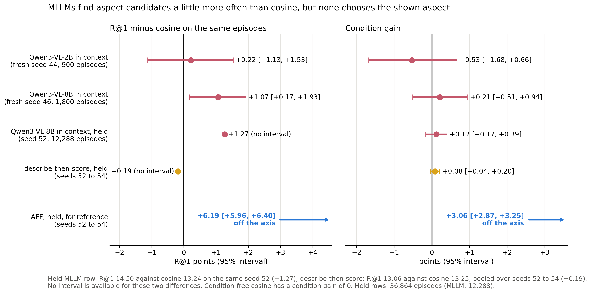

*Figure 12. The MLLM comparators against cosine on R@1 and condition gain, with AFF for reference.*

*Table 7. Swap success on the held paintings (the condition-free scores are 0 by construction). The MLLM row is on seed 52
only (12,288 episodes); its AFF-minus value is computed on those episodes. Every other row is pooled over seeds 52 to 54.*

| Scorer | Swap success (%) | AFF minus it |
|---|---|---|
| AFF | 11.50 [11.25, 11.76] | |
| R1 | 11.67 | −0.17 [−0.33, −0.01] |
| in-context MLLM (seed 52) | 13.08 | −1.61 [−2.19, −1.01] |
| DTS told the true aspect name | 16.43 | −4.93 [−5.29, −4.57] |
| DTS | 3.93 | +7.57 [+7.28, +7.86] |
| RCA | 3.17 | +8.33 [+8.05, +8.61] |

On swap success the in-context MLLM, the privileged DTS and R1 (by 0.17) are above AFF. **Our reading.** Swap success
asks only that the two aspect candidates are in the right order under both conditions, wherever they rank. A scorer
that ordered the two independently at random in each condition (ties ignored) would reach 25% (one half in each condition, so one quarter for both), and every scorer in
Table 7 is below that, AFF included. So swap success alone does not show that a scorer reads the aspect; R@1 and
condition gain do, and on those no MLLM comparator comes near AFF. The paper must still report the swap-success row.

> Source: round 6 report (analysis, "External comparators" and "Swap success");
> [r6 spec](../../superpowers/specs/2026-10-09-r6-held-test-design.md) §3.8.

## 6. The steps, in date order

The table below lists every step of the main line; worked steps are described in full in §3 and §4, the others in
short form after it.

*Table 8. Every step of the main line, against its bar.*

| Date | Step | Result against its bar | Outcome |
|---|---|---|---|
| 4 Oct | label-free groupings and heads, read by a rule | the reader chose the aspect (gain 4.41) but lost R@1 to its condition-free version | diagnostic |
| 5 Oct | Leiden affect grouping | reader margin +0.35 against +0.16 for k-means at the same group count | worked |
| 6 Oct | reader rounds 1 and 2: learned reader, confidence gate, CSD style grouping | gated reader +0.44, short of the +0.5 bar; the CSD grouping lowered every reader's margin | did not work |
| 6 Oct | brainstorm on the gated reader | one-sided affect steering found, +0.70 on development episodes | worked |
| 6 Oct | round 3: fresh test of AFF | +0.59 [+0.46, +0.73] over B′(A0), seven of seven checks | worked (GO) |
| 7 Oct | round 4: three vetoes on AFF's gate | none beat AFF (net −18, −18 and −34 rankings of 49,152) | did not work |
| 7 Oct | round 5: GoEmotions placement of captions | +0.36 and +0.43 against the +0.5 bar; both below AFF | did not work |
| 7 Oct | fine-tuned CLIP as a comparator | 14.97 to 15.14 R@1 on fresh episodes, 3.74 to 3.91 below AFF | comparator |
| 10 Oct | round 6: held read of AFF | +0.60 [+0.46, +0.73] over B′(A0), seven of seven checks with Holm | worked (GO) |
| 12 Oct | round 7: label-free style groupings without content | 0 of 12 candidate scorers passed the gate | did not work (NO-GO) |

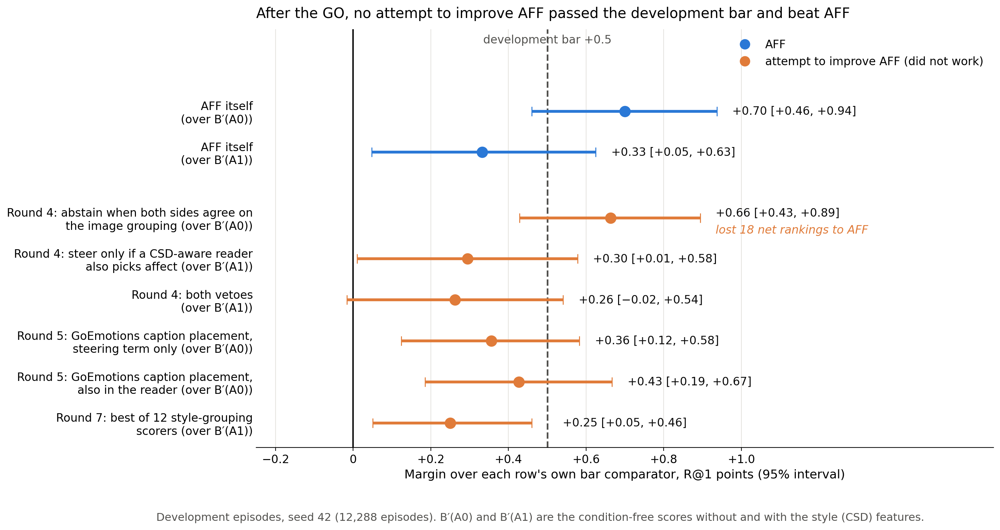

*Figure 13. The three rounds after the fresh GO, on development episodes: each attempt's margin over its own bar
comparator, against the +0.5 development bar.*

### 4 to 6 October · from groupings to a confident reader (worked in part)

- **Idea.** If the examples share an aspect, they should also share a group in a label-free grouping that tracks that
  aspect. A reader that sees which grouping the supports agree on, and the contrasts do not, then knows the condition.
- **What happened.** The first reader, a rule on three groupings, chose the aspect (gain 4.41) but lost R@1 against
  the same heads with the condition ignored, because it lost finding. Fusing it onto B, a better affect grouping
  (Leiden) and a learned reader with a confidence gate brought the margin to +0.44 on development episodes, short of the
  +0.5 bar. A style grouping from the CSD encoder raised the told ceiling to +2.23, the highest measured, but lowered
  every reader's margin: it lifted the condition-free comparators as much as the readers, and the reader picked it for
  genre conditions.
- **What it changed.** AFF uses the three groupings without CSD; CSD survives only in the stronger comparator B′(A1).
- Sources: stage report [§10](2026-10-04_aspect_conditioned_similarity_methods.md), [grouping report](../auto/v2/2026-11-12_partition_quality_leiden_communities.md),
  [round 1](../auto/v2/2026-11-18_reader_fix_csd.md), [round 2](../auto/v2/2026-11-19_reader_fix_round2.md).

### 6 October · one-sided affect steering, and its fresh test (worked)

- **Idea.** Taking the gated reader's margin apart located nearly all of it on the emotion side of the two emotion
  pairs. So steer only when the reader picks affect.
- **Design.** §4.1. The affect grouping was fixed by name before the test, with a label-free reason recorded (it is the
  grouping least redundant with B); that reason was stated after affect was seen to pay.
- **Result.** GO on three never-used seeds, +0.59 [+0.46, +0.73] over B′(A0) (§3.2). The rule's prior expected about
  +0.3, because earlier fresh tests had roughly halved development effects; AFF kept 84% of its development margin.
- **What it changed.** AFF became the current best and the method for the held read.
- Sources: [brainstorm](../auto/v2/2026-11-20_r1_levers_brainstorm.md), [round 3](../auto/v2/2026-11-21_round3_affect_gate.md).

### 7 October · round 4, vetoes on AFF's gate (did not work)

Three vetoes could only switch AFF's steering off: abstain when supports and contrasts both agree strongly on the image
grouping; steer only if a second reader that also sees CSD picks affect; or both. The first cleared the development bar
(+0.66 [+0.43, +0.89] over B′(A0)) but lost 18 net rankings to AFF; the other two failed the bar against B′(A1). Every
veto also switched off emotion-side steering that paid.
Source: [round 4](../auto/v2/2026-11-22_round4_aff_vetoes.md).

### 7 October · round 5, GoEmotions placement of captions (did not work)

A head that places each caption in the affect grouping from its own GoEmotions probabilities was far more accurate than
the CLIP caption head (86.17% against 35.72% held-out placement accuracy). Yet the two variants reached only +0.36
[+0.12, +0.58] and +0.43 [+0.19, +0.67] over B′(A0), below the +0.5 bar, and both lost to AFF (by 169 and 134 of
49,152 rankings). The likely reason: every agreement pairs the sharper caption side with the weak image head (image-side
lift 1.04), and each unit of gain cost more either rate.
Source: [round 5](../auto/v2/2026-11-23_idea3_goemotions.md).

### 7 October · a fine-tuned CLIP as a comparator (descriptive)

We fine-tuned CLIP ViT-B/32 label-free on ArtELingo image and caption pairs in three ways (linear probe, last block,
LoRA; three learning rates each, nine runs on a GPU cluster), chose on validation retrieval only and scored by cosine.
On fresh episodes they reached 14.97 to 15.14 R@1, +1.93 to +2.10 over plain CLIP but 3.15 to 3.32 below B′(A0). Their
lift went to the genre candidate, barely to the emotion candidate. A fine-tuned CLIP is therefore a reported baseline,
not the strongest condition-free comparator.
Source: [fine-tuned CLIP](../auto/v2/2026-11-24_clip_lightweight_ft.md).

### 9 to 10 October · round 6, the held read (worked)

- **Idea.** One pre-registered read of frozen AFF on the held paintings, the paper's claim test.
- **Design.** Every weight frozen on development episodes; seeds 52 to 54; seven checks with Holm; B′(A1) and R1 as
  secondary checks; DTS, the fine-tuned CLIPs and the in-context MLLM reported beside.
- **Result.** GO (§3.1); B′(A1) and R1 inconclusive.
- **What it changed.** The ArtELingo claim stands; the style × genre loss became the main weakness to fix.
- Source: [round 6](../auto/v2/2026-11-25_artelingo_held_test.md).

### 12 October · round 7, label-free style groupings without content (did not work)

AFF is below B′(A0) on style × genre because no grouping tracks style. We built six label-free style groupings meant to cut
across the image content grouping: CSD style vectors with the content directions projected out, CSD's neighbour graph
with edges inside one content group removed or halved, and CLIP token statistics with the image embedding regressed
out. Each was scored by R1 and by an extended AFF that also steers on the style grouping, on development episodes only.

A ceiling check came first: told the true styles, the score beat its matched control on style × genre by +3.92 [+3.35,
+4.49], a ceiling on style × genre alone, so it is larger than the pooled told margins of §4.2, and far above the
expected +0.9. But none of the 12 candidate scorers passed the gate. The best pooled margin was
+0.25 [+0.05, +0.46] against a bar of +0.5 over the strongest comparator, B′(A1), which AFF itself clears by only
+0.33 there. Every candidate also lost 0.93 to 1.61 points to AFF on emotion × genre (bar: at most 0.3). The
label-free groupings reached about a tenth of the ceiling on style × genre (Figure 14).

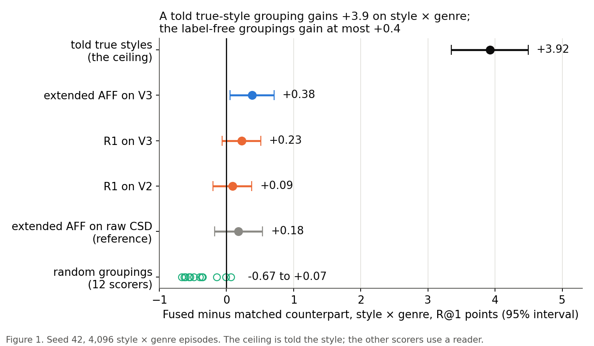

*Figure 14. Round 7 on style × genre, development episodes: the told ceiling against the label-free candidates and
random-grouping controls. V2 and V3: CSD's neighbour graph with the edges inside one content group removed (V2) or halved (V3).*

The pre-registered consequence: the paper is the ArtELingo paper with AFF, and AFF stays the current best.
Source: [round 7](../auto/v2/2026-11-26_design_l_style_source.md).

## 7. Where we stand

**Current best:** AFF, frozen as tested in round 3 and read once on the held paintings.

**What is established** (ArtELingo, CLIP ViT-B/32, pooled over three aspect pairs): AFF beats cosine, RCA, B, B′(A0)
and its matched control on R@1 on held paintings (+0.60 [+0.46, +0.73] over B′(A0)), with a condition gain of +3.06; the
fresh test four days earlier gave the same margin.

**Limits that travel with every AFF number:**

1. **Selection.** AFF was found among about 50 label-free variants on development episodes, and rounds 4 and 5 read
   about 10 more there.
2. **Per pair.** No per-pair claim: AFF is below B′(A0) on style × genre (−0.43 [−0.65, −0.21] on held paintings), and also below its matched control (−0.28 [−0.48, −0.09]) and B′(A1) (−1.24) there.
3. **Strongest comparator.** The margin over B′(A1) is +0.14 [−0.03, +0.30], not established.
4. **Mechanism.** AFF's lead over R1 is +0.02 on held paintings, and on fresh episodes a random gate that steers the
   same side as often is not distinguishable from AFF (no such control on held paintings). In our reading, the gain
   comes from steering one side, not from reading emotion.
5. **Scope.** One dataset and one backbone; the plan's CUB and SemArt held tests and a second backbone are not run.
6. **External signal.** The affect grouping uses the external GoEmotions classifier; its 28 categories name 6 of the 8
   evaluation emotions.
7. **Held paintings.** They were read before with value episodes (the earlier task), and 24 held rows have a training
   image at CLIP cosine of at least 0.99.

**Our reading.** The contribution with the most support is the task and its protocol: they expose that a strong score
that ignores the condition (18.84 R@1 on held paintings) beats every external baseline we ran, including fine-tuned
CLIP and an 8B in-context MLLM. Against that bar, a modest label-free method still adds about 0.6 R@1 points with a
condition gain of 3. AFF itself is a modest method.

## 8. Next

The direction is decided (the user, 12 October): grouping work beside the ArtELingo paper with AFF, with a hard
cut-off on Friday 23 October for a held-read verdict.

- **Main line (round 8).** A learned grouping head on frozen CLIP, trained so that its groups cut across a given content
  grouping (content-group negatives, and FCMI, a fair-clustering objective), in place of CSD; gallery images placed by
  the grouping's own assignment. The aim is a real style signal for style × genre.
- **Second track.** A screen of other style encoders.
- **Paper.** CVPR abstract 10 November, paper 16 November. If round 8 does not pass by the cut-off, the paper reports
  AFF as tested here.

> Sources: [direction log](../../superpowers/direction_log.md) ("Now"), [r8 literature check](../literature/2026-11-30_r8_learned_grouping.md).

## Glossary

| Term | Meaning | Name in the auto reports (for cross-reference) |
|---|---|---|
| aspect, value | a respect in which items can be similar (emotion, style, genre) / one setting of it (sad, Baroque, landscape) | aspect, value |
| aspect episode | a query, 4 support pairs, 4 contrast pairs and 13 candidates in the other modality; the aspect is never named | aspect episode |
| aspect pair | the two aspects of an episode | aspect pair |
| condition a / b | supports show aspect A / supports and contrasts swapped | condition a / b |
| R@1 | share of rankings where the target ranks first, in percent | R@1 |
| condition gain | R@1 minus the other aspect's first-place rate; 0 for any condition-free scorer | condition gain, gain statistic |
| either rate | how often a candidate that shares either aspect ranks first | either rate |
| swap success | the order of the two aspect candidates flips correctly with the condition | swap success |
| matched control | the same score with only the condition removed | matched counterpart, CF |
| B, B′(A0), B′(A1) | the condition-free scores: the best before AFF; rebuilt on AFF's groupings; with the CSD style grouping added | B, B′(A0), B′(A1) |
| development bar | a margin of at least +0.5 R@1 with a lower bound above 0 on development episodes; earns a test | D10 |
| development, fresh, held episodes | seed 42 (reused); new seeds on the development paintings (one test each); the held paintings (read once) | seed 42; seeds 43 to 51; seeds 52 to 54 |
| grouping, head | a label-free partition of the training rows / a logistic regression that places an image or caption in it | partition, grouping; head |
| affect grouping | Leiden communities of GoEmotions caption probabilities, 41 groups | affect |
| reader | a classifier that says which grouping the support pairs share | reader, R-c |
| practice episode | an episode built from a grouping, not a label, to train the reader | bank episode |
| told | given the right grouping from the labels; a ceiling, not a method | told oracle |
| told ceiling | a scorer given the right grouping from the evaluation labels; an upper reference, not a method | told oracle |
| R1 | the gated reader: steers whenever confident, whatever grouping it picks | R1 |
| AFF | one-sided affect steering: R1, steering only when the pick is affect | AFF |
| random one-sided gate | a control that steers at random with AFF's open share per condition; it knows the condition, so it is not a method | random-share control |
| RCA | relevant component analysis, a metric fitted on the example pairs | RCA |
| DTS | describe-then-score: an MLLM names what the supports share, CRL scores it on CLIP | DTS, DTS-CF, DTS-N |
| CSD | a pretrained style encoder (ECCV 2024) | csd, configuration A1 |
| Holm | Holm's step-down correction across a read's checks | Holm |

## Sources

- Previous stage report: [2 to 4 October](2026-10-04_aspect_conditioned_similarity_methods.md); weekly report:
  [1 to 7 October](../weekly/2026-10-07_aspect_task_to_affect_steering.md); [CVPR readiness memo](2026-10-07_cvpr_readiness.md).
- Task and baselines: [CVPR plan](../../superpowers/specs/2026-10-02-cosir-v2-cvpr-publication-plan-design.md),
  [E1 baselines](../auto/v2/2026-10-30_aspect_baselines.md), [backbone check](../auto/v2/2026-10-25_backbone_check.md),
  [E3 go/no-go and MLLM probes](../auto/v2/2026-11-01_aspect_factor_gonogo.md).
- Main line: [grouping report](../auto/v2/2026-11-12_partition_quality_leiden_communities.md),
  [round 1](../auto/v2/2026-11-18_reader_fix_csd.md), [round 2](../auto/v2/2026-11-19_reader_fix_round2.md),
  [brainstorm](../auto/v2/2026-11-20_r1_levers_brainstorm.md), [round 3](../auto/v2/2026-11-21_round3_affect_gate.md),
  [round 4](../auto/v2/2026-11-22_round4_aff_vetoes.md), [round 5](../auto/v2/2026-11-23_idea3_goemotions.md),
  [fine-tuned CLIP](../auto/v2/2026-11-24_clip_lightweight_ft.md), [round 6](../auto/v2/2026-11-25_artelingo_held_test.md),
  [round 7](../auto/v2/2026-11-26_design_l_style_source.md).
- Literature: [CVPR literature review](../literature/2026-10-21_cvpr_literature_review.md),
  [novelty check](../literature/2026-10-24_aspect_task_novelty_check.md),
  [held-claim check](../literature/2026-11-25_held_claim_check.md), [style sources](../literature/2026-11-27_style_sources.md).
- Figures of this report: [`../assets/2026-10-12_affect_steering_line/`](../assets/2026-10-12_affect_steering_line/)
  (built by `build_figures.py` from the round 3 and round 6 result files).

## Appendix A. Earlier approaches that did not read the aspect

These lines ran from 30 September to 4 October, before or beside the main line. They are listed for completeness; the
[weekly report](../weekly/2026-10-07_aspect_task_to_affect_steering.md) §1 and §3 describe them.

| Approach | Best result | Comparator | Why it failed |
|---|---|---|---|
| shared image and caption factors on value episodes | 21.22 R@1 | a prototype of the examples that ignores the query, 22.83 | the examples gave the answer away; on aspect episodes the factors stayed at CLIP level (11.32 against 11.13) |
| nine metrics fitted on the example pairs | RCA 13.38 R@1, every condition gain within 0.4 of 0 | cosine, 12.96 (development episodes) | four value-disjoint pairs estimate the values shown, not the aspect they share |
| factors trained on label-free practice episodes (method A) and three repairs | −2.96 [−3.29, −2.64] R@1 | its own condition-free control (fresh seed 43) | it chose the aspect a little but lost much more in finding |

What they left: method A's factors, centred on the episode's example items and with the condition ignored, are one of
the three parts of B, and RCA became the pre-registered external bar.
