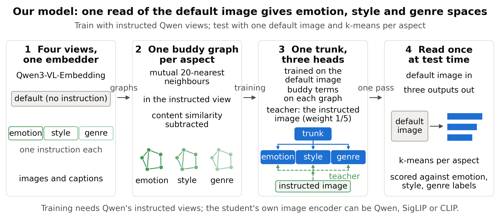
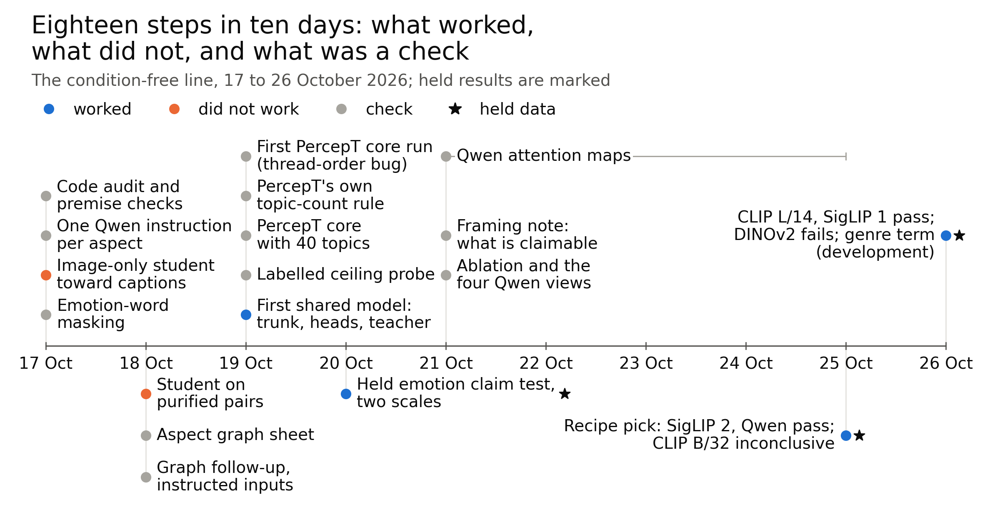
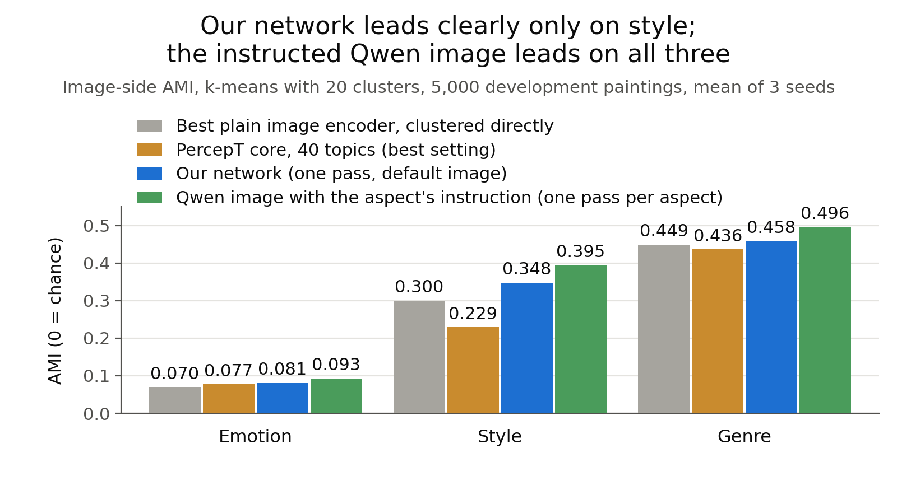
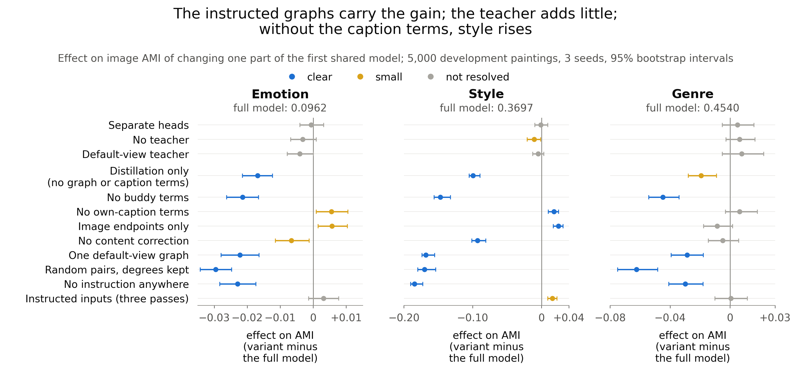
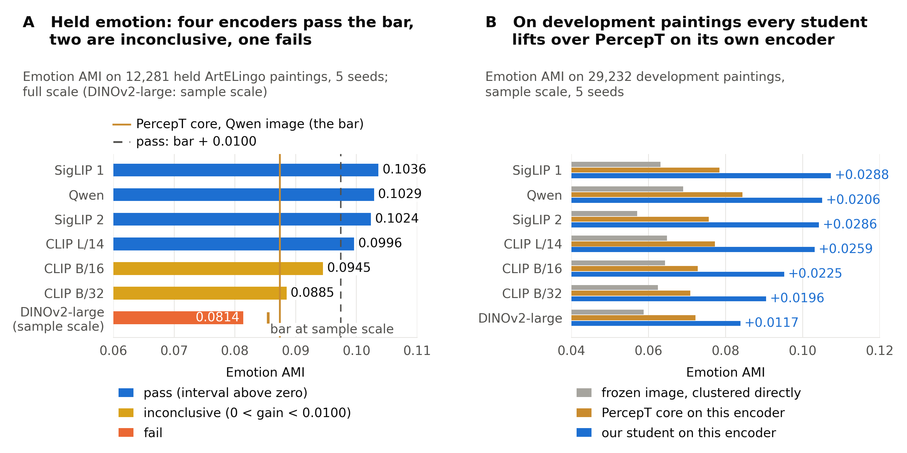

# Stage report, 2026-10-15 to 2026-10-26: one read of the default image gives emotion, style and genre spaces; the held emotion lead over PercepT holds on four image encoders

> Covers 2026-10-15 to 2026-10-26. Previous stage report: [2026-10-19, the Qwen buddy line](2026-10-19_qwen_buddy_line.md);
> its period (steps 1 to 11) is folded in here as the first part, condensed.
> Every number comes from the auto report linked in its section; steps 1 to 11 may also quote the previous stage report, and step 11, which has no auto report, cites its round log. The direction log is cited for decisions and the user's readings, not for numbers.
> In the user's quotes, square brackets replace an internal code name by its plain name; omissions are marked with an ellipsis.
> AMI has 4 decimals where its report gives 4, and 3 decimals where the report gives 3 (the
> reports up to 12-15). "Development" means the ArtELingo train side; "held" means the 12,281 held paintings. The
> report names keep the project's sequence dates (such as 12-22); the step dates are the real Amsterdam dates.

## Summary

- On 2026-10-15 we stopped the conditioned line and started a condition-free model of aspect spaces for paintings,
  compared with PercepT.
- The design: one Qwen3-VL-Embedding instruction per aspect gives a buddy graph per aspect. A small network with one
  shared trunk and three heads learns from these graphs, then reads the default image once.
- Qwen, SigLIP 2, SigLIP 1 and CLIP L/14 passed separate held emotion tests against the strongest eligible PercepT entry.
- Several attempts did not work: two image-only student pilots, the DINOv2-large student, two genre loss variants, and
  every PercepT run with the paper's own settings and topic cut (all collapsed). CLIP B/16 and CLIP B/32 were
  inconclusive.
- Our reading: the relational Qwen genre variant was promising on development data. It was picked on one seed and tested on three fresh seeds. It has no held genre test.
- All held claims use k-means and need Qwen at training (graphs, teacher, captions). The next step is the user's
  choice: a held genre test, more development work on the relational term, or the write-up.

| Summary comparison | Model | Comparator | Sample |
|---|---:|---:|---|
| Held emotion, current Qwen recipe | 0.1029 | strongest PercepT entry 0.0874 | 12,281 paintings, five seeds |
| Development genre, relational term at weight 8 | 0.5022 | current recipe 0.4694 | 29,232 paintings; three fresh seeds after one-seed selection |

Sources: [claim test, stage 2](../auto/percept/2026-12-19_claim_test_stage2.md), [recipe and
backbones](../auto/percept/2026-12-24_recipe_backbones.md), [encoders and
genre](../auto/percept/2026-12-25_encoders_genre.md).

## Where we started

We started from a stopped line and a comparator that we had to rebuild.

### The project and the question

We stopped and archived the conditioned line on 2026-10-15 after the supervisors judged it too specific and too complicated for a good CVPR paper (user; [archive index](../../../archive/v2_conditioned/README.md)).

We asked whether one default-image read could produce emotion, style and genre spaces with higher label agreement than PercepT.
Aspect-named retrieval, due with the CVPR abstract on 2026-11-10, was not measured.

Source: [direction log](../../superpowers/direction_log.md), entry 2026-10-15.

### PercepT and why it is the comparator

PercepT ("Beyond Semantics", arXiv 2606.03345) is the closest prior method.
Stage 1 clusters image-caption pairs with an autoencoder and deep embedded clustering (DEC).
Stage 2 predicts those topics from images; evaluation compares topics with emotion and genre labels using AMI.

Our reading: PercepT had four weaknesses in the literature note. It was a preprint without released code.
On ArtELingo, the fused embedding without DEC gave AMI 0.16 against PercepT's 0.18; DEC added little.
Its emotion encoder used GoEmotions labels. It reported no held-out protocol or retrieval.

Four of the audit's eight differences defined PercepT core, our reimplementation on our feature stores.
The faithful version, with CLIP L/14 and GoEmotions-tuned ModernBERT, is not built.

| Core change | Definition |
|---|---|
| Unit | image-caption pairs |
| Fusion | the paper's Eq. 2 |
| Topic count | the paper's topic-count algorithm |
| Stage 2 targets | multi-hot caption unions |

Our reading: PercepT addresses our task but sets a weak style/genre comparator on our protocol (step 10).
We therefore also cluster frozen default and instructed images directly.

Sources: [PercepT literature note](../literature/2026-12-05_percept_neighbourhood.md), [code audit](../auto/percept/2026-12-04_percept_code_audit.md), [glossary](../../../GLOSSARY.md).

### The data and the splits

ArtELingo supplies WikiArt paintings and viewers' captions labelled with nine emotions, including "something else."
Painting emotion is the caption-label mode; style and genre come from WikiArt. Splits group paintings; artist overlap was not measured.

| Set | Paintings | Pairs or captions | Role |
|---|---:|---|---|
| Train | 42,969 | 216,107 image-caption pairs | full-scale training |
| Validation | 6,152 | 30,872 captions | full-scale early stopping (label-free) |
| Developed sample, fit part | 13,400 | 67,327 image-caption pairs | sample-scale training and graphs |
| Developed sample, stopping part | 1,489 | | early stopping (label-free) |
| Developed sample, evaluation part | 5,000 (genre on 4,053) | | development scores, 10-17 to 10-21 |
| Fresh development paintings | 29,232 (genre on 23,682) | | development scores, 10-25 and 10-26 |
| Held | 12,281 (genre on 9,949) | 61,744 captions, labels only | claim tests |
| ArtELingo-28 test store | 746 | translated captions, labels only | second test set |
| Developed sample, total | 19,889 | 99,999 captions | drawn from train and validation |
| ArtELingo-28 overlap | 248 held; 498 outside our store | different image files for shared paintings | all outside the train side |

Train and validation form the train side. Fresh development paintings are those outside the developed sample;
they served only as training data before 10-25. ArtELingo-28 has captions translated into English.
Its paintings lie outside our train side; the table gives the overlap with held paintings.

Sources: [model sheet](../auto/percept/2026-12-16_model_sheet.md), [claim test, stage 1](../auto/percept/2026-12-18_claim_test_stage1.md),
[claim test, stage 2](../auto/percept/2026-12-19_claim_test_stage2.md), [recipe and backbones](../auto/percept/2026-12-24_recipe_backbones.md),
[aspect graph design §3.3](../../superpowers/specs/2026-10-18-aspect-graph-sweep-design.md).

### The metric and the readings

AMI (adjusted mutual information) measures cluster-label agreement; 0 means chance.
We average 20-cluster k-means over three clustering seeds, then model seeds; genre excludes unlabelled paintings.
Image-side AMI uses image outputs. The 10-18 graph sheets' target AMI averaged image and caption sides.

Leiden community detection chooses its cluster count on a nearest-neighbour graph; it does not decide claims.
We also report V-measure, ARI and FMI. A label-trained probe provided a ceiling reference on 5,000 development paintings:

| Default Qwen image reading | Emotion AMI | Style AMI | Genre AMI |
|---|---:|---:|---:|
| Label-trained probe | 0.1215 | 0.5275 | 0.6566 |
| Direct clustering | 0.0696 | 0.2217 | 0.4486 |

Direct-clustering source: [four Qwen views](../auto/percept/2026-12-22_d2_ablation.md).

Sources: [model sheet](../auto/percept/2026-12-16_model_sheet.md), [direction log](../../superpowers/direction_log.md), entries 2026-10-19 and 2026-10-20.

### The comparators

PercepT core's Qwen arm, own reading (top topic of 40), was strongest in every held test, with matched training paintings.

| Comparator | What it is | What the comparison tests |
|---|---|---|
| PercepT core, Qwen arm, own reading (strongest eligible entry) | Qwen image/emotion-caption topics; default-image classifier; top-topic reading | whether student emotion AMI exceeds the strongest eligible entry |
| PercepT core, other arms and the k-means reading | four other arms; k-means at 20 on topic probabilities | eligible comparators; never strongest on held data |
| PercepT, paper settings (strict; K = 40) | paper settings with original topic cut or 40 fixed topics | collapsed runs excluded; definition in glossary |
| Matched arm | same Qwen topics; Stage 2 reads the student's encoder | whether the student exceeds its same-encoder PercepT arm |
| Frozen input | default image embeddings clustered directly | whether training adds label agreement |
| Instructed Qwen image (the target) | aspect-instructed image, clustered directly; one pass per aspect | whether one default-image pass preserves comparable label agreement |
| Label-trained linear probe | label-trained logistic regression on default Qwen images | a ceiling reference |

Sources: [claim test, stage 2](../auto/percept/2026-12-19_claim_test_stage2.md), [recipe and backbones](../auto/percept/2026-12-24_recipe_backbones.md), [glossary](../../../GLOSSARY.md).

### The claim-test rule

Held claims use a fixed rule on 12,281 paintings and five model seeds.
The margin d subtracts the strongest eligible PercepT AMI from the student's emotion AMI.
Eligibility includes every arm and both readings, including matched arms; collapsed paper-settings runs are excluded.

- **Pass:** d at least 0.0100 and the paired 95% bootstrap interval above 0.
- **Inconclusive:** 0 < d < 0.0100, or d at least 0.0100 with the interval reaching 0.
- **Fail:** d at most 0.

The bootstrap draws paintings and model seeds 2,000 times and retakes the eligible-entry maximum in each draw.
Each test starts at sample scale, then runs at full scale unless the sample test fails.

| Training scale | Paintings |
|---|---:|
| Sample | 13,400 fit |
| Full | 42,969 train |

On ArtELingo-28 a positive margin "holds" when its interval is above 0.
It is "qualified" when the interval reaches below 0; a negative margin "fails".

Sources: [claim test design §3](../../superpowers/specs/2026-10-20-claim-test-design.md), [recipe and backbones](../auto/percept/2026-12-24_recipe_backbones.md).

### What the literature allows us to call new

Aspect prompting is prior art; the combined line was not found in the literature search.
DIOR, COCO-Facet, ESMC and guideline-driven clustering produce aspect-specific embeddings.
No work found combined image/caption prompts, aspect graphs, emotion/style/genre evaluation and a multi-head image-only student.

Our reading: "just prompt Qwen" is the main expected criticism, so the instructed image is a necessary comparator.
In the studies reviewed, no single-teacher student exceeded its teacher on the teacher's own task.
For jina-v5 clustering, the student scored 53.4 against its teacher's 57.1.
Our reading: captions could supply an additional emotion signal.

Sources: [prompted aspect views](../literature/2026-12-07_prompted_aspect_views.md), [PercepT neighbourhood](../literature/2026-12-05_percept_neighbourhood.md), [ways to improve](../literature/2026-12-20_ways_to_improve.md).

## The design, as it stands on 2026-10-26

The current model trains on Qwen's instructed views and reads the default image once.
The tables distinguish its recipe from the first shared model tested on 10-20.

*Instructed views build one graph per aspect; a shared trunk with three heads learns from them; at test time one
default image gives three aspect outputs.*

### The four views

Aspect instructions changed Qwen's clustering geometry. Qwen3-VL-Embedding-2B ("Qwen") replaces its default system
prompt, "Represent the user's input," with either form below ([step 2](#2026-10-17--one-instruction-per-aspect-in-qwen-check)):

- The focus form: "Represent the <aspect> of this artwork, or of this description of an artwork. Focus only on the <aspect>."
- The one-word form: "Describe the <aspect> of this artwork in one word."

The views are default, emotion focus, style one-word and genre one-word.
Emotion and genre use captions and images; style uses images. Own-aspect AMI rises while most other-aspect AMIs fall:

| Image view | Emotion AMI | Style AMI | Genre AMI |
|---|---:|---:|---:|
| Default | 0.0696 | 0.2217 | 0.4486 |
| Emotion instruction | 0.0929 | 0.1678 | 0.4096 |
| Style instruction | 0.0630 | 0.3952 | 0.3490 |
| Genre instruction | 0.0701 | 0.2644 | 0.4956 |

5,000 development paintings (genre on 4,053), k-means at 20. Source: [ablation, four Qwen views](../auto/percept/2026-12-22_d2_ablation.md).

### The graphs

Each aspect used a graph of mutual top-20 neighbours on painting means.
Residual graphs subtract weighted default-view content similarity from aspect similarity.
Graph types came from ([steps 6 and
7](#2026-10-18--aspect-graph-sheet-check)); [step 12](#2026-10-19--the-first-shared-model-the-model-sheet-worked) made
the final picks by image-side AMI.

| Aspect | View | Graph | Code in the reports |
|---|---|---|---|
| Emotion | emotion focus form, captions | residual, with a content weight set per painting | Gres |
| Style | style one-word form, images | residual, content weight 0.5 | Fres05 |
| Genre | genre one-word form, images | plain aspect graph on the image side | R0o |

The graphs use the training paintings only; labels never enter a graph. Sources: [aspect graph
sheet](../auto/percept/2026-12-11_aspect_graph_sheet.md), [model sheet](../auto/percept/2026-12-16_model_sheet.md).

### The network: one trunk, three heads

One shared trunk produced three aspect outputs. Each side is a two-layer MLP on default Qwen embeddings:
image or painting-mean caption. Aspects share the first layer; each head has its own second layer.

| Layer | Widths |
|---|---|
| Trunk | 2048 to 1024 |
| Each head | 1024 to 2048 |

Source for widths: [spec, section 3](../../superpowers/specs/2026-10-19-stage2-model-sheet-design.md#3-design).

The trunk entered in [step
12](#2026-10-19--the-first-shared-model-the-model-sheet-worked). Source: [model
sheet](../auto/percept/2026-12-16_model_sheet.md).

### The losses

The loss sums InfoNCE terms per aspect; each head's terms use its own graph and teacher.

| Term | What it pulls together | Weight, first shared model | Weight, current recipe | Decided in |
|---|---|---:|---:|---|
| Buddy terms | a painting's image and caption outputs toward its buddy's image and caption outputs; other paintings in the batch are negatives | 1 | 1 | steps 6 and 12 |
| Own-caption terms | each image output and its own caption output | 1 | removed | step 17 |
| Teacher term (direct distillation) | the image head's output toward the instructed Qwen image of its aspect; temperature 0.05; image side only | 0.5 | 0.25 | steps 12 and 17 |
| Relational genre term | the batch similarity rows of the genre head toward those of the instructed genre image (KL divergence) | none | none (8 in a development variant) | step 18 |
| Nominal teacher share | teacher weight divided by total term weights | 1/5 (0.5 of 2.5) | 1/5 (0.25 of 1.25) | steps 12 and 17 |

Both recipes assign the teacher one fifth of nominal loss weight.
Each aspect stops on label-free loss; stopping sample sizes are in the data table.
Temperature source: [spec, section 3](../../superpowers/specs/2026-10-19-stage2-model-sheet-design.md#3-design).

Sources: [model sheet](../auto/percept/2026-12-16_model_sheet.md), [recipe and
backbones](../auto/percept/2026-12-24_recipe_backbones.md).

### Reading at test time

Test-time inference used only the image side: one default-image encoder pass, the trunk and the heads.
Each head's output is clustered with k-means (20 clusters) and scored against its label.
The instructed image needs one encoder pass per aspect; PercepT core adds a topic classifier.

### Other image encoders

Other students changed only the image input layer. The graphs, teacher and caption side stayed Qwen's; nothing was tuned per encoder.

| Image encoder | Input width |
|---|---:|
| SigLIP 2 | 1,152 |
| CLIP B/32 | 512 |
| DINOv2-large | 1,024 |

Widths: [spec, section 3](../../superpowers/specs/2026-10-25-recipe-and-backbones-design.md#3-design).

This entered in [step 17](#2026-10-25--the-recipe-pick-and-the-first-backbone-tests-worked). Source: [recipe
and backbones](../auto/percept/2026-12-24_recipe_backbones.md).

### Cost

Our reading: training and inference were inexpensive, but parameters exceeded PercepT core's.
Costs describe the first shared model; the current recipe uses the same layers.

| Cost item | First shared model | PercepT core, Qwen arm | Instructed Qwen image |
|---|---|---|---|
| Trainable parameters | 16,791,552 (both sides); 8,395,776 image side | 7,220,152 | 0 |
| Training per model seed, 42,969 paintings | about 120 s | about 712 s (four arms together) | none |
| Backbone at test time | 1 default Qwen pass, 0.0871 s per image | 1 default Qwen pass, 0.0871 s | 3 instructed passes, 0.0936 s each |
| Network pass per painting | 32 µs on CPU | not timed | none |

Separate heads would have 25,184,256 parameters against the trunk's 16,791,552.

| Other backbone pass | Seconds per image |
|---|---:|
| SigLIP 2 | 0.0134 |
| CLIP B/32 | 0.0044 |

The rates come from different runs and include image loading. Source: [framing note §2](../auto/percept/2026-12-21_advantages_framing.md).

## Timeline

*Nine checks and two failed pilots built the comparator and the graphs. The first shared model, three more checks and
three held tests followed: twelve checks in all.*

1. 2026-10-17 · Code audit and premise checks (check).
2. 2026-10-17 · One Qwen instruction per aspect (check).
3. 2026-10-17 · Image-only student toward instructed caption targets (did not work).
4. 2026-10-17 · Emotion-word masking in captions (check).
5. 2026-10-18 · Student on purified buddy pairs (did not work).
6. 2026-10-18 · Aspect graph sheet (check).
7. 2026-10-18 · Graph follow-up with instructed inputs (check).
8. 2026-10-19 · First PercepT core run: the reproduction check failed on k-means thread order (check).
9. 2026-10-19 · PercepT core with its own topic-count rule (check).
10. 2026-10-19 · PercepT core with 40 topics (check).
11. 2026-10-19 · The image-side ceiling with a labelled probe (check).
12. 2026-10-19 · The first shared model: the model sheet (worked).
13. 2026-10-20 · The held emotion claim test, sample scale then full scale (worked).
14. 2026-10-21 · The framing note: what is claimable (check).
15. 2026-10-21 · The ablation of the first shared model and the four Qwen views (check).
16. 2026-10-21 to 10-25 · Qwen's attention maps under the four views (check).
17. 2026-10-25 · The recipe pick and the first backbone tests (worked).
18. 2026-10-26 · Four more encoders, the lift per encoder, and the genre variants (worked).

## The steps, in date order

Steps 1 to 11 are condensed from the previous stage report; steps 12 to 18 are in full.

### 2026-10-17 · Code audit and premise checks (check)

The audit found eight differences; four defined [PercepT core](#percept-and-why-it-is-the-comparator).
On 99,999 captions, CLIP text emotion AMI was 0.047 against supervised GoEmotions' 0.209. PercepT needed repair.
Source: [code audit](../auto/percept/2026-12-04_percept_code_audit.md), [new-line candidates](../auto/percept/2026-12-06_new_line_candidates.md), [prompted aspect views](../auto/percept/2026-12-08_prompted_aspect_views_check.md).

### 2026-10-17 · One instruction per aspect in Qwen (check)

Instructions raised own-aspect AMI on the aspect's visible side.
We tested ten conditions (default plus three wordings per aspect) on 99,999 captions and 5,000 paintings.

| View and label | Instructed | Default Qwen | Other reference |
|---|---:|---:|---|
| Captions, emotion (focus form) | 0.278 | 0.122 | GoEmotions classifier 0.209; CLIP text 0.047 |
| Images, style (one-word form) | 0.395 | 0.222 | CSD style encoder 0.317; CLIP image 0.300 |
| Images, emotion (focus form) | 0.093 | 0.069 | |

Image emotion probe accuracy changed from 39.2% to 40.9%.
Our reading: instruction changed cosine geometry more than available information; image emotion remained weak.
Source: [prompted aspect views](../auto/percept/2026-12-08_prompted_aspect_views_check.md).

### 2026-10-17 · Image-only student toward instructed caption targets (did not work)

The image-only caption-target student failed on 5,000 paintings, three seeds.

It reached emotion AMI 0.074 ± 0.000 against the default-caption control's 0.074 ± 0.002; the required level was 0.12.
Our reading: little caption emotion transferred. The user's reading: "there are aspects that we should not expect an
image-only student model can learn" (user).
Source: [image transfer and word masking](../auto/percept/2026-12-09_image_transfer_and_word_masking.md).

### 2026-10-17 · Emotion-word masking in captions (check)

Most caption emotion AMI lift survived masking. The list may miss affect words; we retained the instructed caption source.

Sample: 99,999 captions; 132 affect words masked.

Masked: 0.187 instructed against 0.069 default.

Unmasked: 0.278 instructed against 0.122 default.
Source: [image transfer and word masking](../auto/percept/2026-12-09_image_transfer_and_word_masking.md).

### 2026-10-18 · Student on purified buddy pairs (did not work)

The purified-pair student failed the required level on 5,000 paintings, three seeds; it passed the required margin.

| Purification comparison | Emotion AMI |
|---|---|
| Purified caption-emotion pairs | 0.094 ± 0.002 |
| Default-caption-pair control | 0.070 ± 0.002 |
| Required level | 0.12 |
| Purification minus unpurified pairs | +0.004 |

Our reading: content and emotion co-occur in art, so we compared graph constructions instead of
removing content.
Source: [purified buddy pilot](../auto/percept/2026-12-10_purified_buddy_pilot.md).

### 2026-10-18 · Aspect graph sheet (check)

Our reading: residual graphs trained the best emotion and style networks, although plain graphs had the highest pair agreement.
We built 21 graphs per aspect on 13,400 fit paintings. Networks used default inputs, buddy terms and own-caption terms.

| Graph-sheet coverage | Count |
|---|---|
| Graphs trained per aspect | five or six |
| Evaluation paintings | 5,000 |

Target AMI:

| Aspect | Best graph | Target AMI | Reference graph |
|---|---|---:|---|
| Emotion | residual, content weight 1 | 0.137 ± 0.002 | plain aspect graph, 0.120 (1 seed) |
| Style | residual, content weight 0.5 | 0.260 ± 0.003 | plain aspect graph, 0.218 (1 seed) |
| Genre | image 0.75 + caption 0.25 | 0.420 ± 0.002 | caption graph, 0.402 ± 0.005 |

Image-side style remained 0.348 against instructed Qwen's 0.395. The user's reading: "I think this is a good sign, so our best graph steadily beat plain aspect graph"
(user). Source: [aspect graph sheet](../auto/percept/2026-12-11_aspect_graph_sheet.md).

### 2026-10-18 · Graph follow-up with instructed inputs (check)

Residual graphs stayed ahead on three seeds, on the same evaluation paintings.

| Aspect | Graph target AMI | Comparator target AMI |
|---|---:|---:|
| Emotion, residual vs plain | 0.137 ± 0.002 | 0.118 ± 0.002 |
| Style, residual vs plain | 0.260 ± 0.003 | 0.213 ± 0.005 |
| Genre, image graph vs image-weighted mix | 0.428 ± 0.003 | 0.420 ± 0.002 |

Instructed inputs brought emotion captions and style images within 0.003 of their instructed views.

| Instructed-input stronger side | Network AMI | Instructed view AMI |
|---|---:|---:|
| Emotion captions | 0.216 | 0.217 |
| Style images | 0.393 | 0.395 |
| Genre images | 0.458 | 0.496 |

After the ablation table the user read "... the biggest gain is still test time instruction ... a semi-good sign" (user). Source: [aspect graph follow-up](../auto/percept/2026-12-12_aspect_graph_followup.md).

### 2026-10-19 · First PercepT core run (check)

Variable thread-order sums in k-means initialization caused the September reproduction failure.
We checked repeatable components separately and used one-thread k-means.
Source: [first PercepT core run](../auto/percept/2026-12-13_percept_core.md).

### 2026-10-19 · PercepT core with its own topic-count rule (check)

The paper's topic-count rule kept unstable topic counts. The largest gap between sorted centre norms sat at an end of the list.

| Topic-count setting | Value |
|---|---|
| Paper rule | Algorithm 1, γ = 2 |
| Topics retained across seeds | 1, 2, 3 or 99 |

With 99 topics, core added nothing over direct image clustering. We fixed the count before accepting the comparator.
Source: [PercepT core arms](../auto/percept/2026-12-14_percept_core_arms.md).

### 2026-10-19 · PercepT core with 40 topics (check)

All five arms passed every check with 40 topics fixed. We retained the centres with the most fit pairs.

| Comparator check | Value |
|---|---|
| Centres retained | 40 of 100 |
| Development AUC | 0.85 to 0.96 |
| Seed standard deviation | at most 0.007 |

Image-side AMI, 5,000 paintings, three seeds:

| Arm | Topic features | Image reader | Emotion | Style | Genre |
|---|---|---|---:|---:|---:|
| P1 | CLIP and RoBERTa emotion captions | CLIP patches | 0.053 | 0.167 | 0.356 |
| P2 | CLIP and RoBERTa emotion captions | CLIP image vector | 0.066 | 0.229 | 0.400 |
| P3 | Qwen and instructed emotion captions | Qwen image vector | 0.077 | 0.189 | 0.436 |
| P4 | Qwen and instructed emotion captions | CLIP patches | 0.054 | 0.162 | 0.361 |
| P5 | Qwen and RoBERTa emotion captions | Qwen image vector | 0.074 | 0.181 | 0.435 |

The best arms were level with or below direct clustering (CLIP style 0.300; Qwen genre 0.449).
The user's reading: "I think this is a good comparator" (user).
Our reading: topic prediction added little; direct image clustering remained a comparator. Source:
[PercepT core with 40 topics](../auto/percept/2026-12-15_percept_core_k40.md).

### 2026-10-19 · The image-side ceiling with a labelled probe (check)

The default-image probe exceeded direct clustering on every aspect (table below).
The instructed-image probe reached 0.130 / 0.569 / 0.658.
Our reading: default images held most label signal; instruction mainly changed geometry.
Source: [image-side ceiling log](../../../src/test/20261019_emotion_ceiling/20261019_emotion_ceiling_log.md), [direction log](../../superpowers/direction_log.md) (2026-10-19).

### Where the first part ended (2026-10-19)

By 10-19 our network clearly led both comparators only on style; instructed Qwen led all aspects.
Image-side AMI, 5,000 development paintings, three seeds:

| Method | Emotion | Style | Genre |
|---|---:|---:|---:|
| Qwen default image, clustered directly | 0.070 | 0.222 | 0.449 |
| CLIP image, clustered directly | 0.065 | 0.300 | 0.412 |
| PercepT core with 40 topics, best arm per aspect | 0.077 | 0.229 | 0.436 |
| Our network (separate graph-trained networks), default input, one pass | 0.081 | 0.348 | 0.458 |
| Instructed Qwen image, one pass per aspect | 0.093 | 0.395 | 0.496 |
| Label-trained linear probe on default Qwen images | 0.121 | 0.527 | 0.657 |

*On 10-19 our network led PercepT core clearly only on style; the instructed Qwen image led on every aspect.*

On 10-19 we targeted instructed-image AMI from one default-image pass.

Held emotion target: at least 0.01 over PercepT by 2026-10-29. Source: [previous stage report](2026-10-19_qwen_buddy_line.md),
[PercepT core with 40 topics](../auto/percept/2026-12-15_percept_core_k40.md).

### 2026-10-19 · The first shared model: the model sheet (worked)

The first shared model reached the development emotion target; style and genre missed their targets.

- **Idea:** Share the first layer and distil each instructed image into its head.
  Target: instructed-image AMI on every aspect; required emotion level: PercepT core plus 0.0100 (0.0872).
- **Design:** We compared 13 settings on 5,000 development paintings; main rows used three seeds.
  Variants tested trunk sharing, cross-aspect negatives, learned masks and distillation. Graph selection changed to image-side AMI.

| Distillation tested | Definition | Weights |
|---|---|---|
| Direct | InfoNCE toward instructed image | 0.5, 1, 2 |
| Relational | KL between batch similarity rows | 1 |
- **Result:** The first shared model exceeded instructed-image emotion AMI with direct-distillation weight 0.5; style and genre remained below target.

| Setting (code) | Emotion | Style | Genre |
|---|---:|---:|---:|
| Default Qwen image, clustered directly | 0.0696 | 0.2217 | 0.4486 |
| PercepT core, best arm per aspect | 0.0772 | 0.2286 | 0.4359 |
| Separate heads (A1) | 0.0894 | 0.3539 | 0.4574 |
| Trunk, no teacher (T1) | 0.0930 | 0.3591 | 0.4603 |
| **First shared model: trunk, direct distillation at 0.5 (D2)** | **0.0962** | 0.3697 | 0.4540 |
| Trunk, relational distillation at 1 (D5) | 0.0884 | **0.3700** | **0.4891** |
| Distillation only, no graph or caption terms (D1, 1 seed) | 0.0825 | 0.2751 | 0.4366 |
| Best setting with instructed inputs (I1, 1 seed) | 0.0953 | 0.3835 | 0.4852 |
| Instructed Qwen image (the target) | 0.0929 | 0.3952 | 0.4956 |
| Label-trained linear probe (ceiling reference) | 0.1215 | 0.5275 | 0.6566 |

  Image-side AMI, 5,000 development paintings, k-means at 20, mean of three seeds unless marked. CLIP images clustered
  directly give 0.3000 on style.

- **What did not work inside it:** extra negatives and masks gave no consistent gain; masks shared many active dimensions.
  Direct-distillation weight 2 lost on every aspect; distillation alone trailed graph-trained rows.
- **What it changed:** The user chose the first shared model for the held test.

  Our reading: direct distillation helped emotion and style; relational distillation helped style and genre. No setting combined them.
  Instructed inputs still missed style and genre targets on one seed, so the training objective also limited those aspects.

  The user's reading: "A partly positive result. [The first shared model] is the first default-input row above
  the instructed-image target on emotion ..." (user).
- Source: [model sheet](../auto/percept/2026-12-16_model_sheet.md), [model sheet design](../../superpowers/specs/2026-10-19-stage2-model-sheet-design.md).

### 2026-10-20 · The held emotion claim test, sample scale then full scale (worked)

The first shared model passed the held emotion test at both training scales.

- **Idea:** Test held emotion under [the claim-test rule](#the-claim-test-rule).
- **Design:** Five seeds per model; PercepT core had five arms.
  We tested strict paper settings and the version with 40 topics fixed. Both used CLIP + RoBERTa or Qwen topics and CLIP patch readers.

| Claim-test sample | Paintings |
|---|---:|
| Sample-scale training | 13,400 fit |
| Full-scale training | 42,969 train |
| Held evaluation | 12,281 |

  Separate code re-derived each verdict.
- **Result:** Both scales passed against PercepT core's Qwen arm, own reading, the strongest eligible entry.

| Held emotion entry (code) | Reading | Sample scale | Full scale |
|---|---|---:|---:|
| **First shared model (D2)** | k-means | **0.1001** | **0.1008** |
| PercepT core, Qwen arm (B1-own) | own | 0.0855 | 0.0874 |
| PercepT core, Qwen arm (B1-r20) | k-means | 0.0779 | 0.0799 |
| Paper settings, K = 40, CLIP + RoBERTa topics (B4) | own / k-means | 0.0707 / 0.0693 | 0.0711 / 0.0699 |
| Paper settings, K = 40, Qwen topics (B5) | own / k-means | 0.0687 / 0.0652 | 0.0707 / 0.0644 |
| Paper settings, strict (B2, B3) | both | all 10 runs collapsed | all 10 runs collapsed |
| **d, paired 95% interval** | | **+0.0146 [+0.0093, +0.0157]** | **+0.0133 [+0.0081, +0.0146]** |

  The full-scale readings beside the verdict, which decide nothing:

| Full-scale reading | First shared model | Comparator | Difference |
|---|---:|---:|---|
| Style, against PercepT core's stronger reading | 0.3685 | 0.2297 | +0.1388 [+0.1283, +0.1427] |
| Genre, against PercepT core's stronger reading (9,949 paintings) | 0.4438 | 0.4230 | +0.0208 [+0.0103, +0.0310] |
| Emotion, against the instructed Qwen image | 0.1008 | 0.0921 | +0.0087 |
| Style, against the instructed Qwen image | 0.3685 | 0.4026 | −0.0340 |
| Genre, against the instructed Qwen image | 0.4438 | 0.5062 | −0.0623 |
| Emotion under Leiden, against PercepT core | 0.0757 | 0.0762 | −0.0005 [−0.0048, +0.0023] |
| Emotion, k-means at Leiden's mean count | 0.0980 | 0.0789 | +0.0190 |

- **What did not work inside it:** every strict paper settings run collapsed and was excluded from the eligible comparators.

| Paper-settings outcome | Value |
|---|---|
| Strict topic counts, across both scales | 1 to 8 or 98 to 99 |
| Emotion AMI, version with 40 topics fixed | 0.0644 to 0.0711 |

  A deviation: the cluster node's regression check exceeded tolerance, so that route closed before any held read.
  All runs used the local RTX 3090, which reproduced stage 1 bit for bit.
- **What it changed:** The full-scale emotion claim was licensed. The report's sentence is verbatim:

  "On 12,281 held ArtELingo paintings, a model trained on the 42,969 train paintings and read from the default
  Qwen image gives emotion clusters (k-means, 20 clusters) with AMI at least 0.01 above the strongest uncollapsed
  PercepT reimplementation trained on the same paintings, each with its own recipe on our feature stores (point
  estimate over 5 seeds; paired 95% interval of the difference, over paintings and seeds, above 0)."

  It covers no style, genre, other dataset, other backbone, instructed-image comparison or retrieval.
- Under Leiden the lead is gone. The user's reading: "This seems a good overall result. (1) [The first shared model]
  cleared uncollapsed PercepT, that's a good starting point. But need to establish to more backbones and datasets.
  (2) Leiden community seems not really helping? (3) paper settings PercepT seems worse than our PercepT core setting
  which fixed many things." (user)

  Our reading: the held emotion lead depended on the clustering method.

| Model | k-means emotion AMI | Leiden emotion AMI |
|---|---:|---:|
| First shared model | 0.1008 | 0.0757 |
| PercepT core, k-means reading for this comparison | 0.0799 | 0.0762 |

  The user then asked for an ablation: "we did not really understand our current design" (user).
- Source: [claim test, stage 1](../auto/percept/2026-12-18_claim_test_stage1.md), [claim test, stage 2](../auto/percept/2026-12-19_claim_test_stage2.md), [claim test design](../../superpowers/specs/2026-10-20-claim-test-design.md).

### 2026-10-21 · The framing note: what is claimable (check)

Held emotion was the only licensed claim; backbone and dataset transfer still lacked evidence.

- **Idea:** Separate measured advantages from mixed or missing evidence.
- **Design:** A note on the reports up to 12-19 and the literature notes; no experiment.
- **Result:** Only held emotion was licensed. One read produced three spaces; dataset/backbone transfer lacked evidence.
  Our reading: label-free training did not distinguish us from PercepT, which needs no aspect list.
  Training took about six times less time, with 2.3 times PercepT core's parameters.
- **Our reading, three storylines:** one read for all aspects, limited by instructed style/genre; instruction supervision across backbones,
  conditional on another encoder passing; fair topic evaluation, conditional on faithful PercepT.
- **What it changed:** Other-encoder tests and ablations became priorities.
- Source: [framing note](../auto/percept/2026-12-21_advantages_framing.md).

### 2026-10-21 · The ablation of the first shared model and the four Qwen views (check)

Our reading: instructed graphs carried the development result; the teacher added little beside them.

- **Idea:** Attribute the result to components and compare Qwen views.
- **Design:** We tested 12 variants on 5,000 development paintings, three seeds each.
  Some removed groups of terms; those effects do not isolate one component.
  An effect is variant image AMI minus reference AMI. Intervals use a paired painting bootstrap with model seeds resampled.

| Ablation reference | Emotion | Style | Genre |
|---|---:|---:|---:|
| First shared model AMI | 0.0962 | 0.3697 | 0.4540 |
| Seed range, maximum minus minimum | 0.0046 | 0.0082 | 0.0128 |

  Intervals are 95% percentile intervals from 2,000 draws. The effect words:
  - **Not resolved:** the interval includes 0, or the effect is at most one seed range.
  - **Small:** the interval excludes 0 and the effect lies between one and two seed ranges.
  - **Clear:** the interval excludes 0 and the effect is over two seed ranges.
- **Result:** Our reading: the instructed graphs carried the development gain; the teacher added little beside them.

| Variant (code) | Emotion effect | Style effect | Genre effect |
|---|---|---|---|
| Separate heads (R1) | −0.0006 [−0.0041, +0.0031] not resolved | −0.0008 [−0.0097, +0.0088] not resolved | +0.0049 [−0.0053, +0.0158] not resolved |
| No teacher (R2) | −0.0032 [−0.0069, +0.0009] not resolved | −0.0106 [−0.0210, −0.0013] small | +0.0063 [−0.0028, +0.0165] not resolved |
| Default-view teacher (R3) | −0.0041 [−0.0079, +0.0000] not resolved | −0.0048 [−0.0129, +0.0032] not resolved | +0.0077 [−0.0053, +0.0223] not resolved |
| Distillation only (R4) | −0.0169 [−0.0215, −0.0124] clear | −0.0995 [−0.1054, −0.0896] clear | −0.0194 [−0.0280, −0.0092] small |
| No buddy terms (R5) | −0.0214 [−0.0263, −0.0166] clear | −0.1473 [−0.1562, −0.1327] clear | −0.0449 [−0.0543, −0.0342] clear |
| No own-caption terms (R6) | +0.0055 [+0.0009, +0.0105] small | +0.0180 [+0.0099, +0.0249] clear | +0.0063 [−0.0033, +0.0180] not resolved |
| Image endpoints only (R7) | +0.0057 [+0.0014, +0.0103] small | +0.0248 [+0.0172, +0.0314] clear | −0.0086 [−0.0178, +0.0016] not resolved |
| No content correction (R8) | −0.0066 [−0.0115, −0.0013] small | −0.0929 [−0.1015, −0.0813] clear | −0.0049 [−0.0146, +0.0055] not resolved |
| One default-view graph (R9) | −0.0222 [−0.0280, −0.0165] clear | −0.1681 [−0.1740, −0.1557] clear | −0.0287 [−0.0394, −0.0180] clear |
| Random pairs, degrees kept (R10) | −0.0296 [−0.0343, −0.0248] clear | −0.1702 [−0.1801, −0.1541] clear | −0.0625 [−0.0752, −0.0484] clear |
| No instruction anywhere (R11) | −0.0229 [−0.0284, −0.0174] clear | −0.1849 [−0.1905, −0.1728] clear | −0.0299 [−0.0411, −0.0181] clear |
| Instructed inputs, three passes (R12) | +0.0031 [−0.0014, +0.0077] not resolved | +0.0160 [+0.0088, +0.0225] small | +0.0005 [−0.0103, +0.0113] not resolved |

*Removing the instructed graphs or the buddy terms costs clearly on every aspect; the teacher and the trunk change
little.*

  Image endpoints only keeps the image-to-image buddy term and teacher.
  Its style score was close to the instructed image; that difference was not tested.

| Absolute-AMI comparison | Variant | Comparator |
|---|---:|---:|
| Image endpoints only, style vs instructed image | 0.3945 | 0.3952 |
| No instruction anywhere, emotion vs PercepT core | 0.0733 | 0.0772 |
| No instruction anywhere, style vs PercepT core | 0.1848 | 0.2286 |
| No instruction anywhere, genre vs PercepT core | 0.4241 | 0.4359 |
| Instructed inputs, genre vs instructed image | 0.4545 | 0.4956 |

  Our reading: instruction changed own-aspect clustering more than probe accuracy. Changes from the default image view:

| Own-label change, image side | Emotion | Style | Genre |
|---|---:|---:|---:|
| AMI | +0.0232 | +0.1735 | +0.0470 |
| Probe balanced accuracy | +0.013 | +0.030 | +0.011 |

  Our reading: the views shared much structure. Image-side CKA ranged from 0.550 (emotion/style) to 0.795 (default/genre).
  Style and genre offsets shared more directions than either shared with emotion.

- **What did not work inside it:** removing instruction from the graphs left the model below PercepT on development data.
  Removing only the teacher had no resolved emotion or genre effect and a small style cost.
- **What it changed:** Our reading: instruction acted mainly through the graphs; the teacher added little beside them.
  Distillation alone reached style AMI 0.2702 against the default image's 0.2217.

  Our reading: removing own-caption terms helped, but also raised teacher share from 1/5 to 1/3.
  Instructed inputs still missed the genre target, so the input alone did not explain the shortfall.
  The [synthesis](#what-the-analyses-say-about-the-design) gathers these readings.
- The user's reading: "(1) Seems we have a nice ablation and find some key points and also some design redundency.
  (2) Even this is only on development data, this is already at certain level of clearance to guide the next-step
  design. (3) seems our model depends very much of the instructions? (4) the difference across four qwen features is
  within my expectation, instructing towards emotion will hurt style and genre." (user)
- Source: [ablation and the four Qwen views](../auto/percept/2026-12-22_d2_ablation.md), [direction log](../../superpowers/direction_log.md) (2026-10-21).

### 2026-10-21 to 10-25 · Qwen's attention maps under the four views (check)

Our reading: instructions moved attention, but raw attention gave a weak picture of where the model looked.

- **Idea:** Inspect pooled-token attention under each instruction, as the user requested.
- **Design:** We inspected 5,000 development paintings under four instructions and three inputs (image, caption, both).

| Attention analysis | Scope |
|---|---|
| Layer band | 16 to 27 |
| Initial summaries | seven measures and a viewer |
| Value-weighted maps | 304 paintings |

  A border check followed.
- **Result:** Our reading: instructions moved attention, but raw attention weakly represented where the model looked.

| Finding | Number |
|---|---|
| The instructions change the image map (L1 distance to the default map) | 0.68 (emotion), 0.79 (style), 0.81 (genre); shuffled positions 1.16 to 1.23; rounding floor 0.09 |
| The image's share of the pooled token's attention | 0.22 (default) against 0.12 (each instruction) |
| Instructed maps are more peaked (top 1% of image tokens) | 0.14 to 0.15 of the mass, against 0.06 |
| The hottest token sits on the image border | 34 to 63% of paintings (instructed), 29% (default), 21% by chance |
| Neighbouring tokens are weakly alike (median Moran's I) | 0.14 (default), 0.06 to 0.09 (instructions) |
| Caption attention under the emotion instruction | moves to emotion words (bored, anger, lonely) |

  Attention weight is not importance. The first token took 0.62 to 0.67 of the attention and passed on little.
  Maps were speckled even on a plain grey image.

  In the grey-ring test, the emotion peak landed on the grey ring more often than on the original border.
  Our reading: this supported a positional cause.
- **What it changed:** The user's reading: "very interesting results, provide some potential basis for deeper
  analysis." (user). Four candidate ideas were parked: a probe of the border tokens, aspect words as a caption
  signal, a masking test of attention against importance, and class differences in the image share.
- Source: [attention maps](../auto/percept/2026-12-23_attention_maps.md).

### 2026-10-25 · The recipe pick and the first backbone tests (worked)

SigLIP 2 and Qwen passed the held emotion tests; CLIP B/32 remained inconclusive.

- **Idea:** Check own-caption removal on fresh paintings, then test other encoders.
- **Design:** Part 1 scored six recipes on 29,232 fresh development paintings, seed 0. A fixed rule selected the recipe.
  It required a gain of at least one seed range with its interval above 0, and no loss exceeding one range per aspect.
  The largest mean gain in seed ranges won.

  Part 2 tested SigLIP 2, CLIP B/32 and Qwen with each matched arm eligible, at both scales.
- **Result, part 1:** dropping the own-caption terms at teacher share 1/5 won. It is the current recipe.

| Recipe (code) | Teacher share | Outcome under the guarded rule |
|---|---|---|
| First shared model (R0-5) | 1/5 | the reference; emotion 0.1010 on these paintings |
| First shared model, larger teacher weight (R0-3) | 1/3 | fails the style and genre guards; mean −1.36 seed ranges |
| **No own-caption terms (R6-5)** | **1/5** | **picked; mean gain 1.60 seed ranges** |
| No own-caption terms (R6-3) | 1/3 | no qualifying gain; mean 0.10 |
| Image endpoints only (R7-5) | 1/5 | passes; mean gain 1.55 |
| Image endpoints only (R7-3) | 1/3 | passes; mean gain 1.04 |

  At teacher share 1/5, removal of own-caption terms raised emotion and style AMI on one development seed.

| Aspect | Selected recipe minus first shared model [95% interval] |
|---|---|
| Emotion | +0.0061 [+0.0046, +0.0076] |
| Style | +0.0240 [+0.0216, +0.0261] |
| Genre | +0.0070 [+0.0039, +0.0102], below one seed range |

  Our reading: this separated removal from the teacher-share change at share 1/5 only; the larger share alone lost.

- **Result, part 2:** SigLIP 2 and Qwen with the current recipe passed at both scales; CLIP B/32 was inconclusive.

| Student (code) | Sample scale: AMI, d | Full scale: AMI, d | Matched arm, full scale | Outcome |
|---|---|---|---:|---|
| SigLIP 2 (K2) | 0.1020, +0.0165 [+0.0110, +0.0177] | 0.1024, +0.0150 [+0.0096, +0.0163] | 0.0793 | pass at both scales |
| CLIP B/32 (K3) | 0.0901, +0.0046 [−0.0006, +0.0057] | 0.0885, +0.0011 [−0.0043, +0.0025] | 0.0716 | inconclusive at both scales |
| Qwen, current recipe (K4) | 0.1045, +0.0190 [+0.0137, +0.0201] | 0.1029, +0.0154 [+0.0100, +0.0169] | 0.0874 | pass at both scales |

  Held emotion AMI, 12,281 paintings, five seeds; PercepT core's Qwen arm, own reading, was strongest each time:
  0.0855 at sample scale, 0.0874 at full scale.

  Every student also led PercepT on style and genre.
  Full-scale margins below use 12,281 style paintings and 9,949 genre paintings.

| Full-scale margin | SigLIP 2 | CLIP B/32 | Qwen |
|---|---:|---:|---:|
| Emotion, over the frozen input | +0.0455 | +0.0243 | +0.0321 |
| Emotion, over the instructed Qwen image | +0.0103 | −0.0035 | +0.0108 |
| Style, over the instructed Qwen image | +0.0278 | −0.0333 | −0.0029 |
| Style, over the frozen input | +0.1019 | +0.0714 | +0.1763 |
| Genre, over the frozen input | +0.0923 | +0.0400 | +0.0014 |
| Genre, over the instructed Qwen image | −0.0375 | −0.0577 | −0.0527 |

  Under Leiden, SigLIP 2 and Qwen emotion intervals included zero.
  CLIP B/32's margin was −0.0043 [−0.0088, −0.0016].

  ArtELingo-28, 746 paintings, full-scale weights, emotion AMI:

| Model | AMI | Gain against the strongest comparator | Outcome |
|---|---:|---|---|
| First shared model on Qwen | 0.1344 | +0.0067 [−0.0200, +0.0116] against 0.1277 | qualified |
| SigLIP 2 student | 0.1536 | +0.0244 [−0.0044, +0.0271] against its matched arm, 0.1292 | qualified |
| CLIP B/32 student | 0.1198 | −0.0079 [−0.0332, +0.0001] against 0.1277 | fails |
| Qwen, current recipe | 0.1443 | +0.0167 [−0.0103, +0.0212] against 0.1277 | qualified |

- **The genre ceiling probe:** a label-free ridge map from default to instructed images used 13,400 fit paintings.
  On fresh development paintings it reached genre AMI 0.5040.

  References: instructed genre image 0.4989; default image 0.4623; first shared model 0.4604.

  Our reading: default images held genre information; losses limited its use.
- **What did not work inside it:** CLIP B/32 stayed inconclusive on held data and failed on ArtELingo-28.
- **What it changed:** SigLIP 2 and Qwen earned separate claims, "with Qwen3-VL-Embedding's instructed graphs, instructed teacher and default captions" at training.

  The user's reading: "I think for SigLIP2 and Qwen thats a good result, CLIP B/32 suprisingly beging bad." (user). Our reading:
  CLIP B/32 had a positive held margin below the required size; it failed only on ArtELingo-28.
- Source: [recipe and backbones](../auto/percept/2026-12-24_recipe_backbones.md), [recipe and backbones design §3](../../superpowers/specs/2026-10-25-recipe-and-backbones-design.md).

### 2026-10-26 · Four more encoders, the lift per encoder, and the genre variants (worked)

CLIP L/14 and SigLIP 1 passed; CLIP B/16 was inconclusive and DINOv2-large failed. Our reading: the genre variant was promising on development data.

- **Idea:** Extend encoder tests, compare development lifts and test genre losses.
- **Design:** Three stages:
  - Stage i changed only step 17's encoder list: CLIP B/16, CLIP L/14 (224 px), SigLIP 1 (So400m/14, 384 px), DINOv2-large.
  - Stage ii compared seven sample-trained students with their own PercepT arms: 29,232 fresh development paintings, five seeds, plus frozen-image statistics.
  - Stage iii changed only Qwen's genre loss at seed 0; emotion/style could lose at most one seed range. Fresh seeds 1 to 3 checked the winner.
- **Result, stage i:** CLIP L/14 and SigLIP 1 passed at both scales; CLIP B/16 was inconclusive; DINOv2-large failed
  at sample scale, so it had no full-scale test.

| Student (code) | Sample scale: AMI, d | Full scale: AMI, d | ArtELingo-28 gain | Held outcome |
|---|---|---|---|---|
| CLIP B/16 (K6) | 0.0944, +0.0089 [+0.0036, +0.0101] | 0.0945, +0.0070 [+0.0016, +0.0085] | −0.0001 [−0.0259, +0.0077], fails | inconclusive |
| CLIP L/14 (K7) | 0.0992, +0.0138 [+0.0083, +0.0150] | 0.0996, +0.0122 [+0.0068, +0.0136] | +0.0125 [−0.0140, +0.0191], qualified | pass |
| SigLIP 1 (K8) | 0.1046, +0.0191 [+0.0137, +0.0202] | 0.1036, +0.0162 [+0.0106, +0.0179] | +0.0200 [−0.0061, +0.0250], qualified | pass |
| DINOv2-large (K5) | 0.0814, −0.0041 [−0.0094, −0.0030] | not run | +0.0024 [−0.0227, +0.0069], qualified (sample scale) | fail |

  Held tests used 12,281 paintings and five model seeds; ArtELingo-28 used 746 paintings and five model seeds.
  PercepT core's Qwen arm, own reading, was again the strongest eligible entry.

| Stage-i diagnostic | Value |
|---|---|
| Strongest PercepT entry, sample / full scale | 0.0855 / 0.0874 |
| CLIP L/14 and SigLIP 1, Leiden emotion intervals | include zero |
| CLIP B/16, Leiden emotion margin | −0.0030 [−0.0076, −0.0003] |
| Student emotion minus frozen input, range | +0.0211 to +0.0364 |
| Student genre minus instructed Qwen image, range | −0.0360 to −0.0517 |
| SigLIP 1 style minus instructed Qwen image | +0.0325 |
| CLIP L/14 style minus instructed Qwen image | +0.0108 |

  These diagnostics use full-scale weights, except DINOv2-large, which uses sample-scale weights.
  All four students remained below instructed Qwen on genre and above PercepT on style and genre.
  SigLIP 1 and CLIP L/14 exceeded instructed Qwen on style.

*Four encoders pass the held bar, two are inconclusive and one fails; on development paintings every student lifts
over PercepT on its own encoder.*

- **Result, stage ii:** every one of the seven students lifted over its own PercepT arm on development paintings.

| Encoder | Frozen image | Own PercepT arm | Student | Lift [95% interval] |
|---|---:|---:|---:|---|
| Qwen | 0.0690 | 0.0844 | 0.1050 | +0.0206 [+0.0171, +0.0223] |
| SigLIP 2 | 0.0571 | 0.0756 | 0.1042 | +0.0286 [+0.0249, +0.0302] |
| CLIP B/32 | 0.0624 | 0.0708 | 0.0905 | +0.0196 [+0.0163, +0.0209] |
| CLIP B/16 | 0.0643 | 0.0728 | 0.0952 | +0.0225 [+0.0195, +0.0235] |
| CLIP L/14 | 0.0648 | 0.0772 | 0.1031 | +0.0259 [+0.0229, +0.0271] |
| SigLIP 1 | 0.0631 | 0.0784 | 0.1073 | +0.0288 [+0.0250, +0.0307] |
| DINOv2-large | 0.0587 | 0.0722 | 0.0839 | +0.0117 [+0.0090, +0.0127] |

  Emotion AMI: 29,232 development paintings, 13,400 training paintings, five seeds.
  Own arms are Qwen core for Qwen and matched arms otherwise.
  Our reading: Qwen's lift was inflated by recipe selection on these paintings.

  Encoder statistics on each default image, as Spearman correlation with the lift over the seven encoders:
  - style neighbour purity +0.929, style silhouette +0.964, genre purity +0.893, emotion silhouette +0.893;
  - the frozen image's emotion AMI +0.036, the own arm's AMI +0.571.

  DINOv2 had the lowest purity on every aspect. Sample-scale held/development ranks correlated at Spearman +0.893; six encoders changed rank.
  Our reading: highest style purity belonged to SigLIP 1, CLIP L/14 and SigLIP 2, so it may reflect encoder size.

- **Result, stage iii:** Our reading: the Qwen relational variant at weight 8 was promising on development data.
  It reached the instructed genre target after selection on one seed; the fresh-seed comparison follows.

| Genre variant (code) | Genre AMI | Emotion effect | Style effect | Genre effect | Guards met |
|---|---:|---|---|---|---|
| Current recipe, seed 0 (R6-5) | 0.4674 | reference (0.1071) | reference (0.3987) | reference | |
| Teacher weight ×2 (GT-2) | 0.4594 | −0.0020 [−0.0034, −0.0006] | −0.0038 [−0.0057, −0.0018] | −0.0079 [−0.0107, −0.0051] | yes |
| Teacher weight ×4 (GT-4) | 0.4478 | −0.0013 [−0.0026, +0.0001] | −0.0003 [−0.0020, +0.0014] | −0.0195 [−0.0228, −0.0165] | yes |
| Relational term, weight 0.5 (GR-0.5) | 0.4935 | −0.0064 [−0.0078, −0.0049] | −0.0034 [−0.0053, −0.0013] | +0.0261 [+0.0234, +0.0288] | no (emotion) |
| Relational term, weight 2 (GR-2) | 0.4948 | +0.0001 [−0.0012, +0.0015] | −0.0016 [−0.0035, +0.0002] | +0.0274 [+0.0243, +0.0306] | yes |
| Relational term, weight 4 (GR-4) | 0.4938 | −0.0004 [−0.0019, +0.0010] | −0.0002 [−0.0019, +0.0016] | +0.0264 [+0.0232, +0.0295] | yes |
| **Relational term, weight 8 (GR-8)** | **0.5018** | −0.0032 [−0.0045, −0.0019] | −0.0052 [−0.0070, −0.0034] | **+0.0345 [+0.0315, +0.0377]** | yes |
| Regression term, weight 1 (GA-1) | 0.4675 | −0.0045 [−0.0058, −0.0031] | −0.0093 [−0.0111, −0.0073] | +0.0002 [−0.0026, +0.0030] | no (style) |

  Development sample: 29,232 paintings, genre on 23,682; seed 0.

  Instructed genre target: 0.4989.

  Weight 2 led the first five variants, triggering weights 4 and 8.

  Fresh seeds 1 to 3:

| Aspect | Relational term at weight 8 | Current recipe | Effect [95% interval] |
|---|---:|---:|---|
| Emotion | 0.1049 | 0.1045 | +0.0004 [−0.0012, +0.0022] |
| Style | 0.3931 | 0.3941 | −0.0010 [−0.0056, +0.0028] |
| Genre | 0.5022 | 0.4694 | +0.0328 [+0.0235, +0.0442] |

- **What did not work inside it:** DINOv2-large failed on held data. A larger teacher weight lowered genre. The
  regression term left the genre head at 0.4675 while its discarded adaptor reached 0.4985.
  Our reading: the adaptor may have absorbed the gain. CLIP B/16 was inconclusive on held data and failed on ArtELingo-28.
- **What it changed:** CLIP L/14 and SigLIP 1 earned separate emotion claims.
  Genre remained Qwen/development only: seven variants, one selection seed; only weight 8, the highest tried, received fresh-seed tests.
  See [the user's reading and our answer](#the-plug-and-play-question).
- Source: [encoders and genre](../auto/percept/2026-12-25_encoders_genre.md), [encoders and genre design §3](../../superpowers/specs/2026-10-25-encoders-and-genre-design.md).

## All attempts at a glance

| Date | Step | Result against its bar or comparator | Outcome |
|---|---|---|---|
| 10-17 | 1. Code audit and premise checks | eight differences from the paper; four define PercepT core | check |
| 10-17 | 2. One instruction per aspect | caption emotion 0.278 against default 0.122 | check |
| 10-17 | 3. Image-only student toward caption targets | 0.074 against control 0.074; bar 0.12 | did not work |
| 10-17 | 4. Emotion-word masking | masked 0.187 against default 0.069 | check |
| 10-18 | 5. Student on purified pairs | 0.094 against control 0.070; bar 0.12 | did not work |
| 10-18 | 6. Aspect graph sheet | style target AMI 0.260 against plain graph 0.218; no bar | check |
| 10-18 | 7. Graph follow-up | style target AMI 0.260 against 0.213 on three seeds; no bar | check |
| 10-19 | 8. First PercepT core run | reproduction failed on k-means thread order | check |
| 10-19 | 9. PercepT's own topic-count rule | kept 1, 2, 3 or 99 topics by seed | check |
| 10-19 | 10. PercepT core with 40 topics | all five arms pass; style 0.229 against CLIP image 0.300 | check |
| 10-19 | 11. Labelled ceiling probe | style 0.527 against direct clustering 0.222 | check |
| 10-19 | 12. First shared model | emotion 0.0962 against bar 0.0872 and instructed image 0.0929 | worked |
| 10-20 | 13. Held emotion claim test | 0.1008 against 0.0874, +0.0133 [+0.0081, +0.0146] | worked |
| 10-21 | 14. Framing note | one licensed claim (held emotion); no experiment | check |
| 10-21 | 15. Ablation and four views | one default-view graph −0.1681 on style; no teacher −0.0032 on emotion | check |
| 10-21 to 10-25 | 16. Attention maps | image share 0.22 to 0.12 under instructions | check |
| 10-25 | 17. Recipe pick and first backbones | SigLIP 2 0.1024 and Qwen 0.1029 against 0.0874; CLIP B/32 inconclusive | worked |
| 10-26 | 18. Four more encoders, lift, genre | CLIP L/14 0.0996, SigLIP 1 0.1036 against 0.0874; DINOv2 fails; genre 0.5022 against 0.4694 | worked |

Sources: the reports linked in each step.

## What the analyses say about the design

Our reading: instructed graphs carried the development result; other components had smaller or unresolved effects.

| Synthesis evidence | Evaluation paintings | Model seeds |
|---|---:|---:|
| Ablation | 5,000 development | three |
| Recipe selection | 29,232 development | one |
| Encoder lifts | 29,232 development | five |
| Held comparisons | 12,281 | five |

The paragraphs below use these samples; genre excludes paintings without genre labels.

**Our reading: instruction acted through the graphs on development data.** A default-view graph cost style AMI −0.1681
against the first shared model; a default-view teacher had no resolved effect. Without instruction anywhere, the model fell below PercepT core.
Source: [ablation](../auto/percept/2026-12-22_d2_ablation.md).

**Our reading: the teacher added little beside the instructed graphs on development data.** Removal changed emotion AMI by −0.0032
(not resolved) and style by −0.0106 (small).

A larger teacher weight gave genre AMI 0.4478 at ×4 against 0.4674.
Our reading: matching similarity rows may suit clustering better than matching coordinates. Sources:
[ablation](../auto/percept/2026-12-22_d2_ablation.md), [encoders and
genre](../auto/percept/2026-12-25_encoders_genre.md).

**Our reading: own-caption terms were unnecessary for the measured development scores at teacher share 1/5.**
Recipe selection separated removal from the share change on one seed. Captions remain in graphs and buddy terms; why the own-caption term hurt is open. Sources:
[ablation](../auto/percept/2026-12-22_d2_ablation.md), [recipe and
backbones](../auto/percept/2026-12-24_recipe_backbones.md).

**Our reading: sharing the trunk reduced parameters without a resolved development AMI cost in the ablation.**
Separate heads required 25,184,256 parameters against 16,791,552. The model sheet favoured the trunk on emotion and tied on style and genre.
Sources: [model sheet](../auto/percept/2026-12-16_model_sheet.md), [framing
note](../auto/percept/2026-12-21_advantages_framing.md), [ablation](../auto/percept/2026-12-22_d2_ablation.md).

**Our reading: development lifts transferred more widely than the held claim.** All seven own-arm lifts were positive,
from +0.0117 to +0.0288. CLIP L/14 and SigLIP 1 passed separately on held data; their own-arm development scores started higher.
Every student needs Qwen graphs, teacher and captions at training. Sources: [recipe and
backbones](../auto/percept/2026-12-24_recipe_backbones.md), [encoders and
genre](../auto/percept/2026-12-25_encoders_genre.md).

**Our reading: the loss limited the use of genre information in the default image.** On fresh development paintings,
the ridge map gave genre AMI 0.5040 against instructed Qwen's 0.4989 and the first shared model's 0.4604.
The instructed-input genre effect in the ablation was not resolved.

Our reading: the Qwen relational term at weight 8 was promising on development data.
Picked on one seed, it reached 0.5022 against the recipe's 0.4694 on three fresh seeds; it has no held genre test. Sources:
[ablation](../auto/percept/2026-12-22_d2_ablation.md), [recipe and
backbones](../auto/percept/2026-12-24_recipe_backbones.md), [encoders and
genre](../auto/percept/2026-12-25_encoders_genre.md).

**Our reading: instructions redirected attention on development paintings.** Image attention share changed from 0.22 to 0.12;
the emotion instruction favoured emotion words. Raw attention does not establish where useful image information lies. Source: [attention
maps](../auto/percept/2026-12-23_attention_maps.md).

**Our reading: the held emotion lead depended on clustering method.** The first shared model's Leiden margin was
−0.0005 [−0.0048, +0.0023]. K-means at Leiden's mean count retained +0.0190 against PercepT core.

Our reading: cluster count alone did not explain the loss. Every passing student's Leiden emotion interval included zero;
style and genre margins stayed positive. Held claims remain k-means only.

Sources: [claim test, stage
2](../auto/percept/2026-12-19_claim_test_stage2.md), [recipe and
backbones](../auto/percept/2026-12-24_recipe_backbones.md), [encoders and
genre](../auto/percept/2026-12-25_encoders_genre.md).

## Where we stand

The current recipe gives a held emotion lead over the strongest PercepT on four image encoders, with Qwen at training.

### Held emotion, every encoder

| Student | Emotion AMI | Strongest PercepT entry | d [95% interval] | Held outcome | ArtELingo-28 |
|---|---:|---:|---|---|---|
| First shared model, Qwen | 0.1008 | 0.0874 | +0.0133 [+0.0081, +0.0146] | pass | qualified |
| Current recipe, Qwen | 0.1029 | 0.0874 | +0.0154 [+0.0100, +0.0169] | pass | qualified |
| SigLIP 1 | 0.1036 | 0.0874 | +0.0162 [+0.0106, +0.0179] | pass | qualified |
| SigLIP 2 | 0.1024 | 0.0874 | +0.0150 [+0.0096, +0.0163] | pass | qualified |
| CLIP L/14 | 0.0996 | 0.0874 | +0.0122 [+0.0068, +0.0136] | pass | qualified |
| CLIP B/16 | 0.0945 | 0.0874 | +0.0070 [+0.0016, +0.0085] | inconclusive | fails |
| CLIP B/32 | 0.0885 | 0.0874 | +0.0011 [−0.0043, +0.0025] | inconclusive | fails |
| DINOv2-large (sample scale) | 0.0814 | 0.0855 | −0.0041 [−0.0094, −0.0030] | fail | qualified (sample scale) |

12,281 held paintings, five seeds, full scale unless marked; the strongest entry is PercepT core's Qwen arm, own
reading. Sources: [claim test, stage 2](../auto/percept/2026-12-19_claim_test_stage2.md), [recipe and backbones](../auto/percept/2026-12-24_recipe_backbones.md), [encoders and genre](../auto/percept/2026-12-25_encoders_genre.md).

### All methods on held data, three aspects

Every method on the held paintings, three aspects, with no verdict. The PercepT core rows give, per aspect, the stronger
of its two readings: its own top topic for emotion and style, k-means on its topic probabilities for genre (the sources
give both readings; the Qwen row is the strongest eligible entry on emotion). The strongest core style entry over all
arms is 0.2297, from the arm with CLIP features and Qwen topics ([step 13](#2026-10-20--the-held-emotion-claim-test-sample-scale-then-full-scale-worked)).
The label-trained probe has no held value; its row repeats the development value from
[the metric and the readings](#the-metric-and-the-readings).

| Method | Emotion | Style | Genre |
|---|---:|---:|---:|
| **Frozen default image, clustered directly (no training)** | | | |
| Qwen | 0.0708 | 0.2233 | 0.4521 |
| SigLIP 1 | 0.0672 | 0.3632 | 0.4273 |
| SigLIP 2 | 0.0569 | 0.3285 | 0.3764 |
| CLIP L/14 | 0.0659 | 0.3527 | 0.4026 |
| CLIP B/16 | 0.0631 | 0.3066 | 0.4119 |
| CLIP B/32 | 0.0642 | 0.2978 | 0.4085 |
| DINOv2-large | 0.0602 | 0.2354 | 0.4209 |
| **PercepT core, its classifier on that encoder's image** | | | |
| Qwen | 0.0874 | 0.1950 | 0.4230 |
| SigLIP 1 | 0.0821 | 0.2293 | 0.4539 |
| SigLIP 2 | 0.0793 | 0.2280 | 0.4558 |
| CLIP L/14 | 0.0793 | 0.2306 | 0.4433 |
| CLIP B/16 | 0.0749 | 0.2228 | 0.4309 |
| CLIP B/32 | 0.0716 | 0.2161 | 0.4286 |
| DINOv2-large (sample scale) | 0.0726 | 0.1975 | 0.4300 |
| **Two ceilings** | | | |
| Instructed Qwen image, one pass per aspect | 0.0921 | 0.4026 | 0.5062 |
| Label-trained linear probe, default Qwen image (5,000 development paintings) | 0.1215 | 0.5275 | 0.6566 |
| **Our network, read once on that encoder's default image** | | | |
| Qwen, first shared model | 0.1008 | 0.3685 | 0.4438 |
| Qwen, current recipe | 0.1029 | 0.3996 | 0.4534 |
| SigLIP 1 | 0.1036 | 0.4351 | 0.4702 |
| SigLIP 2 | 0.1024 | 0.4304 | 0.4687 |
| CLIP L/14 | 0.0996 | 0.4133 | 0.4654 |
| CLIP B/16 | 0.0945 | 0.3894 | 0.4575 |
| CLIP B/32 | 0.0885 | 0.3693 | 0.4484 |
| DINOv2-large (sample scale) | 0.0814 | 0.3342 | 0.4544 |

12,281 held paintings (genre on 9,949), k-means with 20 clusters, five model seeds, full-scale training unless marked;
the frozen rows need no training. Sources: emotion as in the table above; the Qwen frozen image and the instructed
image from [claim test, stage 2](../auto/percept/2026-12-19_claim_test_stage2.md) ("Target and encoder" table); the
students' style and genre, the matched arms' two readings and the other frozen images from the rounds' stage-4 held
readings, `src/test/20261025_recipe_backbones/outputs/part2/reported_stage4.md` and its `.json` (SigLIP 2, CLIP B/32,
the Qwen recipe; linked from [recipe and backbones](../auto/percept/2026-12-24_recipe_backbones.md)) and
`src/test/20261025_encoders_genre/outputs/part2/reported_stage4.json` (CLIP B/16, CLIP L/14, SigLIP 1;
`reported_stage3` for DINOv2-large; linked from [encoders and genre](../auto/percept/2026-12-25_encoders_genre.md)); the
probe from [model sheet](../auto/percept/2026-12-16_model_sheet.md). The auto reports state the students' style and
genre only as margins over the instructed image and the frozen input.

### The current recipe against the instructed Qwen image

The current Qwen recipe led instructed Qwen on held emotion and trailed on genre; its style difference was close to zero.

| Held aspect, current Qwen recipe | Full-scale margin over instructed Qwen image |
|---|---:|
| Emotion | +0.0108 |
| Style | −0.0029 |
| Genre | −0.0527 |

Full-scale comparison: 12,281 paintings, genre on 9,949, five model seeds.
Only style has a reported interval, at sample scale: −0.0041 [−0.0089, +0.0007].
The auto reports give no fresh-development instructed emotion or style AMI.

Our reading: the relational Qwen genre variant was promising on development data, selected on one seed and tested on three fresh seeds.

Development sample: 29,232 paintings, genre on 23,682.

| Development genre comparison | AMI |
|---|---:|
| Relational term at weight 8, three fresh seeds | 0.5022 |
| Current recipe, same fresh seeds | 0.4694 |
| Instructed Qwen genre image | 0.4989 |

Sources: [recipe and backbones](../auto/percept/2026-12-24_recipe_backbones.md), [encoders and
genre](../auto/percept/2026-12-25_encoders_genre.md).

### What the paper can claim today

Separate claims apply to X = Qwen3-VL-Embedding, SigLIP 2, SigLIP 1 and CLIP L/14.
Report 12-24's licensed sentence is:

"On 12,281
held ArtELingo paintings, a model whose image side reads the default X image, trained on the 42,969 train paintings
with Qwen3-VL-Embedding's instructed graphs, instructed teacher and default captions, gives emotion clusters (k-means,
20 clusters) with AMI at least 0.01 above the strongest PercepT core reimplementation trained on the same paintings,
one whose Stage 2 reads the same X image included (5 seeds; paired 95% interval over paintings and seeds above 0)."

Source: [recipe and backbones](../auto/percept/2026-12-24_recipe_backbones.md).
CLIP L/14 and SigLIP 1 licence: [encoders and genre](../auto/percept/2026-12-25_encoders_genre.md), stage i.

### Limits

- k-means only: under Leiden no emotion lead holds.
- Qwen is needed at training for every student: its graphs, its teacher and its captions.
- One dataset. ArtELingo-28 is small (746 paintings), and every result there is qualified at best.
- Selection on development paintings: the recipe, the graphs and the genre variant were chosen on development data;
  the genre variant among seven on one seed.
- No held genre or style claim; the style and genre margins over PercepT are readings beside the verdict.
- No retrieval number.
- PercepT with its own encoders (the faithful version) is not built; all PercepT entries read our feature stores.

### The plug-and-play question

The user's reading (2026-10-26): "I think this is partially good, CLIP L and SigLip1 did the job, and results seems
positive and okey. However, the failed other several models (clip b 16&32, dinov2) possibly means our design is not
really a plug&play module that fits any model backbones." (user)

Our reading: all seven students exceeded their own PercepT arms on development data.
Only four encoders passed the required margin over the common full-scale PercepT comparator (0.0874).
Their own-arm development scores also started higher.

CLIP B/16 and CLIP B/32 were inconclusive: positive margins below the required size. DINOv2-large failed.
Every student still needs Qwen graphs, teacher and captions at training. Source: [encoders and
genre](../auto/percept/2026-12-25_encoders_genre.md).

## Next

The next experiment is the user's choice; the options come from the direction log entry of 2026-10-26.

1. A held genre claim test of the relational term at weight 8 (a new rule, then a held read).
2. More development work on the relational term: weights above 8, and weights 2 and 4 on fresh seeds.
3. Pause genre and write the encoder claims.

Retrieval by aspect name, the second half of the 2026-11-10 target, still waits; the CVPR abstract is due the same
day. Our reading: we recommend option 2, then option 1; the best weight is still open, and a held test should fix one variant first.

Source: [direction log](../../superpowers/direction_log.md), entry 2026-10-26; [encoders and genre](../auto/percept/2026-12-25_encoders_genre.md).

## Glossary

- **Aspect:** emotion, style or genre.
- **View:** Qwen embeddings under one instruction, or the default embeddings.
- **Graph codes:** Gres (emotion residual graph, content weight set per painting), Fres05 and Fres1 (residual graph,
  weight 0.5 or 1), R0 (plain aspect graph), R0o (the other side's plain graph; for genre, images).
- **Trunk:** the shared first layer.
- **Head:** each aspect's own second layer.
- **D2:** the first shared model (trunk, buddy and own-caption terms, teacher weight 0.5; R0-5 in step 17). **R6-5:**
  the current recipe (no own-caption terms, teacher weight 0.25).
- **R0-3:** first shared model at teacher share 1/3. **R6-3:** no own-caption terms at share 1/3.
- **R7-5, R7-3:** image endpoints only at teacher share 1/5 and 1/3, respectively.
- **Teacher share:** the teacher weight over the sum of all term weights.
- **GR-0.5, GR-2, GR-4, GR-8:** the relational genre term at that weight. GT-2, GT-4: genre teacher weight ×2, ×4.
  GA-1: regression through a discarded adaptor.
- **Model sheet codes:** A1 separate heads; T1 trunk without teacher; D1 distillation only; D5 relational
  distillation; I1 instructed inputs.
- **Ablation codes:** R1 separate heads; R2 no teacher; R3 default-view teacher; R4 distillation only;
  R5 no buddy terms; R6 no own-caption terms; R7 image endpoints only; R8 no content correction;
  R9 one default-view graph; R10 random pairs with degrees kept; R11 no instruction anywhere; R12 instructed inputs.
- **PercepT arm codes:** P1 to P5 are defined by topic features and image readers in [step 10](#2026-10-19--percept-core-with-40-topics-check); P3 is the Qwen arm.
- **PercepT test codes:** B1-own and B1-r20, the Qwen arm with its
  own reading and with k-means; B2, B3 (strict) and B4, B5 (K = 40), the paper settings runs. Collapsed: under 10 or
  over 90 topics, or one topic with over half the pairs.
- **M2 to M8:** matched arms. **K1 to K8:** students: K1 the first shared model on Qwen; K2 SigLIP 2; K3 CLIP B/32; K4
  Qwen with the current recipe; K5 DINOv2-large; K6 CLIP B/16; K7 CLIP L/14; K8 SigLIP 1.
- **Pass, inconclusive, fail:** the outcomes of [the claim-test rule](#the-claim-test-rule) (GO, IN, NO in the
  reports).
- **Seed range:** the first shared model's maximum minus minimum AMI over three seeds (step 15).
- **Lift:** student emotion AMI minus its own PercepT arm's AMI, on development data.
- **Margin:** model AMI minus the named comparator's AMI.

## Sources

Auto reports (sequence names): [code audit](../auto/percept/2026-12-04_percept_code_audit.md) ·
[new-line candidates](../auto/percept/2026-12-06_new_line_candidates.md) ·
[prompted aspect views](../auto/percept/2026-12-08_prompted_aspect_views_check.md) ·
[image transfer and word masking](../auto/percept/2026-12-09_image_transfer_and_word_masking.md) ·
[purified buddy pilot](../auto/percept/2026-12-10_purified_buddy_pilot.md) ·
[aspect graph sheet](../auto/percept/2026-12-11_aspect_graph_sheet.md) ·
[aspect graph follow-up](../auto/percept/2026-12-12_aspect_graph_followup.md) ·
[first PercepT core run](../auto/percept/2026-12-13_percept_core.md) ·
[PercepT core arms](../auto/percept/2026-12-14_percept_core_arms.md) ·
[PercepT core with 40 topics](../auto/percept/2026-12-15_percept_core_k40.md) ·
[model sheet](../auto/percept/2026-12-16_model_sheet.md) ·
[claim test, stage 1](../auto/percept/2026-12-18_claim_test_stage1.md) ·
[claim test, stage 2](../auto/percept/2026-12-19_claim_test_stage2.md) ·
[framing note](../auto/percept/2026-12-21_advantages_framing.md) ·
[ablation](../auto/percept/2026-12-22_d2_ablation.md) ·
[attention maps](../auto/percept/2026-12-23_attention_maps.md) ·
[recipe and backbones](../auto/percept/2026-12-24_recipe_backbones.md) ·
[encoders and genre](../auto/percept/2026-12-25_encoders_genre.md).

Literature notes: [PercepT neighbourhood](../literature/2026-12-05_percept_neighbourhood.md) ·
[prompted aspect views](../literature/2026-12-07_prompted_aspect_views.md) ·
[ways to improve](../literature/2026-12-20_ways_to_improve.md).

Specs and rules: [aspect graph design](../../superpowers/specs/2026-10-18-aspect-graph-sweep-design.md) ·
[model sheet design](../../superpowers/specs/2026-10-19-stage2-model-sheet-design.md) ·
[claim test design](../../superpowers/specs/2026-10-20-claim-test-design.md) ·
[recipe and backbones design](../../superpowers/specs/2026-10-25-recipe-and-backbones-design.md) ·
[encoders and genre design](../../superpowers/specs/2026-10-25-encoders-and-genre-design.md).

Context: [direction log](../../superpowers/direction_log.md) · [glossary](../../../GLOSSARY.md) ·
[image-side ceiling log](../../../src/test/20261019_emotion_ceiling/20261019_emotion_ceiling_log.md) ·
[archive index](../../../archive/v2_conditioned/README.md) · [previous stage report](2026-10-19_qwen_buddy_line.md).
