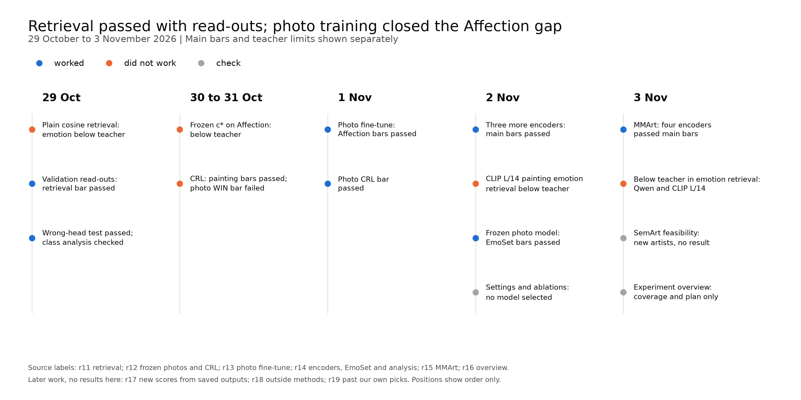
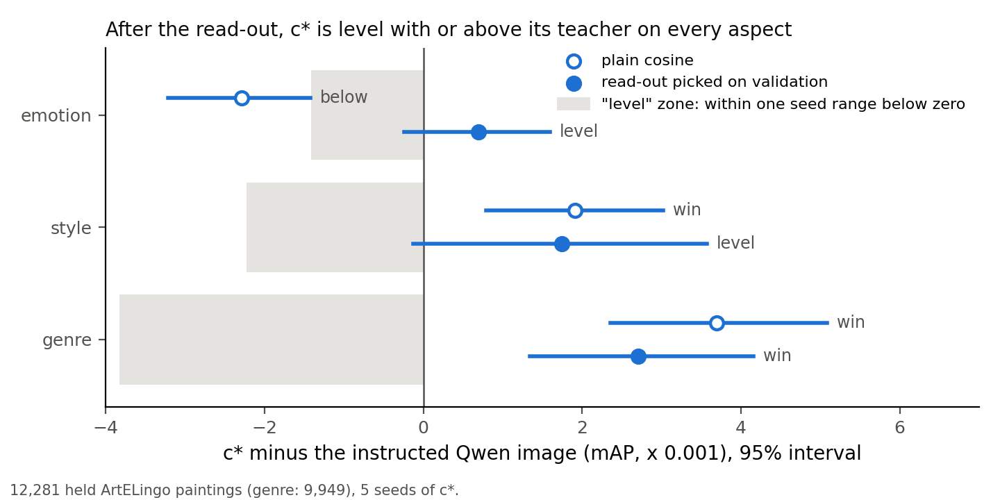
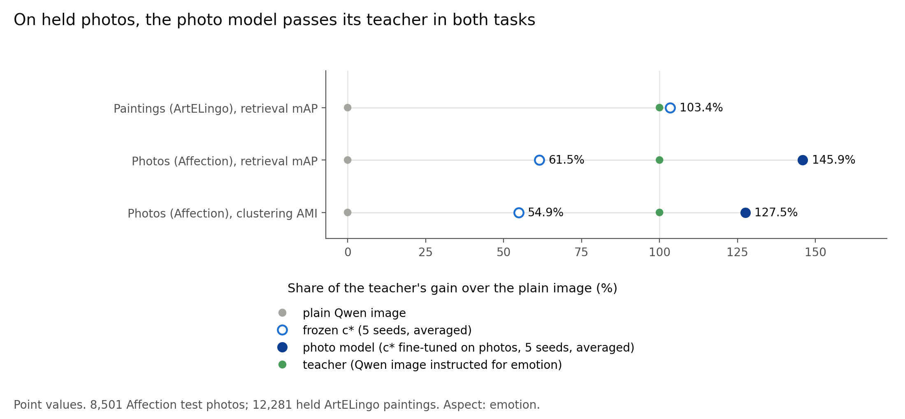

# Stage report, 2026-10-29 to 2026-11-03: retrieval passed with validation read-outs; photo training and wider tests extended the evidence

> Written 2026-11-04. Covers 2026-10-29 to 2026-11-03, Amsterdam dates.
> Previous stage: [recipe sweep](2026-10-28_recipe_sweep.md).
> Numbers came from the linked auto reports, overview, facts inventory and SemArt check.
> Running work used the controller's status at 2026-11-04 08:30, without new result scores.
> Auto report filenames kept the project's sequence dates; step dates below were real dates.

## Summary

- We started with c*, our painting model, whose held clustering result exceeded its Qwen teacher on emotion and narrowly on style.
- Painting retrieval passed after each model picked its read-out on validation. Plain cosine failed the emotion bar against the teacher.
- Frozen c* exceeded the plain image on Affection photos, but fell below the teacher. This confirmation failed.
- Photo training reversed that gap on Affection. The frozen photo model then exceeded the teacher on EmoSet, which shaped no earlier choice.
- The main bars passed on more encoders and MMArt paintings. Emotion retrieval against the teacher remained a limit.
- We checked coverage and approved six further loops. The three running rounds had no results reported here.

Sources: [retrieval](../auto/percept/2026-12-29_retrieval.md), [frozen photos](../auto/percept/2026-12-31_affection_confirmation.md),
[photo training](../auto/percept/2027-01-01_photo_finetune.md), [encoders and EmoSet](../auto/percept/2027-01-02_backbones_sweep.md),
[MMArt](../auto/percept/2027-01-03_mmart_test.md), [decided plan](../../user_read/2026-11-03_experiment_overview.md#the-plan-decided-2026-11-03).

## Where we started

We asked whether one default image embedding could supply separate spaces for emotion, style and genre.
We called the selected painting model **c\***: a shared trunk and aspect heads on a frozen image encoder.
Its recipe used instructed Qwen graphs, captions and teacher targets during training, with no aspect instruction at image encoding time.
The teacher was the Qwen image embedding under the instruction for that aspect.

We entered this stage with the following held clustering scores. AMI measured agreement between clusters and labels, corrected for chance.
Genre was LEVEL under the fixed margin, although its whole difference interval lay below zero.

| ArtELingo aspect | c* AMI | Qwen teacher AMI | Strongest eligible PercepT AMI |
|---|---:|---:|---:|
| Emotion | 0.1066 | 0.0921 | 0.0874 |
| Style | 0.4066 | 0.4026 | 0.2297 |
| Genre | 0.5001 | 0.5062 | 0.4269 |

The open questions were retrieval, transfer beyond these paintings, and dependence on the image encoder.
PercepT was our re-implementation of the published topic method; matched PercepT used the candidate's own image encoder.
Earlier recipe selection had already read ArtELingo held clustering scores. The split was separate from training, but no longer unseen research evidence.

Sources: [previous stage](2026-10-28_recipe_sweep.md#where-we-stand),
[facts inventory, clustering](../../../src/test/20261103_experiment_overview/facts_inventory.md#a1-clustering).

## Timeline

We kept the failed transfer and teacher comparisons beside the successful main tests.

*Figure 1. Positions showed order, not duration. Grey marked checks that decided no result.*

Sources: [auto reports](#sources), [direction log](../../superpowers/direction_log.md).

## The steps, in date order

### 2026-10-29 · Plain cosine retrieval (did not work)

We ranked held paintings by cosine similarity in the named aspect's head. Emotion fell below the teacher and failed the required LEVEL or WIN bar.
Contentment carried the loss; training had not directly optimized exact majority-label retrieval. That explanation remained our unchecked reading.

| Aspect | c* mAP | Plain Qwen mAP | Teacher mAP | c* minus teacher [95%] | Outcome |
|---|---:|---:|---:|---|---|
| Emotion | 0.2642 | 0.2424 | 0.2665 | -0.0023 [-0.0032, -0.0014] | BELOW |
| Style | 0.3110 | 0.1801 | 0.3091 | +0.0019 [+0.0008, +0.0030] | WIN |
| Genre | 0.5896 | 0.4760 | 0.5860 | +0.0037 [+0.0024, +0.0051] | WIN |

Source: [retrieval, results](../auto/percept/2026-12-29_retrieval.md#results).

### 2026-10-29 · Validation-picked retrieval read-outs (worked)

We passed the retrieval bar after choosing how to compare each model's saved embeddings on validation paintings.
A read-out changed retrieval, without training the model.

- **Idea:** we tested whether the comparison rule, rather than the representation alone, limited retrieval.
- **Design:** each arm chose from centering, PCA whitening and neighbour query expansion. Validation halves fitted and scored each other.
  One guarded pick served all aspects. c*, plain Qwen and the teacher picked centering plus ten-neighbour expansion.
- **Result:** c* exceeded plain Qwen on every aspect. It was LEVEL with the teacher on emotion and style, and a WIN on genre.
- **What it changed:** we supported retrieval with validation-picked read-outs. We kept the failed plain-cosine version beside that claim.

| Aspect | c* mAP | Plain Qwen mAP | Teacher mAP | c* minus teacher [95%] |
|---|---:|---:|---:|---|
| Emotion | 0.2691 | 0.2483 | 0.2684 | +0.0007 [-0.0002, +0.0016] |
| Style | 0.3235 | 0.1924 | 0.3217 | +0.0017 [-0.0001, +0.0036] |
| Genre | 0.6151 | 0.5361 | 0.6124 | +0.0027 [+0.0013, +0.0042] |

*Figure 2. The emotion comparison moved from BELOW to LEVEL. LEVEL supported no superiority claim.*

We used the held ArtELingo set below, with five model seeds. mAP averaged each query's average precision over other labelled paintings.
Joint bootstrap intervals drew queries and seeds with a fixed gallery.

| Retrieval protocol | Scope |
|---|---|
| Held paintings | 12,281; genre labels on 9,949 |
| Validation paintings | 6,152 |
| Bootstrap draws | 10,000 |
| Fixed validation mAP ranges, emotion / style / genre | 0.0014 / 0.0022 / 0.0038 |
| Read-out candidates | Up to 25 per arm |

WIN required a positive interval lower bound. Otherwise LEVEL required that bound above minus the fixed validation seed range; BELOW covered the rest.
Differences used unrounded scores, so displayed subtraction could differ in its last digit.

No whitening candidate passed its guard. Centering also failed for CRL, which picked expansion without centering.
Every pick used the largest neighbour count offered. We did not establish that this menu exhausted retrieval gains.
Validation had also chosen c*'s epochs within the development data used for the earlier recipe search.

The claim covered Qwen image queries on ArtELingo only. Caption majority labels were noisy; emotion's class-share chance mAP was 0.2007.
CLIP L/14, SigLIP 2, PercepT and CRL were descriptive in this round, with no licensed comparison claims.
We had not tested text queries.

Source: [retrieval, what ran, analysis and deviations](../auto/percept/2026-12-29_retrieval.md).

### 2026-10-29 · Wrong-head test and per-class emotion analysis (worked; analysis checked)

We found that each named head retrieved its own labels better than either wrong head.
All correct-head minus wrong-head intervals were positive. The teacher and CRL showed the same diagonal pattern descriptively, so this was not unique to c*.

| Label queried | Correct-head mAP | First wrong head, mAP | Second wrong head, mAP |
|---|---:|---|---|
| Emotion | 0.2642 | Style, 0.2487 | Genre, 0.2539 |
| Style | 0.3110 | Emotion, 0.1529 | Genre, 0.2167 |
| Genre | 0.5896 | Emotion, 0.4520 | Style, 0.3593 |

Contentment explained the plain-cosine emotion deficit: its AP difference against the teacher was -0.0324, across 4,244 queries.
The other eight classes gained between +0.0027 and +0.0340 AP. Query-weighted mAP gave the largest class the largest weight.
These were diagnostics, with no per-class claims.

Graded emotion used overlap between caption-emotion distributions instead of exact majority labels.
Its nDCG was 0.9343 for c* against 0.9341 for the teacher, a gain of +0.0002 [+0.0001, +0.0004].
The source marked this confirmation qualified. Our reading was that c* might preserve emotion mixtures while losing majority-label matches; we did not test that cause.

Sources: [retrieval, switch test and analysis](../auto/percept/2026-12-29_retrieval.md),
[decision to retain a supporting switch sentence](../../superpowers/direction_log.md#2026-10-30--retrieval-round-read-c-level-with-its-teacher-after-validation-picked-read-outs-far-above-the-plain-qwen-image-next-r12-on-more-datasets-confirmation-and-a-literature-check-on-a-signal-beyond-the-teacher).

### 2026-10-30 to 2026-10-31 · Frozen c* on Affection (did not work)

We tested painting-trained heads on photos without training on Affection. Both tasks exceeded plain Qwen but fell below the teacher, so confirmation failed.
Painting-only training was a possible cause, not a checked explanation. The user chose photo training before the freeze because the photo bar was at least level with the teacher.

| Affection task | Frozen c* | Plain Qwen | Teacher | c* minus teacher [95%] |
|---|---:|---:|---:|---|
| Clustering AMI | 0.1384 | 0.1041 | 0.1666 | -0.0282 [-0.0333, -0.0233] |
| Retrieval mAP | 0.2755 | 0.2452 | 0.2945 | -0.0190 [-0.0205, -0.0176] |

The comparison used Affection's test photos, with validation-only picks and five seeds. Emotion was the only aspect.
Plurality labels had alphabetical tie breaks. The teacher's artwork wording beat photo wording on validation in both tasks.

| Affection protocol | Scope |
|---|---|
| Test / validation photos | 8,501 / 4,251 |
| Tied test labels | 1,917, or 22.6% |
| Untied diagnostic photos | 6,584 |
| Teacher wordings / CRL versions tried | 2 / 4 |

Dropping ties kept both teacher deficits. Plain cosine, graded nDCG and every source kept teacher above c* above plain.
Contentment, excitement and sadness carried most of the weighted deficit. CLIP L/14 and frozen PercepT were descriptive.
PercepT's published scores used another protocol, so they supplied no direct comparison.

Impressions supplied an example gallery only, with no result claim. Its actual image count differed from the spec, as noted in Sources.

Sources: [frozen photos](../auto/percept/2026-12-31_affection_confirmation.md),
[decision and reason](../../superpowers/direction_log.md#2026-10-31--affection-confirmation-read-frozen-c-above-the-plain-qwen-image-below-its-teacher-fails-the-artelingo-crl-bars-pass-next-c-trained-on-photos-too-before-the-11-10-freeze).

### 2026-10-30 to 2026-10-31 · CRL comparisons (paintings worked; frozen photos did not work)

We passed all painting retrieval bars against our CRL re-implementation. Frozen c* on Affection was LEVEL with CRL and failed its WIN bar.
Validation selected CLIP L/14 with painting wording over the other CRL versions; test outcomes did not change that pick.

| Data and aspect | c* mAP | Selected CRL mAP | Difference [95%] | Outcome |
|---|---:|---:|---|---|
| ArtELingo emotion | 0.2691 | 0.2554 | +0.0137 [+0.0124, +0.0149] | WIN |
| ArtELingo style | 0.3235 | 0.2816 | +0.0418 [+0.0392, +0.0444] | WIN |
| ArtELingo genre | 0.6151 | 0.5033 | +0.1118 [+0.1087, +0.1149] | WIN |
| Affection emotion | 0.2755 | 0.2739 | +0.0016 [-0.0001, +0.0032] | LEVEL; failed WIN bar |

The painting bars followed the earlier descriptive held CRL scores. Only the Qwen CRL version was new; c* and CLIP CRL repeated known outputs.
These claims were therefore weaker evidence than comparisons fixed before any held scores.
Unselected Qwen CRL exceeded selected CLIP CRL on held painting emotion; photo-worded CLIP CRL also exceeded the selected version on Affection.
Neither diagnostic changed the validation pick.

For the same image encoder, ArtELingo emotion mAP was 0.2671 for CLIP L/14 c* against 0.2554 for CLIP L/14 CRL.
This was a point comparison only. The later bootstrap and its predeclared bar belonged to New scores from saved outputs.

Sources: [CRL results and selection disclosure](../auto/percept/2026-12-31_affection_confirmation.md#results),
[same-encoder point comparison and later test decision](../../superpowers/direction_log.md).

### 2026-11-01 · Photo fine-tune on Affection (worked)

We reversed the teacher gap after training the emotion pathway on Affection's unlabelled photos and free-text explanations.
The old frozen confirmation stayed failed.

- **Idea:** we tested whether photo-domain training could close the gap left by painting-trained heads.
- **Design:** we started from c*, kept the backbone fixed, and trained the emotion pathway with graphs, buddy terms and the teacher.
  Validation picked the settings and retrieval read-out. Near-copies of validation or test photos were excluded from training.
- **Result:** the photo model was a WIN over plain Qwen, the teacher and CRL in the scored tasks below.
- **What it changed:** we kept c* for paintings and a separate photo model. We did not establish one model for both domains.

| Affection task | Photo model | Plain Qwen | Teacher | Photo minus teacher [95%] |
|---|---:|---:|---:|---|
| AMI | 0.1838 | 0.1041 | 0.1666 | +0.0172 [+0.0121, +0.0225] |
| mAP | 0.3172 | 0.2452 | 0.2945 | +0.0227 [+0.0210, +0.0244] |
| mAP against CRL | 0.3172 | CRL 0.2739 | not applicable | +0.0433 [+0.0411, +0.0455] against CRL |

*Figure 3. Photo training reversed the Affection deficit. Shares compared each model's gain over plain Qwen with the teacher's gain.*

| Training and selection | Scope |
|---|---|
| Train photos before / after near-copy filter | 72,255 / 69,927 |
| Removed train photos | 2,328, at default-image cosine at least 0.85 to validation or test |
| Sweep / fresh final runs | 9 rows / 5 runs |
| Selected graph neighbours | 80, against c*'s 40 |
| Best epoch, all final runs | 1 |

The teacher bar was LEVEL or WIN. Although the measured differences were WIN, the licensed teacher sentence remained “level with or better than”.
Training followed the frozen failure on these same test photos. Picks froze before final scoring, but this was a claim test after test-informed research choices.
It supplied no claim of transfer without photo training.

The exact sweep pick was uncertain. Its lead over the next row was smaller than half the new AMI seed range, and CPU/GPU differences approached the tie margin.
Removing content correction failed both validation teacher gaps. Random initialization was only a validation row, so it supplied no from-scratch test claim.
Plain cosine, untied labels and every photo source supported the final ordering; contentment remained slightly below the teacher per class.

The independent comparison followed the written verdict, rather than preceding it. It matched all checked values, and the verdict counted only after that check passed.
The user then chose wider tests and an analysis-only sweep, leaving both recipes frozen.

Sources: [photo fine-tune](../auto/percept/2027-01-01_photo_finetune.md),
[wider-test decision](../../superpowers/direction_log.md#2026-11-02--photo-fine-tune-read-the-photo-model-above-the-plain-qwen-image-and-above-its-teacher-on-affection-holds-the-crl-claim-passes-next-open-step-2-in-r14-decide).

### 2026-11-02 · Three more image encoders (worked, with one failed teacher cell)

We passed the main painting and Affection bars on SigLIP 2, SigLIP 1 and CLIP L/14.
These encoders replaced the default image input; instructed Qwen graphs, captions and teacher targets still supplied training supervision.
We did not test training without Qwen.

- **Idea:** we tested whether c*'s fixed recipe extended beyond Qwen image inputs.
- **Design:** each encoder trained c* and its photo fine-tune. Painting comparisons used that encoder's plain image and matched PercepT.
  Photo comparisons used its plain image, with Qwen's teacher as a separate reference.
- **Result:** all painting plain-image comparisons passed, as did matched-PercepT clustering and Affection plain-image comparisons.
- **What it changed:** the evidence covered more image inputs, within the earlier encoder-selection limit.

| Encoder | Smallest painting AMI gain over plain | Smallest painting mAP gain over plain | Smallest AMI gain over matched PercepT |
|---|---|---|---|
| SigLIP 2 | +0.0477 [+0.0439, +0.0514] | +0.0249 [+0.0238, +0.0260] | +0.0253 [+0.0198, +0.0267] |
| SigLIP 1 | +0.0399 [+0.0363, +0.0434] | +0.0236 [+0.0225, +0.0247] | +0.0250 [+0.0195, +0.0264] |
| CLIP L/14 | +0.0377 [+0.0343, +0.0411] | +0.0192 [+0.0181, +0.0203] | +0.0243 [+0.0192, +0.0252] |

Every minimum above was emotion; style and genre also passed. The Affection scores were:

| Encoder | Photo AMI / own plain AMI | Photo mAP / own plain mAP |
|---|---|---|
| SigLIP 2 | 0.1924 / 0.1142 | 0.3227 / 0.2515 |
| SigLIP 1 | 0.1928 / 0.1200 | 0.3234 / 0.2545 |
| CLIP L/14 | 0.1941 / 0.1127 | 0.3221 / 0.2581 |

The separate teacher comparisons included LEVEL results, not universal wins. Painting genre clustering was LEVEL on each added encoder; for CLIP L/14 its point sat below the teacher, -0.0052 [-0.0103, -0.0000].
CLIP L/14 painting emotion retrieval failed its teacher bar: mAP 0.2671 against 0.2684, difference -0.0013 [-0.0023, -0.0003].
Its point deficit sat inside the seed range, but its interval lower bound did not. It licensed no teacher claim.

We had selected these encoders because an older model passed an earlier emotion test on the same ArtELingo held paintings.
Affection test photos had also been scored before. These were fixed-recipe claim tests, not wholly fresh research tests.
All trained comparisons used five seeds.

Source: [backbones sweep, results and limits](../auto/percept/2027-01-02_backbones_sweep.md).

### 2026-11-02 · Frozen photo model on EmoSet (worked)

We exceeded plain Qwen and the teacher on a photo test set that had shaped no earlier choice.
We froze the Affection-trained photo model and chose only evaluation wording, ranges and read-outs on EmoSet validation.

| EmoSet task | Photo model | Plain Qwen | Teacher | Photo minus teacher [95%] |
|---|---:|---:|---:|---|
| AMI | 0.4571 | 0.3918 | 0.4390 | +0.0181 [+0.0121, +0.0242] |
| mAP | 0.4838 | 0.3864 | 0.4519 | +0.0320 [+0.0295, +0.0347] |

| EmoSet population | Before filter | Near-copies removed | Kept |
|---|---:|---:|---:|
| Validation | 5,905 | 135 | 5,770 |
| Test | 17,716 | 368 | 17,348 |

The filter removed default-Qwen cosine at least 0.85 to Affection training photos.
Keeping near-copies reduced the AMI gain over plain Qwen from +0.0653 to +0.0390, still a WIN.
All four uncut comparison lower bounds stayed positive.
Emotion was the only tested aspect, and the claim used Qwen only; the other photo encoders supplied descriptive EmoSet rows.

The gain was not uniform across classes. At the selected read-out, amusement AP was 0.3203 against the teacher's 0.3471.
Plain cosine also put awe below the teacher. These diagnostics qualified the aggregate result without changing it.

Source: [backbones sweep, EmoSet results and diagnostics](../auto/percept/2027-01-02_backbones_sweep.md).

### 2026-11-02 · Settings and ablation sheets (check)

We completed the analysis sheets without choosing a new recipe. Sweeps used validation; saved removals supplied held ablations on Qwen.
Each effect below was against its complete model on the same machine.

| Sheet | Scope | Example effect [95%] |
|---|---|---|
| Painting settings | 39 rows; 13 settings; three seeds | Buddy temperature 0.1: style AMI -0.0163 [-0.0220, -0.0102] |
| Photo settings | 14 rows; three seeds | No content correction: emotion AMI -0.0320 [-0.0391, -0.0247] |
| Saved ablations | Eight removals; five seeds; both tasks | No instructed graphs: held style AMI -0.1903 [-0.1959, -0.1822] |
| Saved genre ablation | Same held comparison | No relational term: AMI -0.0440 [-0.0512, -0.0372]; mAP -0.1175 [-0.1214, -0.1134] |

Longer photo training improved some validation scores, but analysis named no better setting.
Some photo-sheet intervals were not centred on the point difference because cross-fit points and pooled bootstrap intervals used different estimators.
Node and local scores also differed; same-machine references kept those differences out of the reported effects.
No broader sweep was approved before the paper; the user kept these sheets as analysis.

Source: [backbones sweep, analysis and deviations](../auto/percept/2027-01-02_backbones_sweep.md),
[decision against a bigger sweep](../../superpowers/direction_log.md).

### 2026-11-03 · MMArt on four encoders (worked, with teacher limits)

We passed the main bars on new paintings and MMArt's own labels for every tested encoder.
We tested frozen c*, with read-outs and seed ranges picked on ArtELingo validation paintings carrying MMArt labels.
No MMArt test result selected a model.

| Encoder | Emotion AMI: c* / own plain / matched PercepT | Emotion mAP: c* / own plain |
|---|---|---|
| Qwen | 0.0609 / 0.0407 / 0.0514 | 0.2011 / 0.1935 |
| SigLIP 2 | 0.0608 / 0.0332 / 0.0451 | 0.2016 / 0.1897 |
| SigLIP 1 | 0.0620 / 0.0370 / 0.0468 | 0.2021 / 0.1913 |
| CLIP L/14 | 0.0590 / 0.0386 / 0.0454 | 0.2010 / 0.1912 |

All aspects passed the plain-image clustering and retrieval bars and matched-PercepT clustering bars, using five seeds.
Against the teacher, all cells predeclared for “better than” passed. Other cells could license at most “level with or better than”.
Some positive bounds were narrow, and emotion AMI remained low in every arm.

| MMArt scope | Value |
|---|---|
| Test paintings, cosine cut below 0.95 to ArtELingo train/validation | 16,384 |
| Labelled emotion / style / genre paintings | 16,218 / 16,384 / 13,420 |
| Validation paintings | 5,769 |
| Teacher cells: WIN / LEVEL / BELOW | 18 / 4 / 2 |
| Predeclared stronger teacher cells | 15; all WIN |
| New-artist subset | 15 paintings, 12 artists; no scores |

Emotion retrieval was BELOW the teacher for Qwen and CLIP L/14. Both failed teacher cells stayed in the record:

| Encoder | Emotion mAP difference against teacher [95%] | Outcome |
|---|---|---|
| Qwen | -0.0010 [-0.0015, -0.0004] | BELOW; no teacher claim |
| CLIP L/14 | -0.0011 [-0.0015, -0.0006] | BELOW; no teacher claim |

The shared-image diagnostic found a smaller emotion gain under MMArt labels than under ArtELingo labels.
Our reading was that changed labels explained much of the smaller emotion effect; the diagnostic did not isolate every cause.
On the farther subset, plain-image gains survived, but Qwen style retrieval also fell below the teacher.
That subset was descriptive and changed no claim.

MMArt and ArtELingo both used WikiArt and shared most artists. We therefore claimed new paintings and labels, not a new art source or unseen artists.
The added encoders had also passed earlier ArtELingo emotion tests. Comparisons had no multiplicity correction, and PercepT used the stronger reading again in each draw.
Thread count changed a small clustering score below the narrowest reported positive bound.

Sources: [MMArt test](../auto/percept/2027-01-03_mmart_test.md),
[cut change and test decision](../../superpowers/direction_log.md).

### 2026-11-03 · SemArt feasibility (check)

We found a possible genre test from another source, not a model result.
SemArt came from the Web Gallery of Art. Artist matching supplied a candidate set outside ArtELingo's training artists.

| SemArt check | Count |
|---|---:|
| Paintings checked | 21,382 |
| Kept at cosine below 0.95 | 17,840 |
| Kept paintings by new artists | 11,162 |
| New artists | 2,717 |
| Type classes, close to genre | 10 |

The cosine cut missed copies across scans from different sources. Artist-name matching used aliases and surname checks, but residual name misses remained possible.
Workshop and family versions also remained close. SemArt supplied no emotion or style labels.
The later spec removed exact image duplicates from the candidate set; its scope was genre only, with no result included here.

Sources: [SemArt check](../../../src/test/20261103_semart_check/20261103_semart_check_log.md),
[Past our own picks, data roles](../../superpowers/specs/2026-11-03-past-picks-design.md#33-data-roles).

### 2026-11-03 · Experiment overview (check)

We mapped existing evidence and missing comparisons; we decided no result from the overview.
It separated clustering, the main task, from retrieval and recorded the limitations of reused tests, selected encoders and missing outside methods.
The user then approved six loops to fill selected gaps. The coverage and plan below reflected that decision.

Sources: [overview](../../user_read/2026-11-03_experiment_overview.md),
[facts inventory](../../../src/test/20261103_experiment_overview/facts_inventory.md), [direction log](../../superpowers/direction_log.md).

## All attempts at a glance

We retained failures against their own bars; later successes did not replace them.

| Date | Attempt | Result against its bar | Outcome |
|---|---|---|---|
| 2026-10-29 | Plain cosine | Emotion below teacher, -0.0023 mAP | did not work |
| 2026-10-29 | Validation-picked read-outs | Emotion and style LEVEL with teacher; genre WIN | worked |
| 2026-10-29 | Whitening; CRL centering | Every whitening arm failed its validation guard; CRL centering failed too | did not work |
| 2026-10-29 | Wrong-head test | Named head beat both alternatives in each label column | worked |
| 2026-10-29 | Graded emotion | c* nDCG 0.9343 against teacher 0.9341 | qualified |
| 2026-10-29 | Per-class emotion | Contentment loss against teacher carried majority-label deficit | check |
| 2026-10-29 | Comparator regression, first queue | Wrong sample-scale PercepT mapper failed replay; full-scale mapper fixed before final scoring | failed check, corrected |
| 2026-10-29 | Read-out build smoke | Float rounding and truncated whitening null space broke agreement; numeric convention fixed before the full run | failed check, corrected |
| 2026-10-30 to 2026-10-31 | Frozen Affection transfer | Below teacher in AMI and mAP | did not work |
| 2026-10-30 to 2026-10-31 | CRL retrieval, ArtELingo | All aspect WIN bars passed, after earlier descriptive scores | worked, selection caveat |
| 2026-10-30 to 2026-10-31 | CRL retrieval, frozen Affection | LEVEL against CRL; required WIN | did not work |
| 2026-10-30 to 2026-10-31 | Photo teacher wording / alternative CRL versions | Lost validation selection; test diagnostics did not repick | not picked |
| 2026-10-30 to 2026-10-31 | Impressions gallery | Examples only, no claim bar | check |
| 2026-11-01 | Photo fine-tune | All plain-image, teacher and CRL bars passed | worked |
| 2026-11-01 | Photo sweep, no content correction | Both validation teacher gaps negative | did not work |
| 2026-11-01 | Other photo sweep rows, including random start | Below selected score; random start never tested held | not picked |
| 2026-11-01 | Photo smoke checks | Bootstrap draw count and diagnostic normalization fixed; reruns passed before the final run | failed checks, corrected |
| 2026-11-02 | Three additional encoders | Main painting and Affection bars passed | worked |
| 2026-11-02 | CLIP L/14 painting emotion retrieval | Below teacher, -0.0013 mAP | did not work |
| 2026-11-02 | Frozen photo model, EmoSet | Above plain Qwen and teacher in both tasks | worked |
| 2026-11-02 | Settings and eight removals | Analysis only; no new pick | check |
| 2026-11-02 | Missing graph input; isolated diagnostic imports | Initial failures fixed; failed units reran; sheets and diagnostics completed | failed runs, corrected |
| 2026-11-02 | Analysis spot re-derivation | Cross-fit mAP and layout adapters corrected; final independent checks agreed | failed check, corrected |
| 2026-11-03 | MMArt, four encoders | Main bars passed for each encoder | worked |
| 2026-11-03 | MMArt emotion retrieval, Qwen and CLIP L/14 | Both below teacher | did not work |
| 2026-11-03 | Far MMArt, Qwen style retrieval | Below teacher on descriptive subset | check; limit |
| 2026-11-03 | New artists within MMArt | Too few paintings for clustering; no scores | not scored |
| 2026-11-03 | SemArt and experiment overview | Feasibility and coverage only | check |

Sources: [retrieval](../auto/percept/2026-12-29_retrieval.md), [Affection](../auto/percept/2026-12-31_affection_confirmation.md),
[photo fine-tune](../auto/percept/2027-01-01_photo_finetune.md), [backbones](../auto/percept/2027-01-02_backbones_sweep.md),
[MMArt](../auto/percept/2027-01-03_mmart_test.md), [SemArt](../../../src/test/20261103_semart_check/20261103_semart_check_log.md).

## What we have and what is missing

We had broad internal coverage, but outside comparisons and checks of the evaluation protocol remained incomplete.
The tables started from the overview and added only scope named in the approved specs' Brief, §3.2, §3.3 and §6.
A claim cell meant a claim test or its comparator, not a universal win. Failed cells kept their qualification.

“Four encoders” meant Qwen, SigLIP 2, SigLIP 1 and CLIP L/14.
“Three new encoders” meant DINOv2, CLIP B/32 and CLIP B/16; “seven encoders” meant both groups together.
Teacher meant instructed Qwen only. Painting columns covered emotion, style and genre; photo columns covered emotion; SemArt covered genre/type only.
Each `filling` entry named running scope, not a completed result. `not planned` meant no addition in these three rounds.

### Clustering coverage

| Method | ArtELingo held | MMArt test | Affection test | EmoSet test | SemArt new artists |
|---|---|---|---|---|---|
| Our painting model | Four encoders, claim; filling: Past our own picks, three new encoders | Four encoders, claim; filling: Past our own picks, three new encoders | Qwen, failed confirmation; other encoders not planned | Qwen, descriptive; other encoders not planned | filling: Past our own picks, seven encoders, genre |
| Photo model | not planned | not planned | Four encoders, claim; filling: Past our own picks, three new encoders | Qwen, claim; SigLIP 2, SigLIP 1, CLIP L/14, descriptive | not planned |
| Plain image | Four encoders, claim comparator; three others had earlier descriptive rows; filling: Past our own picks, three new encoders for current c* | Four encoders, claim comparator; filling: Past our own picks, three new encoders | Four encoders, claim comparator; filling: Past our own picks, three new encoders | Qwen, claim comparator; SigLIP 2, SigLIP 1, CLIP L/14, descriptive | filling: Past our own picks, seven encoders |
| Teacher | Qwen, claim comparator | Qwen, claim comparator | Qwen, claim comparator | Qwen, claim comparator | filling: Past our own picks, Qwen genre |
| PercepT on the same encoder | Four encoders, claim comparator; three others in earlier tests; filling: Past our own picks, three new encoders with current c* | Four encoders, claim comparator; filling: Past our own picks, three new encoders | Qwen, descriptive; additions not planned | not planned | filling: Past our own picks, seven encoders |
| CRL | filling: New scores from saved outputs, CLIP L/14 | filling: New scores from saved outputs, CLIP L/14 | Qwen and CLIP L/14, descriptive | CLIP L/14, descriptive | not planned |
| CLAY | filling: Outside methods, CLIP L/14 features; compared with CLIP L/14 and Qwen c* | filling: Outside methods, CLIP L/14 features; compared with CLIP L/14 and Qwen c* | not planned | not planned | not planned |
| TPIPS | filling: Outside methods, TPIPS Qwen 8B; compared with Qwen c* | filling: Outside methods, TPIPS Qwen 8B; compared with Qwen c* | not planned | not planned | not planned |
| TURTLE | filling: Outside methods, four encoders, plain images and c* heads | filling: Outside methods, four encoders, plain images and c* heads | not planned | not planned | not planned |

New scores from saved outputs added class-count metrics to existing painting claim cells on the four encoders.
On photos, it added metrics for the four Affection photo models and Qwen on EmoSet, not new frozen painting-model confirmations.
Outside methods added TURTLE partitions of both plain images and c* heads; it did not add photo tests.

### Retrieval coverage

| Method | ArtELingo held | MMArt test | Affection test | EmoSet test | SemArt new artists |
|---|---|---|---|---|---|
| Our painting model | Four encoders, claim with teacher limits; filling: Past our own picks, three new encoders | Four encoders, claim with teacher limits; filling: Past our own picks, three new encoders | Qwen, failed confirmation; other encoders not planned | Qwen, descriptive; other encoders not planned | filling: Past our own picks, seven encoders, genre |
| Photo model | not planned | not planned | Four encoders, claim; filling: Past our own picks, three new encoders | Qwen, claim; SigLIP 2, SigLIP 1, CLIP L/14, descriptive | not planned |
| Plain image | Four encoders, claim comparator; filling: Past our own picks, three new encoders | Four encoders, claim comparator; filling: Past our own picks, three new encoders | Four encoders, claim comparator; filling: Past our own picks, three new encoders | Qwen, claim comparator; SigLIP 2, SigLIP 1, CLIP L/14, descriptive | filling: Past our own picks, seven encoders |
| Teacher | Qwen, claim comparator | Qwen, claim comparator | Qwen, claim comparator | Qwen, claim comparator | filling: Past our own picks, Qwen genre |
| PercepT on the same encoder | Qwen, descriptive; filling: New scores from saved outputs, four encoders, claim comparisons | filling: New scores from saved outputs, four encoders | Qwen, descriptive; additions not planned | not planned | not planned |
| CRL | CLIP L/14, claim comparator; Qwen, descriptive; filling: New scores from saved outputs, same-encoder CLIP L/14 comparison | filling: New scores from saved outputs, CLIP L/14 claim comparison and Qwen c* versus CLIP L/14 CRL descriptive comparison | CLIP L/14, claim comparator; Qwen, descriptive | CLIP L/14, descriptive | not planned |
| CLAY | filling: Outside methods, CLIP L/14 features; compared with CLIP L/14 and Qwen c* | filling: Outside methods, CLIP L/14 features; compared with CLIP L/14 and Qwen c* | not planned | not planned | not planned |
| TPIPS | filling: Outside methods, TPIPS Qwen 8B; compared with Qwen c* | filling: Outside methods, TPIPS Qwen 8B; compared with Qwen c* | not planned | not planned | not planned |

Past our own picks added PercepT clustering comparators, but no PercepT retrieval comparison on its new encoders or SemArt.
We therefore did not mark those retrieval cells as filling. TEMI followed Outside methods as a separate build with a timing-limited scope.
No requested coverage cell remained unclear after these checks.

### Gaps and what fills them

We mapped every overview to-do to its decided loop or explicit deferral. Status described the controller snapshot, not results.

| Overview gap | Round or later loop | Status |
|---|---|---|
| Standard clustering metrics | New scores from saved outputs | Scoring/checks done; report pending |
| Cluster-count sensitivity | New scores from saved outputs | Descriptive sweeps running |
| Stronger clustering on plain images and c* heads | Outside methods | TURTLE running; TEMI separate build later |
| DEC loss on each head, with and without a pull to initial clusters | Head variants | Decided; later loop |
| Criterion-driven clustering | Cite and explain only | Not run; large build and many per-image model calls, beyond the paper schedule |
| New-artist genre test | Past our own picks | SemArt included; no results here |
| Same-encoder CRL comparison | New scores from saved outputs | Claim scoring done; report pending |
| CRL on MMArt | New scores from saved outputs | Claim scoring done; report pending |
| Untold retrieval, joined heads without an aspect name | New scores from saved outputs | Claim scoring done; report pending |
| Text queries through caption heads | Text queries | Small exploration first; later claim loop if useful |
| Emotion below teacher, limit or per-class analysis | New scores from saved outputs; paper text | Descriptive look included; failed cells retained here |
| MMArt perspective captions as queries | Text queries | Follows initial text exploration |
| TPIPS timing probe | Outside methods | Probe completed before design; extraction underway |
| TPIPS comparator | Outside methods | Night extraction underway |
| CLAY comparator | Outside methods | Build and checks passed; labels pending |
| Encoder-selection check | Past our own picks | Three new encoder feature stores extracting; cluster training underway |
| Second instructed embedder | No scheduled loop | Important; user deferred its priority decision; comparator only, no c* retraining needed |
| Deeper residual heads | Head variants | Decided for supplementary work |
| One-pass cost table | Past our own picks | Included; no result here |
| Qualitative cluster figure | Qualitative figure | Decided; follows cluster-count scoring and design with the user |
| Second photo aspect | Cite and explain only | Not run; large new aspect/data path and data-access risk, after the paper |
| Note that the frozen encoder kept its own retrieval | Paper text | Open wording item; no experiment |
| Training-domain column and outside-method context rows | Paper text | Decided; no experiment |
| CRL clustering on paintings, added after overview | New scores from saved outputs | CLIP L/14 comparisons included |
| PercepT retrieval on other encoders and MMArt, added after overview | New scores from saved outputs | Four-encoder painting scope included; photo expansion not planned |

Sources for both coverage tables and the gap mapping:
[overview tables and plan](../../user_read/2026-11-03_experiment_overview.md),
[facts inventory, coverage](../../../src/test/20261103_experiment_overview/facts_inventory.md#b-coverage-grid-derived-from-a),
[New scores, arms/data/criteria](../../superpowers/specs/2026-11-03-new-scores-design.md#32-arms-and-controls),

[Outside methods, arms/data/criteria](../../superpowers/specs/2026-11-03-outside-methods-design.md#32-arms-and-controls),
[Past our own picks, arms/data/criteria](../../superpowers/specs/2026-11-03-past-picks-design.md#32-arms-and-controls).
The controller supplied current execution status.

## Rounds in progress (no results yet)

We reported design and execution status only, at 2026-11-04 08:30. These rounds had no reports available for this stage report.
We did not read the New scores outcome records.

**New scores from saved outputs.** We asked whether standard metrics, cluster counts and missing retrieval comparisons supported the existing picture.
The design reused saved outputs, comparing c* with plain images, matched PercepT, the teacher and same-encoder CRL; it also tested joined-head untold retrieval.
No training or GPU work was involved. Checks, validation picks and claim scoring were done; independent re-derivation matched 22,615 values.
Descriptive sweeps were running. The report was due 2026-11-04 by 18:00.

**Outside methods.** We asked how c* compared with text-conditioned outside methods and stronger clustering of plain images.
TPIPS used its aspect text; CLAY selected a text set and read-out on validation. Comparisons used Qwen c*, CLIP L/14 c*, and TURTLE on plain images and c* heads.
The build and CLAY, TURTLE and loader checks had passed. TPIPS features were extracting in six night shards, ending about Thursday 2026-11-05 23:00.
TURTLE fits ran on the cluster node. Labels were expected Friday 2026-11-06 before 11:00; TEMI followed as a separate build.

**Past our own picks.** We asked whether results survived the earlier encoder selection, transferred to name-matched new artists, and supported a one-pass cost claim.
The design added DINOv2, CLIP B/32 and CLIP B/16; SemArt genre covered seven encoders against plain images, matched PercepT and Qwen's teacher.
The cost probe compared model time with three instructed teacher passes. The build had finished; features of the new encoders were extracting and training ran on the cluster node.
The report was expected about 2026-11-10 at the latest.

The later loops covered the qualitative figure, head variants and text queries; none supplied results here.

Sources: the three [New scores](../../superpowers/specs/2026-11-03-new-scores-design.md),
[Outside methods](../../superpowers/specs/2026-11-03-outside-methods-design.md) and
[Past our own picks](../../superpowers/specs/2026-11-03-past-picks-design.md) specs, plus the controller snapshot supplied for this report.

## Where we stand

We supported painting clustering and retrieval on four image encoders and two painting test sets.
The separate photo models supported Affection emotion on four encoders; frozen Qwen photo transfer supported EmoSet emotion.
The tables above kept every headline beside its baseline.

The strongest fresh photo evidence was EmoSet, which shaped no earlier model choice.
MMArt extended the painting evidence to new paintings and labels, but retained the WikiArt source and most training artists.
Emotion retrieval against the teacher remained the main limit: the reported BELOW cells licensed no teacher claim.
Affection photo training had repaired a failed confirmation on the same test set, rather than supplied unseen-test confirmation.

Claims remained tied to the reported datasets, aspects, seeds and evaluation protocols.
The analysis sheets selected no replacement, and the running rounds supplied no new result here.
We had not established Qwen-free training, one model across both domains, text-query retrieval, or a second photo aspect.

Sources: [overview](../../user_read/2026-11-03_experiment_overview.md),
[backbones limits](../auto/percept/2027-01-02_backbones_sweep.md#results-brief), [MMArt limits](../auto/percept/2027-01-03_mmart_test.md#results-brief).

## Next

The user decided the six loops on 2026-11-03. We recorded them as decisions, without further recommendations.

| Decided loop | Scope | Position at the report snapshot |
|---|---|---|
| New scores from saved outputs | Metrics, counts, CRL clustering and retrieval, PercepT retrieval, untold retrieval, emotion analysis | Running; report pending |
| Outside methods | TPIPS, CLAY, TURTLE, then TEMI | Running; TEMI separate later build |
| Past our own picks | Three new encoders, SemArt genre, cost table | Running |
| Qualitative figure | Example clusters against plain images | Follow-up after cluster counts, designed with the user |
| Head variants | DEC on every head and deeper residual heads | Later loop; moved forward to the weekend in the direction log |
| Text queries | Caption-side exploration, then MMArt perspective captions | Later loop; moved forward to the weekend in the direction log |

The initial overview dates were estimates. We used the controller's newer running-round schedule above and the direction log's later scheduling decision for head variants and text queries.
The second instructed embedder retained a later priority decision. Criterion-driven clustering and a second photo aspect remained cite-and-explain items.

Sources: [decided overview plan](../../user_read/2026-11-03_experiment_overview.md#the-plan-decided-2026-11-03),
[later decisions](../../superpowers/direction_log.md).

## Glossary

- **c\*:** our painting model, with a shared trunk and emotion, style and genre heads on a frozen image encoder.
- **Photo model:** c*'s emotion pathway fine-tuned on unlabelled Affection train photos and explanations; separate from painting c*.
- **Aspect / head:** the requested property, and the model output space for that property.
- **Teacher:** Qwen's image embedding under the aspect instruction; used in training and as a comparator.
- **Plain image:** the encoder's image embedding without an aspect instruction.
- **Matched PercepT:** our PercepT re-implementation on the same image encoder as c*; a clustering/topic comparator.
- **CRL / CLAY / TPIPS:** outside methods whose image similarity depended on a named aspect; CRL here meant our re-implementation.
- **TURTLE / TEMI:** label-free clustering methods on frozen features; TEMI remained a later separate build.
- **Read-out:** the comparison of saved embeddings, possibly with centering, whitening or neighbour query expansion.
- **AMI / NMI / ARI / ACC:** adjusted mutual information, normalized mutual information, adjusted Rand index, and best one-to-one cluster/class accuracy.
- **mAP / AP / nDCG:** mean average precision, per-query or per-class average precision, and normalized discounted cumulative gain.
- **WIN / LEVEL / BELOW:** a positive difference interval; otherwise a lower bound above minus the fixed validation seed range; otherwise below that tolerance.
- **Seed range:** validation maximum minus minimum across model seeds; the fixed tolerance for LEVEL in these retrieval and transfer tests.
- **Told / untold retrieval:** the aspect name selected a head, or the joined heads supplied one vector without an aspect name.
- **Held / validation:** a test split, or data used for stopping, ranges and picks. Prior test reuse remained disclosed.
- **Claim / descriptive / check:** a result judged against a fixed bar, an analysis deciding no claim, or a protocol/coverage check.
- **Buddy terms / content correction / relational term:** graph-linked training losses, removal of content similarity before emotion/style graph construction, and copying the teacher's genre similarity pattern.

## Sources

The internal labels below named source rounds only. They did not add methods or result claims.

| Label and meaning | Source |
|---|---|
| r11, painting retrieval | [2026-12-29 auto report](../auto/percept/2026-12-29_retrieval.md) |
| r12, frozen photo confirmation and CRL | [2026-12-31 auto report](../auto/percept/2026-12-31_affection_confirmation.md) |
| r13, photo fine-tune | [2027-01-01 auto report](../auto/percept/2027-01-01_photo_finetune.md) |
| r14, backbones, EmoSet and analysis | [2027-01-02 auto report](../auto/percept/2027-01-02_backbones_sweep.md) |
| r15, MMArt | [2027-01-03 auto report](../auto/percept/2027-01-03_mmart_test.md) |
| r16, overview and decisions | [overview](../../user_read/2026-11-03_experiment_overview.md), [facts inventory](../../../src/test/20261103_experiment_overview/facts_inventory.md), [direction log](../../superpowers/direction_log.md), [SemArt check](../../../src/test/20261103_semart_check/20261103_semart_check_log.md) |
| r17, New scores from saved outputs | [spec, Brief, §3.2, §3.3, §6](../../superpowers/specs/2026-11-03-new-scores-design.md) |
| r18, Outside methods | [spec, Brief, §3.2, §3.3, §6](../../superpowers/specs/2026-11-03-outside-methods-design.md) |
| r19, Past our own picks | [spec, Brief, §3.2, §3.3, §6](../../superpowers/specs/2026-11-03-past-picks-design.md) |

The controller's 2026-11-04 08:30 snapshot supplied running status and superseded earlier schedule estimates.
We used no outcome record from New scores from saved outputs.

### Source differences and how we handled them

We kept final checked numbers and distinguished changed scope from a contradiction.

| Sources that differed | Difference | Treatment here |
|---|---|---|
| Backbones auto report versus its later handoffs, as documented in Deviations | Final teacher cells: 18 WIN, 5 LEVEL, 1 BELOW; handoffs: 17 WIN, 6 LEVEL, 1 BELOW | Used final checked cells |
| Backbones auto report versus handoff note, documented in Deviations | Handoff said no teacher plain-cosine rows; EmoSet diagnostic had them, unlike ArtELingo/Affection | Kept EmoSet diagnostic scope |
| MMArt auto report's previous-round table label and direction log versus backbones scope | They attached the earlier 18 WIN, 5 LEVEL, 1 BELOW counts to ArtELingo; the backbones total included Affection teacher cells too | Treated those as the backbones round's combined counts, not ArtELingo-only counts |
| Retrieval initial replay versus frozen reference, documented in Deviations | Sample-scale PercepT AMI 0.08549055120302276 versus required full-scale 0.08742922158584242 | Correction preceded final scoring; no erroneous value used as a result |
| Frozen-photo auto report versus its spec, documented in Deviations | Impressions had 822 image IDs rather than 827 | Descriptive gallery only; no claim |
| MMArt direction entry versus spec/auto report | Direction called it confirmation; spec ran a claim test | Used claim-test meaning |
| MMArt decision rationale versus auto report | Direction described a second art source; both MMArt and ArtELingo actually used WikiArt | Claimed new paintings and labels, not a new source |
| SemArt feasibility/overview versus Past our own picks §3.3 | Feasibility had 11,162 paintings; spec scored 11,159 after exact-image deduplication | Reported feasibility separately; later scope was genre only |
| Overview initial plan versus later direction decision | Head/text loops were initially later in November; direction moved them to the weekend of 2026-11-06 to 2026-11-08 | Used later decision; no new deadline invented |
| Three specs and overview versus controller snapshot | Earlier dates differed from current execution estimates, especially Past our own picks | Used controller snapshot for current status |
| Retrieval spec wording, corrected in direction log, versus model facts | Earlier reason for excluding text queries said c* had no text side; it had a trained caption side, not yet tested for retrieval | Kept text queries as untested, not impossible |

The running-round date differences were recorded below to make the superseded estimates explicit.

| Round | Earlier estimate | Controller status used here |
|---|---|---|
| New scores from saved outputs | Overview results 2026-11-05; spec report 2026-11-04 by 18:00 | Report due 2026-11-04 by 18:00 |
| Outside methods | Overview about 2026-11-08; spec report 2026-11-06 18:00 | TPIPS ending about 2026-11-05 23:00; labels 2026-11-06 before 11:00; TEMI later |
| Past our own picks | Overview about 2026-11-10; spec about 2026-11-06, at latest 2026-11-07 23:00 | Report expected about 2026-11-10 at the latest |

### Storage

We deleted nothing and proposed no removal for this report. We kept the timeline script and all three report figures.
The two copied figures matched their originals. Earlier auto reports' storage actions were historical, not actions authorized or repeated by this job.
