# Weekly report, 29 October to 3 November 2026: one plain-image read retrieves by aspect and holds on new paintings; after photo training it holds on new photos; outside comparisons are the main gap

> Written 2026-11-04. CoSiR, main. Covers 2026-10-29 to 2026-11-03, and the round finished on 2026-11-04 (§6.1) (the [previous weekly report](2026-10-28_condition_free_line.md)
> ended on 2026-10-28; "How we got here" restates what you need from it). Every number comes from the report linked in its section. Lines marked
> **Verdict (reference)** are our reading of the results; they decide nothing. File names of the auto reports carry a sequence date later than the
> real date; the Sources section gives both.

## Summary

In short: a small network, the painting model, reads one plain image (no instruction) from a frozen encoder (its weights stay fixed) and gives separate
emotion, style and genre spaces. Each of these three is an aspect. We test on paintings (ArtELingo, MMArt) and photos (Affection, EmoSet). The teacher is
Qwen's image embedding computed with an instruction that names one aspect.

Every comparison has one of three outcomes. We define them here once.

- **Clearly above:** the whole 95% interval of the difference is above zero. For a bare point estimate we say "higher".
- **Level:** the interval is not wholly above zero, but its lower end is above minus one seed range. This is within an agreed margin: not worse than one seed range. It does not show that the two are equal.
- **Below:** the lower end is under minus one seed range.

"How we got here" defines the other terms.

- **The painting model retrieved by a named aspect once each model's post-processing (how saved embeddings are compared) was picked on validation paintings.**
  Its emotion mAP (a retrieval score) was 0.2691 against 0.2684 for the teacher (+0.0007 [−0.0002, +0.0016], level). Genre was clearly above the teacher,
  though only narrowly (+0.0027 mAP). With plain cosine (no post-processing), emotion fell below the teacher (§1).
- **The frozen painting model failed on photos, and photo training reversed the gap.** Frozen on Affection, it gave AMI (a clustering score) 0.1384
  against the teacher's 0.1666. The photo model, fine-tuned with no emotion labels, gave 0.1838 (§2).
- **The strongest new evidence is EmoSet, a test set that shaped no earlier choice.** The frozen photo model gave AMI 0.4571
  against 0.4390 for the teacher (+0.0181 [+0.0121, +0.0242], clearly above) (§2.3).
- **The recipe (the fixed training procedure) held on three more image encoders.** On CLIP L/14, the smallest painting AMI gain over the plain image was
  +0.0377 [+0.0343, +0.0411], with one retrieval comparison below the teacher. We picked these encoders after an earlier test on the same paintings (§3).
- **The model held on 16,384 new paintings with new labels (MMArt).** Qwen emotion AMI was 0.0609 against 0.0407 for the plain
  image. Two emotion retrieval comparisons fell below the teacher, and the paintings share most artists with training (§4).
- **The second main message is what is missing.** Our own comparisons are broad, but the other outside comparisons and new artists are open. Two rounds of work
  (each a planned set of runs) are in progress to fill these gaps; they have no results here (§6).
- **Against the teacher, the result depends on the metric.** A third round finished on 2026-11-04. On paintings, at each test set's class count, AMI and NMI (mutual-information scores) were clearly above the teacher in 46 of 48 comparisons, and ARI and ACC (adjusted Rand index, cluster accuracy) in 22 of 48. All five below were emotion. Against the plain image, all 96 comparisons were clearly above (§6.1).
- **The main limit is emotion retrieval against the teacher.** Across eight painting comparisons, none was clearly above, five were level
  and three were below, by at most 0.0013 mAP. All results also need Qwen at training (§5.5).

## Idea and contributions

### Background

Image-text embedders such as CLIP, SigLIP and Qwen3-VL-Embedding-2B ("Qwen") place a plain image at one point, with no choice
of aspect. Qwen can also follow a text instruction that names an aspect, but it needs one pass per aspect. PercepT ("Beyond Semantics") finds perceptual topics in one space.

Instructed embedders and outside methods make similarity depend on a named aspect, but they need that aspect at test
time. An outside method is a method from another paper that compares images through a named aspect. The three we use are CRL (projects frozen features onto texts for a criterion), CLAY (projects a frozen image onto text values of an aspect,
with no training) and TPIPS (an embedder fine-tuned on human votes).

### The problem

We asked whether one read of the plain image can give separate emotion, style and genre spaces (one embedding space per aspect). A curator could then
group or search a collection by each aspect, with one image pass and no instruction.

### Our approach

We train a small network on the instructed views of one embedder (its plain image, its captions and one instructed image per aspect) and test it on the
plain image. Training uses no labels. Labels score the results and, on validation data, also pick settings and post-processing (§1.2, §5.5). Each comparison
uses a real alternative: the plain image, PercepT on the same encoder, the instructed Qwen image and CRL.

### The setup at a glance

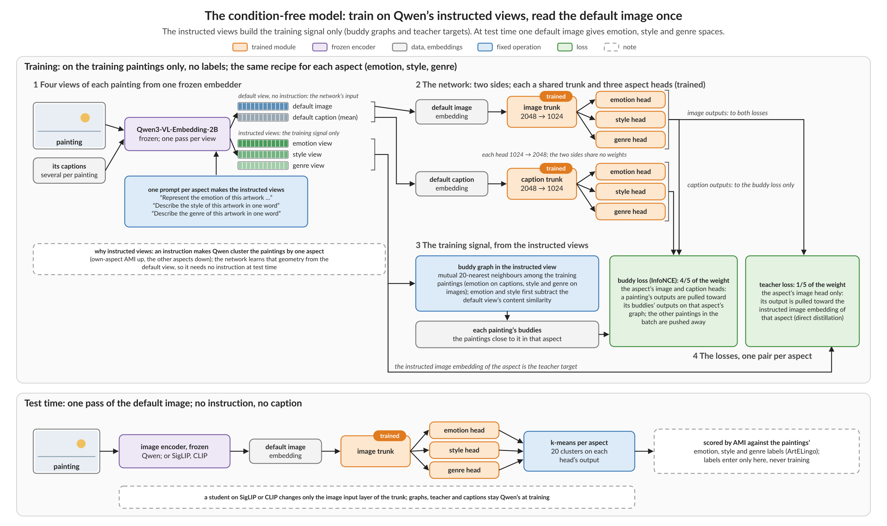

*Figure 1. The setup as of 2026-10-26. Top: training, with no labels. Bottom: one image pass at test time. Later changes
keep this flow. The model now uses 40 graph neighbours per item in place of the 20 shown, and it adds a relational genre term (a loss that copies the teacher's similarity pattern for genre).*

Instructed views link each item to its nearest items in one aspect: its buddies. The network learns these links, then
reads only the plain image. §5.2 gives the design and the buddy rule.

### Data

*Table 1. The test sets. Held means a test split kept out of training; validation is a separate split that picks settings and post-processing. Training used
42,969 ArtELingo paintings (validation: 6,152); the photo model also used 69,927 Affection photos.*

| Test set | Items | Labels | Role |
|---|---:|---|---|
| ArtELingo held | 12,281 paintings (WikiArt, with captions) | emotion, style, genre (genre on 9,949) | held; scored in earlier work |
| MMArt test | 16,384 paintings (WikiArt, not in ArtELingo) | emotion and style (MMArt); genre (WikiArt) | new paintings and labels |
| Affection test | 8,501 photos (with free-text explanations) | emotion | scored in earlier work |
| EmoSet test | 17,348 photos | emotion | shaped no earlier choice |
| SemArt new artists | 11,159 paintings (Web Gallery of Art) | genre | in progress |

### Our method so far

The painting model reads one plain image through a trunk and three heads. The photo model fine-tunes its emotion path
on Affection photos and their explanations, with no emotion labels. Both were clearly above the plain image in every test fixed in advance (the painting model on four encoders; the photo model on four encoders for Affection and on Qwen for EmoSet); emotion retrieval against the
teacher is the main caveat.

### Goal (the plan's target, not yet reached)

Our target is CVPR 2027 (a computer vision conference; it is no fixed commitment): abstract 2026-11-10, paper 2026-11-16, supplementary 2026-11-23. Our test against the teacher is level with or clearly above.

### Novelty

To our knowledge, no prior work distils (copies into a student network) the aspect-instructed views of one embedder into a small multi-head student on a
frozen image encoder, with no instruction at test. CRL and CLAY project a frozen embedding onto text at test and train
nothing. TPIPS fine-tunes the embedder on human votes. Instructed embedders need one pass per aspect. We do not present
aspect prompting, neighbour graphs or distillation as new.

> Sources: [related work sources](../literature/2027-01-03_paper_related_work_sources.md), parts H1 and C; [previous weekly report](2026-10-28_condition_free_line.md), Novelty.

### Contributions

*Table 2. Contributions: what we have on 2026-11-03, and what a full success would add.*

| Contribution | What we have now | What a full success would add |
|---|---|---|
| Method: one plain-image read gives aspect spaces | Clearly above the plain image and PercepT on the same encoder on four encoders and two painting sets; a photo model clearly above the teacher on Affection and EmoSet; retrieval by a named aspect | A result on new artists; encoders that no earlier test picked; a cost result for the one pass |
| Protocol: fair comparators and tests fixed in advance | Rules fixed before each read, five seeds, separate re-derivation; the failed tests stay in the record; standard clustering metrics and cluster counts (§6.1) | Outside comparisons as context rows |
| Analysis: which parts carry each aspect | Eight part removals, 13 painting settings and 14 photo settings on Qwen, as analysis only | Reported, not required: head variants and text queries |

> Sources: [stage report](../stage/2026-11-04_datasets_and_retrieval.md), "The steps, in date order" and "Where we stand"; [direction log](../../superpowers/direction_log.md), entries 2026-10-31 and 2026-11-03.

## How we got here

Last week ended with one painting model, one held dataset (ArtELingo) and no retrieval result. The [previous weekly report](2026-10-28_condition_free_line.md)
has the full story. Its key held AMI numbers (clustering scores), on 12,281 ArtELingo paintings:

- emotion 0.1066 against 0.0921 for the teacher (+0.0145 [+0.0113, +0.0177]);
- emotion 0.0874 for the strongest PercepT entry;
- style clearly above the teacher, though only narrowly (+0.0041 [+0.0004, +0.0081]), and genre level.

This week tested retrieval, then new data and encoders. Figure 2 shows the steps.

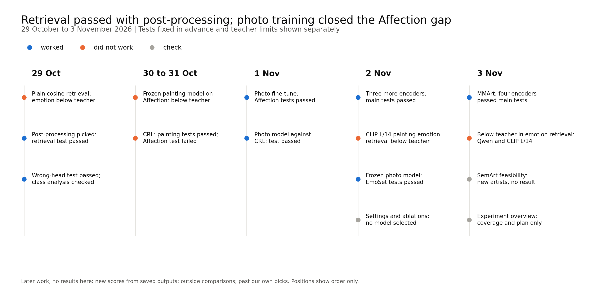

*Figure 2. The steps of the week, by date. Positions show order only. Blue marks a step that passed its tests fixed in advance, orange a step
that did not, grey a check.*

**Terms used throughout** (glossary at the end):

- **Aspect:** emotion, style or genre. A head is the network's output for one aspect.
- **Task:** clustering, scored by AMI, or retrieval, scored by mAP.
- **AMI** (adjusted mutual information): agreement between clusters and labels, corrected for chance. k-means runs fresh on each method's outputs for each test set, with 20 clusters and three random states; the AMI is the mean over the three states. No clusters are saved in a model or carried from training.
- **mAP** (mean average precision): how high the items with the same label rank, averaged over queries. AP is the same score for one query or one class.
- **Plain image:** an encoder's image embedding with no instruction.
- **Teacher:** the Qwen image embedded under one aspect's instruction (the "instructed" image). It is used in training and as a comparator, and it
  needs one encoder pass per aspect.
- **Frozen:** with weights fixed. The frozen painting model is the painting model used on photos with no photo training.
- **Painting model:** a shared trunk with emotion, style and genre heads on a frozen image encoder.
- **Emotion path:** the image side and the text side of the model, each a trunk with an emotion head. The text side reads captions (paintings) or explanations (photos) and is used only in training; at test, the emotion head on the image side gives the output.
- **Photo model:** the painting model with its emotion path fine-tuned on Affection photos and their explanations, with no emotion labels.
- **Matched PercepT:** our re-implementation of PercepT on the same image encoder as the model. Its topics still come from Qwen, also on the other encoders.
- **Outside method:** a method from another paper that compares images through a named aspect (CRL, CLAY, TPIPS). TURTLE and TEMI are label-free clustering methods, not outside methods in this sense.
- **CRL:** an outside method (NeurIPS 2025) that projects frozen features onto texts written for a criterion. We use our
  re-implementation.
- **Post-processing:** how saved embeddings are compared at retrieval time, with no new training, for example after centering or with query expansion. Plain cosine is retrieval with none. Each model picks one on validation.
- **Told retrieval:** a query is an image plus an aspect name. The name only picks the head; the model gets no instruction text. A hit has the same label.
- **Validation and held:** validation data pick settings, post-processing and seed ranges. A held set is a test split kept out of training.
- **Test fixed in advance, score only, cell:** a test fixed in advance has a pass rule set before the scores were read. A score-only result has no such rule and decides nothing. A cell is one comparison for one encoder, test set, aspect and task.
- **Clearly above, level, below:** as defined in the Summary. Outcomes use unrounded values.
- **Seed range:** a model's validation spread (maximum minus minimum) over its seeds, for one aspect, task and dataset, fixed before the test. Qwen ArtELingo clustering uses last week's
  fixed ranges, from three development seeds: 0.0046, 0.0082 and 0.0128 for emotion, style and genre.
- **Round:** one planned set of runs with its own spec; §6 names the two in progress and the one finished on 2026-11-04.

Comparisons used five model seeds and 95% bootstrap intervals. Retrieval intervals are a joint bootstrap over queries and seeds with a fixed gallery,
so they do not cover a new gallery. Differences used unrounded scores, so a shown subtraction can differ in its last digit.

> Sources: [previous weekly report](2026-10-28_condition_free_line.md), Summary and §6.1; [stage report](../stage/2026-11-04_datasets_and_retrieval.md), "Where we started" and "Glossary".

## 1. Does the model also retrieve by a named aspect?

The model did, on paintings, after each model's post-processing was picked on validation paintings. With plain cosine it failed one test:
emotion against the teacher. The test used 12,281 held ArtELingo paintings (genre labels on 9,949) and Qwen image queries.
Each labelled query ranked the other labelled paintings.

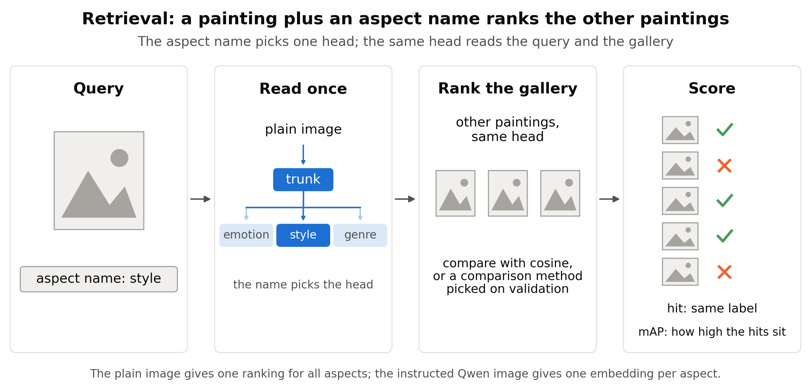

*Figure 3. How one retrieval query works: the aspect name picks the head, and that head ranks the other paintings.*

### 1.1 Plain cosine and its miss on emotion (2026-10-29)

With plain cosine, the painting model was clearly above the plain image on every aspect, but emotion fell below the teacher. The test against the teacher asked for
level or clearly above, so this first form of the retrieval result failed.

*Table 3. Held retrieval with plain cosine (mAP).*

| Aspect | Painting model | Plain image | Teacher | Model minus teacher [95%] | Outcome |
|---|---:|---:|---:|---|---|
| Emotion | 0.2642 | 0.2424 | 0.2665 | −0.0023 [−0.0032, −0.0014] | below |
| Style | 0.3110 | 0.1801 | 0.3091 | +0.0019 [+0.0008, +0.0030] | clearly above |
| Genre | 0.5896 | 0.4760 | 0.5860 | +0.0037 [+0.0024, +0.0051] | clearly above |

One class carried the miss (§1.4). Training did not directly optimise retrieval of each painting's majority label (its most common caption emotion). That
explanation is not checked.

### 1.2 The post-processing picked on validation (2026-10-29)

Post-processing picked on validation brought emotion to level with the teacher and left the gains over the plain image large.
Post-processing changes retrieval without any training. Each model chose from centering, PCA whitening and neighbour query
expansion, up to 25 options, on 6,152 validation paintings. One pick served all aspects. Selection also reused data: validation chose the painting model's epochs within development data that had already picked the model among about 60 configurations, before the post-processing step.

*Table 4. Held retrieval with the post-processing picked on validation (mAP).*

| Aspect | Painting model | Plain image | Teacher | Model minus teacher [95%] | Outcome |
|---|---:|---:|---:|---|---|
| Emotion | 0.2691 | 0.2483 | 0.2684 | +0.0007 [−0.0002, +0.0016] | level |
| Style | 0.3235 | 0.1924 | 0.3217 | +0.0017 [−0.0001, +0.0036] | level |
| Genre | 0.6151 | 0.5361 | 0.6124 | +0.0027 [+0.0013, +0.0042] | clearly above |

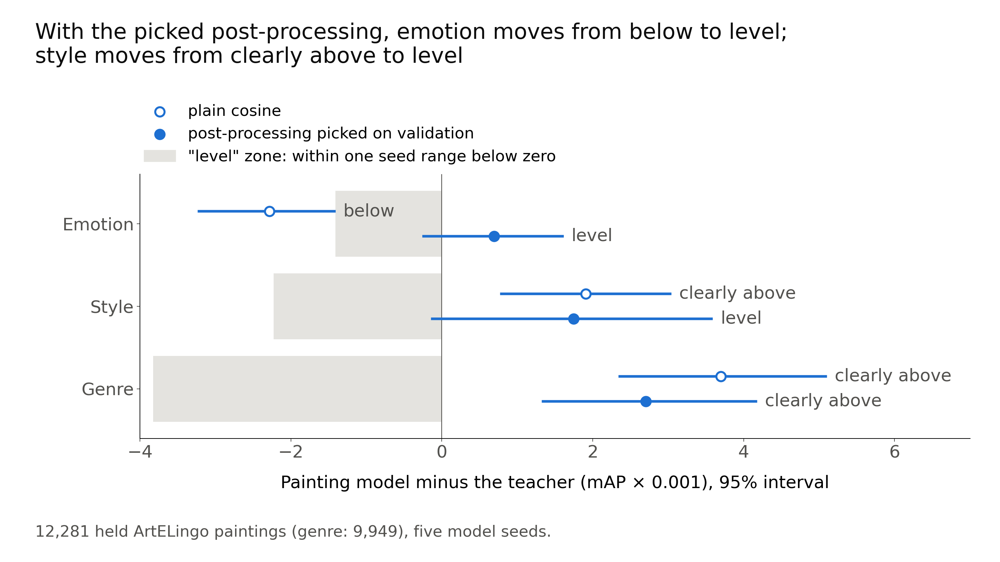

*Figure 4. The painting model minus the teacher, with plain cosine and with the picked post-processing. Emotion
moved from below to level. Level shows only that the model is not worse than one seed range, not that it equals the teacher. Style moved from clearly above to level, with about the same gap (+0.0017 beside +0.0019); the interval widened.*

Style's gap, +0.0017, was about the same as +0.0019 with plain cosine. The interval widened, so the outcome moved from clearly above to level. Genre was clearly above the teacher, though only narrowly (+0.0027 mAP: 0.6151 beside 0.6124).
On painting mAP the seed range is 0.0014 for emotion, 0.0022 for style and 0.0038 for genre.

The painting model, the plain image and the teacher all picked centering plus ten-neighbour expansion. No whitening option passed its validation check. Every pick used the largest neighbour count offered, so the options we offered may not exhaust the gains from post-processing. Emotion's chance mAP, from the class shares, was 0.2007, and the majority labels from captions are noisy.

### 1.3 The wrong-head test (2026-10-29)

Each head, queried with its own aspect name, retrieved its own labels better than either wrong head, and each difference was clearly above zero.
The teacher and CRL showed the same pattern as point values, so the pattern is not unique to our model. Our model gives this pattern from one read of the plain image.

*Table 5. Held plain-cosine mAP for each label set, through the correct head and through each wrong head.*

| Label queried | Correct head | First wrong head | Second wrong head |
|---|---:|---|---|
| Emotion | 0.2642 | style head, 0.2487 | genre head, 0.2539 |
| Style | 0.3110 | emotion head, 0.1529 | genre head, 0.2167 |
| Genre | 0.5896 | emotion head, 0.4520 | style head, 0.3593 |

### 1.4 Emotion per class (2026-10-29)

One emotion class, contentment, explained the plain-cosine deficit. Its AP (average precision) difference against the teacher was −0.0324 across 4,244 of the 12,281
queries. The other eight classes were higher than the teacher's, by +0.0027 to +0.0340 AP. mAP weights each query equally, so the
largest class weighs most. These are diagnostics, with no per-class conclusions.

Graded emotion gave a qualified result. It scored the overlap between caption-emotion distributions in place of exact labels. The nDCG (a graded ranking score) was:

- 0.9343 for the model against 0.9341 for the teacher (+0.0002 [+0.0001, +0.0004]);
- 0.9292 for the plain image.

The retrieval report read this as a hint that the model keeps emotion mixtures but loses exact matches; that is not checked.

### 1.5 CRL on paintings (2026-10-30 to 10-31)

The painting model was clearly above CRL on all three aspects. Validation picked the CRL version: CLIP L/14 with criterion texts worded for paintings.
The tests came after we had seen CRL's score-only held scores, so this evidence is weaker than a comparison fixed earlier.

*Table 6. Held painting retrieval against the CRL version picked on validation (mAP).*

| Aspect | Painting model (Qwen) | CRL (CLIP L/14) | Difference [95%] | Outcome |
|---|---:|---:|---|---|
| Emotion | 0.2691 | 0.2554 | +0.0137 [+0.0124, +0.0149] | clearly above |
| Style | 0.3235 | 0.2816 | +0.0418 [+0.0392, +0.0444] | clearly above |
| Genre | 0.6151 | 0.5033 | +0.1118 [+0.1087, +0.1149] | clearly above |

The two arms use different encoders. On the same encoder, CLIP L/14, emotion mAP was 0.2671 for our model trained on CLIP L/14 (§3) against 0.2554 for
CRL; this is a point comparison only. An unpicked Qwen version of CRL exceeded the picked one on held emotion, but picks use validation only, so the pick stayed.

> Sources: [retrieval report](../auto/percept/2026-12-29_retrieval.md), Results and Analysis; [Affection report](../auto/percept/2026-12-31_affection_confirmation.md), Results; [stage report](../stage/2026-11-04_datasets_and_retrieval.md), steps of 2026-10-29 to 10-31.

**Verdict (reference).** The retrieval result on paintings rests on picked post-processing; for emotion it is level with the teacher. The large margins are over the plain
image; against the teacher, the model is level on emotion and style and only narrowly clearly above on genre.

## 2. Does the model hold on photos?

Trained on paintings alone, the model did not hold on photos. After fine-tuning on photos with no emotion labels it did, and the photo model, frozen again for testing, was then clearly above the teacher on a test set that shaped no earlier choice. Emotion was the only aspect tested on photos.

### 2.1 The failed test: the frozen painting model on Affection (2026-10-30 to 10-31)

**Idea.** We tested whether heads trained on paintings transfer to photos with no photo training.

**Setting and method.** The input was the plain Qwen image of each Affection photo. The heads stayed frozen. The score was
emotion AMI and mAP on 8,501 test photos, with plurality labels (the emotion with the most votes); 1,917 of them (22.6%) had tied votes, broken alphabetically.

The post-processing and wording were picked on 4,251 validation photos. The teacher's instruction was tried in two wordings, one for artwork and one for photos, and the artwork wording scored higher on validation in both tasks. The test asked for clearly above the plain image and level or clearly above the teacher, in both tasks.

*Table 7. The frozen painting model on Affection test.*

| Task | Painting model | Plain image | Teacher | Model minus plain [95%] | Model minus teacher [95%] | Outcome against teacher |
|---|---:|---:|---:|---|---|---|
| AMI | 0.1384 | 0.1041 | 0.1666 | +0.0343 [+0.0298, +0.0387] | −0.0282 [−0.0333, −0.0233] | below |
| mAP | 0.2755 | 0.2452 | 0.2945 | +0.0304 [+0.0293, +0.0315] | −0.0190 [−0.0205, −0.0176] | below |

**Result.** The test failed: the model was clearly above the plain image and fell below the teacher in both tasks. Against CRL it was level
(0.2755 against 0.2739, +0.0016 [−0.0001, +0.0032]). The point estimate is higher, but the interval is not wholly above zero, so the test for clearly above failed.

The order of model, plain image and teacher stayed the same with ties dropped (6,584 photos), with plain cosine, with graded nDCG and in each of the image collections that Affection draws on.
Contentment, excitement and sadness carried most of the deficit. Painting-only training is a possible cause; this test did
not check it.

We read this as a gain over the plain image that still falls short of the teacher, and chose to try photo training before the planned freeze of the recipe. The failed test stays failed.

### 2.2 The photo fine-tune (2026-11-01)

Photo training reversed the teacher gap in both tasks on Affection. The photo model was also clearly above CRL.

**Design.** We started from the painting model and kept the image encoder frozen. We trained its emotion path on 69,927 Affection photos and the free-text explanations that come with them, with the same kinds of graph, buddy terms and teacher. No emotion labels were used. Validation picked
the settings, in a pick sweep of nine rows, and the post-processing. All picks were frozen before the test. Train labels were never read.

**How it trains.** The fine-tune starts the emotion path from its ArtELingo weights. The text side reads the explanations. Encoder features stay fixed, and the style and genre heads are unused.

- Graphs link photos that are mutual nearest neighbours by explanation under the emotion instruction, 80 per photo, with content similarity subtracted.
- Four buddy terms pull a photo's image and text outputs toward those of its buddies. A teacher term (weight 0.25) pulls toward the instructed image. No emotion label enters.
- AdamW uses batches of 512 graph pairs, for up to 200 epochs. It stops early on the validation loss, with a patience of 15. All five final runs (one per seed) kept epoch 1.
- At test, the photo model reads one plain image. k-means runs new on the test photos, and retrieval ranks them.

*Table 8. The photo model on Affection test, against the same comparators.*

| Task | Photo model | Plain image | Teacher | Photo minus plain [95%] | Photo minus teacher [95%] |
|---|---:|---:|---:|---|---|
| AMI | 0.1838 | 0.1041 | 0.1666 | +0.0797 [+0.0741, +0.0857] | +0.0172 [+0.0121, +0.0225] |
| mAP | 0.3172 | 0.2452 | 0.2945 | +0.0720 [+0.0699, +0.0742] | +0.0227 [+0.0210, +0.0244] |

Against CRL (0.2739), the mAP difference was +0.0433 [+0.0411, +0.0455], clearly above. The order held with ties dropped, with plain cosine and in each image collection.

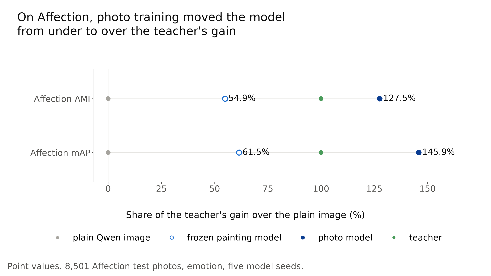

*Figure 5. Each model's gain over the plain Qwen image, as a share of the teacher's gain. Photo training moved Affection from
54.9% to 127.5% in AMI and from 61.5% to 145.9% in mAP. The frozen painting model is the model of §2.1. Point values.*

**Start point.** A run from random weights, with the same settings as the painting start (40 neighbours), scored about the same on validation on one seed: AMI 0.1801 beside 0.1769, and mAP 0.3227 for both. We did not pick it, so it has no test score. The picked setting (80 neighbours) was not tried from random weights. A run from random weights at the picked settings is planned after the rounds in progress.

**Limits.**

- We trained after the failure on these same test photos, so this test is not a fresh confirmation. Picks did freeze first.
- The test against the teacher asked for level or clearly above, so the only sentence it supports is "level with or better than the teacher".
- The result does not show transfer without photo training, or one model for both domains.
- The exact pick is close to noise. Its lead over the second-best sweep row was 0.0032 AMI, under half of the photo model's seed range (0.00707). Training is also not deterministic across devices: a CPU and a GPU build differed by about 0.6 score units, near the 0.5 tie margin, so the exact setting is less certain.
- We removed 2,328 of 72,255 train photos as near-copies of validation or test photos (plain-image cosine at least 0.85; 69,927 remain).

We then asked for wider tests. The test also limited the wording: a "better than" statement needed a new test that asked for clearly above.

### 2.3 EmoSet, a test set that shaped no earlier choice (2026-11-02)

The frozen photo model was clearly above the plain image and the teacher on EmoSet in both tasks, in a test fixed in advance that asked for clearly above. No model trained on EmoSet. Only the evaluation wording, seed ranges and post-processing were chosen, using EmoSet validation photos and not test photos.

*Table 9. The frozen photo model on 17,348 EmoSet test photos.*

| Task | Photo model | Plain image | Teacher | Photo minus plain [95%] | Photo minus teacher [95%] |
|---|---:|---:|---:|---|---|
| AMI | 0.4571 | 0.3918 | 0.4390 | +0.0653 [+0.0589, +0.0719] | +0.0181 [+0.0121, +0.0242] |
| mAP | 0.4838 | 0.3864 | 0.4519 | +0.0975 [+0.0948, +0.1004] | +0.0320 [+0.0295, +0.0347] |

We removed 368 of 17,716 test photos as near-copies of Affection train photos (17,348 remain).

With the near-copies kept, the AMI gain over the plain image fell to +0.0390 [+0.0318, +0.0464], still with a positive lower bound. The other three differences moved by 0.0010 at most, so the result against the teacher stands. Why this one gain moved is not checked.

The gain was uneven: amusement AP was lower than the teacher's (0.3203 against 0.3471; a point comparison with no interval), and awe was also lower with plain cosine. The result covers Qwen and emotion only.
On the other three encoders, EmoSet gave score-only results.

> Sources: [Affection report](../auto/percept/2026-12-31_affection_confirmation.md), Results and Analysis; [photo fine-tune report](../auto/percept/2027-01-01_photo_finetune.md); [encoders report](../auto/percept/2027-01-02_backbones_sweep.md), Results and Analysis; [direction log](../../superpowers/direction_log.md), entries 2026-10-31 and 2026-11-02.

**Verdict (reference).** EmoSet is the strongest photo evidence so far, since it shaped no earlier choice. The Affection result is
weaker evidence, because it follows a failure on the same photos.

## 3. Does the recipe depend on the image encoder?

On the three further encoders tested, all tests against the plain image and matched PercepT passed; against the teacher, one comparison fell below. We trained the painting model and its
photo fine-tune on SigLIP 2, SigLIP 1 and CLIP L/14 with the recipe unchanged (2026-11-02). These encoders replaced only the image
input. Qwen's instructed graphs, captions and teacher still supplied training. We did not test training without Qwen.

*Table 10. Painting results on 12,281 held ArtELingo paintings. Each entry is the smallest of three aspects; emotion was the
smallest every time.*

| Encoder | AMI gain over own plain image | mAP gain over own plain image | AMI gain over matched PercepT |
|---|---|---|---|
| SigLIP 2 | +0.0477 [+0.0439, +0.0514] | +0.0249 [+0.0238, +0.0260] | +0.0253 [+0.0198, +0.0267] |
| SigLIP 1 | +0.0399 [+0.0363, +0.0434] | +0.0236 [+0.0225, +0.0247] | +0.0250 [+0.0195, +0.0264] |
| CLIP L/14 | +0.0377 [+0.0343, +0.0411] | +0.0192 [+0.0181, +0.0203] | +0.0243 [+0.0192, +0.0252] |

*Table 11. Photo model on 8,501 Affection test photos, against each encoder's own plain image.*

| Encoder | AMI, model / plain | AMI gain [95%] | mAP, model / plain | mAP gain [95%] |
|---|---|---|---|---|
| Qwen | 0.1838 / 0.1041 | +0.0797 [+0.0741, +0.0857] | 0.3172 / 0.2452 | +0.0720 [+0.0699, +0.0742] |
| SigLIP 2 | 0.1924 / 0.1142 | +0.0782 [+0.0724, +0.0845] | 0.3227 / 0.2515 | +0.0711 [+0.0673, +0.0749] |
| SigLIP 1 | 0.1928 / 0.1200 | +0.0728 [+0.0668, +0.0787] | 0.3234 / 0.2545 | +0.0688 [+0.0652, +0.0722] |
| CLIP L/14 | 0.1941 / 0.1127 | +0.0815 [+0.0746, +0.0880] | 0.3221 / 0.2581 | +0.0640 [+0.0605, +0.0671] |

Against the Qwen teacher, the 24 comparisons of these three encoders (six on ArtELingo and two on Affection per encoder) gave 18 clearly above, 5 level and 1 below. All six others were on ArtELingo.

The one below was CLIP L/14 emotion retrieval (Table 12). Its point deficit was inside the seed range (0.00169), but its lower bound (−0.0023) was beyond it, so the result is below.

*Table 12. The comparisons (cells) that were not clearly above the teacher. A value of −0.0000 is a negative number that rounds to zero.*

| Encoder, aspect, task | Model / teacher | Difference [95%] | Outcome |
|---|---|---|---|
| SigLIP 2, emotion, mAP | 0.2692 / 0.2684 | +0.0008 [−0.0001, +0.0017] | level |
| SigLIP 2, genre, AMI | 0.5084 / 0.5062 | +0.0022 [−0.0040, +0.0091] | level |
| SigLIP 1, emotion, mAP | 0.2688 / 0.2684 | +0.0004 [−0.0005, +0.0013] | level |
| SigLIP 1, genre, AMI | 0.5065 / 0.5062 | +0.0003 [−0.0049, +0.0057] | level |
| CLIP L/14, emotion, mAP | 0.2671 / 0.2684 | −0.0013 [−0.0023, −0.0003] | below |
| CLIP L/14, genre, AMI | 0.5010 / 0.5062 | −0.0052 [−0.0103, −0.0000] | level |

**The limit on how we picked them.** We chose these three because an older model passed an earlier emotion test of ours on the same held paintings. In that test DINOv2 failed, and CLIP B/32 and B/16 were unclear; this report did not test those three. The Affection test photos had also been scored
before. These are tests with a fixed recipe, and they are not wholly fresh. The round called "Past our own picks" (§6) tests the
encoders that the earlier test left out.

> Sources: [encoders report](../auto/percept/2027-01-02_backbones_sweep.md), Results and "What it does not show"; [photo fine-tune report](../auto/percept/2027-01-01_photo_finetune.md), Results; [experiment overview](../../user_read/2026-11-03_experiment_overview.md), "Clustering: what is missing".

**Verdict (reference).** The recipe carried to three encoders of two families (SigLIP and CLIP), within the limit of the pick. Qwen remains a
training dependency on every encoder.

## 4. Does the model hold on paintings it never saw?

It held on new paintings and new labels, on all four encoders; it did not address new artists. We tested the frozen painting model on MMArt, a set of WikiArt paintings outside ArtELingo (WikiArt is a public online collection of paintings), scored with MMArt's own labels (2026-11-03). Post-processing and seed ranges came from the 5,769 ArtELingo validation paintings that carry MMArt labels (the validation set of §1.2 has 6,152 paintings in all). No MMArt test result selected a model.

MMArt holds 74,234 WikiArt paintings with generated texts, which these tests do not use. Its emotion label is a field with nine ArtEmis classes. MMArt's paper says its emotional text is grounded in ArtEmis utterances (about 5.7 per painting) and does not define the field further. Style also comes from MMArt, and genre from WikiArt's genre files. MMArt emotion equals our ArtELingo painting label on only 43.4% of 11,398 shared held paintings, so we treat it as its own label set.

### 4.1 The test on four encoders

The model was clearly above the plain image and matched PercepT in all nine comparisons per encoder: AMI and mAP against the plain image, AMI against matched PercepT, on each of the three aspects. For matched PercepT, each bootstrap draw took the larger of its own-topic reading and its 20-cluster reading, which makes the comparator stronger.

*Table 13. MMArt emotion on 16,384 paintings. Emotion gave the smallest gain over the plain image in every row.*

| Encoder | AMI: model / plain / matched PercepT | Gain over plain [95%] | mAP: model / plain | Gain over plain [95%] |
|---|---|---|---|---|
| Qwen | 0.0609 / 0.0407 / 0.0514 | +0.0201 [+0.0178, +0.0227] | 0.2011 / 0.1935 | +0.0075 [+0.0070, +0.0082] |
| SigLIP 2 | 0.0608 / 0.0332 / 0.0451 | +0.0276 [+0.0252, +0.0301] | 0.2016 / 0.1897 | +0.0120 [+0.0114, +0.0125] |
| SigLIP 1 | 0.0620 / 0.0370 / 0.0468 | +0.0249 [+0.0226, +0.0274] | 0.2021 / 0.1913 | +0.0108 [+0.0103, +0.0113] |
| CLIP L/14 | 0.0590 / 0.0386 / 0.0454 | +0.0204 [+0.0182, +0.0227] | 0.2010 / 0.1912 | +0.0098 [+0.0093, +0.0103] |

Emotion AMI was low in every arm, near 0.06 for the model. All 16,384 paintings carried style labels; 16,218 carried emotion and
13,420 genre labels. We did not correct the intervals for the number of comparisons, so a narrow positive lower bound is weaker evidence.

### 4.2 The near-copy cut

The test set kept only paintings whose plain-image cosine to every ArtELingo train and validation painting was below 0.95, after we removed exact copies.
The counts:

- 16,782 MMArt paintings lie outside ArtELingo; a first cut at 0.85 removed 6,375 of them, mostly other works by the same artists;
- we moved the cut to 0.95 before the test, which left the 16,384 test paintings;
- the 0.85 cut became a diagnostic subset of 10,403 paintings, after 4 duplicates inside MMArt were dropped.

On the 0.85 subset, which lies farther from training, the gains over the plain image survived. Qwen
style retrieval also fell below the teacher there (−0.0039 [−0.0058, −0.0020]), which changes no conclusion above.

### 4.3 The two emotion retrieval cells below the teacher

On MMArt, emotion retrieval fell below the teacher on Qwen and CLIP L/14. Across all 24 teacher comparisons the result was:

- 18 clearly above, some narrowly, 4 level and 2 below;
- all 15 comparisons fixed in advance to need "clearly above" (a "better than" test) were clearly above.

*Table 14. The two MMArt emotion retrieval cells that fell below the teacher.*

| Encoder | Emotion mAP difference against teacher [95%] | Seed range | Outcome |
|---|---|---:|---|
| Qwen | −0.0010 [−0.0015, −0.0004] | 0.0015 | below |
| CLIP L/14 | −0.0011 [−0.0015, −0.0006] | 0.0006 | below |

On Qwen, contentment AP (average precision) was 0.2413 against the teacher's 0.2547, and amusement was 0.0828 against 0.0710.

With plain cosine, Qwen emotion mAP was 0.1998 for the model, 0.1935 for the plain image and 0.2026 for the teacher. We had not expected the Qwen cell to fall below the teacher.

### 4.4 The new-artist limit

MMArt and ArtELingo both come from WikiArt and share most artists. Only 15 test paintings, by 12 artists, come from artists with no
ArtELingo train paintings. That is fewer than the 20 clusters that k-means needs, so we made no scores for them. We therefore say only that the paintings
and labels are new. The test covers no new art source and no unseen artists.

### 4.5 The shared-paintings analysis

On the same paintings, the emotion gain under MMArt labels was about half the gain under ArtELingo labels, while the style gain did not
change. The analysis used 11,528 paintings that carry both label sets, on Qwen, against the plain image.

*Table 15. AMI gain over the plain image on the same 11,528 paintings, under each label set.*

| Comparison | MMArt labels [95%] | ArtELingo labels [95%] |
|---|---|---|
| Emotion | +0.0192 [+0.0166, +0.0220] | +0.0364 [+0.0332, +0.0398] |
| Style | +0.1878 [+0.1810, +0.1927] | +0.1879 [+0.1809, +0.1923] |

The emotion gain on the MMArt test set (+0.0201) sat close to the shared-paintings value under MMArt labels. Our reading is that the
changed labels explain much of the smaller emotion effect. The labelled populations differ, so this analysis does not isolate every
cause.

### 4.6 The SemArt side check (2026-11-03)

SemArt (Web Gallery of Art) is a possible genre test from another source; this check gave no model result. The counts:

- 21,382 paintings, of which 17,840 stayed below cosine 0.95;
- 11,162 of these came from 2,717 artists with no ArtELingo train paintings;
- the later round spec removed exact duplicates, which left 11,159 paintings.

SemArt has 10 type classes, close to genre, and no emotion or style labels. Copies across scans and artist-name misses may remain.

> Sources: [MMArt report](../auto/percept/2027-01-03_mmart_test.md), Results and Analysis; [direction log](../../superpowers/direction_log.md), entries 2026-11-02 and 2026-11-03; [SemArt check](../../../src/test/20261103_semart_check/20261103_semart_check_log.md); [MMArt spec](../../superpowers/specs/2026-11-02-mmart-test-design.md), test cut.

**Verdict (reference).** The gains over the plain image and matched PercepT carried to new paintings and labels. Against the teacher the
ArtELingo pattern repeated: clearly above in clustering, level or slightly below in emotion retrieval.

## 5. The successful line, as one design

One plain-image read, trained on instructed graphs, gave the results below on every test set. The section starts with the result, then gives the design, the evidence for each part, where the gain sits, what the result covers and what is new.

### 5.1 The result across all test sets

The model was clearly above the plain image on every test set. Against the teacher it was clearly above in most clustering comparisons. Retrieval was mixed: clearly above for the photo model and on painting genre, but never clearly above on painting emotion (Figure 10). Table 16 uses
Qwen. The painting rows use the painting model. The EmoSet row and the second Affection row use the photo model.

*Table 16. The result on Qwen. n/a marks a comparison with no result; italic entries are score only (no test fixed in advance). Item counts are in Table 1; five seeds. The PercepT and CRL columns give those methods' own scores; the last two columns compare our model with the teacher.*

| Test set, model | Aspect, task | Our model | Plain image | PercepT | CRL | Model minus teacher [95%] | Outcome |
|---|---|---:|---:|---:|---:|---|---|
| ArtELingo, painting | Emotion AMI | 0.1066 | 0.0708 | 0.0874 | n/a | +0.0145 [+0.0113, +0.0177] | clearly above |
| | Style AMI | 0.4066 | 0.2233 | 0.2297 | n/a | +0.0041 [+0.0004, +0.0081] | clearly above |
| | Genre AMI | 0.5001 | 0.4521 | 0.4269 | n/a | −0.0060 [−0.0103, −0.0015] | level |
| | Emotion mAP | 0.2691 | 0.2483 | *0.2483* | 0.2554 | +0.0007 [−0.0002, +0.0016] | level |
| | Style mAP | 0.3235 | 0.1924 | *0.1523* | 0.2816 | +0.0017 [−0.0001, +0.0036] | level |
| | Genre mAP | 0.6151 | 0.5361 | *0.5049* | 0.5033 | +0.0027 [+0.0013, +0.0042] | clearly above |
| MMArt, painting | Emotion AMI | 0.0609 | 0.0407 | 0.0514 | n/a | +0.0043 [+0.0023, +0.0063] | clearly above |
| | Style AMI | 0.4227 | 0.2314 | 0.1959 | n/a | +0.0069 [+0.0011, +0.0127] | clearly above |
| | Genre AMI | 0.5131 | 0.4498 | 0.4257 | n/a | +0.0060 [+0.0022, +0.0102] | clearly above |
| | Emotion mAP | 0.2011 | 0.1935 | n/a | n/a | −0.0010 [−0.0015, −0.0004] | below |
| | Style mAP | 0.3472 | 0.2046 | n/a | n/a | −0.0004 [−0.0023, +0.0016] | level |
| | Genre mAP | 0.6199 | 0.5151 | n/a | n/a | +0.0027 [+0.0015, +0.0041] | clearly above |
| Affection, frozen painting | Emotion AMI | 0.1384 | 0.1041 | *0.0870* | n/a | −0.0282 [−0.0333, −0.0233] | below |
| | Emotion mAP | 0.2755 | 0.2452 | *0.2386* | 0.2739 | −0.0190 [−0.0205, −0.0176] | below |
| Affection, photo | Emotion AMI | 0.1838 | 0.1041 | *0.0870* | n/a | +0.0172 [+0.0121, +0.0225] | clearly above |
| | Emotion mAP | 0.3172 | 0.2452 | *0.2386* | 0.2739 | +0.0227 [+0.0210, +0.0244] | clearly above |
| EmoSet, photo | Emotion AMI | 0.4571 | 0.3918 | n/a | n/a | +0.0181 [+0.0121, +0.0242] | clearly above |
| | Emotion mAP | 0.4838 | 0.3864 | n/a | n/a | +0.0320 [+0.0295, +0.0347] | clearly above |

The ArtELingo PercepT clustering entries are the strongest PercepT entry per aspect on Qwen among those allowed as comparators. The MMArt PercepT AMI takes, in
each bootstrap draw, the larger of its own-topic and 20-cluster readings. The Affection PercepT rows are frozen, and their AMI (0.0870) is PercepT's own-topic
reading; its 20-cluster AMI is 0.0784. CRL is the CLIP L/14 version picked on validation.

Separate code that recomputed the results from saved outputs matched every value it checked: 378 in the photo fine-tune, 2,768 in the encoder and EmoSet round,
and 6,697 on MMArt.

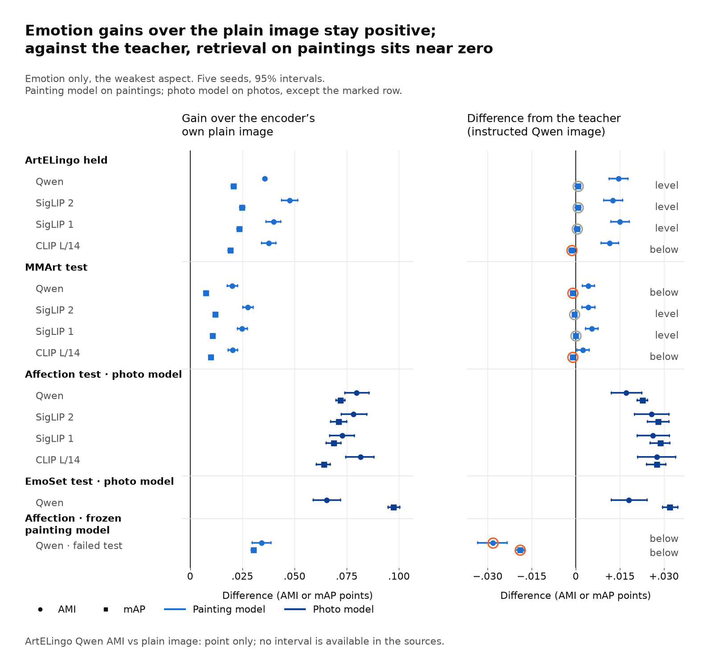

*Figure 6. Emotion, the weakest aspect, across test sets and encoders. Circles are AMI and squares are mAP; horizontal lines are 95% intervals. Left: the gain over each encoder's
own plain image. The ArtELingo Qwen AMI is a point only, the difference of two rounded values, since the sources give no interval. Right: the difference from the
teacher; a grey ring marks a level comparison and an orange ring a below one. Light blue is the painting model and dark blue the photo model; the bottom row is the
frozen painting model on Affection photos, the failed test.*

### 5.2 The design

The design has two models, and the second starts from the first. Neither uses labels in training, and neither uses an instruction text at test time; told retrieval uses the aspect name only to pick a head.

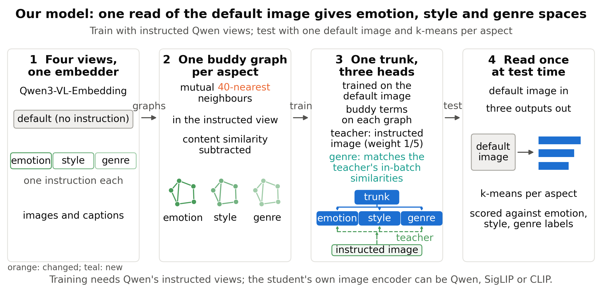

*Figure 7. The painting model as one design: four views from one embedder (the default image and one instructed image per aspect; the default captions come with them), one buddy graph per aspect, a trunk with three heads, and one read at test
time. The figure says "default image"; this report says plain image. The teacher's 1/5 is the direct teacher term's weight 0.25 against 1 for the buddy terms (0.25 of 1.25); the genre relational term (weight 8) comes on top. The figure shows content similarity subtracted; the genre graph does not use it. Orange and teal mark the last changes of October.*

1. **Views.** Frozen Qwen gives the default image, the default captions and one instructed view per aspect. These train the model.
2. **Buddy graphs.** One graph per aspect links each painting to its mutual top-40 neighbours (each is in the other's top 40). Emotion and style first subtract content similarity (how alike two paintings are in what they show), a step called the content correction; the genre graph has none.
3. **Network.** A shared trunk feeds three heads, on an image side (from image embeddings) and a text side (from caption embeddings). Other encoders change only the image input.
4. **Losses.** Buddy terms pull buddies together. A direct teacher term pulls each image head toward its teacher. A relational term on the genre head
   copies the teacher's similarity pattern.
5. **Read at test time.** One plain-image pass, then k-means per head, or retrieval through the named head with the picked post-processing.

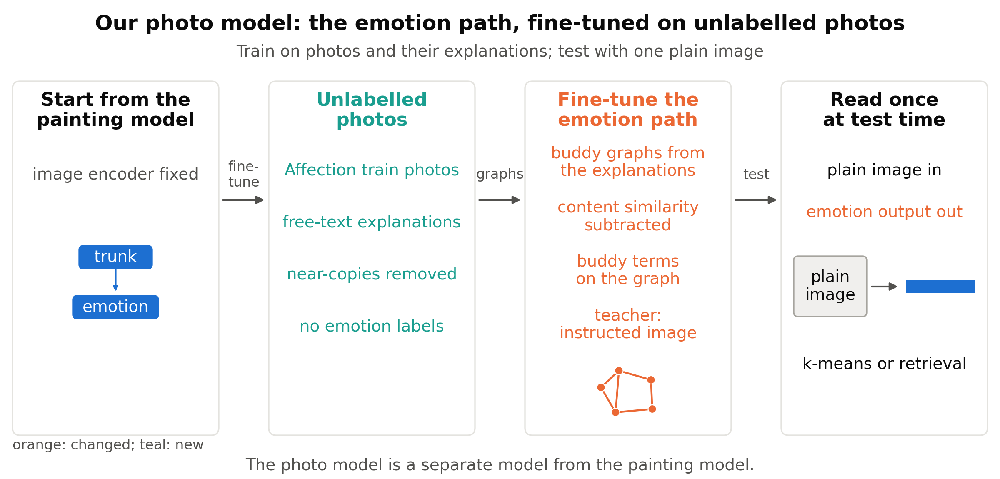

*Figure 8. The photo model. It starts from the painting model (image encoder fixed; image trunk, text trunk and emotion head shown), trains on Affection photos (the figure calls them unlabelled: no emotion labels) and their
explanations with near-copies removed, and reads one plain image at test time. Orange marks what changed and teal what is new. The graph setting of 80 neighbours, the losses and the training loop are in §2.2.*

The photo model keeps this structure and fine-tunes the emotion path only. Its graphs come from the photo explanations in place of captions, with the content correction on. Validation changed one setting: 80 graph neighbours against 40. It uses the same teacher weight and learning rate as the painting recipe.

### 5.3 Why each part is there

The instructed graphs, the buddy terms and the content correction carry emotion and style; the relational term carries genre. Table 17 removes one
part at a time, on held paintings. Each removal is a saved run on Qwen with five seeds, compared with the complete model run on the same machine. Nothing was
retuned after a removal.

*Table 17. Held AMI change when one part is removed from the painting model. A negative change means the part helped.*

| Removed part | Emotion | Style | Genre |
|---|---|---|---|
| Instructed graphs | −0.0327 [−0.0361, −0.0292] | −0.1903 [−0.1959, −0.1822] | +0.0054 [−0.0014, +0.0132] |
| Buddy terms | −0.0277 [−0.0305, −0.0250] | −0.1512 [−0.1547, −0.1451] | −0.0015 [−0.0059, +0.0027] |
| Content correction | −0.0090 [−0.0119, −0.0062] | −0.0752 [−0.0814, −0.0679] | +0.0072 [+0.0030, +0.0113] |
| Relational term | +0.0009 [−0.0013, +0.0032] | 0.0000 [−0.0054, +0.0048] | −0.0440 [−0.0512, −0.0372] |
| Sharper teacher row | +0.0016 [−0.0015, +0.0046] | +0.0008 [−0.0030, +0.0048] | −0.0038 [−0.0074, −0.0002] |
| Direct teacher | +0.0035 [+0.0008, +0.0056] | +0.0041 [+0.0016, +0.0067] | −0.0031 [−0.0080, +0.0014] |
| Text side of the buddy terms | +0.0009 [−0.0024, +0.0044] | +0.0072 [+0.0015, +0.0121] | −0.0034 [−0.0119, +0.0045] |
| Shared trunk | −0.0001 [−0.0025, +0.0027] | +0.0023 [−0.0022, +0.0069] | −0.0001 [−0.0057, +0.0059] |

Three parts did not help in Table 17. Removing the direct teacher raised held emotion and style, and removing the text side raised style. Removing the shared trunk changed nothing we could tell from zero. In retrieval the relational term also mattered: removing it changed held genre mAP by −0.1175 [−0.1214, −0.1134].

The settings sheets ran on validation data and chose nothing: each row changes one training setting and is compared with the unchanged model. The painting sheet had 39 rows over 13 settings, with three seeds. No row was better on all three aspects, and we approved no broader sweep before the paper. One example:

- raising the buddy temperature to 0.1 changed style AMI by −0.0163 [−0.0220, −0.0102].

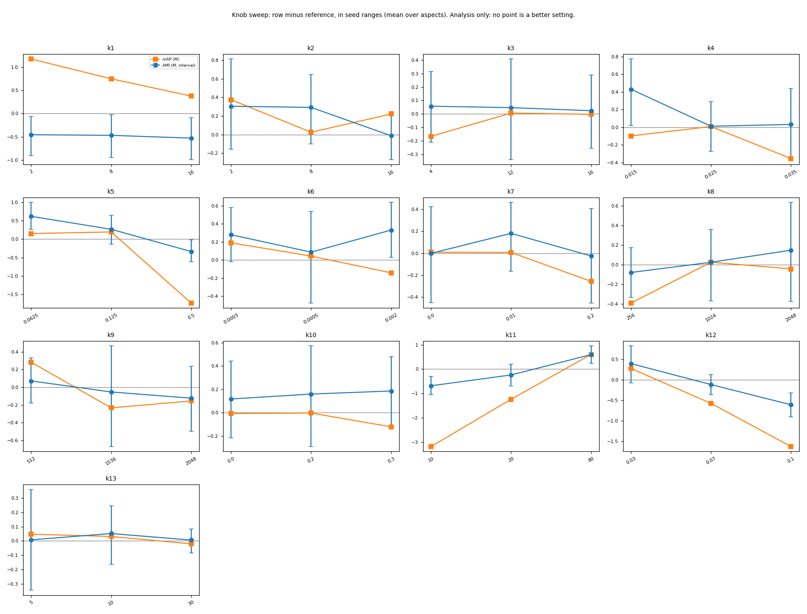

*Figure 9. The 13 painting settings on validation, each row minus the same-machine painting model, in seed ranges averaged over aspects. Panels k1 to k13:
emotion, style and genre relational weight; relational teacher temperature; direct teacher weight; learning rate; weight decay; batch size; trunk width;
dropout; graph neighbours; buddy temperature; stopping patience. No point is a better setting.*

The photo sheet had 14 rows with three seeds (the pick sweep of §2.2 had nine). Turning off the content correction changed validation emotion AMI by −0.0320 [−0.0391, −0.0247]. In the pick sweep, the row with the correction off was the only trained row with negative gaps to the teacher.

The random start of §2.2 (training from random weights in place of the painting start) gave similar scores to the painting start on one seed. On photos the painting start may add little. One seed cannot show it, and the random start never reached a test.

Longer photo training raised some validation scores, although all final runs stopped at epoch 1. Against the photo model, on seeds 0 to 2, twenty fixed epochs (no early stop) changed:

- AMI by +0.0067 [+0.0014, +0.0127];
- mAP by +0.0056 [+0.0042, +0.0071].

The analysis named no better setting, and the painting and photo recipes both stayed frozen.

### 5.4 Where the gain sits

The largest gains over the plain image sit on style and genre; emotion is the weak aspect, both in size and against the teacher. On held ArtELingo retrieval (mAP, Qwen painting model, picked post-processing), the gains over the plain image were:

- style: +0.1311 [+0.1282, +0.1340];
- genre: +0.0790 [+0.0764, +0.0817];
- emotion: +0.0208 [+0.0198, +0.0217].

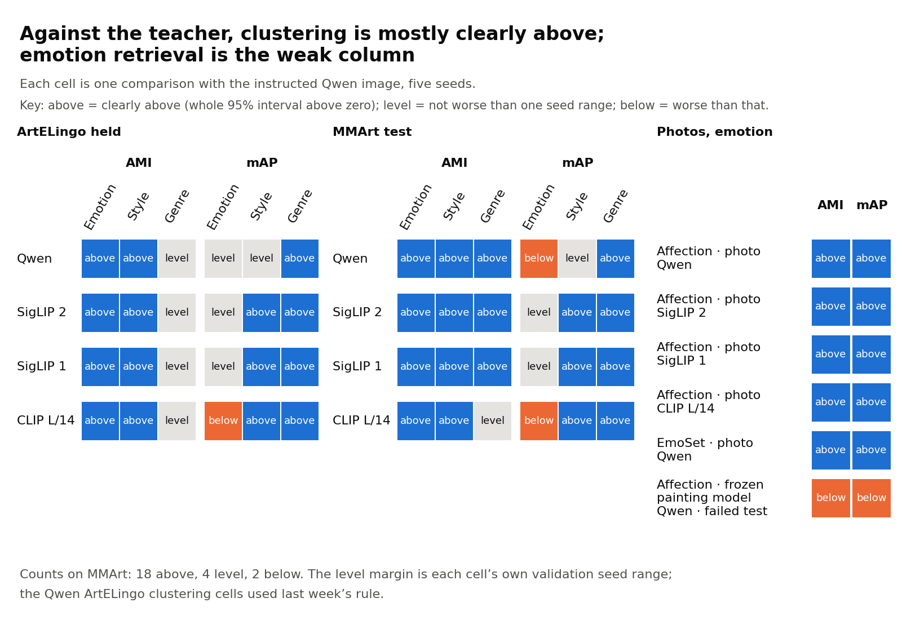

*Figure 10. Every comparison with the teacher on Qwen and the three further encoders: clearly above (blue, marked "above"), level (grey) or below (orange). Panels: ArtELingo held and MMArt test for
paintings, with three aspects and two tasks each; Affection and EmoSet for photos, where only emotion was tested and EmoSet used Qwen only. The bottom row is the failed
frozen painting model. Across both painting sets, emotion retrieval is the only aspect and task with no clearly above cell. On ArtELingo alone, genre clustering at 20 clusters also has none (four level); at the class count it does (§6.1). The Qwen ArtELingo clustering comparisons used last week's seed ranges.*

Against the teacher, the eight painting emotion retrieval comparisons gave five level and three below, by at most 0.0013 mAP. MMArt shows the same pattern in the share of the teacher's gain over the plain image that the model keeps (as in Figure 5): over 100% in every clustering comparison, and 88.2% to 99.8% in emotion retrieval.

Per class, contentment is the recurring weak spot in retrieval. It is the largest emotion class on ArtELingo and on Affection (4,244 and 2,626 queries, Table 18), so it weighs most in mAP.
On EmoSet the exception was amusement.

*Table 18. Emotion AP per class where the source reports a teacher gap; "not reported" marks a figure the source does not give. Diagnostics; no per-class conclusions.*

| Test set, model, post-processing | Class | Our model | Teacher | Difference |
|---|---|---:|---:|---|
| ArtELingo, painting, plain cosine | Contentment (4,244 queries) | not reported | not reported | −0.0324 |
| MMArt, painting on Qwen, picked | Contentment | 0.2413 | 0.2547 | not reported |
| MMArt, painting on Qwen, picked | Amusement | 0.0828 | 0.0710 | not reported |
| Affection, photo, picked | Contentment (2,626 queries) | 0.3718 | 0.3784 | −0.0065 |
| Affection, photo, picked | Awe (1,460 queries) | 0.3321 | 0.2785 | +0.0536 |
| Affection, photo, picked | Disgust (351 queries) | 0.3272 | 0.1975 | +0.1297 |
| EmoSet, photo, picked | Amusement | 0.3203 | 0.3471 | not reported |

On Affection, photo training raised sadness AP from 0.1822 (frozen painting model) to 0.2997 (photo model) and disgust from 0.1985 to 0.3272. Why emotion is
weaker in retrieval than in clustering is not checked. One unchecked reading from the sources: training did not directly optimise retrieval of exact majority
labels.

### 5.5 What the result covers, and what it does not

The result covers told retrieval and k-means clustering on four test sets, within the rules below.

- **Covered:** paintings on four encoders, emotion, style and genre, on two test sets. Photos: emotion on Affection (four encoders) and EmoSet (Qwen).
- **Not covered: training without Qwen.** Every model needs Qwen's graphs, captions and teacher at training.
- **Not covered: one model for both domains.** The painting and photo models are separate.
- **Not covered: new artists, or an art source other than WikiArt.** §4.4.
- **Not covered: text queries, a second photo aspect.** All retrieval in §1 to §5 used image queries with a named aspect; §6.1 adds untold retrieval.
- **Not covered: emotion retrieval clearly above the teacher on paintings.** No painting comparison was clearly above on emotion retrieval; three fell below the teacher.
- **Selection.** Earlier work read the ArtELingo held scores and the Affection test photos, and the three added encoders were chosen after an earlier test on the same paintings. Label-scored validation picked post-processing and wordings (two teacher wordings, four CRL versions) and, earlier, the painting model among about 60 configurations. Only EmoSet shaped no earlier choice. Encoder results rest on picks we made ourselves.
- **Metric.** Every result in §1 to §5 uses AMI at 20 clusters and mAP; §6.1 adds three metrics and the class count.

### 5.6 What is new

To our knowledge, the new part is the combination: one teacher queried under several aspect instructions, one graph per aspect (with content similarity removed for emotion and style), and a small multi-head student with no instruction at test. The parts are known. The related-work note (our literature search) found no match in its targeted searches, which is not proof of novelty.

The second point is a finding. Students that exceed their teachers are known (Born-Again Networks, RKD, AM-RADIO). The note found no case of a small student on
frozen features that exceeds the instruction-following embedder on the aspect named in the instruction. Our result holds in clustering on most comparisons at AMI and NMI, and on about half at ARI and ACC (§6.1). In retrieval it holds on photos and painting genre but not on painting emotion, so the statement should not be widened. Why it happens is not checked.

> Sources: [stage report](../stage/2026-11-04_datasets_and_retrieval.md); [MMArt report](../auto/percept/2027-01-03_mmart_test.md), Analysis; [encoders report](../auto/percept/2027-01-02_backbones_sweep.md), Analysis; [photo fine-tune report](../auto/percept/2027-01-01_photo_finetune.md), "What ran" and Analysis; [Affection report](../auto/percept/2026-12-31_affection_confirmation.md), Analysis; [retrieval report](../auto/percept/2026-12-29_retrieval.md), Results and Analysis; [previous weekly report](2026-10-28_condition_free_line.md), Table 17 (held AMI of all eight removals; the encoders report reuses these saved runs); [related work sources](../literature/2027-01-03_paper_related_work_sources.md), part C; [experiment overview](../../user_read/2026-11-03_experiment_overview.md), Retrieval.

**Verdict (reference).** One plain-image read gave a gain over the plain image on every test set. The result is strongest on style, genre and photo emotion,
and weakest on painting emotion retrieval against the teacher.

## 6. What is missing, and what fills it?

Our own comparisons are broad; the gaps are the other outside comparisons and checks past our own picks. On 2026-11-03 we mapped every method against every
test set, and we approved six loops (planned pieces of work) to fill selected gaps. Three of them are called rounds here. One finished on 2026-11-04 (§6.1). Two were in progress at the status time, 2026-11-04 08:30, and have no results here. The others start later.

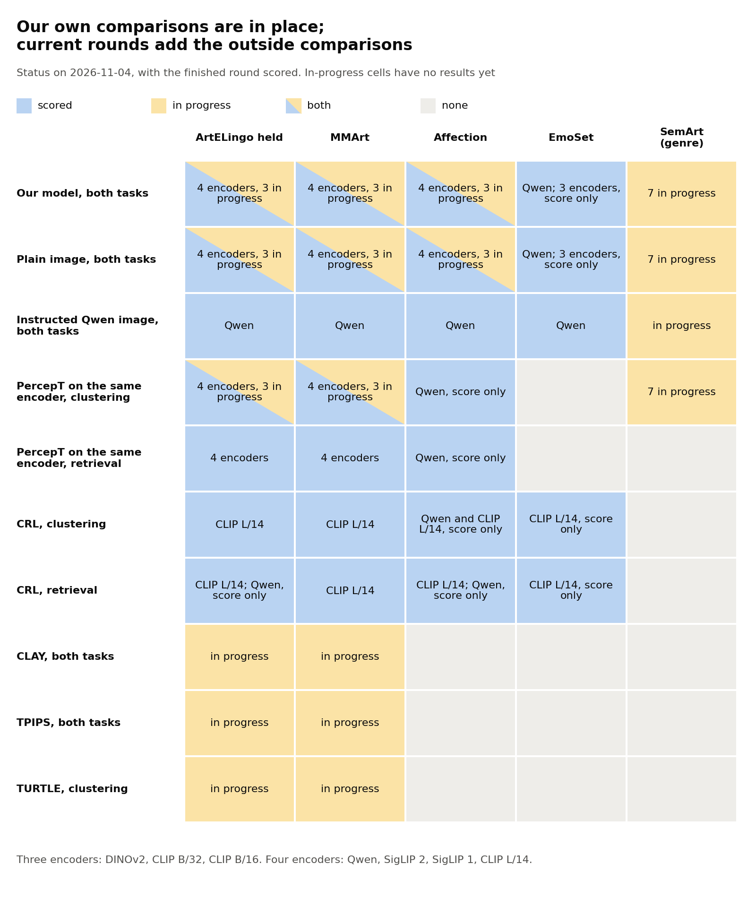

*Figure 11. Methods against test sets on 2026-11-04, with the finished round of §6.1 scored, one row per method and task. Scored: the encoders that have scores. In progress: a current round adds it, and no result is reported yet. Both: part scored, part in progress. None: no score, and no current round adds one. Scored means a test fixed in advance or its comparator, and does not mean clearly above. "Score only" means a result with no rule fixed in advance; it decides nothing. On photos, "our model" is the photo model; on paintings and SemArt it is the painting model. "Both tasks" means clustering and
retrieval. "Instructed Qwen image" is the teacher. "4 encoders" are Qwen, SigLIP 2, SigLIP 1 and CLIP L/14; "3 in progress" are DINOv2, CLIP B/32 and CLIP B/16; "7" is all seven. PercepT's topics come from Qwen on every row. The
failed frozen painting model test on Affection (§2.1) is not a row.*

The "What fills it" column of the next table names the round or loop; the text below the table describes the rounds.

*Table 19. The gaps and what fills them, on 2026-11-04. The status of the rounds in progress is from 08:30.*

| Gap | What fills it | Status |
|---|---|---|
| Standard clustering metrics (normalised mutual information, adjusted Rand index, accuracy) | New scores from saved outputs | Done (§6.1) |
| Cluster-count sensitivity | New scores from saved outputs | Done, score only (§6.1) |
| CRL on the same encoder; CRL on MMArt; CRL clustering on paintings | New scores from saved outputs | Done (§6.1) |
| Untold retrieval (joined heads, no aspect name) | New scores from saved outputs | Done (§6.1) |
| PercepT retrieval on other encoders and MMArt | New scores from saved outputs | Done (§6.1) |
| Emotion below the teacher | New scores from saved outputs; paper text | Per-class look done (§6.1); failed cells stay; paper text open |
| Stronger clustering on plain images and on the heads | Outside comparisons | TURTLE running; TEMI a separate build later |
| TPIPS and CLAY as comparators | Outside comparisons | TPIPS extraction underway; CLAY build and checks passed, labels pending |
| Encoder selection | Past our own picks | Features extracting; training running on a compute-cluster node |
| New-artist genre test | Past our own picks | SemArt included; no results here |
| One-pass cost table | Past our own picks | Included; no result here |
| Text queries; MMArt's per-perspective captions as queries | Text queries (later loop) | Small exploration first |
| DEC loss (deep embedded clustering) on each head; deeper heads | Head variants (later loop) | Decided to run |
| Qualitative cluster figure | Qualitative figure (later loop) | Decided; follows cluster-count scoring |
| Second instructed embedder | No scheduled loop | Important; we deferred its priority |
| Criterion-driven clustering (grouping images by a criterion named in text); second photo aspect | Cite and explain only | Not run |

**New scores from saved outputs.** This round finished on 2026-11-04. §6.1 gives its results.

**Outside comparisons.** This round asks how the model compares with outside methods that take a text for the aspect, and with stronger clustering of plain images. TPIPS reads a text that names the aspect; CLAY picks its text values for the aspect, and its post-processing, on validation. TURTLE clusters plain images and model heads without labels. The build and the checks had passed. TPIPS features were extracting, ending about 2026-11-05 23:00,
and labels were expected on 2026-11-06 before 11:00. TEMI, another label-free clustering method, follows as a separate build.

**Past our own picks.** This round asks whether results survive the earlier encoder selection, transfer to new artists (SemArt artists whose names match no ArtELingo training artist), and support a statement about cost (one pass for the plain image against one pass per aspect for the teacher). It adds DINOv2, CLIP B/32 and CLIP B/16.

SemArt genre covers seven encoders against plain images, matched PercepT and the teacher. The build had finished; features were extracting and training ran on
the compute-cluster node. The report was expected about 2026-11-10 at the latest.

**Later loops.** The qualitative figure follows the cluster counts, and we design it together; head variants and text queries moved forward to the weekend of 2026-11-06 to 11-08.

> Sources: [stage report](../stage/2026-11-04_datasets_and_retrieval.md), "What we have and what is missing", "Rounds in progress" and "Next"; [experiment overview](../../user_read/2026-11-03_experiment_overview.md); specs (the Brief section of each): [New scores](../../superpowers/specs/2026-11-03-new-scores-design.md), [Outside methods](../../superpowers/specs/2026-11-03-outside-methods-design.md), [Past our own picks](../../superpowers/specs/2026-11-03-past-picks-design.md).

### 6.1 New scores from saved outputs: first results (2026-11-04)

The gains over the plain image and PercepT held under the standard clustering metrics; against the teacher the outcome depends on the metric. We scored saved outputs again, with no training or GPU work, on four encoders and four test sets. The round adds:

- NMI, ARI and ACC beside AMI, with k-means at each test set's class count (emotion 9, or 8 on EmoSet; style 27 on ArtELingo and 20 on MMArt; genre 10);
- CRL on the same encoder as the model, PercepT in retrieval, and untold retrieval (three heads joined into one vector, no aspect name).

Each of the 412 comparisons has its own outcome, and there is no overall verdict. Picks and seed ranges were fixed on validation before the new test values were read. Separate code matched every comparison. The 412 comparisons have no correction for their number.

*Table 19a. The 412 comparisons, five model seeds. Clustering is at the class count, except that the CRL row also holds six AMI comparisons at 20 clusters.*

| Comparison | Comparisons | Clearly above | Level | Below |
|---|---:|---:|---:|---:|
| Painting model / plain image, clustering | 96 | 96 | 0 | 0 |
| Painting model / matched PercepT, clustering | 96 | 93 | 3 | 0 |
| Painting model / teacher, clustering on paintings | 96 | 68 | 23 | 5 |
| Photo model / plain image and teacher, clustering | 40 | 38 | 2 | 0 |
| Painting model / CRL, clustering (both CLIP L/14) | 30 | 26 | 3 | 1 |
| Painting model / CRL, retrieval (both CLIP L/14) | 6 | 6 | 0 | 0 |
| Untold painting model / plain image, retrieval | 24 | 22 | 1 | 1 |
| Painting model / PercepT, retrieval | 24 | 24 | 0 | 0 |

*Table 19b. The painting model against the teacher on paintings, by metric, at the class count.*

| Metric | Clearly above | Level | Below |
|---|---:|---:|---:|
| AMI | 23 | 1 | 0 |
| NMI | 23 | 1 | 0 |
| ARI | 11 | 10 | 3 |
| ACC | 11 | 11 | 2 |

**Against the teacher.** AMI and NMI were clearly above in 46 of 48 comparisons, and ARI and ACC in 22 of 48. All five below are emotion: ARI on ArtELingo (Qwen and SigLIP 1) and on MMArt (SigLIP 1), and ACC on MMArt (SigLIP 1 and CLIP L/14). One example is ArtELingo emotion ARI on Qwen, 0.0605 against 0.0726 for the teacher. We cannot say that the model is better than the teacher in all four metrics.

**Near the limits, the outcome words are less firm.** Eight level comparisons (seven teacher, one CRL) have the whole interval below zero, because the seed range is larger than the gap. Two below comparisons have an interval that reaches zero, for example MMArt SigLIP 1 emotion ARI against the teacher: −0.0002 [−0.0021, +0.0017], seed range 0.0015.

**Against the plain image, PercepT and CRL.** One example is ArtELingo emotion on Qwen: class-count AMI 0.1024 against 0.0696 for the plain image. All 12 AMI comparisons and all 6 retrieval comparisons were clearly above CRL on the same encoder. Four class-count comparisons with CRL were not clearly above: ArtELingo emotion ARI and both sets' emotion ACC were level, and MMArt style ACC was below.

**Untold retrieval.** Against plain images, emotion was clearly above in 8 of 8 comparisons, and style and genre each in 7 of 8. Naming the aspect still helps: untold mAP was below told mAP in all 24 comparisons, by 0.0037 to 0.0088 in emotion, 0.0513 to 0.0757 in style and 0.0732 to 0.0908 in genre.

**Cluster counts (score only).** At counts other than the class count, the model's point value was lower in 0 of 200 comparisons with the plain image, 0 of 160 with PercepT, 45 of 200 with the teacher and 9 of 160 with CRL on CLIP L/14 (3 of 40 on the same encoder).

**Emotion per class.** Contentment AP was lower than the teacher's on every encoder and both painting sets: −0.0246 to −0.0209 on ArtELingo and −0.0147 to −0.0130 on MMArt, with intervals below zero. Whether this explains the ARI and ACC results is not checked.

**Selection.** Some test values had been seen before these rules: AMI at 20 clusters and mAP of the main comparisons, MMArt and EmoSet class-count AMI, and some ArtELingo mAP values of CRL and PercepT. NMI, ARI, ACC, CRL clustering, CRL on MMArt, the other PercepT retrieval values and untold retrieval had not been seen.

> Sources: [new scores report](../auto/percept/2027-01-04_new_scores.md), Results brief, Results and Analysis; [spec](../../superpowers/specs/2026-11-03-new-scores-design.md).

**Verdict (reference).** The gains over the plain image and PercepT held under the standard metrics. Statements against the teacher must name the metric.

## 7. Go/no-go checklist

*Table 20. Go/no-go items and their status on 2026-11-04.*

| Item | Kind | Status | Where |
|---|---|---|---|
| The final recipe on SigLIP 2, SigLIP 1 and CLIP L/14 | required (decision of 2026-10-27) | passed, one teacher cell below | §3 |
| Aspect-named retrieval (the second task, after clustering) | required for the 2026-11-10 target | passed with picked post-processing; not passed with plain cosine | §1 |
| Photos at least level with the teacher | required (our decision, 2026-10-31) | failed for the frozen model; passed by the photo model | §2 |
| "Better than the teacher" on data that shaped no earlier choice | required for that wording (our decision, 2026-11-02) | passed on EmoSet, emotion, Qwen | §2.3 |
| Second painting set | reported | passed on four encoders, two cells below the teacher | §4 |
| Standard clustering metrics, cluster counts | reported | done; against the teacher the outcome depends on the metric | §6.1 |
| CLAY, TPIPS, TURTLE | reported | in progress | §6 |
| New-artist test | reported | in progress | §6 |
| Encoders past our own picks | reported | in progress | §6 |
| Untold retrieval | reported | done | §6.1 |
| Text queries | reported | not run | §6 |
| PercepT with its own encoders (faithful version) | reported | not built; no loop | previous report |
| Second instructed embedder | reported | not run; priority open | §6 |
| Paper wording for emotion retrieval below the teacher | decision | open | §8 |

*Table 21. The paper options and what each still needs.*

| Option | Source | Still needs |
|---|---|---|
| One read for all aspects: one painting model clearly above the plain image, with the teacher as a harder comparator | previous weekly report; this report §1, §4 | The rows for outside comparisons; teacher wording that names the metric; the wording of the emotion retrieval limit |
| Instruction supervision across encoders: Qwen's instructed views train models on other encoders | previous weekly report; this report §3 | The result on the three encoders in progress (DINOv2, CLIP B/32, CLIP B/16) |
| A fair comparison table with a column that states whether a method trained on images from the test domain | direction log, 2026-11-03 | CLAY and TPIPS rows; the matched PercepT, teacher, MMArt and EmoSet rows exist |

> Sources: [previous weekly report](2026-10-28_condition_free_line.md), §7; [direction log](../../superpowers/direction_log.md), entries 2026-10-31 to 2026-11-03.

## 8. Status at the end of the week

- **Current best:** the painting model on paintings and the photo model on photos, both frozen. Each test fixed in advance passed its separate re-derivation check (§5.1).
- **Finished on 2026-11-04:** New scores from saved outputs (§6.1).
- **In progress:** Outside comparisons, Past our own picks.
- **Not started:** the qualitative figure, head variants, text queries.
- **Open decisions:**
  1. the priority of a second instructed embedder;
  2. the wording of a paper note that the frozen encoder kept its own retrieval (no experiment needed);
  3. the paper's wording for emotion retrieval below the teacher, after the per-class look.

> Sources: [stage report](../stage/2026-11-04_datasets_and_retrieval.md), "Where we stand" and "Next"; [direction log](../../superpowers/direction_log.md), "Now".

## Glossary

| Plain name | Meaning | Name in the full reports (for searching them) |
|---|---|---|
| Aspect | emotion, style or genre | aspect |
| Frozen | with weights fixed | frozen |
| Round | one planned set of runs with its own spec | round |
| Painting model | trunk with three aspect heads, trained on ArtELingo paintings, 40 graph neighbours | c*, k11=40 |
| Emotion path | the image side and the text side, each a trunk with an emotion head; the text side is used only in training | emotion pathway, caption-side trunk |
| Photo model | the painting model's emotion path fine-tuned on Affection photos and their explanations, with no emotion labels | photo model |
| Teacher | the Qwen image under one aspect's instruction | teacher, instructed image, T |
| Plain image | an encoder's image embedding with no instruction | frozen input, frozen image, plain image |
| Matched PercepT | PercepT re-implementation on the model's encoder; its topics still come from Qwen | matched arm, M2 to M8 |
| Outside method | a method from another paper that compares images through a named aspect (CRL, CLAY, TPIPS) | outside method |
| Post-processing | how saved embeddings are compared at retrieval time, with no new training | read-out, stage 4 pick |
| Clearly above, level, below | the three outcomes of a comparison, as defined in the Summary | WIN, LEVEL, BELOW |
| Test fixed in advance; score only | a pass rule set before the scores were read; a result with no such rule, which decides nothing | claim test, bar; descriptive |
| Seed range | a score's validation maximum minus minimum over model seeds, for one aspect, task and dataset; Qwen ArtELingo clustering uses last week's fixed ranges from three development seeds | r, r' |
| Told, untold retrieval | the aspect name picks the head; or the three heads' outputs are joined into one vector and no name is given | told, untold |
| Wrong-head test | an aspect's labels queried through another aspect's head | switch test, aspect-switch table |
| Buddy graph, buddy terms | graphs of nearest items per aspect, and the contrastive losses on them | graph, buddy terms |
| Content correction | subtraction of content similarity before the emotion and style graphs | residual graph |
| Relational term | a genre loss that copies the teacher's similarity pattern | relational term, GR-8 |
| Sharper teacher row | the teacher row of the relational term at temperature 0.02 (a lower temperature makes the row sharper) | GS-0.02 |
| New scores from saved outputs | round finished on 2026-11-04: metrics, counts, CRL, untold retrieval | r17 |
| Outside comparisons | round in progress: TPIPS, CLAY, TURTLE, then TEMI | Outside methods, r18 |
| Past our own picks | round in progress: three new encoders, SemArt, cost | r19 |
| CLAY | a training-free projection of a frozen image onto text values of an aspect (its condition) | CLAY |
| TPIPS | an embedder fine-tuned on human similarity votes, queried along a factor (an aspect) named in text | TPIPS |
| TURTLE, TEMI | label-free clustering methods on frozen features | TURTLE, TEMI |
| NMI, ARI, ACC | normalised mutual information, adjusted Rand index, best one-to-one cluster accuracy | NMI, ARI, ACC |
| Class count | the number of label classes in a test set, used as the number of k-means clusters | class count |
| DEC | deep embedded clustering, a clustering loss | DEC |
| nDCG, AP | a graded ranking score; average precision per query or class | nDCG, AP |

## Sources

Stage report: [2026-11-04, datasets and retrieval](../stage/2026-11-04_datasets_and_retrieval.md).

Auto reports (real date of writing, then the sequence date in the file name):
[retrieval, 2026-10-29 (12-29)](../auto/percept/2026-12-29_retrieval.md) ·
[Affection, 2026-10-31 (12-31)](../auto/percept/2026-12-31_affection_confirmation.md) ·
[photo fine-tune, 2026-11-01 (2027-01-01)](../auto/percept/2027-01-01_photo_finetune.md) ·
[encoders and EmoSet, 2026-11-02 (2027-01-02)](../auto/percept/2027-01-02_backbones_sweep.md) ·
[MMArt, 2026-11-03 (2027-01-03)](../auto/percept/2027-01-03_mmart_test.md) ·
[new scores, 2026-11-04 (2027-01-04)](../auto/percept/2027-01-04_new_scores.md).

Other: [experiment overview](../../user_read/2026-11-03_experiment_overview.md) ·
[facts inventory](../../../src/test/20261103_experiment_overview/facts_inventory.md) ·
[direction log](../../superpowers/direction_log.md) ·
[SemArt check](../../../src/test/20261103_semart_check/20261103_semart_check_log.md) ·
[related work sources](../literature/2027-01-03_paper_related_work_sources.md) ·
[previous weekly report](2026-10-28_condition_free_line.md).

Specs of the rounds in progress, Brief only:
[New scores](../../superpowers/specs/2026-11-03-new-scores-design.md) ·
[Outside methods (spec file name)](../../superpowers/specs/2026-11-03-outside-methods-design.md) ·
[Past our own picks](../../superpowers/specs/2026-11-03-past-picks-design.md).
