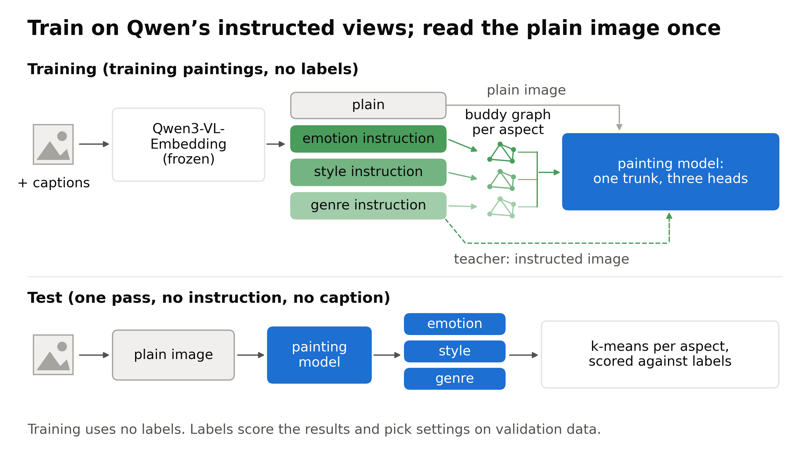
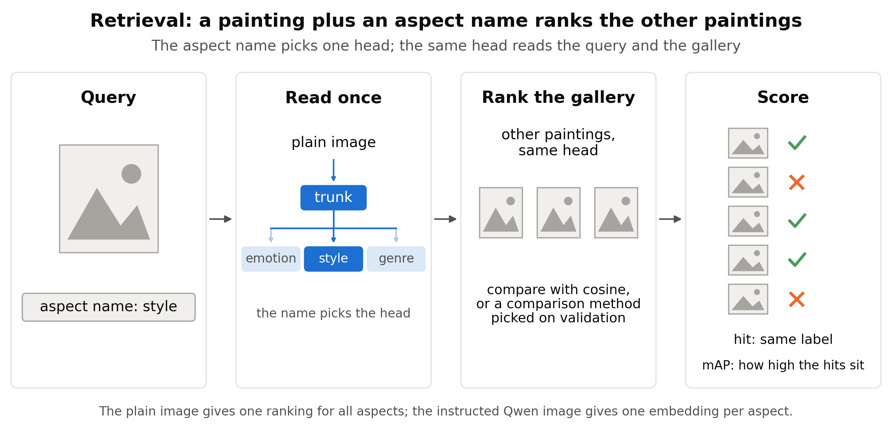
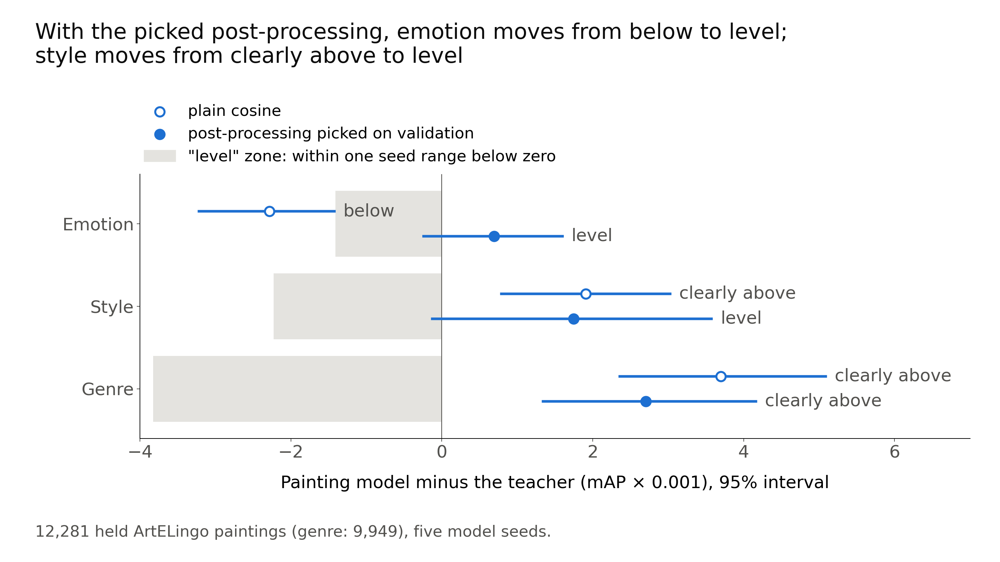
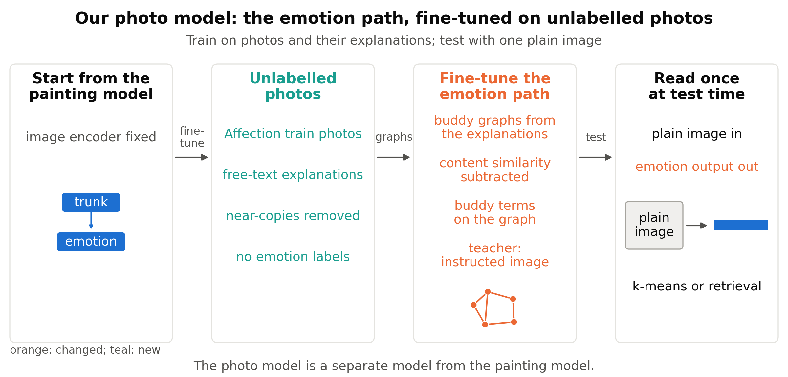
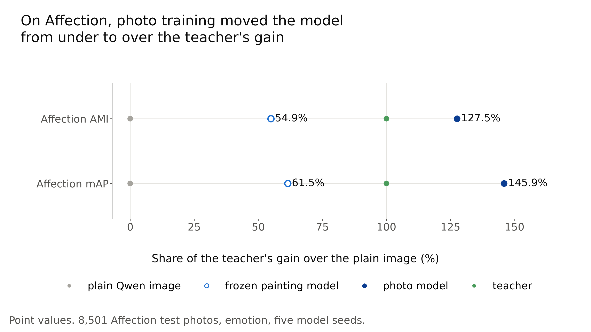
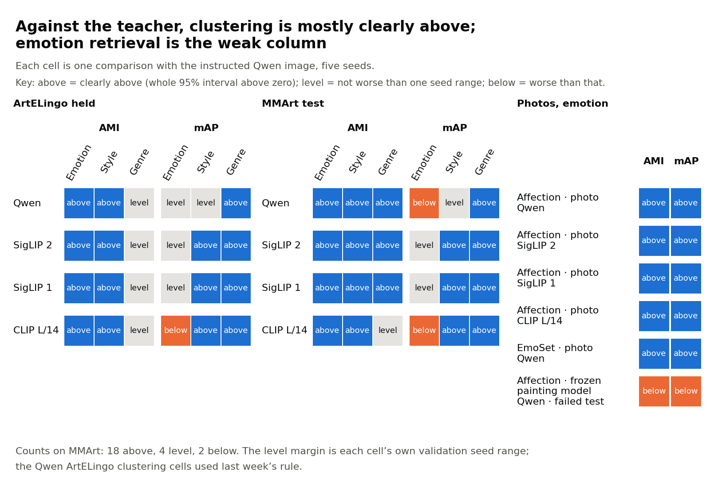
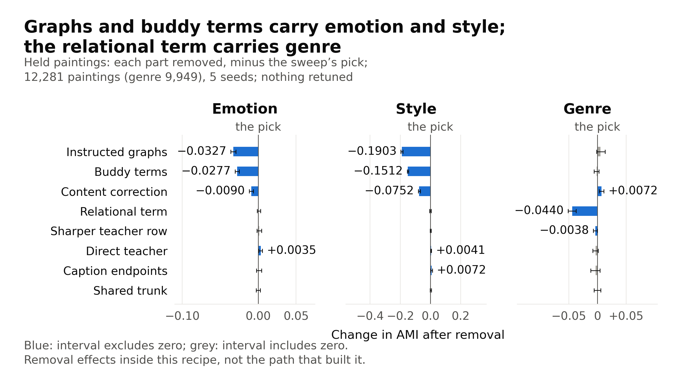
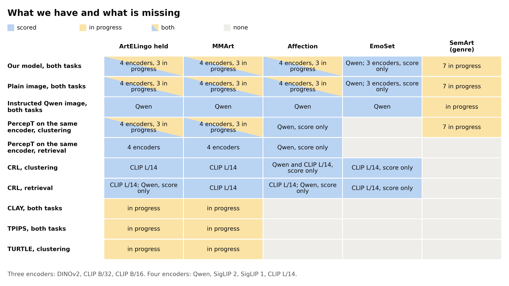

# CoSiR weekly report, 4 November 2026

CoSiR: one read of an image gives separate emotion, style and genre spaces

Retrieval, more datasets, what is missing and what we fill

Notes: This deck summarises the weekly report for 4 November 2026 (docs/reports/weekly/2026-11-04_datasets_and_retrieval.md). Every number is taken from that report and its sources. It follows last week's deck and stands alone: the opener and the setting slides give what you need. A space here is one embedding space per aspect (emotion, style or genre). Abbreviations are avoided in the text; some figures still use the short names.

---

## Problem and goal of CoSiR

- PercepT, which finds perceptual topics, leans on an emotion-tuned caption encoder chosen in advance; that is hard to carry to new datasets, and maybe to other image encoders.
- Instead: one general embedder, Qwen3-VL-Embedding-2B ("Qwen"), told the aspect (emotion, style or genre) by an instruction text.
- Teacher: Qwen's image under that instruction; our strongest label-free comparator.
- Goal: from one plain image pass (no instruction), give a space per aspect that is clearly above PercepT and level with or clearly above the teacher (both outcomes are defined on the outcomes slide).

Notes: An aspect is emotion, style or genre. PercepT is "Beyond Semantics" (arXiv 2606.03345). An embedder is a model that maps images and text to vectors; an image encoder is its image side, which we also swap for other encoders later. The plain image is an encoder's image embedding with no instruction. Qwen's default prompt is "Represent the user's input." The instructed views replace it. Emotion: "Represent the emotion that this artwork, or this description of an artwork, conveys. Focus only on the emotion." Style: "Describe the artistic style of this artwork in one word." Genre: "Describe the genre of this artwork in one word." The teacher needs one encoder pass per aspect, and the aspect must be named at test time. If one plain pass is level with it, we get three aspect spaces for the price of one pass. On 12,281 held ArtELingo paintings, the teacher gives emotion AMI 0.0921 and the plain image 0.0708. AMI is adjusted mutual information between k-means clusters and labels; 0 is chance. Label-free means the comparator uses no labels when it makes embeddings.

---

## Approach of CoSiR in one picture

- Training: Qwen's instructed views and captions next to the plain image; no labels.
- Buddy graphs link items that rank each other among their closest neighbours (buddies); the painting model pulls buddies together.
- The painting model is our small network: a shared trunk with one head per aspect; a head gives that aspect's embedding.
- Test: one plain image pass feeds three heads; k-means groups a head's embeddings into 20 clusters, or retrieval uses one named head.

Notes: Top: training paintings only; Qwen stays frozen. Emotion buddies come from instructed captions; style and genre buddies from instructed images. Each instructed Qwen image is also a teacher target for its head; the text side adds training signal. A relational term on the genre head copies the teacher's similarity pattern. The model now uses 40 graph neighbours per item. Bottom: only the image side runs at test time. The painting model is a shared trunk with emotion, style and genre heads on a frozen image encoder. Training uses no labels. Labels score the results and, on validation data, also pick settings and post-processing; the footer of this slide's figure says so. This figure is a slide copy of last week's: it says "plain image" where the old one said "default image", names the painting model, and corrects the footer, which had said labels only score the clusters.

---

## Progress of CoSiR so far

- A week ago: one painting model, tested on ArtELingo paintings only, and no retrieval result.
- This week: retrieval on paintings, a photo model (the painting model fine-tuned on photos), three more image encoders and a second painting set (MMArt).
- Also this week: a coverage check of every method against every test set, then more clustering metrics and retrieval comparisons.

Notes: Where last week ended, on 12,281 held ArtELingo paintings (WikiArt paintings with emotion, style and genre labels): emotion AMI 0.1066 against 0.0921 for the teacher (+0.0145 [+0.0113, +0.0177]) and 0.0874 for the strongest PercepT entry; style clearly above the teacher, though only narrowly; genre level. Retrieval: can the model search by a named aspect? Photo model: the painting model fine-tuned on photos and their explanations, with no emotion labels. Three more encoders: SigLIP 2, SigLIP 1 and CLIP L/14. Second painting set: MMArt. Coverage check: every method against every test set, then work to fill the gaps. The extra clustering metrics and retrieval comparisons are finished; the other work has no results here.

---

## Setting of this week's tests: test sets and comparators

| Test set | Items | Labels | Role |
|---|---:|---|---|
| ArtELingo held | 12,281 paintings | emotion, style, genre | scored in earlier work |
| MMArt test | 16,384 paintings | emotion, style (MMArt); genre (WikiArt) | new paintings and labels |
| Affection test | 8,501 photos | emotion | scored in earlier work |
| EmoSet test | 17,348 photos | emotion | shaped no earlier choice |

- **Held:** a test split kept out of training. A set scored in earlier work may have shaped our choices; EmoSet did not.
- **Plain image, teacher:** as on the opening slides.
- **Matched PercepT:** our re-implementation of PercepT on the same image encoder as the model; its topics still come from Qwen.
- **CRL:** an outside method (a method from another paper that compares images through a named aspect); it projects frozen features onto texts written for a criterion. Our re-implementation.

Notes: ArtELingo has genre labels on 9,949 of the held paintings. Training used 42,969 ArtELingo paintings (validation: 6,152); the photo model also used 69,927 Affection photos. ArtELingo and MMArt are WikiArt paintings. MMArt gives emotion and style labels; genre labels come from WikiArt's genre files. Affection photos come with free-text explanations. A fifth test set, SemArt, holds 11,159 paintings from the Web Gallery of Art with genre labels; it is in progress and has no results here. Validation data pick settings and post-processing. Comparisons used five model seeds and 95% bootstrap intervals. CRL is from NeurIPS 2025. Frozen means with weights fixed. The other outside methods are CLAY and TPIPS; TURTLE and TEMI are label-free clustering methods, not outside methods in this sense.

---

## Setting of this week's tests: one example per test set

- At test time a model reads only the image; the labels score the result.

Notes: Each example is one item of the test set. MMArt: a WikiArt painting with an emotion and a style from MMArt and a genre from WikiArt's genre files. Affection: a photo with free-text explanations written by people; each person also names an emotion, and the label is the emotion with the most votes (here awe 3, excitement 2, contentment 1). The explanations train the photo model and are not used at test time. EmoSet: a photo with one emotion label, from eight classes. ArtELingo items look like the MMArt example, with captions in place of generated texts. The examples show the data only; they were not chosen by any score.

---

## Setting of this week's tests: outcomes

| Outcome | Meaning |
|---|---|
| Clearly above | the whole 95% interval of the difference is above zero; for a bare point estimate we say "higher" |
| Level | the lower end of the interval is above minus one seed range: within an agreed margin, not worse than one seed range; it does not show the two are equal |
| Below | the lower end is under minus one seed range |

- Each comparison is the model's score minus a comparator's, over five model seeds.
- Seed range: how far a model's validation score spreads over its seeds, for one aspect, task and dataset, fixed before the test.
- Test fixed in advance: a pass rule set before the scores are read; a score-only result has no such rule and decides nothing.
- Clustering score (adjusted mutual information): agreement between k-means clusters and labels, corrected for chance; 0 is chance.

Notes: A difference is the model minus its comparator, and outcomes use unrounded values. A seed range is the maximum minus the minimum. Qwen ArtELingo clustering uses last week's fixed ranges, from three development seeds: 0.0046, 0.0082 and 0.0128 for emotion, style and genre. Example: emotion retrieval against the teacher gave +0.0007 [−0.0002, +0.0016], which is level. Level shows only that the model is not worse than one seed range; it does not show the model is better. A test that failed stays failed in the record. k-means runs fresh on each method's outputs for each test set, with 20 clusters and three random states; no clusters are saved in a model. In the report, one comparison for one encoder, test set, aspect and task is called a cell.

---

## Setting of retrieval

- **Task:** find items with the same label as the query, for one named aspect. The name only picks the head; our model gets no instruction text.
- **Gallery:** the other labelled paintings of the test set.
- **Retrieval score (mean average precision):** how high the items with the same label rank, averaged over queries.
- **Post-processing:** how saved embeddings are compared at retrieval, with no new training; plain cosine is retrieval with none.

Notes: We call this told retrieval. A query is one image plus an aspect name. All retrieval here used image queries. A hit has the same label. AP (average precision) is the same score for one query or one class. Only the teacher gets an instruction text. Retrieval intervals are a joint bootstrap over queries and seeds with a fixed gallery, so they do not cover a new gallery. Emotion's chance retrieval score on ArtELingo, from the class shares, is 0.2007, and the majority labels from captions are noisy. The aspect name is not an instruction in this sense: it selects one of the model's heads and is never fed to a text encoder. Each model picks its post-processing on validation, from centering, PCA whitening and neighbour query expansion.

---

## Experiments on retrieval: plain cosine and picked post-processing

Open markers: plain cosine. Filled markers: the picked post-processing. Grey zone: level, one seed range.

- **Plain cosine:** rank the paintings by the cosine similarity of their saved embeddings, with no other step.
- **Purpose:** does the painting model also retrieve by a named aspect?
- **Design:** 12,281 held paintings; each model picked one post-processing on validation; pass rule: level or clearly above the teacher.

Notes: Result in words: plain cosine failed the rule, because emotion fell below the teacher (0.2642 against 0.2665). With the picked post-processing, emotion and style were level (0.2691 against 0.2684; 0.3235 against 0.3217) and genre narrowly clearly above (0.6151 against 0.6124, +0.0027). Plain cosine, model / plain image / teacher: emotion 0.2642 / 0.2424 / 0.2665, style 0.3110 / 0.1801 / 0.3091, genre 0.5896 / 0.4760 / 0.5860; the model was clearly above the plain image on every aspect. Model minus teacher with plain cosine: emotion −0.0023 [−0.0032, −0.0014], style +0.0019 [+0.0008, +0.0030], genre +0.0037 [+0.0024, +0.0051]. The saved embeddings are the outputs of the trained model and of the encoders, computed once. Genre labels cover 9,949 paintings. One class carried the emotion miss: contentment, with an AP difference of −0.0324 across 4,244 of the 12,281 queries. The other eight classes were higher than the teacher's, by +0.0027 to +0.0340 AP. These are diagnostics, with no per-class conclusions. The retrieval score weights each query equally, so the largest class weighs most. Graded emotion (nDCG, a graded ranking score on the overlap of caption-emotion distributions) gave 0.9343 for the model against 0.9341 for the teacher, +0.0002 [+0.0001, +0.0004], and 0.9292 for the plain image. One unchecked explanation: training did not directly optimise retrieval of each painting's majority label. With the picked post-processing: style's gap, +0.0017, is about the same as +0.0019 with plain cosine; the interval widened, so the outcome moved from clearly above to level. The plain image stayed lower: emotion 0.2483, style 0.1924, genre 0.5361. Centering subtracts the mean embedding; whitening decorrelates the embedding dimensions; neighbour query expansion averages a query with its nearest neighbours. The three models are the painting model, the plain image and the teacher. Up to 25 options. Model minus teacher: emotion +0.0007 [−0.0002, +0.0016], style +0.0017 [−0.0001, +0.0036], genre +0.0027 [+0.0013, +0.0042]. The teacher's own scores change with the post-processing. The painting model, the plain image and the teacher all picked centering plus ten-neighbour expansion. No whitening option passed its validation check. Every pick used the largest neighbour count offered, so the options may not exhaust the gains from post-processing. Selection reused data: validation chose the painting model's epochs within development data that had already picked the model among about 60 configurations. Verdict (reference): The retrieval result on paintings rests on picked post-processing; for emotion it is level with the teacher. The large margins are over the plain image; against the teacher, the model is level on emotion and style and only narrowly clearly above on genre.

---

## Experiments on retrieval: each head and CRL

| Label queried | Correct head | First wrong head | Second wrong head | Model, picked | CRL, picked |
|---|---:|---|---|---:|---:|
| Emotion | 0.2642 | style head, 0.2487 | genre head, 0.2539 | 0.2691 | 0.2554 |
| Style | 0.3110 | emotion head, 0.1529 | genre head, 0.2167 | 0.3235 | 0.2816 |
| Genre | 0.5896 | emotion head, 0.4520 | style head, 0.3593 | 0.6151 | 0.5033 |

- **Purpose:** check that each head serves its own aspect, and compare with an outside method (CRL).
- **Design:** the head columns use plain cosine; the last two columns use the picked post-processing, with the CRL version picked on validation; pass rule against CRL: clearly above.
- **Result:** each head was clearly above both wrong heads on its own labels, and the model was clearly above CRL on all three aspects.

Notes: A head is the model's output for one aspect; a wrong head is another aspect's head. The teacher and CRL showed the same head pattern as point values, so the pattern is not unique to our model. Our model gives it from one read of the plain image. The picked CRL version is CLIP L/14 with criterion texts worded for paintings. Differences: emotion +0.0137 [+0.0124, +0.0149], style +0.0418 [+0.0392, +0.0444], genre +0.1118 [+0.1087, +0.1149]. The CRL tests came after we had seen CRL's score-only held scores, so this evidence is weaker than a comparison fixed earlier. The two sides use different encoders. On CLIP L/14 for both, emotion retrieval score was 0.2671 for our model against 0.2554, a point comparison only. An unpicked Qwen version of CRL exceeded the picked one on held emotion; picks use validation only, so the pick stayed.

---

## Experiments on photos: frozen painting model

| Task | Painting model | Plain image | Teacher | CRL | Outcome against teacher |
|---|---:|---:|---:|---:|---|
| Clustering score | 0.1384 | 0.1041 | 0.1666 | n/a | below |
| Retrieval score | 0.2755 | 0.2452 | 0.2945 | 0.2739 | below |

- **Purpose:** do heads trained on paintings transfer to photos with no photo training?
- **Design:** the painting model, unchanged (frozen), on 8,501 Affection test photos; pass rules: clearly above the plain image and CRL, level or clearly above the teacher.
- **Result:** the test failed: clearly above the plain image, but below the teacher on both scores, and only level with CRL.

Notes: The painting model used this way is called the frozen painting model. Model minus plain: AMI +0.0343 [+0.0298, +0.0387], mAP +0.0304 [+0.0293, +0.0315]. Model minus teacher: AMI −0.0282 [−0.0333, −0.0233], mAP −0.0190 [−0.0205, −0.0176]. CRL difference: +0.0016 [−0.0001, +0.0032]; the point estimate is higher, but the interval is not wholly above zero, so the test for clearly above failed. In the table, n/a means this comparison has no result. Labels are plurality votes; 1,917 of the test photos (22.6%) had tied votes, broken alphabetically. Post-processing and wording were picked on 4,251 validation photos. The order of model, plain image and teacher stayed the same with ties dropped, with plain cosine, with graded nDCG and in each image collection. Contentment, excitement and sadness carried most of the deficit. Painting-only training is a possible cause; this test did not check it. We chose to try photo training next. The failed test stays failed.

---

## Method of the photo model: design

- Start from the painting model with the image encoder frozen; train only the emotion path on 69,927 Affection photos and their free-text explanations, with no emotion labels.

Notes: The emotion path is the image side and the text side, each a trunk with an emotion head. The text side reads the explanations (they take the place of captions) and is used only in training. Orange marks what changed and teal what is new; the figure calls the photos unlabelled, which means no emotion labels. Training loop: the fine-tune starts the emotion path from its ArtELingo weights; encoder features stay fixed, and the style and genre heads are unused. AdamW uses batches of 512 graph pairs, for up to 200 epochs, and stops early on the validation loss with a patience of 15; all five final runs kept epoch 1. Graphs: photos that are mutual nearest neighbours by explanation, 80 per photo (validation chose 80 against 40), with content similarity (how alike two photos are in what they show) subtracted. Loss: four buddy terms pull a photo's image and text outputs toward those of its buddies; a teacher term (weight 0.25) pulls toward the instructed image. No emotion label enters, and train labels were never read. At test: the photo model reads one plain image; k-means runs new on the test photos (20 clusters, three random states), and retrieval ranks them. We removed 2,328 of 72,255 train photos as near-copies of validation or test photos (plain-image cosine at least 0.85). The photo model and the painting model are separate models.

---

## Experiments on photos: fine-tune on Affection

A point at 100% has the same gain over the plain Qwen image as the teacher.

- **Purpose:** does photo training close the gap to the teacher on Affection?
- **Design:** one setting picked among nine on validation photos, then scored on the 8,501 test photos; pass rule: level or clearly above the teacher.
- **Result:** clearly above the teacher: clustering score 0.1838 against 0.1666; retrieval score 0.3172 against 0.2945.

Notes: Limit: we trained after the failed test on these same photos, so this is no fresh confirmation. In the figure, the frozen painting model keeps 54.9% (clustering) and 61.5% (retrieval) of the teacher's gain; the photo model reaches 127.5% and 145.9%. The nine candidate settings are the nine rows of the validation sweep. Photo minus teacher: AMI +0.0172 [+0.0121, +0.0225], mAP +0.0227 [+0.0210, +0.0244]. Photo minus plain: AMI +0.0797 [+0.0741, +0.0857], mAP +0.0720 [+0.0699, +0.0742]. Against CRL (0.2739), the mAP difference was +0.0433 [+0.0411, +0.0455], clearly above. The order held with ties dropped, with plain cosine and in each image collection. The rule supports only the sentence "level with or better than the teacher"; a "better than" statement needed a new test that asked for clearly above. The result does not show transfer without photo training, or one model for both domains (paintings and photos). The exact pick is close to noise: its lead over the second-best row was 0.0032 AMI, under half of the seed range (0.00707). Start point: a run from random weights, with the same settings as the painting start (40 neighbours), scored about the same on validation on one seed: AMI 0.1801 beside 0.1769, and retrieval score 0.3227 for both. We did not pick it, so it has no test score. The picked setting (80 neighbours) was not tried from random weights. A run from random weights at the picked settings is planned after the work in progress. Verdict (reference): The Affection result is weaker evidence, because it follows a failure on the same photos.

---

## Experiments on photos: EmoSet

| Task | Photo model | Plain image | Teacher | Outcome against teacher |
|---|---:|---:|---:|---|
| Clustering score | 0.4571 | 0.3918 | 0.4390 | clearly above |
| Retrieval score | 0.4838 | 0.3864 | 0.4519 | clearly above |

- **Purpose:** test the photo model on a set that shaped no earlier choice; pass rule: clearly above.
- **Design:** no EmoSet training; 17,348 test photos; wording, seed ranges and post-processing came from EmoSet validation photos.
- **Result:** clearly above the plain image and the teacher on both scores (against the teacher: +0.0181 clustering, +0.0320 retrieval).
- **Scope:** Qwen and emotion only.

Notes: No model trained on EmoSet. The teacher's instruction was tried in two wordings, one for artwork and one for photos, on validation photos. Photo minus teacher: AMI +0.0181 [+0.0121, +0.0242], mAP +0.0320 [+0.0295, +0.0347]. Photo minus plain: AMI +0.0653 [+0.0589, +0.0719], mAP +0.0975 [+0.0948, +0.1004]. We removed 368 of 17,716 test photos as near-copies of Affection train photos. With them kept, the AMI gain over the plain image fell to +0.0390 [+0.0318, +0.0464], still with a positive lower bound. The other three differences moved by 0.0010 at most, so the result against the teacher stands. Why this one gain moved is not checked; by subtraction the plain image most likely moved, also not checked. The gain was uneven: amusement AP was lower than the teacher's (0.3203 against 0.3471; a point comparison with no interval), and awe was also lower with plain cosine. On the other three encoders, EmoSet gave score-only results. Verdict (reference): EmoSet is the strongest photo evidence so far, since it shaped no earlier choice.

---

## Experiments on encoders: three more encoders

| Encoder | Clustering gain over own plain image | Retrieval gain over own plain image | Clustering gain over matched PercepT |
|---|---:|---:|---:|
| SigLIP 2 | +0.0477 | +0.0249 | +0.0253 |
| SigLIP 1 | +0.0399 | +0.0236 | +0.0250 |
| CLIP L/14 | +0.0377 | +0.0192 | +0.0243 |

- **Purpose:** does the recipe (our fixed training procedure) depend on the image encoder?
- **Design:** the same recipe on three more encoders; each entry is the smallest gain of the three aspects, on 12,281 held paintings.
- **Result:** every test against the plain image and matched PercepT passed; against the teacher, 18 of 24 clearly above, 5 level, 1 below.
- **Limit:** we chose these encoders after an earlier test on the same paintings; Qwen still supplies the training views.

Notes: The recipe is the fixed training procedure. These encoders replaced only the image input; Qwen's instructed graphs, captions and teacher still supplied training. We did not test training without Qwen. Emotion was the smallest aspect every time. Intervals: SigLIP 2 +0.0477 [+0.0439, +0.0514], +0.0249 [+0.0238, +0.0260], +0.0253 [+0.0198, +0.0267]. SigLIP 1 +0.0399 [+0.0363, +0.0434], +0.0236 [+0.0225, +0.0247], +0.0250 [+0.0195, +0.0264]. CLIP L/14 +0.0377 [+0.0343, +0.0411], +0.0192 [+0.0181, +0.0203], +0.0243 [+0.0192, +0.0252]. The 24 comparisons are six on ArtELingo and two on Affection per encoder; all six others were on ArtELingo, so every Affection comparison was clearly above. The one below: CLIP L/14 emotion retrieval, 0.2671 against 0.2684, −0.0013 [−0.0023, −0.0003]. Photo model on Affection, clustering score against own plain image: Qwen 0.1838 against 0.1041, SigLIP 2 0.1924 against 0.1142, SigLIP 1 0.1928 against 0.1200, CLIP L/14 0.1941 against 0.1127. Verdict (reference): The recipe carried to three encoders of two families (SigLIP and CLIP), within the limit of the pick. Qwen remains a training dependency on every encoder.

---

## Experiments on new paintings: MMArt

| Encoder | Emotion clustering score, model | Plain image | Matched PercepT |
|---|---:|---:|---:|
| Qwen | 0.0609 | 0.0407 | 0.0514 |
| SigLIP 2 | 0.0608 | 0.0332 | 0.0451 |
| SigLIP 1 | 0.0620 | 0.0370 | 0.0468 |
| CLIP L/14 | 0.0590 | 0.0386 | 0.0454 |

- **Purpose:** test the painting model on new paintings and labels.
- **Data:** MMArt holds 74,234 WikiArt paintings; we kept the 16,384 that are not in ArtELingo and are not near-copies of its paintings.
- **Labels:** emotion is a field of MMArt with nine ArtEmis classes. Style comes from MMArt, genre from WikiArt.
- **Result:** clearly above the plain image and matched PercepT in every comparison; against the teacher, 18 of 24 clearly above, 4 level, 2 below (emotion retrieval).
- **Limit:** only 15 test paintings come from new artists.

Notes: MMArt's paper says its emotional text is grounded in ArtEmis utterances, about 5.7 per painting; it does not define the emotion field further. MMArt emotion equals our ArtELingo painting label on only 43.4% of 11,398 shared held paintings, and it leans to sadness and fear, so we treat it as its own label set. MMArt also gives each painting five generated texts, which these tests do not use. Of 16,782 paintings outside ArtELingo, we dropped exact copies, near-copies (cosine at least 0.95) and duplicates inside MMArt. No MMArt test result selected a model. Emotion gave the smallest gain over the plain image in every row. Nine comparisons: clustering score and retrieval score against the plain image and clustering score against matched PercepT, on each of the three aspects. Qwen emotion AMI gain over the plain image: +0.0201 [+0.0178, +0.0227]. Post-processing and seed ranges came from 5,769 ArtELingo validation paintings with MMArt labels. Below comparisons against the teacher, emotion retrieval score: Qwen −0.0010 [−0.0015, −0.0004], CLIP L/14 −0.0011 [−0.0015, −0.0006]. All 15 comparisons fixed in advance to need "clearly above" (a "better than" test) were clearly above. The test set kept paintings with plain-image cosine below 0.95 to every ArtELingo train and validation painting. On the farther subset at 0.85 (10,403 paintings) the gains over the plain image survived; Qwen style retrieval also fell below the teacher there, −0.0039 [−0.0058, −0.0020]. On 11,528 shared paintings, the Qwen emotion AMI gain was +0.0192 [+0.0166, +0.0220] under MMArt labels and +0.0364 [+0.0332, +0.0398] under ArtELingo labels; style did not change. Our reading: the changed labels explain much of the smaller emotion effect. The intervals are not corrected for the number of comparisons. Both ArtELingo and MMArt come from WikiArt and share most artists; 15 paintings, by 12 artists, come from artists with no ArtELingo train paintings, fewer than the 20 clusters that k-means needs. Verdict (reference): The gains over the plain image and matched PercepT carried to new paintings and labels. Against the teacher the ArtELingo pattern repeated: clearly above in clustering, level or slightly below in emotion retrieval.

---

## Experiments on clustering: other metrics at the true class count

| Clustering comparison | Comparisons | Clearly above | Level | Below |
|---|---:|---:|---:|---:|
| Painting model against plain image | 96 | 96 | 0 | 0 |
| Painting model against matched PercepT | 96 | 93 | 3 | 0 |
| Painting model against teacher | 96 | 68 | 23 | 5 |
| Painting model against CRL (both CLIP L/14) | 30 | 26 | 3 | 1 |
| Photo model against plain image and teacher | 40 | 38 | 2 | 0 |

- **Purpose:** so far each clustering result used one metric (adjusted mutual information) at 20 clusters; we check that the gains hold on more metrics, at the true class count.
- **Design:** saved embeddings, no training; metrics: adjusted mutual information, normalised mutual information, adjusted Rand index, clustering accuracy; one cluster per class (for example, 9 emotions).
- **Result:** against the plain image and matched PercepT, 189 of 192 clearly above, 3 level.
- **Result:** against the teacher the outcome depends on the metric: the two mutual-information metrics 46 of 48 clearly above, adjusted Rand index and clustering accuracy 22 of 48. All 5 below are emotion.

Notes: This work finished on the day of this report and reuses saved embeddings on four encoders and four test sets. It adds normalised mutual information, adjusted Rand index and accuracy beside adjusted mutual information. k-means runs at each test set's class count: ArtELingo 9 / 27 / 10 for emotion, style, genre; MMArt 9 / 20 / 10; Affection 9; EmoSet 8. Each of the 412 comparisons has its own outcome, and there is no overall verdict. Separate code matched every comparison. There is no correction for the number of comparisons. Teacher on paintings, clearly above / level / below per metric: AMI 23 / 1 / 0, NMI 23 / 1 / 0, ARI 11 / 10 / 3, ACC 11 / 11 / 2. The five below: emotion ARI on ArtELingo (Qwen and SigLIP 1) and on MMArt (SigLIP 1), emotion ACC on MMArt (SigLIP 1 and CLIP L/14). Example: ArtELingo emotion ARI on Qwen, 0.0605 against 0.0726 for the teacher. Example against the plain image: ArtELingo emotion AMI on Qwen, 0.1024 against 0.0696. We cannot say that the model is better than the teacher in all four metrics. Eight level comparisons (seven teacher, one CRL) have the whole interval below zero, because the seed range is larger than the gap. Two below comparisons have an interval that reaches zero, for example MMArt SigLIP 1 emotion ARI against the teacher, −0.0002 [−0.0021, +0.0017], seed range 0.0015. CRL: all 12 AMI comparisons clearly above; ArtELingo emotion ARI and both sets' emotion ACC level; MMArt style ACC below. Cluster counts (score only, point values): the model was lower in 0 of 200 comparisons with the plain image, 0 of 160 with PercepT, 45 of 200 with the teacher and 9 of 160 with CRL on CLIP L/14 (3 of 40 on the same encoder). Contentment AP was lower than the teacher's on every encoder and both painting sets: −0.0246 to −0.0209 on ArtELingo, −0.0147 to −0.0130 on MMArt. Whether this explains the ARI and ACC results is not checked. Selection: AMI at 20 clusters and some class-count AMI values had been seen before these rules; NMI, ARI, ACC and CRL clustering had not. Verdict (reference): The gains over the plain image and PercepT held under the other metrics. Statements against the teacher must name the metric.

---

## Experiments on retrieval: more comparators and no aspect name

| Retrieval comparison | Comparisons | Clearly above | Level | Below |
|---|---:|---:|---:|---:|
| Painting model against PercepT | 24 | 24 | 0 | 0 |
| Painting model against CRL (both CLIP L/14) | 6 | 6 | 0 | 0 |
| No aspect named: model against plain image | 24 | 22 | 1 | 1 |

- **Purpose:** add the two missing comparators (PercepT, and CRL on the model's own encoder), and test a query that names no aspect.
- **Design:** ArtELingo and MMArt; metric: retrieval score (mean average precision); with no aspect name, the three heads join into one vector.
- **Result:** clearly above PercepT and CRL in every comparison.
- **Result:** with no aspect name, clearly above the plain image in 22 of 24, but naming the aspect scored higher in all 24.

Notes: Untold retrieval is retrieval with no aspect name. PercepT retrieval uses its topic probabilities. CRL is on the same encoder as the model, CLIP L/14. Untold retrieval against the plain image: emotion 8 of 8 clearly above; style and genre 7 of 8 each; ArtELingo SigLIP 1 style was below and Qwen genre level. Retrieval score lost with no aspect name: emotion 0.0037 to 0.0088, style 0.0513 to 0.0757, genre 0.0732 to 0.0908. Every interval of untold minus told is below zero. Example: untold Qwen, ArtELingo emotion, held, 0.2606 with plain cosine and 0.2603 with the picked post-processing. Point comparison, Qwen painting model against CRL on CLIP L/14 on MMArt, no outcome word: emotion +0.0091 [+0.0085, +0.0099], style +0.0371 [+0.0346, +0.0396], genre +0.1115 [+0.1089, +0.1142]. Selection: CRL and CLIP L/14 model retrieval scores on ArtELingo and Qwen PercepT scores on ArtELingo had been seen before these rules. Verdict (reference): The gains in retrieval held against PercepT and CRL; a named aspect still gives the better retrieval.

---

## Analysis of the results: against the teacher

Each square is one comparison with the teacher at the clustering score with 20 clusters or the retrieval score ("above" means clearly above). Left: ArtELingo paintings. Middle: MMArt paintings. Right: photos, emotion only (Affection and EmoSet).

- Across both painting sets, no emotion retrieval comparison is clearly above: five level, three below, by at most 0.0013 in retrieval score.
- On ArtELingo alone, genre clustering at 20 clusters also has none (four level).
- The frozen painting model on Affection stays in the record as the failed test (bottom right).
- Every comparison of the photo model was clearly above, on Affection and EmoSet.

Notes: The retrieval comparisons use the picked post-processing; on ArtELingo Qwen, emotion is level here (+0.0007) and was below with plain cosine. The three below: Qwen on MMArt −0.0010, CLIP L/14 on MMArt −0.0011 and CLIP L/14 on ArtELingo −0.0013. The Qwen ArtELingo clustering comparisons used last week's seed ranges. In the share of the teacher's gain over the plain image that the model keeps, MMArt gives over 100% in every clustering comparison and 88.2% to 99.8% in emotion retrieval. Per class, contentment is the recurring weak spot in retrieval: it is the largest emotion class on ArtELingo and on Affection, so it weighs most in the retrieval score. On EmoSet the exception was amusement. On Qwen, MMArt contentment AP was 0.2413 against the teacher's 0.2547. Why emotion is weaker in retrieval than in clustering is not checked. Our related-work note found no case of a small student on frozen features that exceeds the instruction-following embedder on the named aspect. Our result holds in clustering on most comparisons at mutual information, on about half at adjusted Rand index and accuracy, and in retrieval on photos and painting genre, and not on painting emotion. Verdict (reference): One plain-image read gave a gain over the plain image on every test set. The result is strongest on style, genre and photo emotion, and weakest on painting emotion retrieval against the teacher.

---

## Analysis of the results: parts and settings

Each panel is one aspect: the held change in clustering score when one part is removed. In the figure, "the pick" is the painting model.

- **Purpose:** find which parts and settings carry the result.
- **Design:** remove one part at a time on held paintings; change one setting at a time on validation.
- **Result:** the instructed graphs, buddy terms and content correction (subtracting content similarity) carry emotion and style; the relational term (a genre loss copying the teacher's similarity pattern) carries genre (−0.0440).
- **Result:** no setting was better on all three aspects, so the settings stayed unchanged.

Notes: The removals are last week's saved runs on Qwen, five seeds, nothing retuned. They are analysis only. The −0.0440 is the change in held genre clustering score when the relational term is removed. In retrieval the relational term also mattered: removing it changed held genre retrieval score by −0.1175 [−0.1214, −0.1134]. Three parts did not help: removing the direct teacher raised held emotion (+0.0035 [+0.0008, +0.0056]) and style (+0.0041 [+0.0016, +0.0067]), removing the text side raised style (+0.0072 [+0.0015, +0.0121]), and removing the shared trunk changed nothing we could tell from zero. "Caption endpoints" in the figure is the text side of the buddy terms. The painting sheet had 39 validation rows over 13 settings, three seeds; it chose nothing. A setting row is one setting variant with its validation scores. The photo sheet had 14 rows with three seeds. Turning off the content correction changed validation emotion AMI by −0.0320 [−0.0391, −0.0247]. A random start gave similar scores to the painting start on one seed (AMI 0.1801 against 0.1769), so on photos the painting start may add little; one seed cannot show it (see the notes of the fine-tune slide). Against the photo model, twenty fixed epochs changed validation AMI by +0.0067 [+0.0014, +0.0127]; the analysis named no better setting.

---

## Analysis of the results: coverage

One row per method and task, one column per test set. Scored means a test fixed in advance or its comparator; it does not mean clearly above.

- **Have:** broad comparisons of our own, plus more clustering metrics, cluster counts and CRL on the same encoder.
- **Missing:** the other outside comparisons, new artists and encoders past our own picks.
- **Not covered:** training without Qwen, one model for both paintings and photos, text queries and a second photo aspect.

Notes: Colours: blue is scored, yellow is in progress (no result yet), blue and yellow together is both, grey is none (no score, and no current work adds one). "Score only" means a result with no rule fixed in advance; it decides nothing. On photos, "our model" is the photo model; on paintings and SemArt it is the painting model. "Both tasks" means clustering and retrieval. "4 encoders" are Qwen, SigLIP 2, SigLIP 1 and CLIP L/14; "3 in progress" are DINOv2, CLIP B/32 and CLIP B/16; "7" is all seven. PercepT's topics come from Qwen on every row. The failed frozen painting model test on Affection is not a row. Other clustering metrics: normalised mutual information, adjusted Rand index and accuracy; cluster counts means sensitivity to a number other than 20 clusters. A second photo aspect is an aspect other than emotion on photos; text queries use a text instead of an image as the query. Gaps with no scheduled work: a second instructed embedder (important; we deferred its priority) and criterion-driven clustering and a second photo aspect (cite and explain only). Selection limit: only EmoSet shaped no earlier choice. Every result before the slide on other clustering metrics uses AMI at 20 clusters and the retrieval score. All results need Qwen at training.

---

## Plan: work in progress and later work

| Work | Question | Status |
|---|---|---|
| Comparison with outside methods | How does the model compare with outside methods that take a text for the aspect, and with stronger clustering of plain images? | Running: features for one outside method (TPIPS) |
| More encoders and new artists | Do results survive our encoder selection, transfer to new artists and support a statement about cost (one pass against one pass per aspect)? | Running: features and training on a compute-cluster node |

- Neither has results yet, so this deck shows none from them.
- **Later work:** a qualitative cluster figure (what each cluster holds), head variants (deeper heads, a deep embedded clustering loss) and text queries (a text as the query).

Notes: Comparison with outside methods: CLAY is a training-free projection of a frozen image onto text values of an aspect. TPIPS is an embedder fine-tuned on human similarity votes, queried along a factor named in text. TURTLE clusters plain images and model heads without labels. TEMI, another label-free clustering method, follows as a separate build. TURTLE and TEMI are not outside methods in the sense of CRL, CLAY and TPIPS. More encoders and new artists: adds DINOv2, CLIP B/32 and CLIP B/16; SemArt genre covers seven encoders on artists whose names match no ArtELingo training artist; the cost question is one pass for the plain image against one pass per aspect for the teacher. PercepT's topics come from Qwen on every encoder. Open decisions for the discussion. (1) The priority of a second instructed embedder, that is, an instructed embedder other than Qwen; we deferred it, and it is important. (2) The paper's wording for emotion retrieval below the teacher, after the per-class look (the per-class diagnostics are in the notes of the slide on plain cosine and picked post-processing: contentment carried the miss). (3) The wording of a paper note that the frozen encoder kept its own retrieval; no experiment is needed. Go/no-go status of the required items: the final recipe on SigLIP 2, SigLIP 1 and CLIP L/14 passed, with one teacher comparison below; aspect-named retrieval passed with picked post-processing and did not pass with plain cosine; photos at least level with the teacher failed for the frozen model and passed for the photo model; "better than the teacher" on data that shaped no earlier choice passed on EmoSet, emotion, Qwen. The paper options: one read for all aspects, instruction supervision across encoders, or a fair comparison table with a column that states whether a method trained on images from the test domain. PercepT with its own encoders is not built and has no scheduled work.
