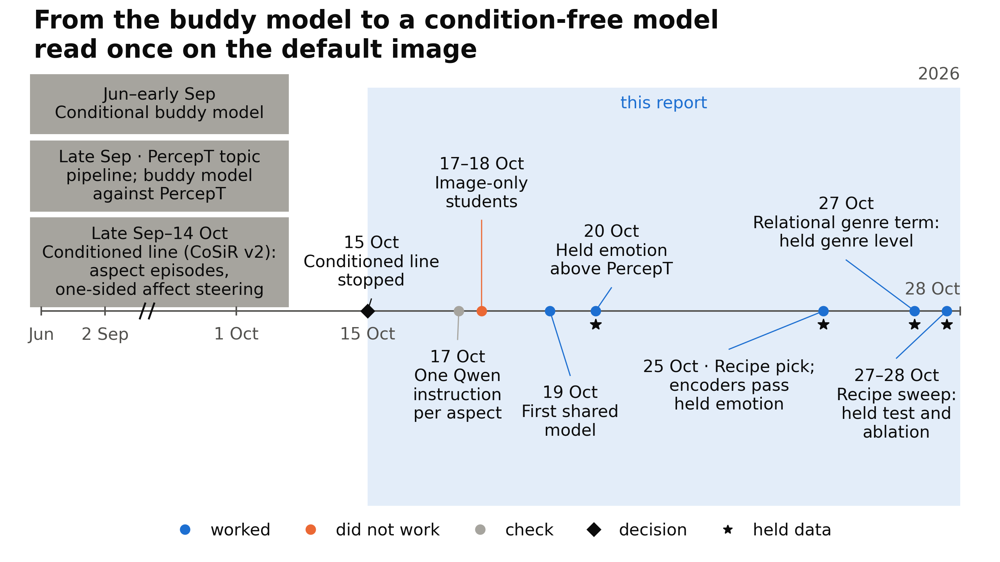

# CoSiR weekly report, 28 October 2026

CoSiR: one read of a painting gives separate emotion, style and genre spaces

From the conditioned line to a condition-free model trained on instructed views

Notes: This deck summarises the source weekly report, draft v2. Figure labels may retain abbreviations and internal names. In figures, c* means the sweep's pick, and G means the previous recipe; their relationship is explained in the sweep setting.

---

## Problem and goal of CoSiR

- Image-text embedders such as Qwen3-VL-Embedding-2B (“Qwen”) place each painting at one point, with no choice of aspect (emotion, style or genre).
- Without an aspect instruction, Qwen's image vectors give emotion agreement of 0.069: adjusted mutual information between clusters and labels; 0 is chance.
- A curator may want separate groups by mood, style or genre from one image pass.
- Goal: exceed PercepT's topic method and match or exceed Qwen's aspect-instructed image vectors on each aspect.

Notes: An embedding is a vector representing an image or caption. We call Qwen's embedding without an aspect instruction the default image embedding or default caption embedding. “Adjusted mutual information” is the clustering score used throughout. The 0.069 uses k-means, which groups nearby vectors, with 20 clusters on development paintings used to choose settings. Separate held paintings, reserved for final tests, give 0.0708 for the same default image method. PercepT clusters image-caption pairs into topics, then trains an image classifier to predict those topics. The instructed Qwen image is the image embedding made with one aspect instruction, requiring one encoder pass per aspect. “Level” allows a shortfall within one seed range, the score spread across random training runs; the precise interval rule appears with the measures. Retrieval by aspect name, finding paintings using an aspect as a query, is not measured yet.

---

## Approach of CoSiR in one picture

- Training uses instructed views: embeddings made with an aspect instruction, alongside the default image embedding.
- Buddy graphs link paintings that rank each other among their closest neighbours; the network learns to bring these linked paintings together.
- At test time, one image pass feeds three heads, the network's aspect outputs; k-means makes 20 clusters per head.

Notes: Top: training paintings only, with Qwen frozen, meaning its parameters stay unchanged. Emotion buddies use instructed captions; style and genre buddies use instructed images. A teacher supplies a target for another network, called the student. Each instructed Qwen image is a teacher target for its aspect head. The image side reads the default image embedding; a caption side supplies extra training outputs. Bottom: only the image side runs at test time. Labels only score clusters; they never enter training, graph building or early stopping. Early stopping chooses when training ends from validation loss without labels. The training objective, or loss, measures how poorly the network matches its training targets.

---

## Progress of CoSiR so far

- Before the new line, the conditioned model used example pairs to specify which aspect should guide similarity.
- The supervisors stopped that line; the replacement needs no aspect condition at test time.
- This report covers the first two weeks: initial checks, tests on reserved paintings, and a sweep over training settings.

Notes: First came the conditional buddy model. Next came PercepT's topic pipeline and its comparison with the buddy model on ArtELingo, a collection of paintings and viewer captions. Then came the conditioned line, ending with one-sided affect steering and its archive. The timeline retains calendar dates for orientation. In the new line, instruction checks led to the first shared model: a common input layer feeding three aspect heads. Its held emotion claim test passed. The earlier recipe removed terms pairing each painting with its own captions and passed held emotion on four image encoders. A relational genre term, matching similarities between paintings, brought held genre level with the instructed Qwen image. The sweep then searched settings and tested its selected candidate, the sweep's pick. The sweep setting later explains the full recipe ancestry.

---

## Experiment on one-sided affect steering

| Image encoder | Held recall at rank 1 margin, percentage points |
|---|---|
| CLIP | +0.60 |
| Qwen3-VL-Embedding-2B | +0.63 |
| SigLIP 2 | +0.51 |

- The conditioned line ranked image-caption pairs using the aspect shown by example pairs.
- One-sided affect steering adjusted scores toward emotion when the examples appeared to share emotion.
- These gains use a weaker comparator: a condition-free scorer built on the method's own three groupings.

Notes: Recall at rank 1 is the fraction of ranking tests whose first result is correct; margins are percentage points. Each held episode is one ranking test on reserved data. CLIP and SigLIP 2 are alternative image encoders, models that turn images into vectors. “Affect” means emotion. Confidence determined whether emotion steering was applied; this summary does not give its threshold. The three groupings were label-free clusters of training rows. The emotion-like grouping used an external emotion classifier on captions. Intervals: Qwen +0.63 [+0.49, +0.76]; SigLIP 2 +0.51 [+0.36, +0.66]. The CLIP result has no interval. The next slide compares against the strongest scorer.

---

## Pitfall in one-sided affect steering

- The previous table uses a weaker comparator built on the method's own groupings.
- Against the strongest scorer that ignores the condition, five evaluations gave margins from −0.52 to +0.13 percentage points.
- The method established no lead against that strongest comparator; it also lost when examples distinguished style from genre.
- The supervisors stopped the line as too specific and complicated for a CVPR paper.

Notes: The five evaluations are the source report's “five reads”; it does not break down the range further here. The report gives no loss margin for the style-versus-genre test. The supervisors made the stop decision, relayed by the user. The user then proposed a condition-free model improving on PercepT, with clustering and retrieval tasks, label-free if possible. Every later claim names its actual comparator.

---

## Plan for the CVPR submission

| Required item | Status |
|---|---|
| Held emotion margin over PercepT at least 0.0100, interval above 0 | met |
| One model for all aspects; level with instructed Qwen accepted | see held-test assessment |
| The final recipe on SigLIP 2, SigLIP 1 and CLIP L/14 image encoders | not run |
| Retrieval of paintings by aspect name | not started |

- Target: one recipe meeting all three aspect comparisons; “level” is accepted, as defined with the measures.
- Submit an abstract if a result holds; the abstract deadline is the hard limit, about two weeks away.
- Verdict (reference): the sweep's pick has emotion and style wins and genre level; the reading of this result is still open.

Notes: The sweep's pick is the candidate selected by the latest search over training settings; adoption remains undecided. SigLIP 1 and CLIP L/14 are other image encoders, alongside SigLIP 2 introduced earlier. The soft target is about the end of this week, followed by continued work until the abstract deadline. Here “a result holds” refers to the submission requirements in the table. The fixed win rule requires the difference interval above zero; level requires its lower bound above minus one seed range. Reported additional checks include the earlier recipe on other encoders and Leiden, a graph clustering method that chooses its own cluster count. ArtELingo-28 is a translated-caption test set of 746 paintings from ArtELingo, not a second dataset. A separate dataset and PercepT with its original encoders remain untested.

---

## Background on aspect-specific embeddings

- PercepT clusters image-caption pairs into topics, then predicts topics from images; it has one topic space.
- Prompted methods receive an aspect instruction at test time and need a pass per aspect.
- Distillation trains a student network to match a teacher's vectors or similarities.
- Our review identified a gap: combining instructed views, aspect buddy graphs and one default-image read for emotion, style and genre.

Notes: Prompted methods reviewed include DIOR, COCO-Facet, ESMC and guideline-driven clustering; these are method names, all using an aspect prompt. Distillation studies reviewed include relational knowledge distillation and methods matching distributions of similarities. Our novelty claim concerns the combination, to our knowledge, rather than every possible method with multiple outputs.

---

## Idea of one instruction per aspect

- An instructed image embedding replaces Qwen's default prompt with an aspect request, such as “Describe the style of this artwork in one word.”
- On the early 5,000-painting development sample, style agreement rose from 0.222 for default images to 0.395 with the style instruction.
- The student learns these targets from default image embeddings; its test inputs therefore need neither captions nor aspect instructions.

Notes: A view means an embedding made under a particular prompt. Default image and default caption embeddings use the default prompt on different input types. The early checks used 99,999 captions and 5,000 development paintings, distinct from the later 29,232-painting development set. Caption emotion agreement: 0.278 instructed against 0.122 default; a supervised emotion classifier gives 0.209. Image style references: a specialised style encoder 0.317, frozen CLIP image 0.300. Image emotion: 0.093 instructed against 0.069 default. A linear probe, a simple classifier trained on labelled embeddings, instead measures accuracy: 39.2% default versus 40.9% instructed. This suggests a larger change in vector similarities than in accessible emotion information. Removing 132 emotion-related words from captions gave emotion agreement 0.187 instructed versus 0.069 default on those same edited captions. That caption value of 0.069 is separate from the default image score. Emotion information is stronger in captions, style in images, genre in both.

---

## Overview of the task

- Input: one painting's default image embedding, without a caption or aspect instruction.
- Output: one vector per aspect, from the emotion, style and genre heads.
- Main score: k-means with 20 clusters per output; adjusted mutual information against that aspect's labels.
- Additional check: Leiden graph clustering chooses its own cluster count.

Notes: Scores average over three clustering seeds, then over model seeds. A seed controls a run's random choices. Genre scoring excludes paintings without genre labels. The main held claims concern k-means; Leiden is a separate robustness check.

---

## Measures for the task

| Measure | Meaning |
|---|---|
| Adjusted mutual information | cluster-label agreement; 0 is chance |
| Seed range | first shared model's development spread: emotion 0.0046, style 0.0082, genre 0.0128 |
| Win | difference interval above zero |
| Level | difference interval's lower bound above minus one seed range |
| Mean gain | average across aspects of gain over the previous recipe, divided by each aspect's seed range |

- A claim test reserves paintings and fixes its rule before scoring; five model seeds give paired 95% intervals.
- Separate code recalculates every decision number.

Notes: The first shared model uses one common input layer, or trunk, with one output head per aspect. Seed range is maximum minus minimum over its three development runs; this fixed scale is also used on held data. Win and level compare against the instructed Qwen image in the held test, and against the previous recipe during candidate selection. A paired bootstrap repeatedly resamples the same paintings and seeds for both methods to estimate uncertainty in their difference. A verdict is the classification obtained by applying the fixed rule. For example, the sweep's pick has held emotion difference +0.0145 [+0.0113, +0.0177]. The report expresses this as +3.155 seed ranges; its displayed rounded inputs should not be used to reproduce the last digit.

---

## Controls and comparators

Before the first shared model, separate aspect networks (blue) trailed the instructed Qwen image (green) on development paintings.

- **PercepT core**: our PercepT reimplementation, with 40 topics and five configurations of precomputed image and caption embeddings.
- **Instructed Qwen image**: the teacher and hardest comparator; one encoder pass per aspect.
- **Frozen image**: the original encoder's vectors clustered directly, without training the encoder.

Notes: A PercepT “arm” is one configuration; a matched arm uses the same image encoder as the student being compared. The Qwen comparison pool contains the eligible PercepT configurations in the Qwen claim test, rather than every encoder-specific arm. PercepT core fixes 40 topics because the paper's topic-count rule kept 1, 2, 3 or 99 depending on seed. All five configurations passed reproducibility checks. Stage 2 topic prediction had area under the receiver operating characteristic curve 0.85 to 0.96, a classifier discrimination measure. Seed standard deviation was at most 0.007. Strongest held cluster-label agreement in the Qwen pool: emotion 0.0874, style 0.2297, genre 0.4269. Emotion uses the Qwen configuration assigning each painting its highest-scoring topic. A labelled linear classifier gives a reference ceiling: emotion 0.1215, style 0.5275, genre 0.6566; it is not a label-free competitor.

---

## Dataset: ArtELingo

| Set | Paintings | Role |
|---|---|---|
| Train | 42,969 | training |
| Validation | 6,152 | label-free early stopping |
| Development | 29,232 (23,682 with genre labels) | recipe choice |
| Held | 12,281 (9,949 with genre labels) | claim tests only |

- ArtELingo pairs WikiArt paintings with viewer captions; each caption has one of nine emotion labels.
- Painting emotion is the most common caption emotion; style and genre labels come from WikiArt.
- Splits group captions by painting; genre scores include only paintings with genre labels.
- ArtELingo-28 was tested with earlier models; a separate second dataset has not run.

Notes: The early sample used 13,400 paintings for training and graphs, and 5,000 for development scores, including 4,053 with genre labels. Those are the samples used by the instruction checks and image-only caption students. The table gives the later full-scale splits. ArtELingo-28 has 746 paintings with translated captions; earlier models were tested there, but the previous recipe and sweep's pick were not. Its earlier positive margins had intervals extending below zero. Artist overlap between splits was not measured.

---

## Novelty against prior work

| Prior work | Shared idea | Limit reported in our review |
|---|---|---|
| Aspect-prompted methods | aspect-specific embeddings | need the aspect at test time |
| ESMC and Multi-Sub, methods using teacher partitions | a teacher grouping per aspect | no reported shared-trunk student from a different default input; ESMC layer sharing unclear |
| PercepT | topics predicted from images | original paper evaluates emotion and genre; one topic space |
| Teacher-matching methods | student learns from teacher | no example found of a single-teacher student exceeding it on the teacher's own task |

- To our knowledge, the combination of instructed views, aspect buddy graphs and a student read once from the default image is new.
- The parts themselves are established; so is the form of the relational genre term.

Notes: The claim covers emotion, style and genre evaluation with the combined design. The student is the network being trained; its multiple heads are the aspect outputs defined earlier. The review calls ESMC and Multi-Sub apparently transductive, meaning they train on the items later scored. It found no held-out protocol for PercepT's topic-clustering evaluation. Our PercepT core additionally scores style, unlike the original paper. The single-teacher statement is limited to the studies reviewed. Exceeding a teacher was reported where another information source contributed. The relational genre term makes the genre head match the instructed image's similarities between paintings; its mathematical form is not claimed as new.

---

## Contributions, now and at full success

| Contribution | Evidence now | Remaining work |
|---|---|---|
| One image read, three aspect spaces | sweep's pick: emotion +0.0145, style +0.0041, genre −0.0060 versus instructed Qwen | the final recipe on other encoders; retrieval |
| Fixed comparison protocol | PercepT core; five-seed tests; paired intervals; independent recalculation | second dataset; original PercepT encoders |
| Component analysis | development and held ablations; seven-encoder development comparison and held emotion tests | explain what the heads learned |

- Verdict (reference): emotion and style are wins and genre is level under the fixed rule; the reading of this result is still open.

Notes: The method row uses the sweep's pick, defined as the latest search's selected candidate, on 12,281 held paintings. Intervals against the instructed Qwen image: emotion [+0.0113, +0.0177], style [+0.0004, +0.0081], genre [−0.0103, −0.0015]. The genre lower bound exceeds −0.0128, minus its seed range. Emotion margin over the strongest eligible PercepT entry in the Qwen pool is +0.0192 [+0.0137, +0.0207]. The earlier recipe supplied the seven-encoder tests; the sweep's pick ran only on Qwen. The full relationship is given with the sweep setting.

---

## Experiment on image-only students toward caption emotion

| Student training | Image emotion agreement | Default-caption control | Pilot target |
|---|---|---|---|
| Match instructed caption targets | 0.074 | 0.074 | 0.12 |
| Learn purified caption buddy pairs | 0.094 | 0.070 | 0.12 |

- Instructed captions carry emotion agreement of 0.278; an image-only student might transfer that signal.
- The early sample supplied 13,400 training paintings and 5,000 development paintings for scoring.
- Controls use default captions; the target-matching student showed no gain at the displayed precision.
- Both missed the pilot's required 0.12; purified pairs transferred some signal, +0.024 over control.

Notes: Caption buddy pairs link paintings close in instructed caption emotion embeddings. Purification removes pairs also linked by the content graph, which uses default embeddings to represent general similarity. The control substitutes default-caption targets or pairs for instructed ones. Scores average three seeds. The 0.12 is the pilot's pre-existing bar, not the later held emotion margin requirement. The user concluded that some aspects may not be learnable by an image-only student. Follow-up work compared ways to build aspect graphs instead of simply removing content-linked pairs.

---

## Experiment on PercepT with the paper's own topic-count settings

- Joint image-caption vectors are compressed and clustered into topics; an image classifier then predicts each topic.
- The paper's rule chooses a topic count from the largest gap between sorted cluster-centre lengths.
- All 20 runs using that rule kept extreme counts: 1 to 8 or 98 to 99 topics.
- Fixing 40 topics gave held emotion agreement of 0.0644 to 0.0711 across settings, below PercepT core's 0.0874.

Notes: Deep embedded clustering jointly learns a compressed representation and cluster assignments. “Fused” pairs combine image and caption embeddings into one vector. Strict runs follow the paper's training settings and topic cut, but use our available encoders. Collapse means under 10 or over 90 topics, or one topic holding over half the pairs. There were 10 strict runs at each training scale, 20 in total; the largest gap always occurred near an end. Fixed-count results are five-seed means over 12,281 held paintings, spanning training scales and topic sources: CLIP with RoBERTa, or Qwen. The range is across settings, not individual seed scores. This is a test of topic-count settings on our features. A faithful original-encoder version, using CLIP L/14 and an emotion-tuned ModernBERT text model, is not built.

---

## Method of the aspect-graph network: design

Four boxes show training views, neighbour graphs, network training and the single image read at test time.

- Four image views supply the default input and three image teachers; captions are additional training inputs.
- Emotion buddies use instructed captions; style and genre buddies use instructed images.
- The sweep changed the maximum mutual neighbours from 20 to 40, marked orange; teal marks the relational genre term.
- At test time, only the image trunk and three heads run; k-means clusters each output.

Notes: This is the sweep's pick, presented as one design. Qwen stays frozen. Buddy graphs use training paintings only; mutual means each painting selects the other among its closest neighbours. The caption side helps train the model but is unused at test time. The shared trunk transforms the input before each aspect head produces its vector. Labels never enter training. The full image-and-caption network has 16,791,552 trainable parameters, versus 7,220,152 for PercepT core's Qwen configuration; these are different architectures. The ablation's 25,184,256 comparator instead removes layer sharing within our own architecture. It measures the saving from a shared trunk, not the size difference from PercepT.

---

## Method of the aspect-graph network: components

- **Buddy graphs** choose aspect neighbours; content correction subtracts default-embedding similarity to reduce links driven by general content.
- **Network**: image and caption sides learn together; a shared trunk feeds aspect heads, and only the image side runs at test time.
- **Buddy terms** pull linked paintings' image and caption outputs together while separating other paintings in the training batch.
- **Teacher terms** match each instructed image vector; the relational genre term also matches its pattern of similarities to other paintings.

Notes: A batch is a group of paintings processed together in one training step. Caption endpoints are the caption outputs included in buddy terms. Each side reads 2048-dimensional default embeddings; captions are averaged per painting. The trunk maps 2048 to 1024 dimensions; each head maps 1024 to 2048. Emotion content-correction weight is set per painting; the source report does not specify that formula. Style uses 0.5; genre uses uncorrected instructed image similarity. Buddy training uses InfoNCE, a contrastive loss separating linked positives from the batch's other items, with weight 1. Batches hold 512 graph pairs, or 1,024 painting rows. The direct teacher term uses InfoNCE, temperature 0.05 and weight 0.25; temperature controls how sharply similarities favour the closest items. For genre, a teacher row lists one painting's similarities to the same batch paintings. Temperature 0.02 sharpens that row to emphasise its closest neighbours. The student matches this probability distribution using Kullback–Leibler divergence, a distribution mismatch measure, at weight 8. This is the relational genre term. Each aspect stops on its label-free validation loss.

---

## Setting of the recipe sweep

- First, vary 13 settings one at a time; then combine the four most promising settings in a grid.
- At seed 0: 39 individual alternatives plus 18 grid configurations, 57 total; confirm three candidates on seeds 1 to 3.
- Select the largest mean gain over the previous recipe, with every aspect's lower bound above minus one seed range.
- The sweep's pick uses 40 neighbours instead of 20: development mean gain +0.683 [+0.452, +0.959] seed ranges over the previous recipe.

Notes: The first shared model has one trunk, three heads, own-caption terms and direct teacher weight 0.5. Own-caption terms pair a painting's image with its own caption outputs. The earlier recipe removes those terms and reduces direct teacher weight to 0.25; it is the recipe tested on seven encoders. The previous recipe adds the relational genre term at weight 8 and teacher-row temperature 0.02 to the earlier recipe. The sweep's pick changes only its graph-neighbour limit from 20 to 40. The sweep selected on development data only; its starting recipe had already been chosen after that recipe's held genre test. No held score selected among sweep candidates. The pick rule was fixed beforehand and also required the mean gain interval above zero. The 13 settings each had alternative values, giving 39 single-setting configurations, followed by 18 new grid configurations. Early screening used 13,400 training paintings at seed 0; confirmation scored 29,232 development paintings on seeds 1 to 3. At seed 0, neighbours alone gave +0.924 seed ranges; changing teacher-row temperature to 0.035 alone gave +0.371. Together they gave +0.751, less than the neighbours change alone. The pick retains temperature 0.02. Confirmation differences versus the previous recipe, in raw adjusted mutual information: emotion +0.0026, style +0.0141, genre −0.0031. The genre interval crossed zero. The second-best candidate's mean gain was +0.369; candidate intervals overlapped. Searching 57 configurations inflates the best seed-0 gains.

---

## Test of the aspect-graph network on held paintings

Left: held agreement for PercepT, instructed Qwen, the previous recipe and the sweep's pick. Right: the pick minus instructed Qwen.

- Test: 12,281 paintings, including 9,949 with genre labels; five seeds and paired 95% intervals.
- Differences from instructed Qwen: emotion +0.0145, style +0.0041, genre −0.0060.
- Differences from strongest PercepT entries in the Qwen comparison pool: emotion +0.0192, style +0.1769, genre +0.0732.
- Verdict (reference): emotion/style win, genre level; win requires an interval above zero, level a lower bound above minus one seed range.

Notes: The reading of this result is still open. The rule was fixed before scoring the sweep's pick on held paintings. Against instructed Qwen: emotion 0.1066 versus 0.0921, difference +0.0145 [+0.0113, +0.0177]; style 0.4066 versus 0.4026, +0.0041 [+0.0004, +0.0081]. Genre: 0.5001 versus 0.5062, difference −0.0060 [−0.0103, −0.0015], against a level bound of −0.0128. Reported differences use underlying values; rounded displayed scores need not subtract exactly. The style lower bound is narrow, about 0.05 seed ranges above zero. PercepT intervals: emotion [+0.0137, +0.0207], style [+0.1663, +0.1809], genre [+0.0622, +0.0796]. The Qwen pool contains the eligible configurations of that claim test. It excludes PercepT configurations matched to other encoders: CLIP L/14 reached style 0.2306, and SigLIP 2 reached genre 0.4558. Thus “strongest” here is limited to the Qwen pool, not every PercepT run. Independent code recalculated decision numbers with 0 differences. The pick's Leiden genre score was 0.5082. Selection caveat: the previous recipe became the sweep's starting point after its held genre result, which reached level with instructed Qwen. Sweep candidates were selected only on development data; the broader design history therefore includes prior held feedback.

---

## Test of the earlier recipe on seven image encoders

Left: held emotion agreement against PercepT core's Qwen configuration. Right: development improvement over PercepT core using each student's encoder.

- Only the image input layer changes; graphs, teacher and captions stay Qwen's.
- Pass requires margin at least 0.0100 over PercepT's 0.0874, with its interval above zero.
- Four pass: SigLIP 1 0.1036, Qwen 0.1029, SigLIP 2 0.1024, CLIP L/14 0.0996.
- CLIP B/16 and B/32 are inconclusive; DINOv2-large fails at sample scale; the sweep's pick ran only on Qwen.

Notes: The earlier recipe precedes the relational genre term, as defined in the sweep ancestry. Its graph, teacher and caption training inputs remain Qwen's even when the image encoder changes. Full-scale training uses 42,969 paintings; sample scale uses 13,400. DINOv2-large was tested only at sample scale against its corresponding strongest eligible PercepT score of 0.0855. Its margin was −0.0041 [−0.0094, −0.0030]. Full-scale margins: SigLIP 1 +0.0162 [+0.0106, +0.0179]; Qwen +0.0154 [+0.0100, +0.0169]; SigLIP 2 +0.0150 [+0.0096, +0.0163]; CLIP L/14 +0.0122 [+0.0068, +0.0136]. CLIP B/16 gave +0.0070 and B/32 +0.0011; neither established the required margin, hence inconclusive. On development paintings all seven improved over PercepT with their own encoder, by +0.0117 to +0.0288. Across seven encoders, improvement correlated with style silhouette, a cluster-separation score (Spearman +0.964), rather than untrained image emotion agreement (+0.036). Under Leiden, every passing student's emotion difference interval included zero. These failures limit the claim that the method works with arbitrary encoders.

---

## Ablation of the aspect-graph network

Three panels show emotion, style and genre changes when each component is removed from the sweep’s pick.

- Remove one part at a time without retuning; the figure shows changes on held paintings.
- Removing instructed graphs changes style by −0.1903; removing buddy terms changes style by −0.1512; both also reduce emotion.
- Removing the relational genre term changes genre by −0.0440; no other removal changes genre by more than 0.0072.
- Removing the direct teacher term or the caption endpoints (caption outputs in the buddy terms) raised held style: +0.0041 and +0.0072.

Notes: Held tests use 12,281 paintings and seeds 0 to 4. Removing instructed graphs: style −0.1903 [−0.1959, −0.1822], emotion −0.0327 [−0.0361, −0.0292]. Removing buddy terms: style −0.1512 [−0.1547, −0.1451], emotion −0.0277. Removing content correction, the default-similarity subtraction defined with the components: style −0.0752, emotion −0.0090, genre +0.0072 [+0.0030, +0.0113]. Removing the relational genre term: genre −0.0440 [−0.0512, −0.0372]. Removing the direct teacher term: emotion +0.0035 [+0.0008, +0.0056], style +0.0041 [+0.0016, +0.0067]. Removing caption endpoints, the caption outputs inside buddy terms: style +0.0072 [+0.0015, +0.0121]. These improvements motivate simplification, but do not establish that removal helps every aspect. Removing teacher-row sharpening: genre −0.0038 [−0.0074, −0.0002]. Removing the shared trunk produces no held change above 0.0023; every interval crosses zero. Sharing saves parameters: 16,791,552 versus 25,184,256 within our architecture. Development tests use 29,232 paintings and seeds 1 to 3. They support the main graph, buddy and content-correction roles for emotion/style, and the relational term for genre. Other effects differ in sign or certainty, including some style and genre removals. An ablation measures a part within this recipe, rather than reconstructing the design history.

---

## Analysis of where the gain sits

| Aspect | Difference from instructed Qwen | Difference from strongest PercepT entry in Qwen pool |
|---|---|---|
| Emotion | +0.0145 | +0.0192 |
| Style | +0.0041 | +0.1769 |
| Genre | −0.0060 | +0.0732 |

- Emotion has the largest improvement over instructed Qwen; style has the largest improvement over PercepT in the Qwen pool.
- Against the previous recipe, held improvement is mainly emotion, +0.0027; the development style improvement did not persist.
- Earlier models showed no resolved emotion lead under Leiden; the sweep's pick has no Leiden emotion test.
- Hypothesis: caption information helps emotion exceed the instructed image; this explanation is untested.

Notes: Held results use 12,281 paintings and five seeds. Against the previous recipe: emotion +0.0027 [+0.0001, +0.0054], style +0.0009 [−0.0044, +0.0065], genre 0.0000. Each label set favoured its corresponding head. Against genre labels, the emotion head scored 0.3889 versus the genre head's 0.5001. Under Leiden, the first shared model's emotion margin over PercepT core was −0.0005 [−0.0048, +0.0023]. Setting k-means to Leiden's mean cluster count retained +0.0190, so cluster count alone did not explain that loss of lead. Captions may add information beyond the image teacher; their role has not been isolated. Style has no caption graph, and its improvement over instructed Qwen is also unexplained.

---

## Analysis of the scope of the result

- Covered: the sweep's pick on held ArtELingo, one default Qwen image read, scored with k-means.
- Unmeasured: the sweep's pick on other encoders, training without Qwen's instructed views, and Leiden emotion/style.
- Unmeasured: a separate dataset, retrieval, and PercepT with its original encoders.
- Test input cost: one default-image pass versus three instructed-image passes; reported timings come from different runs, including image loading.

Notes: Every student still needs Qwen's graphs, teacher and captions during training. Earlier models showed no resolved emotion lead under Leiden; the sweep's pick was tested with Leiden only on genre. ArtELingo-28 was not read for the previous recipe or the sweep's pick. Reported historical rates: 0.0871 seconds per painting for a default-image pass and 0.0936 seconds for each instructed pass. These are different runs, not a controlled speed benchmark; the weekly source does not specify hardware for this comparison. The sweep searched 57 configurations at seed 0, and its starting recipe already reflected held genre feedback.

---

## Ongoing work and plan

- Running: nothing; the sweep and held ablation are complete.
- Open decision: the reading of the sweep's result, then the next work.
- Options: remove the caption endpoints, under one hour; test the sweep's pick on other encoders, half a day; draft the CVPR abstract.
- Not started: retrieval by aspect name; a separate second dataset; PercepT with its original encoders.

Notes: Removing caption endpoints means removing caption outputs from buddy terms, motivated by the held style improvement in the ablation. The measured ablation already covers that variant, so another held test would be close to known. Other-encoder tests would use SigLIP 2, SigLIP 1 and CLIP L/14 to check whether the sweep's pick transfers. They need about half a day of graphics-processor time on the cluster node. That node is available for about two more days, providing a window for these tests. Verdict (reference): the held emotion requirement over PercepT is met; the one-model rule gives emotion and style wins and genre level, the reading is still open. The final recipe's other-encoder tests and retrieval remain incomplete. Paper options: three aspect spaces from one image read, needing encoder tests and retrieval; Qwen instruction supervision across encoders, needing final-recipe transfer tests. A third option is a fair topic evaluation of PercepT, needing its original encoders.
