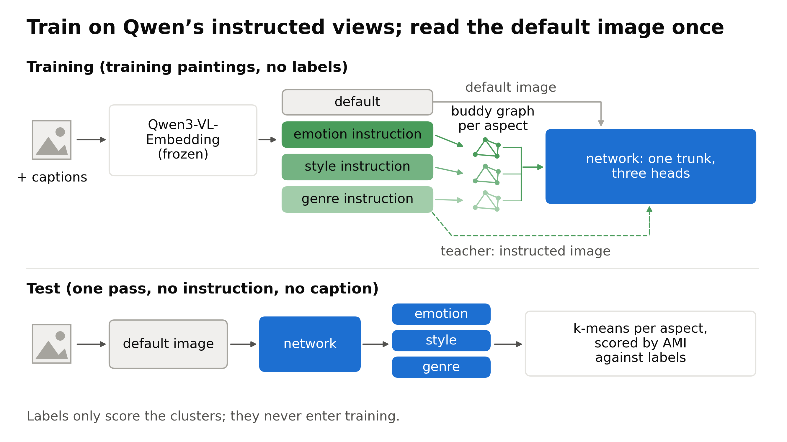
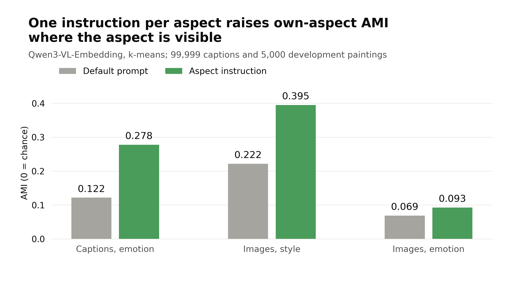
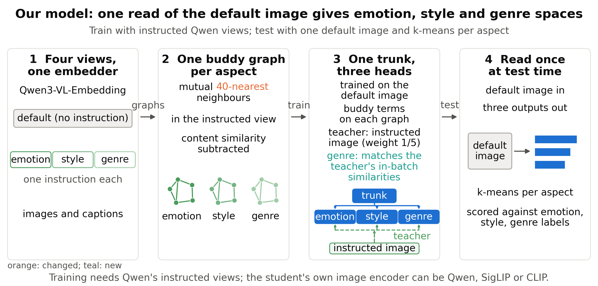
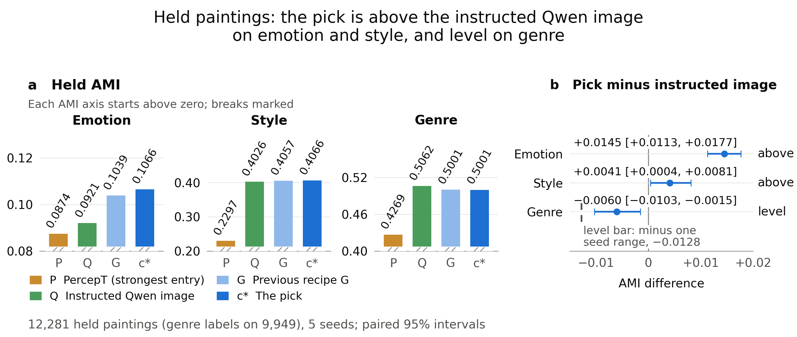
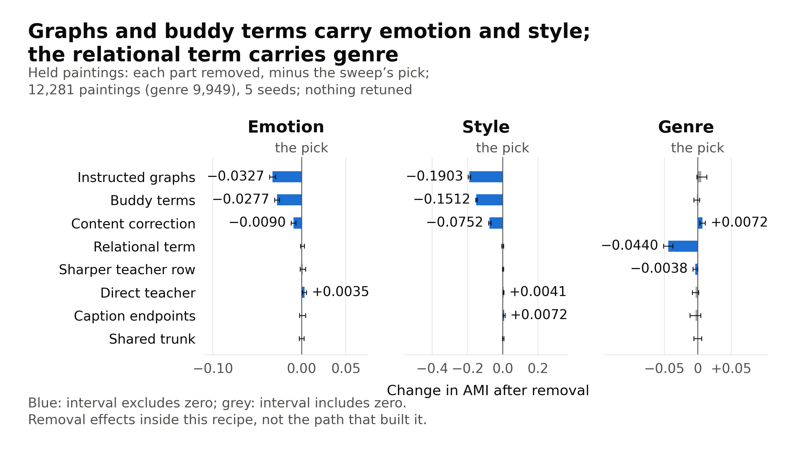

# CoSiR weekly report, 28 October 2026

CoSiR: one read of a painting gives separate emotion, style and genre spaces

A condition-free model trained on Qwen's instructed views

Notes: In figures, c* is the sweep's pick and G is the previous recipe.

---

## Problem and goal of CoSiR

- PercepT finds perceptual topics, but its emotion gain leans on an emotion-tuned caption encoder chosen in advance.
- Such an aspect-specific encoder is hard to carry to new datasets, and maybe to new backbones.
- We want a more general framework: one general embedder, Qwen3-VL-Embedding-2B ("Qwen"), told which aspect to look at.
- The bar is Qwen's image with an aspect instruction: our teacher, and the strongest label-free comparator we have.
- Goal: from one default image pass, beat PercepT and match or beat the instructed Qwen image on emotion, style and genre.

Notes: PercepT (arXiv 2606.03345) clusters image-caption pairs into topics, then trains an image classifier to predict them. Its paper uses CLIP L/14 images and an emotion-tuned ModernBERT caption encoder. Qwen's default prompt is "Represent the user's input." The instructed views replace it. Emotion: "Represent the emotion that this artwork, or this description of an artwork, conveys. Focus only on the emotion." Style: "Describe the artistic style of this artwork in one word." Genre: "Describe the genre of this artwork in one word." Why it is the bar: on held paintings it scores highest of all label-free comparators on every aspect (emotion 0.0921, style 0.4026, genre 0.5062). But it needs one encoder pass per aspect, and the aspect must be named at test time. If one default pass matches it, we get three aspect spaces for the price of one pass. Scores are adjusted mutual information (AMI) between k-means clusters and labels; 0 is chance. The plain default Qwen image gives held emotion 0.0708.

---

## Approach of CoSiR in one picture

- Training uses Qwen's instructed views next to the default image embedding.
- Buddy graphs link paintings that rank each other among their closest neighbours; the network pulls buddies together.
- At test time, one image pass feeds three heads; k-means makes 20 clusters per head.

Notes: Top: training paintings only; Qwen stays frozen. Emotion buddies come from instructed captions; style and genre buddies from instructed images. Each instructed Qwen image is also a teacher target for its head. The image side reads the default image embedding; a caption side adds training signal. Bottom: only the image side runs at test time. Labels only score clusters. They never enter training, graph building or early stopping, which uses label-free validation loss.

---

## Progress of CoSiR so far

- Week 1: checks of the idea, PercepT core as the comparator, the first shared model and its held emotion test.
- Week 2: the recipe on more image encoders, a relational genre term, the recipe sweep and its held test.

Notes: The first shared model is one common trunk with one head per aspect. The relational genre term makes the genre head copy the instructed image's similarities between paintings. The sweep then searched training settings and tested its pick on held paintings.

---

## Plan of CoSiR for the paper

| Required item | Status |
|---|---|
| Held emotion margin over PercepT of at least 0.0100, interval above 0 | met: +0.0192 |
| One model for all aspects, at least level with the instructed Qwen image | emotion and style above, genre level |
| The final recipe on SigLIP 2, SigLIP 1 and CLIP L/14 | not run yet |
| Retrieval of paintings by aspect name | in progress |

- Why 0.0100: PercepT core's seed standard deviation is up to 0.007, so we read gaps under about 0.01 as level.
- For scale: 0.0100 is about 11% of PercepT's 0.0874; our teacher is only 0.0047 above PercepT.

Notes: Row 1: the sweep's pick, +0.0192 [+0.0137, +0.0207], about 22% above PercepT core's 0.0874. Row 2: the sweep's pick on 12,281 held paintings; the reading of this result is still open. "Level" means the lower end of the interval is above minus one seed range. SigLIP 1, SigLIP 2 and CLIP L/14 are other image encoders. A separate second dataset and PercepT with its original encoders are not tested.

---

## Background on aspect-specific embeddings

- PercepT clusters image-caption pairs into topics, then predicts topics from images; it has one topic space.
- Prompted methods take an aspect instruction at test time and need one pass per aspect.
- Distillation trains a student network to copy a teacher's vectors or similarities.
- The gap we found: instructed views, aspect buddy graphs and one default-image read, together.

Notes: Prompted methods reviewed: DIOR, COCO-Facet, ESMC and guideline-driven clustering; all use an aspect prompt. Distillation studies reviewed: relational knowledge distillation and methods that match similarity distributions. The novelty claim is the combination, to our knowledge, not every method with several outputs.

---

## Idea of one instruction per aspect

- An instructed embedding swaps Qwen's default prompt for an aspect request, such as "Describe the style of this artwork in one word."
- On 5,000 early development paintings, style AMI rose from 0.222 (default image) to 0.395 (style instruction).
- The student learns these targets from the default image, so at test time it needs no caption and no instruction.

Notes: A view is an embedding made under one prompt. The early checks used 99,999 captions and 5,000 development paintings, not the later 29,232. Caption emotion: 0.278 instructed against 0.122 default; a supervised emotion classifier gives 0.209. Image style: a style encoder gives 0.317, frozen CLIP images 0.300. Image emotion: 0.093 instructed against 0.069 default. A linear probe's emotion accuracy moved only from 39.2% to 40.9%, so the instruction changes the geometry more than the information. With 132 emotion words removed from captions, instructed caption emotion still gave 0.187 against 0.069 default. Emotion is stronger in captions, style in images, genre in both.

---

## Overview of the task

- Input: one painting's default image embedding; no caption, no aspect instruction.
- Output: one vector per aspect, from the emotion, style and genre heads.
- Main score: k-means with 20 clusters per head, then AMI against that aspect's labels.
- Extra check: Leiden graph clustering, which picks its own number of clusters.

Notes: Scores average three clustering seeds, then the model seeds. Genre scores skip paintings without genre labels. The main held claims use k-means; Leiden is a robustness check.

---

## Measures for the task

| Measure | Meaning |
|---|---|
| AMI | agreement between clusters and labels; 0 is chance |
| Seed range | how far a score moves from the training seed alone: emotion 0.0046, style 0.0082, genre 0.0128 |
| Mean gain | gain over the previous recipe in seed ranges, averaged over the three aspects |

- Seed range: highest minus lowest score of the first shared model over three seeds, on development paintings.
- We use it as the noise unit, so gains on different aspects compare on one scale.
- Claim tests fix their rule before scoring and use five model seeds with paired 95% intervals.

Notes: The first shared model (2026-10-19) was our first model with one trunk and one head per aspect. Its seed range was fixed once and is used for every later comparison, on development and held data. It is called a range because it is the maximum minus the minimum across seeds. A paired bootstrap resamples the same paintings and seeds for both methods. Separate code recomputes every decision number. Example: the sweep's pick is +0.0145 [+0.0113, +0.0177] above the instructed Qwen image on held emotion, about 3.2 seed ranges.

---

## Comparators for the task

Grey: the best frozen encoder per aspect (default Qwen image for emotion and genre, CLIP for style).

- **PercepT core**: our PercepT reimplementation, 40 topics, five input configurations.
- **Instructed Qwen image**: the teacher and hardest comparator; one encoder pass per aspect.
- **Frozen image**: an encoder's own vectors, clustered directly.

Notes: This figure is from 10-19, before the first shared model: separate aspect networks (blue) trailed the instructed Qwen image (green) on development paintings. DINOv2 was not in this comparison; it came in on 10-26. PercepT core fixes 40 topics because the paper's topic-count rule kept 1, 2, 3 or 99 topics depending on the seed. All five configurations passed reproducibility checks; seed standard deviation was at most 0.007. Strongest held PercepT entries in the Qwen claim test: emotion 0.0874, style 0.2297, genre 0.4269. A label-trained linear probe gives a ceiling: emotion 0.1215, style 0.5275, genre 0.6566. It uses labels, so it is a reference, not a competitor.

---

## Dataset for the task: ArtELingo

| Set | Paintings | Role |
|---|---|---|
| Train | 42,969 | training |
| Validation | 6,152 | label-free early stopping |
| Development | 29,232 (23,682 with genre labels) | recipe choice |
| Held | 12,281 (9,949 with genre labels) | claim tests only |

- WikiArt paintings with viewer captions; each caption has one of nine emotion labels.
- A painting's emotion is its most common caption emotion; style and genre come from WikiArt.
- Splits group captions by painting.

Notes: The early checks used a sample: 13,400 paintings for training and graphs, 5,000 for development scores (4,053 with genre labels). ArtELingo-28 (746 paintings, translated captions) was tested with earlier models, not with the previous recipe or the sweep's pick. A separate second dataset has not run. Artist overlap between splits was not measured.

---

## Novelty against prior work

| Prior work | Shared idea | Limit in our review |
|---|---|---|
| Aspect-prompted methods | aspect-specific embeddings | need the aspect at test time |
| ESMC, Multi-Sub (teacher partitions) | a teacher grouping per aspect | no shared-trunk student reading a different default input |
| PercepT | topics predicted from images | evaluates emotion and genre; one topic space |
| Teacher-matching methods | student learns from a teacher | no single-teacher student found that beats it on the teacher's own task |

- New, to our knowledge: instructed views, aspect buddy graphs and a student read once from the default image, together.
- The parts are known, and so is the form of the relational genre term.

Notes: The review calls ESMC and Multi-Sub apparently transductive: they train on the items they later score. It found no held-out protocol for PercepT's topic evaluation. Our PercepT core also scores style. The single-teacher statement covers only the studies reviewed; students did beat teachers where another information source helped.

---

## Contributions, now and at full success

| Contribution | Evidence now | Remaining work |
|---|---|---|
| One image read, three aspect spaces | sweep's pick against instructed Qwen: emotion +0.0145, style +0.0041, genre −0.0060 | final recipe on other encoders; retrieval |
| Fixed comparison protocol | PercepT core; five-seed tests; paired intervals; independent recomputation | second dataset; original PercepT encoders |
| Component analysis | development and held ablations; seven-encoder tests | what the heads learned |

Notes: Held, 12,281 paintings. Intervals against the instructed Qwen image: emotion [+0.0113, +0.0177], style [+0.0004, +0.0081], genre [−0.0103, −0.0015]; the genre lower end is above −0.0128, minus its seed range. Over the strongest PercepT entry: emotion +0.0192 [+0.0137, +0.0207]. The seven-encoder tests used the earlier recipe; the sweep's pick ran only on Qwen.

---

## Side branches: image-only students toward caption emotion

| Student training | Image emotion AMI | Default-caption control | Pilot bar |
|---|---|---|---|
| Copy instructed caption targets | 0.074 | 0.074 | 0.12 |
| Learn purified caption buddy pairs | 0.094 | 0.070 | 0.12 |

- **Purpose:** captions hold more emotion than images (instructed captions 0.278). Can an image-only student learn it?
- **Design:** the student reads the default image and learns caption targets or caption buddy pairs; controls use default captions.
- **Result:** both missed the 0.12 bar. Purified pairs added +0.024 over control; copying targets added nothing.

Notes: Early sample: 13,400 training and 5,000 development paintings; three seeds. Purification removes buddy pairs that the content graph (default embeddings) also links. The 0.12 was the pilot's own bar. Our conclusion then: some aspects may not be learnable by an image-only student this way. Next, we compared ways to build aspect graphs.

---

## Side branches: PercepT with the paper's topic-count rule

- **Purpose:** check whether PercepT with its paper's own topic-count rule beats our fixed 40 topics.
- **Design:** image-caption vectors are clustered into topics; the rule picks the count at the largest gap in sorted cluster-centre lengths.
- **Result:** all 20 runs with that rule collapsed to 1 to 8 or 98 to 99 topics.
- **Result:** with 40 fixed topics, held emotion was 0.0644 to 0.0711, below PercepT core's 0.0874.

Notes: Deep embedded clustering learns a compressed representation and the clusters together. Strict runs follow the paper's training settings and topic cut, on our encoders. Collapse means under 10 or over 90 topics, or one topic with over half the pairs. Ten strict runs per training scale, 20 in all. Fixed-count results: five-seed means over 12,281 held paintings, across training scales and topic sources (CLIP with RoBERTa, or Qwen). A faithful version with the paper's encoders (CLIP L/14 and an emotion-tuned ModernBERT) is not built.

---

## Method of the aspect-graph network: design

- Four Qwen image views: the default input and three aspect teachers; captions help only in training.
- Emotion buddies come from instructed captions; style and genre buddies from instructed images.
- Orange: the sweep raised graph neighbours from 20 to 40. Teal: the relational genre term.
- At test time only the image trunk and three heads run; k-means clusters each output.

Notes: This is the sweep's pick. Qwen stays frozen. Buddy graphs use training paintings only; mutual means each painting picks the other among its closest neighbours. The full image-and-caption network has 16,791,552 trainable parameters; PercepT core's Qwen configuration has 7,220,152, a different architecture. Without a shared trunk our network would need 25,184,256.

---

## Method of the aspect-graph network: components

- **Buddy graphs** pick aspect neighbours; content correction subtracts default similarity to cut links driven by general content.
- **Network**: image and caption sides train together; a shared trunk feeds three aspect heads.
- **Buddy terms** pull linked paintings together and push other paintings in the batch apart.
- **Teacher terms** copy each instructed image vector; for genre, also its similarities to other paintings.

Notes: Each side reads 2048-dimensional default embeddings; captions are averaged per painting. Trunk: 2048 to 1024; each head: 1024 to 2048. Content correction: per-painting weight for emotion, 0.5 for style, none for genre. Buddy terms use InfoNCE, a contrastive loss, at weight 1. Batches hold 512 graph pairs (1,024 painting rows). The direct teacher term uses InfoNCE at temperature 0.05 and weight 0.25. The relational genre term: a teacher row lists one painting's similarities to the batch, sharpened at temperature 0.02; the student matches it by Kullback-Leibler divergence at weight 8. Each head stops on its own label-free validation loss.

---

## Experiments on the aspect-graph network: recipe sweep

| Recipe (development, seed 0) | Emotion | Style | Genre | Mean gain |
|---|---|---|---|---|
| Previous recipe, before the sweep | 0.1058 | 0.3991 | 0.4997 | 0 |
| Best overall and best style: 40 neighbours (the pick) | 0.1107 | 0.4090 | 0.5060 | +0.924 |
| Best emotion: 40 neighbours, style relational weight 8 | 0.1124 | 0.4006 | 0.5038 | +0.651 |
| Best genre: 40 neighbours, style relational weight 2, trunk 512 | 0.1103 | 0.4031 | 0.5144 | +0.874 |

- **Purpose:** find a recipe above the previous one on all three aspects, using development paintings only.
- **Design:** 57 setting changes at seed 0; the pick has the largest mean gain; the top three rerun on seeds 1 to 3.
- **Result:** 40 graph neighbours (was 20) won, both at seed 0 and on the three new seeds.

Notes: Mean gain is in seed ranges over the previous recipe. The previous recipe: the first shared model without own-caption terms, direct teacher weight 0.25, plus the relational genre term. Models train on the 13,400-painting sample; scores use 29,232 development paintings. The previous recipe's row is its seed-0 run on the same cluster node. Style relational weight adds a relational term like the genre one to the style head; the previous recipe has none. Trunk 512 halves the shared trunk's width. On seeds 1 to 3, the pick against the previous recipe: emotion +0.0026 [+0.0011, +0.0045], style +0.0141 [+0.0121, +0.0160], genre −0.0031 [−0.0090, +0.0044]; mean gain +0.683 [+0.452, +0.959]. The best-genre run came second there (+0.369), with genre 0.0060 below the previous recipe. The best-emotion run was fourth by mean gain, so it was not rerun. The best of 57 runs at one seed reads high; the rerun corrects for that. No held score chose among the candidates.

---

## Experiments on the aspect-graph network: held test

Left: held AMI of PercepT, instructed Qwen, the previous recipe and the sweep's pick. Right: the pick minus instructed Qwen.

- **Purpose:** test the sweep's pick on held paintings, under a rule fixed before scoring.
- **Design:** 12,281 paintings (9,949 with genre labels), five seeds, paired 95% intervals.
- **Result:** against instructed Qwen, emotion +0.0145 and style +0.0041 (wins), genre −0.0060 (level).
- **Result:** against the strongest PercepT entries, emotion +0.0192, style +0.1769, genre +0.0732.

Notes: The reading of this result is still open. Emotion 0.1066 against 0.0921, +0.0145 [+0.0113, +0.0177]. Style 0.4066 against 0.4026, +0.0041 [+0.0004, +0.0081]; the lower end is only about 0.05 seed ranges above zero. Genre 0.5001 against 0.5062, −0.0060 [−0.0103, −0.0015], above the level bound of −0.0128. PercepT intervals: emotion [+0.0137, +0.0207], style [+0.1663, +0.1809], genre [+0.0622, +0.0796]. "Strongest" here means within the Qwen claim test; PercepT arms matched to other encoders reached style 0.2306 (CLIP L/14) and genre 0.4558 (SigLIP 2). Independent code recomputed every decision number with no differences. Leiden genre: 0.5082. One caveat: the previous recipe became the sweep's starting point after its held genre test.

---

## Experiments on the aspect-graph network: other image encoders

Left: held emotion AMI against PercepT core's Qwen configuration. Right: development gain over PercepT on each student's encoder.

- These models use the earlier recipe of 10-25, from before the relational genre term and the sweep.
- **Purpose:** check whether the recipe works on image encoders other than Qwen.
- **Design:** only the image input layer changes; a pass needs a held emotion margin of at least 0.0100 over PercepT's 0.0874.
- **Result:** four pass: SigLIP 1 0.1036, Qwen 0.1029, SigLIP 2 0.1024, CLIP L/14 0.0996. CLIP B/16 and B/32 are inconclusive; DINOv2-large fails (sample scale only).

Notes: Graphs, teacher and captions stay Qwen's for every encoder. Full scale trains on 42,969 paintings; DINOv2-large ran only at the 13,400-painting sample scale, margin −0.0041 [−0.0094, −0.0030] against 0.0855. Full-scale margins: SigLIP 1 +0.0162 [+0.0106, +0.0179]; Qwen +0.0154 [+0.0100, +0.0169]; SigLIP 2 +0.0150 [+0.0096, +0.0163]; CLIP L/14 +0.0122 [+0.0068, +0.0136]. CLIP B/16 +0.0070 and B/32 +0.0011 missed the margin. On development paintings all seven beat PercepT on their own encoder, by +0.0117 to +0.0288. The gain tracked style silhouette (Spearman +0.964), not untrained emotion AMI (+0.036). Under Leiden, every passing student's emotion interval included zero. The sweep's pick on these encoders is the next test.

---

## Experiments on the aspect-graph network: ablation

Each panel shows the held change in one aspect when one part is removed from the sweep's pick.

- **Purpose:** find which parts carry the gain. **Design:** remove one part at a time, no retuning, held paintings.
- Instructed graphs and buddy terms carry style (−0.1903 and −0.1512 when removed) and also emotion.
- The relational genre term carries genre (−0.0440); no other removal moves genre by more than 0.0072.
- Removing the direct teacher or the caption endpoints raised held style: +0.0041 and +0.0072.

Notes: 12,281 held paintings, seeds 0 to 4. Instructed graphs: style −0.1903 [−0.1959, −0.1822], emotion −0.0327 [−0.0361, −0.0292]. Buddy terms: style −0.1512 [−0.1547, −0.1451], emotion −0.0277. Content correction: style −0.0752, emotion −0.0090, genre +0.0072 [+0.0030, +0.0113]. Relational genre term: genre −0.0440 [−0.0512, −0.0372]. Direct teacher: emotion +0.0035 [+0.0008, +0.0056], style +0.0041 [+0.0016, +0.0067]. Caption endpoints (caption outputs inside the buddy terms): style +0.0072 [+0.0015, +0.0121]. These hint at a simpler model, but not that removal helps every aspect. Teacher-row sharpening: genre −0.0038 [−0.0074, −0.0002]. Shared trunk: no held change above 0.0023, every interval crosses zero; it saves parameters (16,791,552 against 25,184,256). Development (29,232 paintings, seeds 1 to 3) agrees on the main roles.

---

## Analysis of the held results: all methods

| Method (held paintings) | Emotion | Style | Genre |
|---|---|---|---|
| Zero-shot: default Qwen image, clustered directly | 0.0708 | 0.2233 | 0.4521 |
| PercepT core, Qwen image | 0.0874 | 0.1950 | 0.4230 |
| PercepT core, SigLIP 1 image | 0.0821 | 0.2293 | 0.4539 |
| PercepT core, SigLIP 2 image | 0.0793 | 0.2280 | 0.4558 |
| PercepT core, CLIP L/14 image | 0.0793 | 0.2306 | 0.4433 |
| PercepT, strongest entry of the Qwen test (any input setting) | 0.0874 | 0.2297 | 0.4269 |
| Ceiling: instructed Qwen image, one pass per aspect | 0.0921 | 0.4026 | 0.5062 |
| Ceiling: label-trained linear probe (development) | 0.1215 | 0.5275 | 0.6566 |
| Ours: the sweep's pick, Qwen, one pass | 0.1066 | 0.4066 | 0.5001 |

Notes: 12,281 held paintings (genre on 9,949), k-means with 20 clusters, five model seeds. PercepT core rows use Qwen's image and emotion-caption topics; the encoder named is the one its image classifier reads. Each row gives, per aspect, the stronger of two readings: its own top topic for emotion and style, k-means on topic probabilities for genre. The strongest-entry row is what the held test compares against; its genre entry is a paper-settings model with 40 topics. The probe has no held value; its row is the development value on 5,000 paintings, and it uses labels. For reference, the earlier recipe on SigLIP 1 (before the sweep) reached emotion 0.1036, style 0.4351, genre 0.4702; frozen SigLIP 1 images give style 0.3632, the best frozen style.

---

## Analysis of the held results: where the gain sits

| Aspect | Against instructed Qwen | Against the strongest PercepT entry |
|---|---|---|
| Emotion | +0.0145 | +0.0192 |
| Style | +0.0041 | +0.1769 |
| Genre | −0.0060 | +0.0732 |

- The largest gain over instructed Qwen is on emotion; the largest over PercepT is on style.
- Against the previous recipe, the held gain is mainly emotion (+0.0027); the development style gain did not carry over.
- Under Leiden, earlier models showed no clear emotion lead; the sweep's pick has no Leiden emotion test.
- Our guess, not tested: captions help emotion go past the instructed image.

Notes: 12,281 held paintings, five seeds. Against the previous recipe: emotion +0.0027 [+0.0001, +0.0054], style +0.0009 [−0.0044, +0.0065], genre 0.0000. Each label set favoured its own head: against genre labels, the emotion head scored 0.3889 and the genre head 0.5001. Under Leiden, the first shared model's emotion margin over PercepT core was −0.0005 [−0.0048, +0.0023]. K-means at Leiden's mean cluster count kept +0.0190, so the cluster count alone does not explain that. Style has no caption graph, so its gain over instructed Qwen is also unexplained.

---

## Analysis of the held results: scope

- Covered: the sweep's pick on held ArtELingo, one default Qwen image read, scored with k-means.
- Not measured yet: the sweep's pick on other encoders, training without Qwen's instructed views, Leiden emotion and style.
- Not measured yet: a separate dataset, retrieval, and PercepT with its original encoders.
- Test cost: one default-image pass instead of three instructed passes.

Notes: Every student still needs Qwen's graphs, teacher and captions during training. Leiden was run only on genre for the sweep's pick. ArtELingo-28 was not read for the previous recipe or the sweep's pick. Reported speeds: 0.0871 seconds per painting for a default pass, 0.0936 seconds per instructed pass; these come from different runs, not a controlled benchmark. The sweep searched 57 settings at seed 0, and its starting recipe already reflected held genre feedback.

---

## Ongoing work and plan

- Started: retrieval of paintings by aspect name.
- Ongoing: the final held test of the sweep's pick on SigLIP 2, SigLIP 1 and CLIP L/14.

Notes: Retrieval means finding paintings with an aspect name as the query. The other-encoder tests check whether the sweep's pick transfers the way the earlier recipe did. They need about half a day of GPU time on the cluster node.
