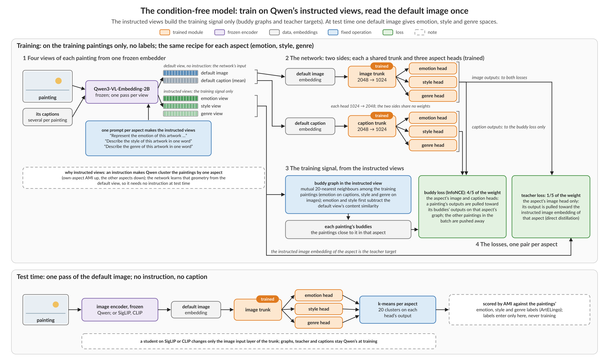
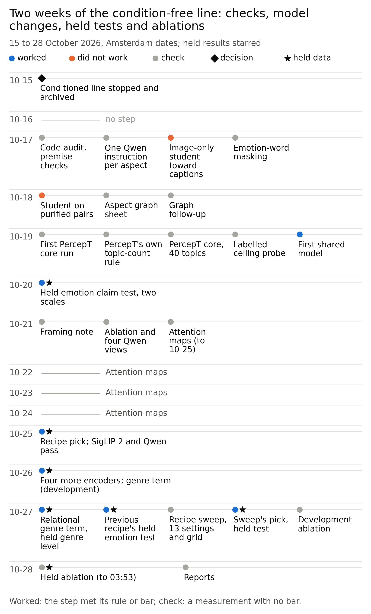
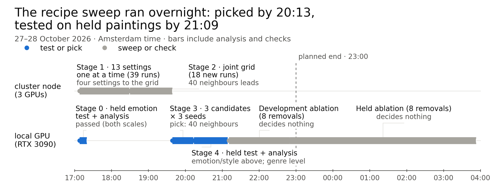
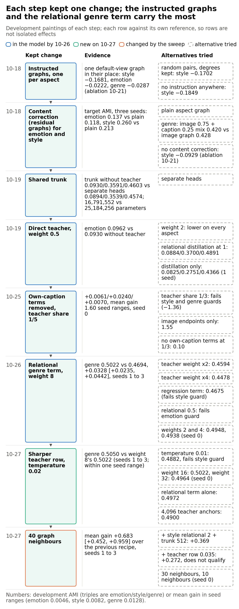
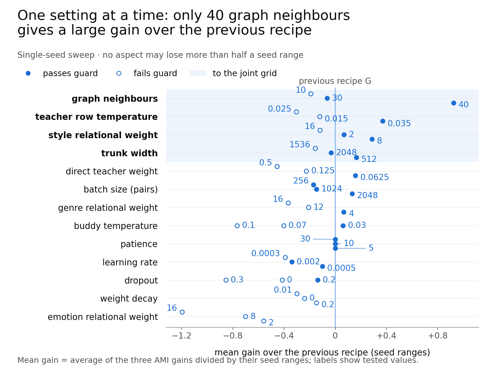
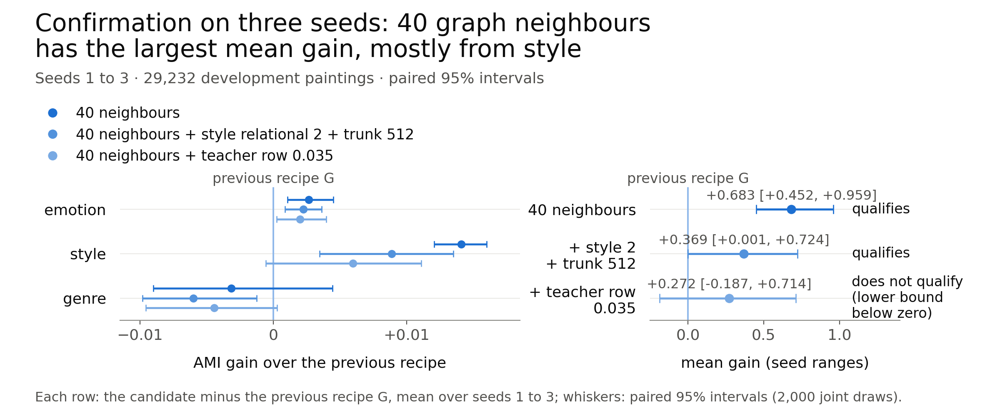
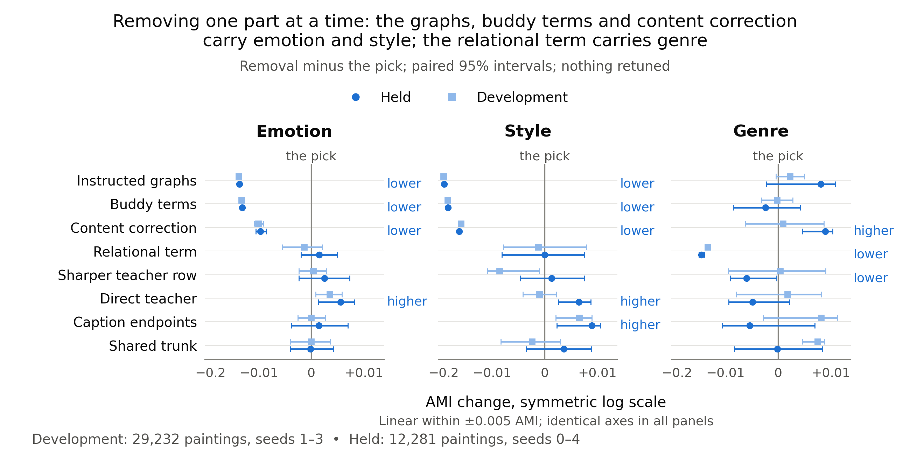

# Weekly report, 15 to 28 October 2026: a condition-free model, read once on the default image, gives held emotion and style clusters above the instructed Qwen image, and genre within one seed range of it

> Draft v1, written 2026-10-28. CoSiR, branch r10-recipe-sweep. Covers 2026-10-15 to 2026-10-28, with the end of the
> conditioned line as a lead-in (the previous weekly item, the [slides of 2026-10-14](../2026-10-14_aff_design_and_scope_slides.md)).
> Every number comes from the report linked in its section. Lines marked **Verdict (reference)** are our reading of the
> results; they decide nothing.

## Summary

- **We stopped the conditioned line on 2026-10-15.** The supervisors judged it too specific and too complicated for a
  CVPR paper. Its best method never beat the strongest scorer that ignores the condition (§1).
- **The new idea is one Qwen3-VL-Embedding instruction per aspect.** Instructions raised own-aspect cluster agreement:
  image style AMI 0.395 with the style instruction against 0.222 for the default image (§2).
- **The design grew in six steps, from 2026-10-19 to 2026-10-28.** A small network with one shared trunk and three heads
  learns from one buddy graph per aspect, then reads the default image once (§3).
- **Held emotion beat PercepT core on four image encoders.** On Qwen, the recipe of 2026-10-25 gave 0.1029 against
  PercepT core's 0.0874 (+0.0154 [+0.0100, +0.0169]) on 12,281 held paintings (§4).
- **The sweep's pick beat the instructed Qwen image on held emotion.** It gave 0.1066 against 0.0921
  (+0.0145 [+0.0113, +0.0177]). Style was above by a narrow interval; genre was below by less than one seed range (§4, §6).
- **Two roots failed:** image-only students toward caption targets, and PercepT with the paper's own topic-count
  settings (§5).
- **The limits.** All held claims use k-means, Qwen at training, and one dataset (ArtELingo). We picked the sweep's pick
  among about 60 configurations, and the held split was read in earlier rounds. There is no retrieval result.

## Idea and contributions

### Background

Image-text embedders such as CLIP, SigLIP and Qwen3-VL-Embedding place a painting at one point, with no
choice of aspect. Their default clusters carry little emotion: the default Qwen image gave emotion AMI 0.069 (§2.1).
The closest prior
method is PercepT ("Beyond Semantics", arXiv 2606.03345). It clusters image-caption pairs into perceptual topics, then
trains a classifier that predicts the topic from the image. It scores the topics against emotion and genre labels with
AMI.

Other work makes aspect-specific embeddings with a prompt or an instruction: DIOR, COCO-Facet, ESMC and
guideline-driven clustering. Each needs the aspect at test time, one pass per aspect. Distillation work trains a
student toward a teacher's embedding or toward its similarity pattern (RKD, PKT, CompRess, SEED, CLIP-KD).

> Sources: [PercepT neighbourhood](../../literature/2026-12-05_percept_neighbourhood.md),
> [prompted aspect views](../../literature/2026-12-07_prompted_aspect_views.md),
> [relational genre term](../../literature/2026-12-26_relational_genre_term.md).

### The problem

We asked whether one read of the default image can give separate emotion, style and genre spaces, each with higher
label agreement than PercepT. A curator could then group a collection by mood, by style or by genre from one image
pass, with no aspect prompt at use. Aspect-named retrieval, the second task of the plan, is not measured yet.

### Our approach

We train on the instructed views of one frozen embedder and test on its default view. The rules that make the test
fair:

- labels never enter training, graph building or early stopping; they only score the clusters;
- the held paintings are separate from every painting used to pick a recipe;
- each comparison uses the strongest real alternative: PercepT core (our reimplementation of PercepT) and the
  instructed Qwen image of the same aspect, which needs one encoder pass per aspect.

### The setup at a glance

*Figure 1. The setup as of 2026-10-26. Top: training on the training paintings only. One frozen embedder gives a
default view and three instructed views; the instructed views build one buddy graph per aspect and the teacher
targets. Bottom: at test time one default-image pass feeds the trunk and three heads; k-means on each head is scored
against that aspect's labels. Later changes (§6.2) do not alter this flow.*

Each painting goes through Qwen3-VL-Embedding-2B ("Qwen") four times: with its default system prompt and with one
instruction per aspect. The instructed views link each painting to its nearest paintings in that aspect: its buddies.
A network with a shared trunk and three heads learns to pull buddies together while it reads only the default view.
At test time it needs no instruction and no caption. §6.2 gives the full design.

### Data

We use ArtELingo: WikiArt paintings with viewers' captions, each caption labelled with one of nine emotions. A
painting's emotion is the mode of its caption labels; style and genre come from WikiArt. Splits group the captions by
painting.

*Table 1. The paintings used in this period.*

| Set | Paintings | Role |
|---|---:|---|
| Train | 42,969 | full-scale training |
| Validation | 6,152 | full-scale early stopping (label-free) |
| Developed sample, fit part | 13,400 | sample-scale training and graphs |
| Developed sample, evaluation part | 5,000 (genre on 4,053) | development scores, 2026-10-17 to 10-21 |
| Fresh development paintings | 29,232 (genre on 23,682) | development scores, from 2026-10-25 |
| Held | 12,281 (genre on 9,949) | claim tests only |
| ArtELingo-28 test store | 746 | second test set, translated captions |

Artist overlap between splits was not measured. A second dataset is planned but not run.

> Sources: [stage report of 2026-10-26](../../stage/2026-10-26_condition_free_line.md), "The data and the splits".

### Our method so far

Our current best model is the sweep's pick of 2026-10-28. It is the previous recipe with 40 graph neighbours in place
of 20. On 12,281 held paintings and five seeds, its emotion AMI was 0.1066 against 0.0921 for the instructed Qwen
emotion image and 0.0874 for PercepT core's strongest entry. Its genre AMI was 0.5001 against the instructed genre
image's 0.5062. The main caveat: the claim covers k-means, Qwen and ArtELingo only, and training needs Qwen's
instructed views.

*Terms.* An **aspect** is emotion, style or genre. A **view** is Qwen's embedding under one instruction, or under the
default prompt. A **head** is the network's output for one aspect.

### Goal (the plan's target, not yet reached)

On 2026-10-15 the user set a soft CVPR target: submit if a result holds by about 2026-10-29, else keep trying until the
abstract deadline of 2026-11-10. On 2026-10-27 the user set the aim for this loop: one recipe that is strongest on all
three aspects, with "level" against the instructed Qwen image accepted. Then come the other passing encoders with the
final recipe, and aspect-named retrieval as the second task.

> Source: [direction log](../../../superpowers/direction_log.md), entries 2026-10-15 and 2026-10-27.

### Novelty

To our knowledge, no published work combines instructed image and caption views, one buddy graph per aspect, an
emotion, style and genre evaluation, and a multi-head image-only student read once. Each neighbour lacks one part:

- DIOR, COCO-Facet, ESMC and guideline-driven clustering make aspect-specific embeddings, but need the aspect at test
  time.
- ESMC and Multi-Sub use one teacher partition per criterion, but have no shared trunk read once, and both are
  transductive.
- PercepT predicts perceptual topics from the image, but has one topic space, scores emotion and genre only, and
  reports no held-out protocol.

What we do not claim as new: aspect prompting; distillation toward a teacher; the relational genre term, which has the
form of similarity-distribution distillation (PKT, CompRess, SEED, CLIP-KD). The literature notes found no
one-teacher student that beat its teacher on the teacher's own task, "only where a second source adds information".
Our captions are such a source for emotion (§6.7).

> Sources: [stage report of 2026-10-26](../../stage/2026-10-26_condition_free_line.md), "What the literature allows us to call new";
> [prompted aspect views](../../literature/2026-12-07_prompted_aspect_views.md),
> [cluster-level losses](../../literature/2026-12-17_cluster_level_losses.md) (Summary, item 4),
> [ways to improve](../../literature/2026-12-20_ways_to_improve.md) (Summary, item 1),
> [relational genre term](../../literature/2026-12-26_relational_genre_term.md) (Q1).

### Contributions

*Table 2. Contributions: what we have on 2026-10-28, and what a full success would add.*

| Contribution | What we have now | What a full success would add |
|---|---|---|
| C1. Method: one default-image read gives three aspect spaces | the sweep's pick on Qwen: held emotion +0.0145 and style +0.0041 above the instructed Qwen image, genre −0.0060 (level within one seed range); held emotion +0.0192 over PercepT core | the final recipe tested on the other passing encoders; aspect-named retrieval |
| C2. Protocol: a fair PercepT comparator and a fixed claim test | PercepT core with five arms on our feature stores; claim tests with a fixed rule, five seeds, paired intervals, separate re-derivation | a second dataset; PercepT with its own encoders (the faithful version, reported) |
| C3. Analysis: which parts carry each aspect | ablations of the first shared model (development) and of the sweep's pick (development and held); seven image encoders on development data | an analysis of what the heads learned (reported, not required) |

> Sources: [recipe sweep report](../../auto/percept/2026-12-28_recipe_sweep.md), [stage report of 2026-10-26](../../stage/2026-10-26_condition_free_line.md).

## How we got here

The last weekly item, the slides of 2026-10-14, described one-sided affect steering on the conditioned task. The
supervisors stopped that line at the meeting of 2026-10-14; the user archived it on 2026-10-15. Figure 2 shows the
fourteen days that followed. The first eleven steps were checks and pilots; the model itself started on 2026-10-19.

<!-- FIGURE SPEC (new). Builder: write docs/reports/assets/2026-10-28_weekly/build_timeline.py; start from
docs/reports/assets/2026-10-26_condition_free_line/build_timeline.py and keep its style.
Title (message): "Two weeks of the condition-free line: checks first, then the model and four held tests".
Subtitle: "15 to 28 October 2026, Amsterdam dates; held results starred".
Layout: one horizontal row per day, 2026-10-15 at the top, 2026-10-28 at the bottom (14 rows); date labels on the
left; within a row, one marker per step from left to right, each with a short label. Empty days show a thin line and
"no step" in grey.
Colours (palette.md and the 2026-10-26 timeline script): worked #1d6fd1; did not work #eb6834; check #a6a49e;
decision (diamond, ink #0b0b0b); held data: black star beside the marker. Ink #0b0b0b, secondary #52514e, grid #e4e3df.
Rows and steps (source in brackets):
- 10-15: decision diamond "Conditioned line stopped and archived" [direction log 2026-10-15].
- 10-16: no step.
- 10-17: check "Code audit, premise checks"; check "One Qwen instruction per aspect"; did not work "Image-only student
  toward captions"; check "Emotion-word masking" [stage report 10-26, steps 1 to 4].
- 10-18: did not work "Student on purified pairs"; check "Aspect graph sheet"; check "Graph follow-up" [steps 5 to 7].
- 10-19: check "First PercepT core run"; check "PercepT's own topic-count rule"; check "PercepT core, 40 topics";
  check "Labelled ceiling probe"; worked "First shared model" [steps 8 to 12].
- 10-20: worked + star "Held emotion claim test, two scales" [step 13].
- 10-21: check "Framing note"; check "Ablation and four Qwen views"; check "Attention maps (to 10-25)" [steps 14 to 16].
- 10-22, 10-23, 10-24: grey bar continuing "Attention maps" [step 16].
- 10-25: worked + star "Recipe pick; SigLIP 2 and Qwen pass" [step 17].
- 10-26: worked + star "Four more encoders; genre term (development)" [step 18].
- 10-27: worked + star "Relational genre term, held genre level" [report 12-27, 00:33 to 02:16]; worked + star
  "G's held emotion test" [report 12-28 stage 0]; check "Recipe sweep, 13 settings and grid" [stages 1 to 3];
  worked + star "Sweep's pick, held test" [stage 4]; check "Development ablation" [report 12-28].
- 10-28: check + star "Held ablation (to 03:53)" [report 12-28]; check "Reports".
Footnote: "Worked: the step met its rule or bar; check: a measurement with no bar; the sweep's pick replaced the
previous recipe under its rule." -->

*Figure 2. The period, one row per day. Colour marks the outcome (blue worked, orange did not work, grey check); stars
mark steps that read held paintings; the diamond marks the stop of the conditioned line. The step list with dates is
in the [stage report of 2026-10-26](../../stage/2026-10-26_condition_free_line.md#timeline) and the
[recipe sweep report](../../auto/percept/2026-12-28_recipe_sweep.md#what-ran).*

The rest of the report follows five questions: why we stopped the conditioned line (§1), what the new idea is and
what the first checks showed (§2), how the design changed (§3), what the held results are (§4), and which side
branches failed (§5). §6 then describes the current model as one design.

**Terms used throughout** (glossary at the end):

- **AMI** (adjusted mutual information): agreement between clusters and labels; 0 is chance. We use k-means with 20
  clusters, averaged over three clustering seeds and then over model seeds. Genre excludes unlabelled paintings.
- **Instructed Qwen image:** the Qwen image embedding made with the instruction of one aspect, clustered directly. It
  is the teacher of our model and its hardest comparator; it needs one encoder pass per aspect.
- **PercepT core:** our reimplementation of PercepT's two stages on our feature stores, with 40 topics and five arms.
  Its strongest held emotion entry is the Qwen arm with its own reading (each painting's top topic): 0.0874.
- **Buddy graph:** for one aspect, the graph that links each painting to its mutual nearest neighbours in that aspect's
  instructed view. Linked paintings are buddies.
- **Seed range:** the spread (maximum minus minimum) of the first shared model's development AMI over three seeds:
  emotion 0.0046, style 0.0082, genre 0.0128. It is the unit for "level" and for the mean gain.
- **Mean gain:** a candidate's AMI gain over its reference on each aspect, divided by that aspect's seed range, then
  averaged over the three aspects.
- **Sample scale and full scale:** training on the 13,400 fit paintings, or on the 42,969 train paintings.
- **Claim test:** a held test under a rule fixed before the read: five model seeds, a paired 95% bootstrap interval over
  paintings and seeds, and a separate re-derivation of every verdict number.

## 1. Why did we stop the conditioned line, and what replaced it?

We stopped the conditioned line because its method won only against a weak bar, and the supervisors judged the task
too specific and too complicated for a good CVPR paper. A condition-free model, built as an improvement over PercepT,
replaced it.

The conditioned line scored image-caption pairs under an aspect shown by example pairs. Its best method was one-sided
affect steering (AFF in the archived reports). In round 9 it passed its held read over the condition-free bar built
on its own three groupings, by these margins in R@1 points:

*Table 3. The last held results of the conditioned line (R@1 points, held ArtELingo episodes).*

| Image encoder | Margin over the condition-free bar on its own groupings |
|---|---|
| CLIP (round 6) | +0.60 |
| Qwen3-VL-Embedding-2B | +0.63 [+0.49, +0.76] |
| SigLIP 2 | +0.51 [+0.36, +0.66] |

Against the strongest condition-free scorer, the margins ranged from −0.52 to +0.13 over five reads. The method also
lost on the style and genre pair. The supervisors relayed their decision through the user: "the line became too
specific and too complicated to make a good CVPR paper; stop it and archive the CVPR plan" (user).

The user drafted the new direction the same day. It was a condition-free model from the buddy model, as an
improvement over PercepT, on PercepT's task plus retrieval, label-free if possible. The archive holds the line's code,
reports and round folders; the git tag of the line restores the code.

> Sources: [direction log](../../../superpowers/direction_log.md), entry 2026-10-15;
> [archive index](../../../../archive/v2_conditioned/README.md).

## 2. What is the new idea, and what did the first checks show?

The new idea is to give Qwen3-VL-Embedding one instruction per aspect and to learn from the views it gives. The first
checks, from 2026-10-17 to 2026-10-19, showed that an instruction raises own-aspect AMI on the side where the aspect
is visible. Emotion is visible mostly in the captions, style in the images, and genre in both.

### 2.1 Premise checks and the instruction views (2026-10-17)

A code audit found eight differences between our September PercepT code and the paper. Four of them define PercepT
core: image-caption pairs as the unit, the paper's fusion (its Eq. 2), its topic-count algorithm, and multi-hot caption
unions as Stage 2 targets. A first premise check found that CLIP text clusters carry little emotion: caption emotion
AMI 0.047, against 0.209 for a supervised GoEmotions classifier, on 99,999 captions.

We then replaced Qwen's default system prompt, "Represent the user's input," with one instruction per aspect. We
tried three wordings per aspect. Two forms were kept:

- the focus form: "Represent the <aspect> of this artwork, or of this description of an artwork. Focus only on the
  <aspect>.";
- the one-word form: "Describe the <aspect> of this artwork in one word."

*Table 4. Own-aspect AMI with and without the instruction, 99,999 captions and 5,000 development paintings.*

| View and label | Instructed Qwen | Default Qwen | Other reference |
|---|---:|---:|---|
| Captions, emotion (focus form) | 0.278 | 0.122 | GoEmotions classifier 0.209 |
| Images, style (one-word form) | 0.395 | 0.222 | CSD style encoder 0.317; CLIP image 0.300 |
| Images, emotion (focus form) | 0.093 | 0.069 | |

Image emotion probe accuracy changed only from 39.2% to 40.9%. Our reading at the time: the instruction changed the
cosine geometry more than the information available. When we masked 132 affect words in the captions, the instructed
caption emotion AMI fell to 0.187, still above the default's 0.069 on the same masked captions.

> Sources: [stage report of 2026-10-26](../../stage/2026-10-26_condition_free_line.md), steps 1, 2 and 4;
> [prompted aspect views check](../../auto/percept/2026-12-08_prompted_aspect_views_check.md);
> [image transfer and word masking](../../auto/percept/2026-12-09_image_transfer_and_word_masking.md).

### 2.2 The aspect graphs (2026-10-18)

Residual buddy graphs trained the best emotion and style networks. A residual graph subtracts a weighted default-view
(content) similarity from the instructed similarity before it takes the mutual top-20 neighbours. We built 21 graphs
per aspect on the 13,400 fit paintings and trained small networks on five or six of them per aspect.

*Table 5. Best graph per aspect against its comparator; target AMI (mean of image and caption sides), 5,000
development paintings, three seeds.*

| Aspect | Best graph | Target AMI | Comparator graph | Its target AMI |
|---|---|---:|---|---:|
| Emotion | residual, content weight 1 | 0.137 | plain aspect graph | 0.118 |
| Style | residual, content weight 0.5 | 0.260 | plain aspect graph | 0.213 |
| Genre | image-side aspect graph | 0.428 | image 0.75 + caption 0.25 mix | 0.420 |

The user read the graph sheet as "a good sign, so our best graph steadily beat plain aspect graph" (user). With
instructed inputs, the networks came within 0.003 of their instructed views on emotion captions and style images, but
not on genre images (0.458 against 0.496).

> Sources: [aspect graph sheet](../../auto/percept/2026-12-11_aspect_graph_sheet.md);
> [aspect graph follow-up](../../auto/percept/2026-12-12_aspect_graph_followup.md).

### 2.3 PercepT core as the comparator (2026-10-19)

PercepT core became a fair comparator only after we fixed its topic count at 40. Its first run failed a reproduction
check, because k-means summed in a thread-dependent order; we then used one-thread k-means. With the paper's own
topic-count rule (Algorithm 1, γ = 2), the kept topic count followed the seed: 1, 2, 3 or 99 topics.

With 40 topics fixed (the 40 of 100 centres with the most fit pairs), all five arms passed every check. Their
development AUC was 0.85 to 0.96 and their seed standard deviation at most 0.007. The arms differ in the features that
build the topics and in the image reader of Stage 2:

*Table 6. PercepT core arms, image-side AMI, 5,000 development paintings, three seeds.*

| Arm | Topic features | Image reader | Emotion | Style | Genre |
|---|---|---|---:|---:|---:|
| P1 | CLIP and RoBERTa emotion captions | CLIP patches | 0.053 | 0.167 | 0.356 |
| P2 | CLIP and RoBERTa emotion captions | CLIP image vector | 0.066 | 0.229 | 0.400 |
| P3 (the Qwen arm) | Qwen and instructed emotion captions | Qwen image vector | 0.077 | 0.189 | 0.436 |
| P4 | Qwen and instructed emotion captions | CLIP patches | 0.054 | 0.162 | 0.361 |
| P5 | Qwen and RoBERTa emotion captions | Qwen image vector | 0.074 | 0.181 | 0.435 |

The best arms were level with or below the frozen images clustered directly (CLIP style 0.300, Qwen genre 0.449). So
we also kept the frozen and instructed images as comparators. The user read PercepT core as "a good comparator"
(user). A label-trained linear probe on the default Qwen image gave a ceiling reference: 0.1215, 0.5275 and 0.6566.

*Figure 3. Where the checks ended on 2026-10-19, before the first shared model. Image-side AMI, 5,000 development
paintings, three seeds. Grey: the best frozen image clustered directly (CLIP on style, Qwen otherwise); orange:
PercepT core's best arm per aspect; blue: our separate graph-trained networks, one default-image pass; green: the
instructed Qwen image, one pass per aspect.*

**Verdict (reference).** By 2026-10-19 the instructed views and the graphs were in place, but our network trailed the
instructed Qwen image on every aspect. Reaching that teacher from one default-image pass became the target.

> Sources: [first PercepT core run](../../auto/percept/2026-12-13_percept_core.md);
> [PercepT core arms](../../auto/percept/2026-12-14_percept_core_arms.md);
> [PercepT core with 40 topics](../../auto/percept/2026-12-15_percept_core_k40.md);
> [stage report of 2026-10-19](../../stage/2026-10-19_qwen_buddy_line.md); [direction log](../../../superpowers/direction_log.md), entry 2026-10-19.

## 3. How did the model's design come about and change?

The design came about in six steps. Each step kept one change that won on development paintings, and four steps
ended in a held test. Table 7 gives the chronology; §6 describes the result as one design, with the evidence for each
part.

*Table 7. The design steps. Development numbers use the development paintings of their date; held numbers use the
12,281 held paintings and five seeds.*

| Date | Step | What changed | Key result against its comparator |
|---|---|---|---|
| 2026-10-19 | First shared model (D2) | one trunk, three heads; direct teacher at weight 0.5 | development emotion 0.0962 against the instructed image's 0.0929 |
| 2026-10-20 | Claim test | none (held test) | held emotion 0.1008 against PercepT core's 0.0874, +0.0133 [+0.0081, +0.0146] |
| 2026-10-21 | Ablation, 12 variants | none (analysis) | one default-view graph: style −0.1681; no teacher: emotion −0.0032, not resolved |
| 2026-10-25 | Recipe pick (R6-5) | own-caption terms removed | development style +0.0240 [+0.0216, +0.0261]; held emotion 0.1029 |
| 2026-10-26 to 27 | Relational genre term, then the previous recipe (G) | genre head matches the teacher's similarity rows, weight 8, teacher row at temperature 0.02 | held genre 0.5001 against the instructed genre image's 0.5062 |
| 2026-10-27 to 28 | Recipe sweep, the sweep's pick (c*) | 40 graph neighbours in place of 20 | held emotion 0.1066 against 0.0921; style 0.4066 against 0.4026 |

### 3.1 The first shared model and its claim test (2026-10-19 and 10-20)

The first shared model was the first default-input setting above the instructed image on development emotion. We
compared 13 settings on 5,000 development paintings. The kept one shares the first layer across the aspects and pulls
each image head toward the instructed image of its aspect (direct distillation, weight 0.5). The user read it as "a
partly positive result" (user), since style and genre stayed below the instructed image (0.3697 against 0.3952;
0.4540 against 0.4956).

On 2026-10-20 it passed the held emotion claim test at both scales. At full scale it gave 0.1008 against PercepT
core's 0.0874. Under Leiden community detection the lead was gone: 0.0757 against 0.0762, −0.0005 [−0.0048, +0.0023].
The user then asked for an ablation: "we did not really understand our current design" (user).

> Sources: [model sheet](../../auto/percept/2026-12-16_model_sheet.md);
> [claim test, stage 2](../../auto/percept/2026-12-19_claim_test_stage2.md); [direction log](../../../superpowers/direction_log.md), entries 2026-10-20 and 2026-10-21.

### 3.2 The ablation of the first shared model (2026-10-21)

The ablation showed that the instructed graphs carried the development result and that the teacher added little
beside them. Without the own-caption terms, style rose. Figure 4 shows all twelve variants.

*Figure 4. Effect on image-side AMI of changing one part of the first shared model; 5,000 development paintings,
three seeds, 95% bootstrap intervals. "Clear" means the interval excludes zero and the effect exceeds two seed ranges;
"small", between one and two; "not resolved", otherwise. Some variants remove a group of terms, so those rows are not
isolated component effects.*

The user read it as "a nice ablation", with "some design redundancy", and asked: "seems our model depends very much of
the instructions?" (user). The next step tested the cheapest change it suggested: dropping the own-caption terms.

> Sources: [ablation and the four Qwen views](../../auto/percept/2026-12-22_d2_ablation.md); [direction log](../../../superpowers/direction_log.md), entry 2026-10-21.

### 3.3 The recipe pick and the genre term (2026-10-25 to 10-27)

On 2026-10-25 a fixed rule picked the recipe without own-caption terms, on 29,232 fresh development paintings. It
became the recipe of the encoder tests (§4.1). On 2026-10-26, a relational genre term at weight 8 raised development
genre from 0.4694 to 0.5022 on three fresh seeds. On 2026-10-27, a sharper teacher row in that term won a second
round and passed its held genre test. This model became the previous recipe.

> Sources: [recipe and backbones](../../auto/percept/2026-12-24_recipe_backbones.md);
> [encoders and genre](../../auto/percept/2026-12-25_encoders_genre.md);
> [relational genre](../../auto/percept/2026-12-27_relational_genre.md).

### 3.4 The recipe sweep (2026-10-27 to 10-28)

The sweep varied the previous recipe's settings and picked one change: 40 graph neighbours. The user chose a staged
sweep and the pick rule: the largest mean gain, with every aspect at least level with the previous recipe. Figure 5
shows how the stages ran.

*Figure 5. The sweep on 2026-10-27 and 10-28. Stages 1 and 2 (one setting at a time, then a joint grid) ran on a
cluster node with three GPUs; stages 0, 3 and 4 and the ablation ran on the local RTX 3090. Blue: tests and the pick;
grey: sweeps and analyses. The held ablation ended at 03:53, after the planned end at 23:00.*

The stages were:

1. stage 0: the held emotion claim test of the previous recipe against PercepT core;
2. stage 1: 13 settings changed one at a time, seed 0, 13,400 fit paintings;
3. stage 2: a joint grid over the four settings with the largest mean gains (18 new runs);
4. stage 3: the top three candidates on seeds 1 to 3, scored on the 29,232 development paintings;
5. stage 4: the pick at full scale, five seeds, on the held paintings;
6. an ablation of the pick that removes each of eight parts, on development and held paintings.

> Sources: [recipe sweep](../../auto/percept/2026-12-28_recipe_sweep.md), "What ran"; [direction log](../../../superpowers/direction_log.md), entry 2026-10-27.

## 4. What are the results on held data?

Held emotion beat PercepT core on four image encoders, and the sweep's pick also beat the instructed Qwen image on
held emotion. On style and genre, every Qwen model led PercepT core by a large margin. Against the instructed Qwen
image, the gap on genre closed to less than one seed range on 2026-10-27.

### 4.1 Held emotion against PercepT core, on seven image encoders (2026-10-20 to 10-26)

The recipe of 2026-10-25 passed the held emotion claim test on Qwen, SigLIP 2, SigLIP 1 and CLIP L/14. A pass needs a
margin of at least 0.0100 over the strongest eligible PercepT entry, with the interval above zero. The eligible
entries include every arm, both readings, and a matched arm whose Stage 2 reads the student's own encoder. For other
encoders, only the image input layer changed; graphs, teacher and captions stayed Qwen's.

*Table 8. Held emotion AMI, 12,281 held paintings, five model seeds, full scale unless marked. The strongest entry was
PercepT core's Qwen arm, own reading, each time.*

| Student | Emotion AMI | Strongest PercepT entry | Margin [95% interval] | Held outcome | ArtELingo-28 (746 paintings) |
|---|---:|---:|---|---|---|
| First shared model, Qwen | 0.1008 | 0.0874 | +0.0133 [+0.0081, +0.0146] | pass | qualified |
| Recipe of 10-25, Qwen | 0.1029 | 0.0874 | +0.0154 [+0.0100, +0.0169] | pass | qualified |
| SigLIP 1 | 0.1036 | 0.0874 | +0.0162 [+0.0106, +0.0179] | pass | qualified |
| SigLIP 2 | 0.1024 | 0.0874 | +0.0150 [+0.0096, +0.0163] | pass | qualified |
| CLIP L/14 | 0.0996 | 0.0874 | +0.0122 [+0.0068, +0.0136] | pass | qualified |
| CLIP B/16 | 0.0945 | 0.0874 | +0.0070 [+0.0016, +0.0085] | inconclusive | fails |
| CLIP B/32 | 0.0885 | 0.0874 | +0.0011 [−0.0043, +0.0025] | inconclusive | fails |
| DINOv2-large (sample scale) | 0.0814 | 0.0855 | −0.0041 [−0.0094, −0.0030] | fail | qualified (sample scale) |

On ArtELingo-28, "qualified" means a positive margin whose interval reaches below zero.

*Figure 6. A: held emotion AMI per image encoder against PercepT core's Qwen arm (orange line) and the pass level
(dashed). B: on 29,232 development paintings at sample scale, every student (blue) lifts over PercepT core on its own
encoder (orange); grey is the frozen image clustered directly.*

On development paintings every one of the seven students lifted over its own PercepT arm, from +0.0117 (DINOv2-large)
to +0.0288 (SigLIP 1). The lift followed the encoder's style structure (Spearman +0.964 with style silhouette, over
seven encoders), not its frozen emotion AMI (+0.036). The weaker encoders' own PercepT arms started lower: CLIP B/32 at
0.0708 against Qwen's 0.0844. Under Leiden, the emotion intervals of every passing student included zero.

The user read the encoder results as "partially good", and added that the failures "possibly means our design is not
really a plug&play module that fits any model backbones" (user).

> Sources: [claim test, stage 2](../../auto/percept/2026-12-19_claim_test_stage2.md);
> [recipe and backbones](../../auto/percept/2026-12-24_recipe_backbones.md);
> [encoders and genre](../../auto/percept/2026-12-25_encoders_genre.md); [direction log](../../../superpowers/direction_log.md), entry 2026-10-26.

### 4.2 Style and genre against the instructed Qwen image (2026-10-25)

The recipe of 2026-10-25 led PercepT core on held style and genre, was level with the instructed Qwen image on style,
and trailed it on genre. Full scale, 12,281 paintings (genre on 9,949), five seeds:

*Table 9. The recipe of 2026-10-25 on Qwen against its comparators, held AMI.*

| Aspect | Recipe of 10-25 | Instructed Qwen image | Margin over it | Frozen default Qwen image |
|---|---:|---:|---:|---:|
| Emotion | 0.1029 | 0.0921 | +0.0108 | 0.0708 |
| Style | 0.3996 | 0.4026 | −0.0029 | 0.2233 |
| Genre | 0.4534 | 0.5062 | −0.0527 | 0.4521 |

The genre head barely moved over the frozen default image (+0.0014). Yet a label-free ridge map from the default to
the instructed image reached development genre 0.5040, above the instructed genre image's 0.4989. Our reading: the
default image held the genre information, and the losses limited its use.

> Sources: [recipe and backbones](../../auto/percept/2026-12-24_recipe_backbones.md);
> [stage report of 2026-10-26](../../stage/2026-10-26_condition_free_line.md), "All methods on held data, three aspects".

### 4.3 The previous recipe's held genre result (2026-10-27)

The previous recipe, with the relational genre term and its sharper teacher row, brought held genre level with the
instructed Qwen genre image within one seed range. The gap to the recipe of 10-25 closed by 0.0467 of its 0.0527.

*Table 10. Held genre AMI of the previous recipe, 9,949 labelled held paintings, five seeds.*

| Comparator | Comparator AMI | Previous recipe (0.5001) minus it |
|---|---:|---|
| Instructed Qwen genre image | 0.5062 | −0.0060 [−0.0105, −0.0014] |
| Recipe of 10-25 | 0.4534 | +0.0467 [+0.0402, +0.0531] |
| Strongest PercepT entry of the Qwen claim test | 0.4269 | +0.0732 [+0.0622, +0.0795] |

The whole interval against the instructed image lies below zero, so "matches or exceeds" was not licensed. The held
lift over the recipe (+0.0467) was larger than the development lift (+0.0356). A likely reason, not checked: the
recipe's best genre checkpoint came from epoch 1 in every seed, the new model's from epochs 4 to 7.

The user read it as "two levels and one win (emotion), and hopefully we can get all three as win" (user), against the
instructed Qwen image. On 2026-10-27 the previous recipe also passed the held emotion claim against PercepT core:
+0.0164 [+0.0107, +0.0182] at full scale and +0.0188 [+0.0137, +0.0200] at sample scale.

> Sources: [relational genre](../../auto/percept/2026-12-27_relational_genre.md), stage C;
> [recipe sweep](../../auto/percept/2026-12-28_recipe_sweep.md), stage 0; [direction log](../../../superpowers/direction_log.md), entry 2026-10-27.

### 4.4 The sweep's pick on held data (2026-10-27)

The sweep's pick beat the instructed Qwen image on held emotion and style, and stayed within one seed range of it on
genre. Under the rule it replaced the previous recipe. The rule fixed the pick on development paintings before any
full-scale run; held data chose nothing.

*Table 11. The sweep's pick on 12,281 held paintings (genre on 9,949), full scale, five seeds; paired 95% intervals.*

| Aspect | The sweep's pick | Instructed Qwen image | Difference [95% interval] | In seed ranges | Rule outcome |
|---|---:|---:|---|---:|---|
| Emotion | 0.1066 | 0.0921 | +0.0145 [+0.0113, +0.0177] | +3.155 | win (T-WIN) |
| Style | 0.4066 | 0.4026 | +0.0041 [+0.0004, +0.0081] | +0.497 | win (T-WIN) |
| Genre | 0.5001 | 0.5062 | −0.0060 [−0.0103, −0.0015] | −0.472 | level (T-LEVEL) |

*Table 12. The sweep's pick against the previous recipe and PercepT, same held paintings.*

| Aspect | Previous recipe | Pick minus previous recipe | Strongest PercepT entry | Pick minus PercepT |
|---|---:|---|---:|---|
| Emotion | 0.1039 | +0.0027 [+0.0001, +0.0054] | 0.0874 (core, Qwen arm, own reading) | +0.0192 [+0.0137, +0.0207] |
| Style | 0.4057 | +0.0009 [−0.0044, +0.0065] | 0.2297 | +0.1769 [+0.1663, +0.1809] |
| Genre | 0.5001 | 0.0000 [−0.0028, +0.0030] | 0.4269 | +0.0732 [+0.0622, +0.0796] |

*Figure 7. a: held AMI per aspect for PercepT's strongest entry (orange), the instructed Qwen image (green), the
previous recipe (light blue) and the sweep's pick (blue); each axis starts above zero. b: the pick minus the
instructed image, with the level bar at minus one seed range for genre.*

The style win is narrow: its lower bound is about 0.05 seed ranges above zero. Against the previous recipe the style
interval crosses zero. So the large development style gain (+0.0141, §6.3) did not carry through as a held gain over
the previous recipe. The emotion margin over PercepT core (+0.0192) passed the claim test's size bar of 0.0100. Under
Leiden, the pick's genre was 0.5082, +0.0627 [+0.0529, +0.0736] over PercepT's strongest Leiden entry (0.4454).

**Verdict (reference).** We trust the emotion result most: the pick beats the instructed image by about three seed
ranges. The style win passes the rule but is narrow, and genre is a level, not a win. The user has not yet given a
reading of this round.

> Sources: [recipe sweep](../../auto/percept/2026-12-28_recipe_sweep.md), stage 4 and results brief;
> [user-read report of 2026-10-28](../../../user_read/2026-10-28_recipe_sweep.md).

### 4.5 The held ablation (2026-10-28)

On held paintings, the relational term carried genre, and the instructed graphs, the buddy terms and the content
correction carried emotion and style. Removing the relational term changed genre AMI by −0.0440 [−0.0512, −0.0372].
Removing the instructed graphs changed style by −0.1903 [−0.1959, −0.1822] and emotion by −0.0327 [−0.0361, −0.0292].
Removing the direct teacher or the caption endpoints raised one or two aspects. §6.3 gives the full table; the
ablation decides nothing.

> Source: [recipe sweep](../../auto/percept/2026-12-28_recipe_sweep.md), "Ablation".

## 5. The side branches: the roots that failed

Two roots failed: a student that tried to learn caption emotion from the image alone, and PercepT with the paper's own
topic-count settings. Several variants inside the successful line also failed; §6.3 lists them as alternatives.

### 5.1 Image-only students toward caption emotion (2026-10-17 and 10-18)

**Idea.** The instructed captions carry emotion (caption AMI 0.278); an image-only student might learn it and carry it
to the image side.

**Setting and method.** We trained an image-only student on the default Qwen image of the 13,400 fit paintings. Its
output was pulled toward the painting's instructed caption embedding. A follow-up trained on buddy pairs from the
caption emotion graph, with pairs that the content graph also linked removed ("purified" pairs). Each control used
default-caption targets or pairs. Output: image emotion AMI on 5,000 development paintings, three seeds, against a
required level of 0.12.

*Table 13. The image-only students, image emotion AMI, 5,000 development paintings, three seeds.*

| Root | Student | Control | Required level |
|---|---:|---:|---:|
| Toward instructed caption targets | 0.074 ± 0.000 | 0.074 ± 0.002 | 0.12 |
| On purified buddy pairs | 0.094 ± 0.002 | 0.070 ± 0.002 | 0.12 |

**Result.** Both failed the required level. Purification added only +0.004 over unpurified pairs. The user read the
first as "there are aspects that we should not expect an image-only student model can learn" (user). Our reading at
the time: content and emotion co-occur in art, so we compared graph constructions instead of removing content
(follow-up: the aspect graph sheet, §2.2).

> Sources: [image transfer and word masking](../../auto/percept/2026-12-09_image_transfer_and_word_masking.md);
> [purified buddy pilot](../../auto/percept/2026-12-10_purified_buddy_pilot.md); [direction log](../../../superpowers/direction_log.md), entry 2026-10-18.

### 5.2 PercepT with the paper's own topic-count settings (2026-10-19 and 10-20)

**Idea.** Run PercepT as the paper specifies it, on our feature stores, as a second comparator beside PercepT core.

**Setting and method.** Stage 1 is an autoencoder with deep embedded clustering (DEC) on fused image-caption pairs.
The paper's Algorithm 1 keeps the topics up to the largest gap between the sorted norms of the cluster centres.
Stage 2 trains a topic classifier on the image.

We ran it strictly (the paper's settings and topic cut) and with 40
topics fixed. Output: held emotion AMI on 12,281 paintings, five seeds. We call a run collapsed if it keeps under 10
or over 90 topics, or one topic holds over half the pairs.

*Table 14. PercepT with the paper's settings, held emotion AMI, both training scales.*

| Run | Topics kept | Emotion AMI | Status |
|---|---|---|---|
| Strict, CLIP and RoBERTa topics, and Qwen topics | 1 to 8, or 98 to 99 | excluded | all 10 runs collapsed |
| 40 topics fixed, either topic source | 40 | 0.0644 to 0.0711 | eligible; never strongest |
| Comparator: PercepT core, Qwen arm, own reading (full scale) | 40 | 0.0874 | strongest |

**Result.** Every strict run collapsed. The largest gap between sorted centre norms always sat at an end of the list,
so the kept count followed the seed. The user read it as "paper settings PercepT seems worse than our PercepT core
setting which fixed many things" (user). The faithful version, with PercepT's own CLIP L/14 and GoEmotions-tuned
ModernBERT encoders, is not built.

> Sources: [PercepT core arms](../../auto/percept/2026-12-14_percept_core_arms.md);
> [claim test, stage 2](../../auto/percept/2026-12-19_claim_test_stage2.md); [direction log](../../../superpowers/direction_log.md), entry 2026-10-21.

### 5.3 What the failed roots have in common

Both roots failed before the comparison they were built for. The image-only students did not take up the caption
emotion signal, and PercepT's own topic cut did not keep a stable topic count on our feature stores.

*Table 15. Each failed root against its comparator.*

| Root | Result | Comparator | Shortfall |
|---|---:|---:|---|
| Image-only student, caption targets (development emotion) | 0.074 | required level 0.12 | the student equals its control (0.074) |
| Image-only student, purified pairs (development emotion) | 0.094 | required level 0.12 | +0.024 over control, below the level |
| PercepT, paper settings with 40 topics (held emotion, best run) | 0.0711 | PercepT core 0.0874 | −0.0163 |

## 6. The successful line: one default-image read, trained on instructed buddy graphs

This section reads the line backwards. It starts from the sweep's pick and its held test (§6.1), describes the model
as one design (§6.2), and explains each part with the evidence that put it there (§6.3). §6.4 to §6.7 analyse the
result.

### 6.1 The result

The sweep's pick beat the instructed Qwen image on held emotion (+0.0145 [+0.0113, +0.0177]) and style
(+0.0041 [+0.0004, +0.0081]). Its genre was within one seed range (−0.0060 [−0.0103, −0.0015]). It beat PercepT core on
emotion by +0.0192 [+0.0137, +0.0207] (12,281 held paintings, genre on 9,949, five seeds; Tables 11 and 12).

The protocol protected the test against selection in four ways:

- the decision rule was committed before the sweep (first commit 35fcf68), with the pick rule and the held outcomes;
- development paintings chose the pick before any full-scale run;
- separate code re-derived every gate and verdict number: 53, 41 then 59, 213 and 66 items, with 0 differences;
- every check passed; the stage 2 monitor timed out once, but no run was repeated and no result changed.

*Table 16. The checks of the sweep (codes as in the report).*

| Check | Measured | Result | Bar | Outcome |
|---|---|---|---|---|
| G-ES, G-EF | previous recipe, held emotion margin over PercepT core, sample and full scale | +0.0188, +0.0164 | at least 0.0100, lower bound above 0 | pass at both scales |
| GRID | the four largest one-setting gains | +0.924, +0.371, +0.288, +0.164 seed ranges | top four | grid of four settings |
| PICK | mean gain of the pick on seeds 1 to 3 | +0.683 [+0.452, +0.959] | each aspect above minus one seed range; mean lower bound above 0 | 40 neighbours picked |
| T-WIN, emotion | held margin over the instructed image | +0.0145 | lower bound above 0 | win |
| T-WIN, style | held margin over the instructed image | +0.0041 | lower bound above 0 | win |
| T-LEVEL, genre | held margin over the instructed image | −0.0060 | lower bound above minus one seed range | level |
| PE | held emotion margin over PercepT core | +0.0192 | at least 0.0100, lower bound above 0 | pass |

Three caveats limit the result. We picked among about 60 configurations, so the seed-0 gains are inflated. Seeds 1 to
3 were new to these runs, but the rounds of 2026-10-26 and 10-27 also picked on them. The held split and the
instructed image's held scores were read in earlier rounds, and the previous recipe was adopted after its held genre
reading.

> Sources: [recipe sweep](../../auto/percept/2026-12-28_recipe_sweep.md), results brief, "Results" and "Deviations".

### 6.2 The design

*Figure 8. The sweep's pick as one design, in four boxes: four views from one embedder; one buddy graph per aspect;
one trunk with three heads, trained with buddy terms and the instructed-image teacher; one read of the default image
at test time. Orange marks the part changed by the sweep (40 neighbours); teal marks the part added on 2026-10-26 and
10-27 (the relational genre term).*

The model has six parts, from the input to the test-time read. Nothing in it uses labels.

1. **Views.** Qwen3-VL-Embedding-2B, frozen, gives each painting a default image, a default caption mean and three
   instructed views: emotion (focus form, on captions), style (one-word form, on images) and genre (one-word form, on
   images).
2. **Buddy graphs.** For each aspect, a graph of mutual 40-nearest neighbours among the training paintings. Emotion
   and style use residual graphs: the instructed similarity minus a weighted default-view (content) similarity, with a
   weight set per painting for emotion and 0.5 for style. Genre uses the plain image-side graph.
3. **Network.** Two sides, image and painting-mean caption, each a two-layer MLP on the default Qwen embeddings. The
   first layer (2048 to 1024) is the shared trunk; each aspect has its own second layer (1024 to 2048), the head.
4. **Buddy terms.** Per aspect, InfoNCE terms pull a painting's image and caption outputs toward its buddies' image and
   caption outputs; other paintings in the batch (512 pairs) are negatives. Weight 1.
5. **Teacher terms.** The direct term pulls each image head toward the instructed image of its aspect (InfoNCE,
   temperature 0.05, weight 0.25). The relational term, on the genre head only, makes the head's similarities to the
   other paintings of the batch match the teacher's row (KL divergence, teacher row at temperature 0.02, weight 8).
6. **Read at test time.** One default-image pass, the image trunk and the three heads; k-means with 20 clusters on
   each head, scored against that aspect's labels.

Each aspect stops on its label-free validation loss. The first shared model had 16,791,552 trainable parameters
(8,395,776 on the image side), against PercepT core's 7,220,152. It trained in about 120 s per seed on 42,969
paintings, against about 712 s for PercepT core's four arms together. The instructed Qwen image needs three encoder
passes at test time (0.0936 s each), our model one default pass (0.0871 s).

> Sources: [stage report of 2026-10-26](../../stage/2026-10-26_condition_free_line.md), "The design, as it stands on 2026-10-26";
> [relational genre](../../auto/percept/2026-12-27_relational_genre.md) (batch size, temperatures);
> [recipe sweep](../../auto/percept/2026-12-28_recipe_sweep.md); [framing note](../../auto/percept/2026-12-21_advantages_framing.md) §2 (costs).

### 6.3 Why each component is there

Figure 9 builds the model up one kept change at a time, with the alternatives tried at each step. Each step is
measured against its own reference, on its own development paintings, so the rows describe the path taken and are not
isolated component effects. The two ablations (of the first shared model and of the sweep's pick) give the isolated
effects.

<!-- FIGURE SPEC (new). Builder: write docs/reports/assets/2026-10-28_weekly/build_build_up.py (matplotlib, same fonts
and ink as docs/reports/assets/2026-10-28_recipe_sweep/build_model_structure.py).
Title (message): "Each step kept one change; the instructed graphs and the relational genre term carry the most".
Subtitle: "Development paintings of each step; each row against its own reference, so rows are not isolated effects".
Layout: a vertical ladder of 8 rows, top to bottom in date order. Left column: the kept change in a teal box
(#1d6fd1 border for "our network" parts; the newest two rows outlined in #eb6834 = changed, teal #1baf7a = new, as in
the model_structure legend). Middle: the evidence number for the kept change. Right: grey dashed boxes (#a6a49e) with
the alternatives tried and their number. Colours: our network #1d6fd1; previous recipe G #8fb8ea; the sweep's pick
#1d6fd1; instructed Qwen image #4a9c5b; PercepT core #c98b2e (palette.md, "Condition-free line").
Rows (kept change | evidence | alternatives; sources):
1. 10-18 "Instructed graphs, one per aspect" | "one default-view graph in their place: style −0.1681, emotion
   −0.0222, genre −0.0287 (ablation 10-21)" | "random pairs, degrees kept: style −0.1702"; "no instruction anywhere:
   style −0.1849" [ablation 12-22, R9, R10, R11].
2. 10-18 "Content correction (residual graphs) for emotion and style" | target AMI, three seeds: emotion 0.137 vs
   plain 0.118, style 0.260 vs plain 0.213 | "plain aspect graph"; "genre: image 0.75 + caption 0.25 mix 0.420 vs image
   graph 0.428" [aspect graph follow-up 12-12];
   "no content correction: style −0.0929 (ablation 10-21)" [12-22, R8].
3. 10-19 "Shared trunk" | trunk without teacher 0.0930/0.3591/0.4603 vs separate heads 0.0894/0.3539/0.4574;
   16,791,552 vs 25,184,256 parameters | "separate heads" [model sheet 12-16, A1 vs T1; framing note].
4. 10-19 "Direct teacher, weight 0.5" | emotion 0.0962 vs 0.0930 without teacher | "weight 2: lower on every aspect";
   "relational distillation at 1: 0.0884/0.3700/0.4891"; "distillation only: 0.0825/0.2751/0.4366 (1 seed)"
   [model sheet 12-16, D2, D5, D1].
5. 10-25 "Own-caption terms removed, teacher share 1/5" | +0.0061/+0.0240/+0.0070, mean gain 1.60 seed ranges, seed 0
   | "teacher share 1/3: fails style and genre guards (−1.36)"; "image endpoints only: 1.55"; "no own-caption terms
   at 1/3: 0.10" [recipe and backbones 12-24].
6. 10-26 "Relational genre term, weight 8" | genre 0.5022 vs 0.4694, +0.0328 [+0.0235, +0.0442], seeds 1 to 3 |
   "teacher weight x2: 0.4594"; "x4: 0.4478"; "regression term: 0.4675 (fails style guard)"; "relational 0.5: fails
   emotion guard"; "weights 2 and 4: 0.4948, 0.4938 (seed 0)" [encoders and genre 12-25, stage iii].
7. 10-27 "Sharper teacher row, temperature 0.02" | genre 0.5050 vs weight 8's 0.5022 (seeds 1 to 3; within one seed
   range) | "temperature 0.01: 0.4882, fails style guard"; "weight 16: 0.5022, weight 32: 0.4964 (seed 0)";
   "relational term alone: 0.4972"; "4,096 teacher anchors: 0.4900" [relational genre 12-27].
8. 10-27 "40 graph neighbours" | mean gain +0.683 [+0.452, +0.959] over the previous recipe, seeds 1 to 3 |
   "+ style relational 2 + trunk 512: +0.369"; "+ teacher row 0.035: +0.272, does not qualify"; "30 neighbours, 10
   neighbours (seed 0)" [recipe sweep 12-28, stages 1 and 3].
Footer: "Numbers: development AMI or mean gain in seed ranges (emotion 0.0046, style 0.0082, genre 0.0128)." -->

*Figure 9. The build-up of the model, from the instructed graphs to the sweep's pick, one kept change per row (left)
with its evidence (middle) and the alternatives tried at that step (grey, right). Development data of each step.*

**The instructed graphs.** They carried the most on emotion and style, on development and held paintings. In the
first ablation, one default-view graph in place of the three instructed graphs cost style −0.1681 [−0.1740, −0.1557].
In the held ablation of the sweep's pick, the same removal cost style −0.1903 [−0.1959, −0.1822]. Our reading of why:
an instruction changed own-aspect clustering much more than probe accuracy (style AMI +0.1735, balanced accuracy
+0.030), so the graphs carry geometry that the default image already holds as information.

**The content correction.** Subtracting default-view similarity helped emotion and style. Without it, held style fell
by −0.0752 [−0.0814, −0.0679] and emotion by −0.0090 [−0.0119, −0.0062]. Held genre rose by +0.0072
[+0.0030, +0.0113] without it, although the genre graph itself has no correction. The development genre change was
+0.0006, with its interval across zero.

**The buddy terms.** They are the training signal of the graphs. Without them, held style fell by −0.1512
[−0.1547, −0.1451] and emotion by −0.0277 [−0.0305, −0.0250]; genre did not change (−0.0015 [−0.0059, +0.0027]).
Genre is carried by the relational term instead.

**The shared trunk.** It saves parameters at no resolved held cost. Separate heads would need 25,184,256 parameters
against 16,791,552. On held paintings, removing it changed no aspect by more than 0.0023, with every interval across
zero. On development paintings it raised genre by +0.0048 [+0.0029, +0.0067].

**The direct teacher.** It added little, and its removal raised held emotion and style. In the first ablation, no
teacher changed emotion by −0.0032 (not resolved) and style by −0.0106 (small). In the sweep's pick, removal raised
held emotion by +0.0035 [+0.0008, +0.0056] and style by +0.0041 [+0.0016, +0.0067]. Why is not checked; its effect on
genre was −0.0031 [−0.0080, +0.0014].

**The caption endpoints.** Captions enter the buddy terms but not the test-time read. Removing the own-caption terms
won the 2026-10-25 pick: style +0.0240 [+0.0216, +0.0261] on one development seed. Removing the remaining caption
endpoints from the sweep's pick raised held style by +0.0072 [+0.0015, +0.0121] and development style by +0.0042
[+0.0013, +0.0072]. Its genre effect was uncertain (held −0.0034 [−0.0119, +0.0045]).

**The relational genre term.** It carries genre. A larger direct teacher weight lowered genre (0.4478 at four times
the weight against 0.4674), while the relational term raised it. Our reading: matching similarity rows may suit
clustering better than matching coordinates. In the held ablation, removing it cost genre −0.0440 [−0.0512, −0.0372];
no other removal changed genre by more than 0.0072.

**The sharper teacher row.** Its support is weak. On seeds 1 to 3 it led weight 8 by 0.0028, inside one genre seed
range. Removing it from the sweep's pick changed held genre by −0.0038 [−0.0074, −0.0002] and development style by
−0.0063 [−0.0134, −0.0006].

**The 40 graph neighbours.** This was the one setting with a large gain in the sweep. Figure 10 shows all 13 settings
at seed 0; Figure 11 the confirmation on seeds 1 to 3.

*Figure 10. Stage 1 of the sweep: mean gain over the previous recipe, in seed ranges, for each tested value of 13
settings at seed 0. Filled points pass the guard (no aspect loses more than half a seed range); the shaded rows went to
the joint grid.*

*Figure 11. Stage 3: the three candidates minus the previous recipe on 29,232 development paintings, seeds 1 to 3.
Left: AMI gain per aspect; right: mean gain in seed ranges, with paired 95% intervals from 2,000 joint draws.*

The pick gained emotion +0.0026 [+0.0011, +0.0045] and style +0.0141 [+0.0121, +0.0160] on development paintings; its
genre change was −0.0031 [−0.0090, +0.0044]. Combinations did not add: the teacher row at 0.035 gave +0.371 alone,
40 neighbours +0.924 alone, and both together +0.751 at seed 0. The pick's lead over the runner-up (0.314 seed ranges)
was within the intervals. Broader positives could explain the style gain; this is not checked.

*Table 17. The ablation of the sweep's pick: each part removed, minus the pick. Development: 29,232 paintings, seeds 1
to 3 (pick 0.1089, 0.4072, 0.5019). Held: 12,281 paintings (genre on 9,949), full scale, seeds 0 to 4 (pick 0.1066,
0.4066, 0.5001).*

| Removal | Development emotion | Development style | Development genre | Held emotion | Held style | Held genre |
|---|---|---|---|---|---|---|
| Relational term | −0.0009 [−0.0035, +0.0013] | −0.0008 [−0.0050, +0.0052] | −0.0297 [−0.0339, −0.0258] | +0.0009 [−0.0013, +0.0032] | 0.0000 [−0.0054, +0.0048] | −0.0440 [−0.0512, −0.0372] |
| Sharper teacher row | +0.0002 [−0.0015, +0.0018] | −0.0063 [−0.0134, −0.0006] | +0.0003 [−0.0082, +0.0073] | +0.0016 [−0.0015, +0.0046] | +0.0008 [−0.0030, +0.0048] | −0.0038 [−0.0074, −0.0002] |
| Direct teacher | +0.0022 [+0.0005, +0.0037] | −0.0007 [−0.0026, +0.0014] | +0.0011 [−0.0051, +0.0057] | +0.0035 [+0.0008, +0.0056] | +0.0041 [+0.0016, +0.0067] | −0.0031 [−0.0080, +0.0014] |
| Buddy terms | −0.0292 [−0.0319, −0.0264] | −0.1555 [−0.1591, −0.1506] | −0.0001 [−0.0020, +0.0018] | −0.0277 [−0.0305, −0.0250] | −0.1512 [−0.1547, −0.1451] | −0.0015 [−0.0059, +0.0027] |
| Caption endpoints | 0.0000 [−0.0016, +0.0017] | +0.0042 [+0.0013, +0.0072] | +0.0056 [−0.0018, +0.0155] | +0.0009 [−0.0024, +0.0044] | +0.0072 [+0.0015, +0.0121] | −0.0034 [−0.0119, +0.0045] |
| Content correction | −0.0103 [−0.0131, −0.0074] | −0.0678 [−0.0737, −0.0599] | +0.0006 [−0.0039, +0.0067] | −0.0090 [−0.0119, −0.0062] | −0.0752 [−0.0814, −0.0679] | +0.0072 [+0.0030, +0.0113] |
| Instructed graphs | −0.0346 [−0.0381, −0.0315] | −0.1994 [−0.2029, −0.1948] | +0.0015 [−0.0002, +0.0032] | −0.0327 [−0.0361, −0.0292] | −0.1903 [−0.1959, −0.1822] | +0.0054 [−0.0014, +0.0132] |
| Shared trunk | 0.0000 [−0.0025, +0.0023] | −0.0015 [−0.0058, +0.0019] | +0.0048 [+0.0029, +0.0067] | −0.0001 [−0.0025, +0.0027] | +0.0023 [−0.0022, +0.0069] | −0.0001 [−0.0057, +0.0059] |

*Figure 12. The ablation of Table 17: each removal minus the sweep's pick, held (dark circles) and development (light
squares), paired 95% intervals, symmetric log scale (linear within ±0.005 AMI). Nothing was retuned after a removal.*

> Sources: [aspect graph follow-up](../../auto/percept/2026-12-12_aspect_graph_followup.md);
> [model sheet](../../auto/percept/2026-12-16_model_sheet.md); [ablation and the four Qwen views](../../auto/percept/2026-12-22_d2_ablation.md);
> [recipe and backbones](../../auto/percept/2026-12-24_recipe_backbones.md); [encoders and genre](../../auto/percept/2026-12-25_encoders_genre.md);
> [relational genre](../../auto/percept/2026-12-27_relational_genre.md); [recipe sweep](../../auto/percept/2026-12-28_recipe_sweep.md), stages 1 to 3 and "Ablation".

### 6.4 Where the gain sits

Against the instructed Qwen image, the gain sits on emotion; against PercepT, it sits on style. Measured in seed ranges
on held paintings, the pick led the instructed image by +3.155 on emotion and +0.497 on style, and trailed by −0.472 on
genre. Against PercepT's strongest entries, the style margin (+0.1769) was much larger than the emotion margin (+0.0192).

Each label set favoured the head of its own name. The emotion head also carried much genre structure: its genre AMI
was 0.3889, against the genre head's 0.5001.

*Table 18. Held AMI of each head against each label set, previous recipe to the sweep's pick.*

| Head | Emotion labels | Style labels | Genre labels |
|---|---|---|---|
| Emotion | 0.1039 to 0.1066 | 0.1647 to 0.1641 | 0.4048 to 0.3889 |
| Style | 0.0622 to 0.0610 | 0.4057 to 0.4066 | 0.2983 to 0.2903 |
| Genre | 0.0695 to 0.0701 | 0.2668 to 0.2720 | 0.5001 to 0.5001 |

The held gain over the previous recipe was mostly emotion (+0.0027 [+0.0001, +0.0054]). The development style gain
(+0.0141) did not hold on held paintings (+0.0009 [−0.0044, +0.0065]). The heads agreed slightly less with each other
in the pick than in the previous recipe (emotion and genre head pair 0.4234 to 0.4066).

> Source: [recipe sweep](../../auto/percept/2026-12-28_recipe_sweep.md), stage 4 and "Analysis".

### 6.5 What carries the gain

The instructed graphs carry emotion and style, and the relational term carries genre. Without instruction anywhere, the
first shared model fell below PercepT core on development data on every aspect (emotion 0.0733 against 0.0772).
The default-view teacher had no resolved effect in that ablation. So instruction acts mainly through the graphs, and
the teacher adds little beside them.

Two other factors carry part of the held emotion lead. First, the clustering method: under Leiden, the first shared
model's emotion lead over PercepT core was −0.0005 [−0.0048, +0.0023], while k-means at Leiden's mean cluster count kept
+0.0190. Second, the captions: they enter through the emotion graph, which uses the instructed caption view. Our
reading: they supply the second source of emotion signal that lets the student pass its teacher; this is not checked.

> Sources: [ablation and the four Qwen views](../../auto/percept/2026-12-22_d2_ablation.md);
> [claim test, stage 2](../../auto/percept/2026-12-19_claim_test_stage2.md);
> [ways to improve](../../literature/2026-12-20_ways_to_improve.md); [recipe sweep](../../auto/percept/2026-12-28_recipe_sweep.md), "Ablation".

### 6.6 What the result covers, and what it does not

The held result covers one model, one embedder, one clustering method and one dataset.

- **Covered:** on 12,281 held ArtELingo paintings, the sweep's pick, read once on the default Qwen image, gives k-means
  emotion and style clusters above the instructed Qwen image and genre clusters level with it within one seed range.
  Its emotion clusters exceed the strongest PercepT core entry by at least 0.0100.
- **Not covered: other encoders.** The four encoder claims of §4.1 use the recipe of 2026-10-25; the sweep's pick ran on
  Qwen only.
- **Not covered: training without Qwen.** Every student needs Qwen's graphs, teacher and captions at training.
- **Not covered: other clustering methods.** Under Leiden no emotion lead held for earlier models; the pick has a
  Leiden reading on genre only.
- **Not covered: other data.** ArtELingo-28 was not read for the previous recipe or the pick; no second dataset ran.
- **Not covered: retrieval,** and PercepT with its own encoders.
- **Selection.** About 60 configurations at seed 0; seeds 1 to 3 used for picks in three rounds; the held split read in
  earlier rounds.

### 6.7 What is new about the method

To our knowledge, the new part is the combination: instructed views as training signal only, one buddy graph per
aspect, and one shared trunk with aspect heads read once on the default image. The literature notes found no work with
all four parts (§ Novelty). The parts themselves are known: aspect prompting, InfoNCE on neighbour graphs, distillation
toward a teacher, and similarity-distribution distillation for the genre term.

The second point is the student passing its teacher. The literature note of 2026-10-20 found no one-teacher student
that passed its teacher on the teacher's own task; students passed "only where a second source adds information". Our
held emotion and style results pass the instructed Qwen image. Our reading: the captions in the emotion graph are such
a second source, but style has no caption graph, and why style passes is not checked.

> Sources: [stage report of 2026-10-26](../../stage/2026-10-26_condition_free_line.md), "What the literature allows us to call new";
> [ways to improve](../../literature/2026-12-20_ways_to_improve.md); [relational genre term](../../literature/2026-12-26_relational_genre_term.md).

## 7. Go/no-go checklist

*Table 19. Go/no-go items and their status on 2026-10-28.*

| Item | Kind | Status | Where |
|---|---|---|---|
| Held emotion above PercepT core by at least 0.0100, interval above 0 (Qwen) | required | met (the sweep's pick +0.0192; recipe of 10-25 +0.0154) | §4.1, §4.4 |
| One model for the emotion, style and genre claims, "level" with the instructed image accepted | required (decision of 2026-10-27) | met: emotion and style win, genre level | §4.4 |
| The final recipe on SigLIP 2, SigLIP 1 and CLIP L/14 | required (decision of 2026-10-27) | not run | §6.6 |
| Aspect-named retrieval, the second task | required for the 2026-11-10 target | not started | §6.6 |
| Held emotion on other encoders with the recipe of 10-25 | reported | four pass, two inconclusive, one fails | §4.1 |
| Leiden readings | reported | emotion lead not resolved under Leiden; pick: genre only | §4.4, §6.5 |
| ArtELingo-28 | reported | qualified for the recipe of 10-25; not read for the pick | §4.1 |
| Second dataset | reported | not run | §6.6 |
| PercepT with its own encoders (faithful version) | reported | not built | §5.2 |
| The user's reading of the sweep | decision | open | §8 |

*Table 20. The paper options and what each still needs.*

| Option | Source | Still needs |
|---|---|---|
| One read for all aspects: one model above the instructed image on emotion and style, level on genre | recipe sweep report; framing note | the encoder tests with the final recipe; retrieval; the user's reading |
| Instruction supervision across backbones: Qwen's instructed views train students on other encoders | encoders and genre report | the final recipe on the three passing encoders; an explanation of the CLIP B and DINOv2 results |
| A fair topic evaluation of PercepT | framing note | the faithful PercepT version |

> Sources: [recipe sweep](../../auto/percept/2026-12-28_recipe_sweep.md); [framing note](../../auto/percept/2026-12-21_advantages_framing.md);
> [direction log](../../../superpowers/direction_log.md), entry 2026-10-27.

## 8. Status at the end of the period

- **Current best:** the sweep's pick on Qwen (the previous recipe with 40 graph neighbours). Held emotion 0.1066,
  style 0.4066, genre 0.5001, against the instructed Qwen image's 0.0921, 0.4026 and 0.5062.
- **In progress:** a stage report of the sweep. No experiment is running. The cluster node stays idle until about
  2026-10-30 23:30.
- **Not started:** aspect-named retrieval; the second dataset; the faithful PercepT.
- **Open decisions (the user's):** the reading of the sweep, then the next work. The options from the sweep report:
  1. drop the caption endpoints from the pick (under one hour; its held numbers already exist as an ablation arm, so a
     held test would be close to known);
  2. test the recipe on SigLIP 2, SigLIP 1 and CLIP L/14 (about half a day of GPU on the cluster node);
  3. draft the CVPR abstract from the supported claims (due 2026-11-10).

> Sources: [recipe sweep](../../auto/percept/2026-12-28_recipe_sweep.md), "Options for next"; [direction log](../../../superpowers/direction_log.md), "Now".

## Glossary

| Plain name | Meaning | Name in the full reports |
|---|---|---|
| Aspect | emotion, style or genre | aspect |
| View | Qwen's embedding under one instruction or the default prompt | view |
| Instructed Qwen image | the Qwen image embedding under one aspect's instruction, clustered directly; the teacher and the held bar | T |
| PercepT core | our reimplementation of PercepT with four corrections and 40 topics, five arms | PercepT core, P1 to P5 |
| PercepT core's own reading | each painting's top topic of 40, on the Qwen arm; the strongest held emotion entry | B1-own |
| Matched arm | a PercepT core arm whose Stage 2 reads the student's own encoder | M2 to M8 |
| Buddy graph | mutual nearest-neighbour graph of one aspect's instructed view | graph, Gres, Fres05, R0o |
| Content correction | subtracting default-view similarity before the graph is built (residual graph) | residual graph |
| Buddy terms | InfoNCE terms that pull a painting's outputs toward its buddies' outputs | buddy terms |
| Caption endpoints | the caption outputs inside the buddy terms | caption endpoints |
| Direct teacher | InfoNCE from each image head toward the instructed image of its aspect | direct distillation, teacher term |
| Relational genre term | KL between the genre head's in-batch similarity rows and the teacher's | relational term, GR-8 |
| Sharper teacher row | the teacher's similarity row at temperature 0.02 in place of 0.05 | GS-0.02 |
| Trunk, head | the shared first layer; each aspect's own second layer | trunk, head |
| First shared model | trunk, buddy and own-caption terms, direct teacher at 0.5 (2026-10-19) | D2, K1, R0-5 |
| Recipe of 2026-10-25 | the first shared model without own-caption terms, teacher weight 0.25 | R6-5, K4 |
| Previous recipe | the recipe of 10-25 plus the relational genre term at weight 8 with the sharper teacher row | G |
| The sweep's pick | the previous recipe with 40 graph neighbours in place of 20 | c*, k11=40 |
| Seed range | the first shared model's max minus min development AMI over three seeds: 0.0046, 0.0082, 0.0128 | r |
| Mean gain | AMI gains divided by the seed ranges, averaged over aspects | mean gain |
| Win, level | interval above 0; lower bound above minus one seed range | T-WIN, T-LEVEL |
| Pass, inconclusive, fail | outcomes of the held emotion claim test | GO, IN, NO; PE-GO |
| Sample scale, full scale | training on 13,400 fit paintings, or on 42,969 train paintings | stage 1, stage 2 (claim tests) |
| Leiden | a graph community method that picks its own cluster count | Leiden |

## Sources

Stage reports: [2026-10-19, the Qwen buddy line](../../stage/2026-10-19_qwen_buddy_line.md) ·
[2026-10-26, the condition-free line](../../stage/2026-10-26_condition_free_line.md).

Auto reports (real date, sequence name in brackets):
[code audit, 2026-10-17 (12-04)](../../auto/percept/2026-12-04_percept_code_audit.md) ·
[prompted aspect views check, 2026-10-17 (12-08)](../../auto/percept/2026-12-08_prompted_aspect_views_check.md) ·
[image transfer and word masking, 2026-10-17 (12-09)](../../auto/percept/2026-12-09_image_transfer_and_word_masking.md) ·
[purified buddy pilot, 2026-10-18 (12-10)](../../auto/percept/2026-12-10_purified_buddy_pilot.md) ·
[aspect graph sheet, 2026-10-18 (12-11)](../../auto/percept/2026-12-11_aspect_graph_sheet.md) ·
[aspect graph follow-up, 2026-10-18 (12-12)](../../auto/percept/2026-12-12_aspect_graph_followup.md) ·
[first PercepT core run, 2026-10-19 (12-13)](../../auto/percept/2026-12-13_percept_core.md) ·
[PercepT core arms, 2026-10-19 (12-14)](../../auto/percept/2026-12-14_percept_core_arms.md) ·
[PercepT core with 40 topics, 2026-10-19 (12-15)](../../auto/percept/2026-12-15_percept_core_k40.md) ·
[model sheet, 2026-10-19 (12-16)](../../auto/percept/2026-12-16_model_sheet.md) ·
[claim test, stage 2, 2026-10-20 (12-19)](../../auto/percept/2026-12-19_claim_test_stage2.md) ·
[framing note, 2026-10-21 (12-21)](../../auto/percept/2026-12-21_advantages_framing.md) ·
[ablation and the four Qwen views, 2026-10-21 (12-22)](../../auto/percept/2026-12-22_d2_ablation.md) ·
[recipe and backbones, 2026-10-25 (12-24)](../../auto/percept/2026-12-24_recipe_backbones.md) ·
[encoders and genre, 2026-10-26 (12-25)](../../auto/percept/2026-12-25_encoders_genre.md) ·
[relational genre, 2026-10-27 (12-27)](../../auto/percept/2026-12-27_relational_genre.md) ·
[recipe sweep, 2026-10-28 (12-28)](../../auto/percept/2026-12-28_recipe_sweep.md).

User-read report: [recipe sweep, 2026-10-28](../../../user_read/2026-10-28_recipe_sweep.md).

Literature notes: [PercepT neighbourhood](../../literature/2026-12-05_percept_neighbourhood.md) ·
[prompted aspect views](../../literature/2026-12-07_prompted_aspect_views.md) ·
[cluster-level losses](../../literature/2026-12-17_cluster_level_losses.md) ·
[ways to improve](../../literature/2026-12-20_ways_to_improve.md) ·
[relational genre term](../../literature/2026-12-26_relational_genre_term.md).

Context: [direction log](../../../superpowers/direction_log.md) (entries 2026-10-15 to 2026-10-27) ·
[archive index of the conditioned line](../../../../archive/v2_conditioned/README.md) ·
[slides of 2026-10-14](../2026-10-14_aff_design_and_scope_slides.md).
