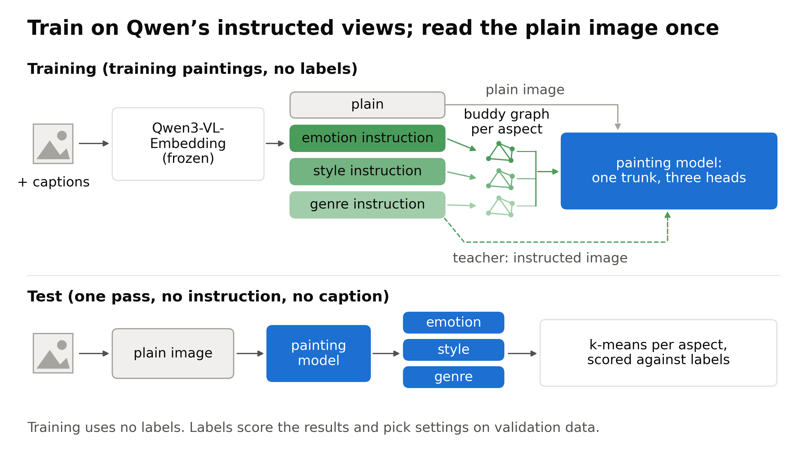
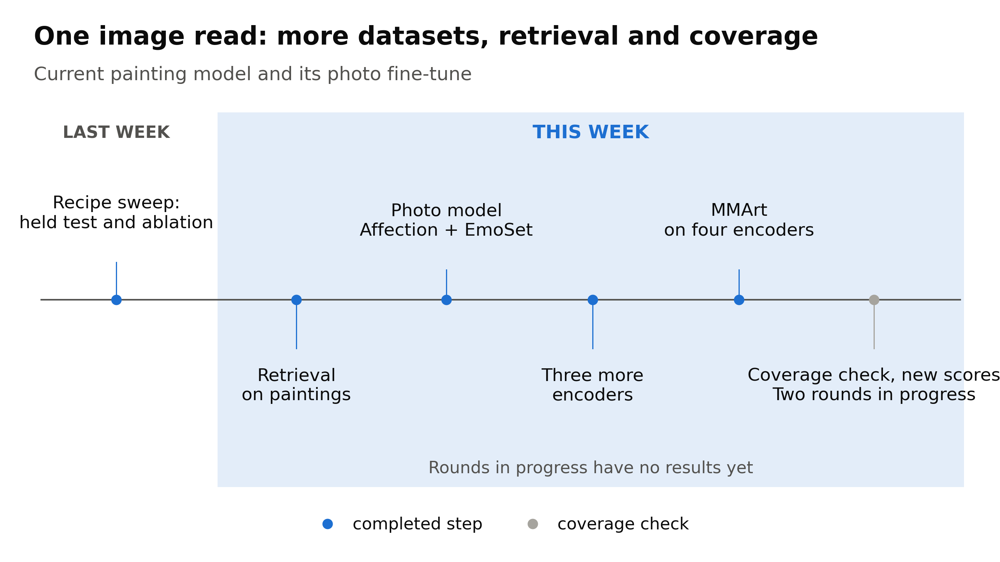
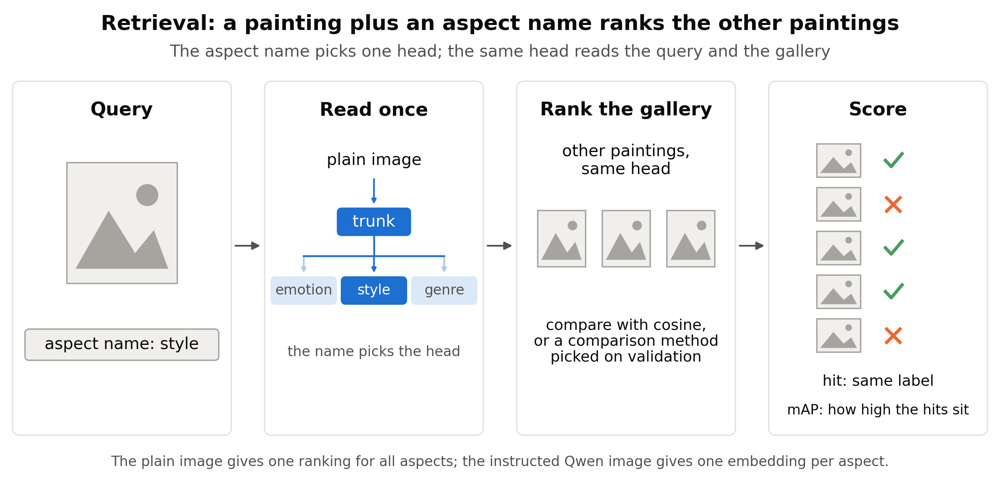
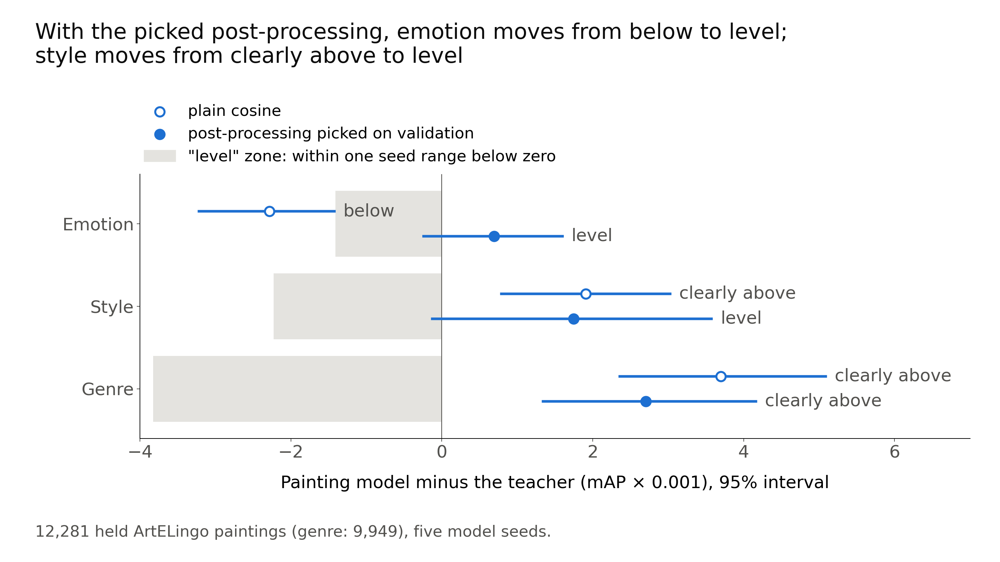
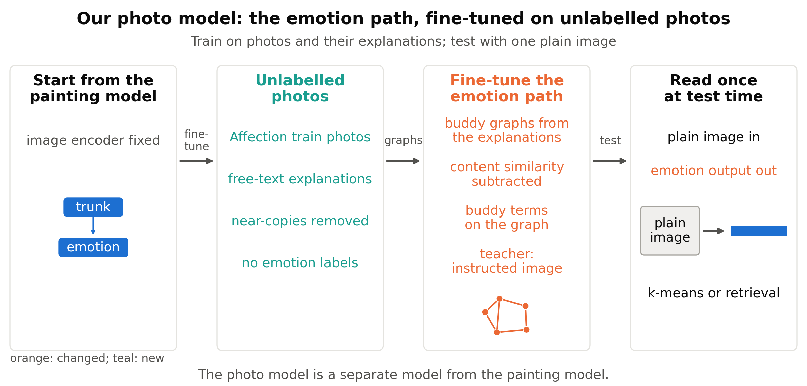
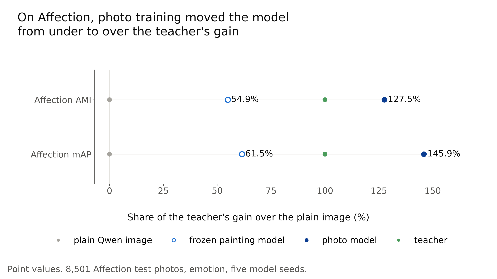
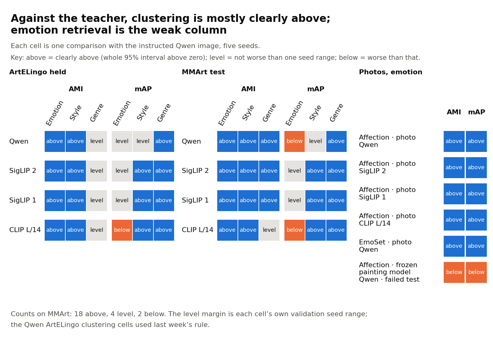
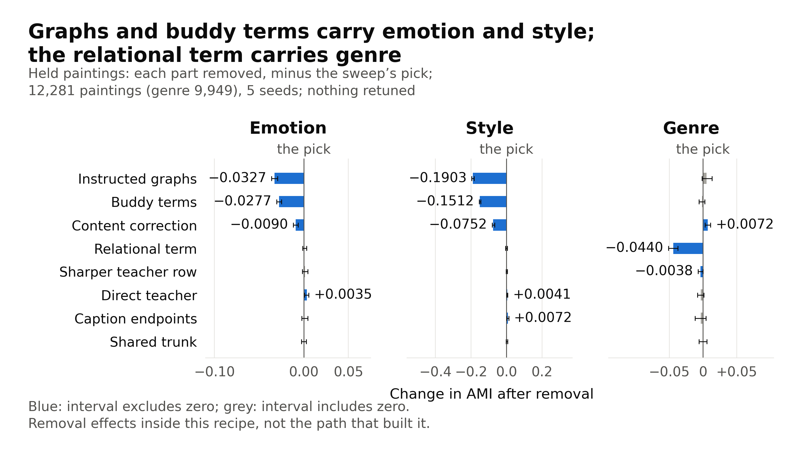
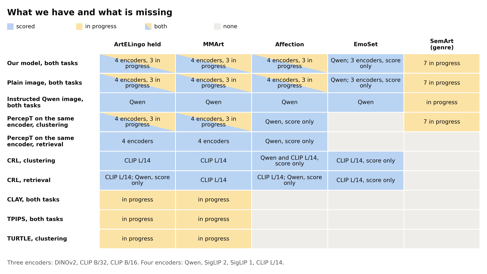

# CoSiR weekly report, 4 November 2026

CoSiR: one read of an image gives separate emotion, style and genre spaces

Retrieval, more datasets, what is missing and what we fill

Notes: This deck summarises the weekly report for 4 November 2026 (draft: docs/reports/weekly/drafts/2026-11-04_datasets_and_retrieval_v3.md; its final path is docs/reports/weekly/2026-11-04_datasets_and_retrieval.md once approved). Every number is taken from that report and its sources. It follows last week's deck and stands alone: the opener and the setting slides give what you need. A space here is one embedding space per aspect (emotion, style or genre). Abbreviations are avoided in the text; some figures still use the short names. Image paths assume the deck sits in docs/reports/weekly/drafts/; from docs/reports/weekly/ they read ../assets/.

---

## Problem and goal of CoSiR

- PercepT, which finds perceptual topics, leans on an emotion-tuned caption encoder chosen in advance; that is hard to carry to new datasets, and maybe to other image encoders.
- Instead: one general embedder, Qwen3-VL-Embedding-2B ("Qwen"), told the aspect (emotion, style or genre) by an instruction text.
- Teacher: Qwen's image under that instruction; our strongest label-free comparator.
- Goal: from one plain image pass (no instruction), give a space per aspect that is clearly above PercepT and level with or clearly above the teacher (both outcomes are defined on the outcomes slide).

Notes: An aspect is emotion, style or genre. PercepT is "Beyond Semantics" (arXiv 2606.03345). An embedder is a model that maps images and text to vectors; an image encoder is its image side, which we also swap for other encoders later. The plain image is an encoder's image embedding with no instruction. Qwen's default prompt is "Represent the user's input." The instructed views replace it. Emotion: "Represent the emotion that this artwork, or this description of an artwork, conveys. Focus only on the emotion." Style: "Describe the artistic style of this artwork in one word." Genre: "Describe the genre of this artwork in one word." The teacher needs one encoder pass per aspect, and the aspect must be named at test time. If one plain pass is level with it, we get three aspect spaces for the price of one pass. On 12,281 held ArtELingo paintings, the teacher gives emotion AMI 0.0921 and the plain image 0.0708. AMI is adjusted mutual information between k-means clusters and labels; 0 is chance. Label-free means the comparator uses no labels when it makes embeddings.

---

## Approach of CoSiR in one picture

- Training: Qwen's instructed views and captions next to the plain image; no labels.
- Buddy graphs link items that rank each other among their closest neighbours (buddies); the painting model pulls buddies together.
- The painting model is our small network: a shared trunk with one head per aspect; a head gives that aspect's embedding.
- Test: one plain image pass feeds three heads; k-means groups a head's embeddings into 20 clusters, or retrieval uses one named head.

Notes: Top: training paintings only; Qwen stays frozen. Emotion buddies come from instructed captions; style and genre buddies from instructed images. Each instructed Qwen image is also a teacher target for its head; the text side adds training signal. A relational term on the genre head copies the teacher's similarity pattern. The model now uses 40 graph neighbours per item. Bottom: only the image side runs at test time. The painting model is a shared trunk with emotion, style and genre heads on a frozen image encoder. Training uses no labels. Labels score the results and, on validation data, also pick settings and post-processing; the footer of this slide's figure says so. This figure is a slide copy of last week's: it says "plain image" where the old one said "default image", names the painting model, and corrects the footer, which had said labels only score the clusters.

---

## Progress of CoSiR so far

- A week ago: one painting model, tested on ArtELingo paintings only, and no retrieval result.
- This week: retrieval on paintings, a photo model (the painting model fine-tuned on photos), three more image encoders and a second painting set (MMArt).
- Also this week: a coverage check of every method against every test set.

Notes: Where last week ended, on 12,281 held ArtELingo paintings (WikiArt paintings with emotion, style and genre labels): emotion AMI 0.1066 against 0.0921 for the teacher (+0.0145 [+0.0113, +0.0177]) and 0.0874 for the strongest PercepT entry; style clearly above the teacher, though only narrowly; genre level. Retrieval: can the model search by a named aspect? Photo model: the painting model fine-tuned on photos and their explanations, with no emotion labels. Three more encoders: SigLIP 2, SigLIP 1 and CLIP L/14. Second painting set: MMArt. Coverage check: every method against every test set, then three rounds of work to fill the gaps. A round is one planned set of runs. The rounds have no results here. The timeline figure keeps its dates, as last week's did.

---

## Setting of this week's tests: test sets and comparators

| Test set | Items | Labels | Role |
|---|---:|---|---|
| ArtELingo held | 12,281 paintings | emotion, style, genre | scored in earlier work |
| MMArt test | 16,384 paintings | MMArt's own | new paintings and labels |
| Affection test | 8,501 photos | emotion | scored in earlier work |
| EmoSet test | 17,348 photos | emotion | shaped no earlier choice |

- **Held:** a test split kept out of training. A set scored in earlier work may have shaped our choices; EmoSet did not.
- **Plain image, teacher:** as on the opening slides.
- **Matched PercepT:** our re-implementation of PercepT on the same image encoder as the model; its topics still come from Qwen.
- **CRL:** an outside method (a method from another paper that compares images through a named aspect); it projects frozen features onto texts written for a criterion. Our re-implementation.

Notes: ArtELingo has genre labels on 9,949 of the held paintings. Training used 42,969 ArtELingo paintings (validation: 6,152); the photo model also used 69,927 Affection photos. ArtELingo and MMArt are WikiArt paintings; MMArt's own labels cover the three aspects. Affection photos come with free-text explanations. A fifth test set, SemArt, holds 11,159 paintings from the Web Gallery of Art with genre labels; it is in progress and has no results here. Validation data pick settings and post-processing. Comparisons used five model seeds and 95% bootstrap intervals. CRL is from NeurIPS 2025. Frozen means with weights fixed. The other outside methods are CLAY and TPIPS; TURTLE and TEMI are label-free clustering methods, not outside methods in this sense.

---

## Setting of this week's tests: outcomes

| Outcome | Meaning |
|---|---|
| Clearly above | the whole 95% interval of the difference is above zero; for a bare point estimate we say "higher" |
| Level | the lower end of the interval is above minus one seed range: within an agreed margin, not worse than one seed range; it does not show the two are equal |
| Below | the lower end is under minus one seed range |

- Each comparison is the model's score minus a comparator's, over five model seeds.
- Seed range: how far a model's validation score spreads over its seeds, for one aspect, task and dataset, fixed before the test.
- Test fixed in advance: a pass rule set before the scores are read; a score-only result has no such rule and decides nothing.
- Clustering score (adjusted mutual information): agreement between k-means clusters and labels, corrected for chance; 0 is chance.

Notes: A difference is the model minus its comparator, and outcomes use unrounded values. A seed range is the maximum minus the minimum. Qwen ArtELingo clustering uses last week's fixed ranges, from three development seeds: 0.0046, 0.0082 and 0.0128 for emotion, style and genre. Example: emotion retrieval against the teacher gave +0.0007 [−0.0002, +0.0016], which is level. Level shows only that the model is not worse than one seed range; it does not show the model is better. A test that failed stays failed in the record. k-means runs fresh on each method's outputs for each test set, with 20 clusters and three random states; no clusters are saved in a model. In the report, one comparison for one encoder, test set, aspect and task is called a cell.

---

## Setting of retrieval

- **Task:** find items with the same label as the query, for one named aspect. The name only picks the head; our model gets no instruction text.
- **Gallery:** the other labelled paintings of the test set.
- **Retrieval score (mean average precision):** how high the items with the same label rank, averaged over queries.
- **Post-processing:** how saved embeddings are compared at retrieval, with no new training; plain cosine is retrieval with none.

Notes: We call this told retrieval. A query is one image plus an aspect name. All retrieval here used image queries. A hit has the same label. AP (average precision) is the same score for one query or one class. Only the teacher gets an instruction text. Retrieval intervals are a joint bootstrap over queries and seeds with a fixed gallery, so they do not cover a new gallery. Emotion's chance retrieval score on ArtELingo, from the class shares, is 0.2007, and the majority labels from captions are noisy. The aspect name is not an instruction in this sense: it selects one of the model's heads and is never fed to a text encoder. Each model picks its post-processing on validation, from centering, PCA whitening and neighbour query expansion.

---

## Experiments on retrieval: plain cosine

| Aspect | Painting model | Plain image | Teacher | Outcome against teacher |
|---|---:|---:|---:|---|
| Emotion | 0.2642 | 0.2424 | 0.2665 | below |
| Style | 0.3110 | 0.1801 | 0.3091 | clearly above |
| Genre | 0.5896 | 0.4760 | 0.5860 | clearly above |

- **Purpose:** test whether the painting model also retrieves by a named aspect.
- **Design:** 12,281 held ArtELingo paintings, image queries, plain cosine (the usual similarity of two embeddings, with no post-processing); pass rule: level or clearly above the teacher.
- **Result:** the model was clearly above the plain image on every aspect, but emotion fell below the teacher, so plain cosine failed the rule.

Notes: Model minus teacher: emotion −0.0023 [−0.0032, −0.0014], style +0.0019 [+0.0008, +0.0030], genre +0.0037 [+0.0024, +0.0051]. The saved embeddings are the outputs of the trained model and of the encoders, computed once. Genre labels cover 9,949 paintings. One class carried the emotion miss: contentment, with an AP difference of −0.0324 across 4,244 of the 12,281 queries. The other eight classes were higher than the teacher's, by +0.0027 to +0.0340 AP. These are diagnostics, with no per-class conclusions. The retrieval score weights each query equally, so the largest class weighs most. Graded emotion (nDCG, a graded ranking score on the overlap of caption-emotion distributions) gave 0.9343 for the model against 0.9341 for the teacher, +0.0002 [+0.0001, +0.0004], and 0.9292 for the plain image. One unchecked explanation: training did not directly optimise retrieval of each painting's majority label. The report calls this form of retrieval the first form and the next slide its second form.

---

## Experiments on retrieval: post-processing picked on validation

Open markers: plain cosine. Filled markers: the picked post-processing. Grey zone: level, one seed range.

- **Purpose:** check whether a better way of comparing the saved embeddings, with no training, closes the emotion gap to the teacher.
- **Design:** each model picked one post-processing for all aspects on 6,152 validation paintings, from centering, whitening or neighbour query expansion.
- **Result:** with the picked post-processing, model against teacher: emotion 0.2691 against 0.2684 (level), style 0.3235 against 0.3217 (level), genre 0.6151 against 0.6124 (clearly above, though only narrowly: +0.0027).
- **Result:** style's gap, +0.0017, is about the same as +0.0019 with plain cosine; the interval widened, so the outcome moved from clearly above to level. The plain image stayed lower: emotion 0.2483, style 0.1924, genre 0.5361.

Notes: Centering subtracts the mean embedding; whitening decorrelates the embedding dimensions; neighbour query expansion averages a query with its nearest neighbours. The three models are the painting model, the plain image and the teacher. Up to 25 options. Model minus teacher: emotion +0.0007 [−0.0002, +0.0016], style +0.0017 [−0.0001, +0.0036], genre +0.0027 [+0.0013, +0.0042]. The teacher's own scores change with the post-processing. The painting model, the plain image and the teacher all picked centering plus ten-neighbour expansion. No whitening option passed its validation check. Every pick used the largest neighbour count offered, so the options may not exhaust the gains from post-processing. Selection reused data: validation chose the painting model's epochs within development data that had already picked the model among about 60 configurations. Verdict (reference): The retrieval result on paintings rests on picked post-processing; for emotion it is level with the teacher. The large margins are over the plain image; against the teacher, the model is level on emotion and style and only narrowly clearly above on genre.

---

## Experiments on retrieval: each head and CRL

| Label queried | Correct head | First wrong head | Second wrong head |
|---|---:|---|---|
| Emotion | 0.2642 | style head, 0.2487 | genre head, 0.2539 |
| Style | 0.3110 | emotion head, 0.1529 | genre head, 0.2167 |
| Genre | 0.5896 | emotion head, 0.4520 | style head, 0.3593 |

- **Purpose:** check that each head serves its own aspect, and compare with an outside method (CRL).
- **Design:** the table queries each label set through each head with plain cosine; the CRL comparison uses the picked post-processing of the last slide and the CRL version picked on validation; pass rule against CRL: clearly above.
- **Result:** in the table, each head was clearly above both wrong heads on its own labels.
- **Result:** with picked post-processing the model was clearly above CRL: emotion 0.2691 against 0.2554, style 0.3235 against 0.2816, genre 0.6151 against 0.5033.

Notes: A head is the model's output for one aspect; a wrong head is another aspect's head. The teacher and CRL showed the same head pattern as point values, so the pattern is not unique to our model. Our model gives it from one read of the plain image. The picked CRL version is CLIP L/14 with criterion texts worded for paintings. Differences: emotion +0.0137 [+0.0124, +0.0149], style +0.0418 [+0.0392, +0.0444], genre +0.1118 [+0.1087, +0.1149]. The CRL tests came after we had seen CRL's score-only held scores, so this evidence is weaker than a comparison fixed earlier. The two arms use different encoders. On CLIP L/14 for both, emotion retrieval score was 0.2671 for our model against 0.2554, a point comparison only. An unpicked Qwen version of CRL exceeded the picked one on held emotion; picks use validation only, so the pick stayed.

---

## Experiments on photos: frozen painting model

| Task | Painting model | Plain image | Teacher | Outcome against teacher |
|---|---:|---:|---:|---|
| Clustering score | 0.1384 | 0.1041 | 0.1666 | below |
| Retrieval score | 0.2755 | 0.2452 | 0.2945 | below |

- **Purpose:** test whether heads trained on paintings transfer to photos with no photo training.
- **Design:** the painting model, unchanged (frozen), reads the plain Qwen image of 8,501 Affection test photos; pass rules: clearly above the plain image and CRL, level or clearly above the teacher.
- **Result:** the model was clearly above the plain image and fell below the teacher on both scores, so the test failed.
- **Result:** against CRL it was level (0.2755 against 0.2739); the point estimate is higher, but the interval is not wholly above zero, so the test for clearly above failed.

Notes: The painting model used this way is called the frozen painting model. Model minus plain: AMI +0.0343 [+0.0298, +0.0387], mAP +0.0304 [+0.0293, +0.0315]. Model minus teacher: AMI −0.0282 [−0.0333, −0.0233], mAP −0.0190 [−0.0205, −0.0176]. CRL difference: +0.0016 [−0.0001, +0.0032]. Labels are plurality votes; 1,917 of the test photos (22.6%) had tied votes, broken alphabetically. Post-processing and wording were picked on 4,251 validation photos. The order of model, plain image and teacher stayed the same with ties dropped, with plain cosine, with graded nDCG and in each image collection. Contentment, excitement and sadness carried most of the deficit. Painting-only training is a possible cause; this test did not check it. We chose to try photo training next. The failed test stays failed.

---

## Method of the photo model: design

- Start from the painting model with the image encoder frozen; train only the emotion path on 69,927 Affection photos and their free-text explanations, with no emotion labels.

Notes: The emotion path is the image side and the text side, each a trunk with an emotion head. The text side reads the explanations (they take the place of captions) and is used only in training. Orange marks what changed and teal what is new; the figure calls the photos unlabelled, which means no emotion labels. Training loop: the fine-tune starts the emotion path from its ArtELingo weights; encoder features stay fixed, and the style and genre heads are unused. AdamW uses batches of 512 graph pairs, for up to 200 epochs, and stops early on the validation loss with a patience of 15; all five final runs kept epoch 1. Graphs: photos that are mutual nearest neighbours by explanation, 80 per photo (validation chose 80 against 40), with content similarity (how alike two photos are in what they show) subtracted. Loss: four buddy terms pull a photo's image and text outputs toward those of its buddies; a teacher term (weight 0.25) pulls toward the instructed image. No emotion label enters, and train labels were never read. At test: the photo model reads one plain image; k-means runs new on the test photos (20 clusters, three random states), and retrieval ranks them. We removed 2,328 of 72,255 train photos as near-copies of validation or test photos (plain-image cosine at least 0.85). The photo model and the painting model are separate models.

---

## Experiments on photos: fine-tune on Affection

A point at 100% has the same gain over the plain Qwen image as the teacher.

- **Purpose:** test whether photo training closes the gap to the teacher on Affection.
- **Design:** the photo model's setting was picked among nine candidate settings on validation photos, then scored on the 8,501 test photos; pass rule: level or clearly above the teacher.
- **Result:** the photo model was clearly above the teacher on both scores: clustering score 0.1838 against 0.1666; retrieval score 0.3172 against 0.2945.
- **Limit:** we trained after the failed test on these same photos (two slides back), so this is no fresh confirmation.

Notes: In the figure, the frozen painting model keeps 54.9% (clustering) and 61.5% (retrieval) of the teacher's gain; the photo model reaches 127.5% and 145.9%. The nine candidate settings are the nine rows of the validation sweep. Photo minus teacher: AMI +0.0172 [+0.0121, +0.0225], mAP +0.0227 [+0.0210, +0.0244]. Photo minus plain: AMI +0.0797 [+0.0741, +0.0857], mAP +0.0720 [+0.0699, +0.0742]. Against CRL (0.2739), the mAP difference was +0.0433 [+0.0411, +0.0455], clearly above. The order held with ties dropped, with plain cosine and in each image collection. The rule supports only the sentence "level with or better than the teacher"; a "better than" statement needed a new test that asked for clearly above. The result does not show transfer without photo training, or one model for both domains (paintings and photos). The exact pick is close to noise: its lead over the second-best row was 0.0032 AMI, under half of the seed range (0.00707). Start point: a run from random weights, with the same settings as the painting start (40 neighbours), scored about the same on validation on one seed: AMI 0.1801 beside 0.1769, and retrieval score 0.3227 for both. We did not pick it, so it has no test score. The picked setting (80 neighbours) was not tried from random weights. A run from random weights at the picked settings is planned after the rounds in progress. Verdict (reference): The Affection result is weaker evidence, because it follows a failure on the same photos.

---

## Experiments on photos: EmoSet

| Task | Photo model | Plain image | Teacher | Outcome against teacher |
|---|---:|---:|---:|---|
| Clustering score | 0.4571 | 0.3918 | 0.4390 | clearly above |
| Retrieval score | 0.4838 | 0.3864 | 0.4519 | clearly above |

- **Purpose:** test the photo model, in a test fixed in advance that asked for clearly above, on a test set that shaped no earlier choice.
- **Design:** the photo model, with no EmoSet training, on 17,348 EmoSet test photos; only the teacher's instruction wording, the seed ranges and the post-processing came from EmoSet validation photos.
- **Result:** the model was clearly above the plain image and the teacher on both scores: +0.0181 clustering score and +0.0320 retrieval score against the teacher.
- **Scope:** Qwen and emotion only.

Notes: No model trained on EmoSet. The teacher's instruction was tried in two wordings, one for artwork and one for photos, on validation photos. Photo minus teacher: AMI +0.0181 [+0.0121, +0.0242], mAP +0.0320 [+0.0295, +0.0347]. Photo minus plain: AMI +0.0653 [+0.0589, +0.0719], mAP +0.0975 [+0.0948, +0.1004]. We removed 368 of 17,716 test photos as near-copies of Affection train photos. With them kept, the AMI gain over the plain image fell to +0.0390 [+0.0318, +0.0464], still with a positive lower bound. The gain was uneven: amusement AP was lower than the teacher's (0.3203 against 0.3471; a point comparison with no interval), and awe was also lower with plain cosine. On the other three encoders, EmoSet gave score-only results. Verdict (reference): EmoSet is the strongest photo evidence so far, since it shaped no earlier choice.

---

## Experiments on encoders: three more encoders

| Encoder | Clustering gain over own plain image | Retrieval gain over own plain image | Clustering gain over matched PercepT |
|---|---:|---:|---:|
| SigLIP 2 | +0.0477 | +0.0249 | +0.0253 |
| SigLIP 1 | +0.0399 | +0.0236 | +0.0250 |
| CLIP L/14 | +0.0377 | +0.0192 | +0.0243 |

- **Purpose:** test whether the recipe (our fixed training procedure) depends on the image encoder.
- **Design:** the same recipe on three more image encoders; each table entry is the smallest gain of the three aspects, on 12,281 held ArtELingo paintings.
- **Result:** every test against the plain image and matched PercepT passed; against the teacher, 24 comparisons (paintings and Affection photos) gave 18 clearly above, 5 level and 1 below.
- **Limit:** we chose these encoders after an earlier test of ours on the same held paintings; Qwen still supplies the training views.

Notes: The recipe is the fixed training procedure. These encoders replaced only the image input; Qwen's instructed graphs, captions and teacher still supplied training. We did not test training without Qwen. Emotion was the smallest aspect every time. Intervals: SigLIP 2 +0.0477 [+0.0439, +0.0514], +0.0249 [+0.0238, +0.0260], +0.0253 [+0.0198, +0.0267]. SigLIP 1 +0.0399 [+0.0363, +0.0434], +0.0236 [+0.0225, +0.0247], +0.0250 [+0.0195, +0.0264]. CLIP L/14 +0.0377 [+0.0343, +0.0411], +0.0192 [+0.0181, +0.0203], +0.0243 [+0.0192, +0.0252]. The 24 comparisons are six on ArtELingo and two on Affection per encoder; all six others were on ArtELingo, so every Affection comparison was clearly above. The one below: CLIP L/14 emotion retrieval, 0.2671 against 0.2684, −0.0013 [−0.0023, −0.0003]. Photo model on Affection, clustering score against own plain image: Qwen 0.1838 against 0.1041, SigLIP 2 0.1924 against 0.1142, SigLIP 1 0.1928 against 0.1200, CLIP L/14 0.1941 against 0.1127. Verdict (reference): The recipe carried to three encoders of two families (SigLIP and CLIP), within the limit of the pick. Qwen remains a training dependency on every encoder.

---

## Experiments on new paintings: MMArt

| Encoder | Emotion clustering score, model | Plain image | Matched PercepT |
|---|---:|---:|---:|
| Qwen | 0.0609 | 0.0407 | 0.0514 |
| SigLIP 2 | 0.0608 | 0.0332 | 0.0451 |
| SigLIP 1 | 0.0620 | 0.0370 | 0.0468 |
| CLIP L/14 | 0.0590 | 0.0386 | 0.0454 |

- **Purpose:** test the painting model on new paintings and labels.
- **Design:** 16,384 WikiArt paintings that are not in ArtELingo, with MMArt's own labels; four image encoders.
- **Result:** against the plain image and matched PercepT the model was clearly above in all nine comparisons per encoder; against the teacher, 18 clearly above, 4 level and 2 below, both below in emotion retrieval (Qwen, CLIP L/14).
- **Limit:** only 15 test paintings come from artists new to ArtELingo training, too few to score; we say only that the paintings and labels are new.

Notes: No MMArt test result selected a model. Emotion gave the smallest gain over the plain image in every row. Nine comparisons: clustering score and retrieval score against the plain image and clustering score against matched PercepT, on each of the three aspects. Qwen emotion AMI gain over the plain image: +0.0201 [+0.0178, +0.0227]. Post-processing and seed ranges came from 5,769 ArtELingo validation paintings with MMArt labels. Below comparisons against the teacher, emotion retrieval score: Qwen −0.0010 [−0.0015, −0.0004], CLIP L/14 −0.0011 [−0.0015, −0.0006]. All 15 comparisons fixed in advance to need "clearly above" (a "better than" test) were clearly above. The test set kept paintings with plain-image cosine below 0.95 to every ArtELingo train and validation painting. On the farther subset at 0.85 (10,403 paintings) the gains over the plain image survived; Qwen style retrieval also fell below the teacher there, −0.0039 [−0.0058, −0.0020]. On 11,528 shared paintings, the Qwen emotion AMI gain was +0.0192 [+0.0166, +0.0220] under MMArt labels and +0.0364 [+0.0332, +0.0398] under ArtELingo labels; style did not change. Our reading: the changed labels explain much of the smaller emotion effect. The intervals are not corrected for the number of comparisons. Both ArtELingo and MMArt come from WikiArt and share most artists; 15 paintings, by 12 artists, come from artists with no ArtELingo train paintings, fewer than the 20 clusters that k-means needs. Verdict (reference): The gains over the plain image and matched PercepT carried to new paintings and labels. Against the teacher the ArtELingo pattern repeated: clearly above in clustering, level or slightly below in emotion retrieval.

---

## Analysis of the results: against the teacher

Each square is one comparison with the teacher ("above" means clearly above). Left: ArtELingo paintings. Middle: MMArt paintings. Right: photos, emotion only (Affection and EmoSet).

- Painting emotion retrieval is the only case with no clearly above cell: of eight comparisons, five were level and three below.
- The three below fell short by at most 0.0013 in retrieval score.
- The frozen painting model on Affection stays in the record as the failed test (bottom right).
- Every comparison of the photo model was clearly above, on Affection and EmoSet.

Notes: The retrieval comparisons use the picked post-processing; on ArtELingo Qwen, emotion is level here (+0.0007) and was below with plain cosine. The three below: Qwen on MMArt −0.0010, CLIP L/14 on MMArt −0.0011 and CLIP L/14 on ArtELingo −0.0013. The Qwen ArtELingo clustering comparisons used last week's seed ranges. In the share of the teacher's gain over the plain image that the model keeps, MMArt gives over 100% in every clustering comparison and 88.2% to 99.8% in emotion retrieval. Per class, contentment is the recurring weak spot in retrieval: it is the largest emotion class on ArtELingo and on Affection, so it weighs most in the retrieval score. On EmoSet the exception was amusement. On Qwen, MMArt contentment AP was 0.2413 against the teacher's 0.2547. Why emotion is weaker in retrieval than in clustering is not checked. Our related-work note found no case of a small student on frozen features that exceeds the instruction-following embedder on the named aspect. Our result holds in clustering on most comparisons and in retrieval on photos and painting genre, and not on painting emotion. Verdict (reference): One plain-image read gave a gain over the plain image on every test set. The result is strongest on style, genre and photo emotion, and weakest on painting emotion retrieval against the teacher.

---

## Analysis of the results: parts and settings

Each panel is one aspect: the held change in clustering score when one part is removed. In the figure, "the pick" is the painting model.

- **Purpose:** find which parts and settings carry the result.
- **Design:** remove one part at a time on held paintings; change one setting at a time on validation.
- **Result:** the instructed graphs, buddy terms and content correction (subtracting content similarity) carry emotion and style; the relational term (a genre loss copying the teacher's similarity pattern) carries genre (−0.0440).
- **Result:** no setting was better on all three aspects, so the settings stayed unchanged.

Notes: The removals are last week's saved runs on Qwen, five seeds, nothing retuned. They are analysis only. The −0.0440 is the change in held genre clustering score when the relational term is removed. In retrieval the relational term also mattered: removing it changed held genre retrieval score by −0.1175 [−0.1214, −0.1134]. Three parts did not help: removing the direct teacher raised held emotion (+0.0035 [+0.0008, +0.0056]) and style (+0.0041 [+0.0016, +0.0067]), removing the text side raised style (+0.0072 [+0.0015, +0.0121]), and removing the shared trunk changed nothing we could tell from zero. "Caption endpoints" in the figure is the text side of the buddy terms. The painting sheet had 39 validation rows over 13 settings, three seeds; it chose nothing. A setting row is one setting variant with its validation scores. The photo sheet had 14 rows with three seeds. Turning off the content correction changed validation emotion AMI by −0.0320 [−0.0391, −0.0247]. A random start gave similar scores to the painting start on one seed (AMI 0.1801 against 0.1769), so on photos the painting start may add little; one seed cannot show it (see the notes of the fine-tune slide). Against the photo model, twenty fixed epochs changed validation AMI by +0.0067 [+0.0014, +0.0127]; the analysis named no better setting.

---

## Analysis of the results: coverage

One row per method and task, one column per test set. Scored means a test fixed in advance or its comparator; it does not mean clearly above.

- **Have:** broad comparisons of our own: plain image, matched PercepT and teacher across the test sets.
- **Missing:** outside comparisons, other clustering measures, other cluster counts, new artists and encoders past our own picks.
- **Not covered:** training without Qwen, one model for both paintings and photos, text queries and a second photo aspect.

Notes: Colours: blue is scored, yellow is in progress (no result yet), blue and yellow together is both, grey is none (no score, and no current round adds one). "Score only" means a result with no rule fixed in advance; it decides nothing. On photos, "our model" is the photo model; on paintings and SemArt it is the painting model. "Both tasks" means clustering and retrieval. "4 encoders" are Qwen, SigLIP 2, SigLIP 1 and CLIP L/14; "3 in progress" are DINOv2, CLIP B/32 and CLIP B/16; "7" is all seven. PercepT's topics come from Qwen on every row. The failed frozen painting model test on Affection is not a row. Other clustering measures: normalised mutual information, adjusted Rand index and accuracy; cluster counts means sensitivity to a number other than 20 clusters. A second photo aspect is an aspect other than emotion on photos; text queries use a text instead of an image as the query. Gaps with no scheduled work: a second instructed embedder (important; we deferred its priority) and criterion-driven clustering and a second photo aspect (cite and explain only). Selection limit: only EmoSet shaped no earlier choice. Every result uses AMI at 20 clusters and the retrieval score. All results need Qwen at training.

---

## Plan: rounds in progress

| Round | Question | Status |
|---|---|---|
| New scores from saved outputs | Do other clustering measures, cluster counts and the missing retrieval comparisons support the picture so far? | Test scoring done; score-only sweeps running; report pending |
| Outside comparisons | How does the model compare with outside methods that take a text for the aspect, and with stronger clustering of plain images? | Build and checks passed; features for one outside method (TPIPS) being extracted |
| Past our own picks | Do results survive our encoder selection, transfer to new artists and support a statement about cost (one pass against one pass per aspect)? | Build finished; features extracting; training running on a compute-cluster node |

- A round is one planned set of runs. None of the rounds has a report yet, so this deck shows no result from them.

Notes: Status is the one in the report. New scores from saved outputs: no training or GPU work; it reuses saved outputs, compares the painting model with plain images, matched PercepT, the teacher and same-encoder CRL, and tests untold retrieval (three heads joined into one vector, no aspect name). The other sweeps are score only: they carry no pass rule. The other clustering measures are normalised mutual information, adjusted Rand index and accuracy. Outside comparisons: CLAY is a training-free projection of a frozen image onto text values of an aspect. TPIPS is an embedder fine-tuned on human similarity votes, queried along a factor named in text. TURTLE clusters plain images and model heads without labels. TEMI, another label-free clustering method, follows as a separate build. TURTLE and TEMI are not outside methods in the sense of CRL, CLAY and TPIPS. Past our own picks: adds DINOv2, CLIP B/32 and CLIP B/16; SemArt genre covers seven encoders on artists whose names match no ArtELingo training artist; the cost question is one pass for the plain image against one pass per aspect for the teacher. PercepT's topics come from Qwen on every encoder.

---

## Plan: later work

- **Qualitative cluster figure:** what each cluster holds, shown with example images; it follows the cluster counts.
- **Head variants:** deeper heads, and a deep embedded clustering loss (a loss that trains the heads toward sharper clusters).
- **Text queries:** a text, rather than an image, as the query.

Notes: Open decisions for the discussion. (1) The priority of a second instructed embedder, that is, an instructed embedder other than Qwen; we deferred it, and it is important. (2) The paper's wording for emotion retrieval below the teacher, after the per-class look (the per-class diagnostics are in the notes of the plain cosine slide: contentment carried the miss). (3) The wording of a paper note that the frozen encoder kept its own retrieval; no experiment is needed. Go/no-go status of the required items: the final recipe on SigLIP 2, SigLIP 1 and CLIP L/14 passed, with one teacher cell below; aspect-named retrieval passed with picked post-processing and did not pass with plain cosine; photos at least level with the teacher failed for the frozen model and passed for the photo model; "better than the teacher" on data that shaped no earlier choice passed on EmoSet, emotion, Qwen. The paper options: one read for all aspects, instruction supervision across encoders, or a fair comparison table with a column that states whether a method trained on images from the test domain. PercepT with its own encoders is not built and has no scheduled work.
