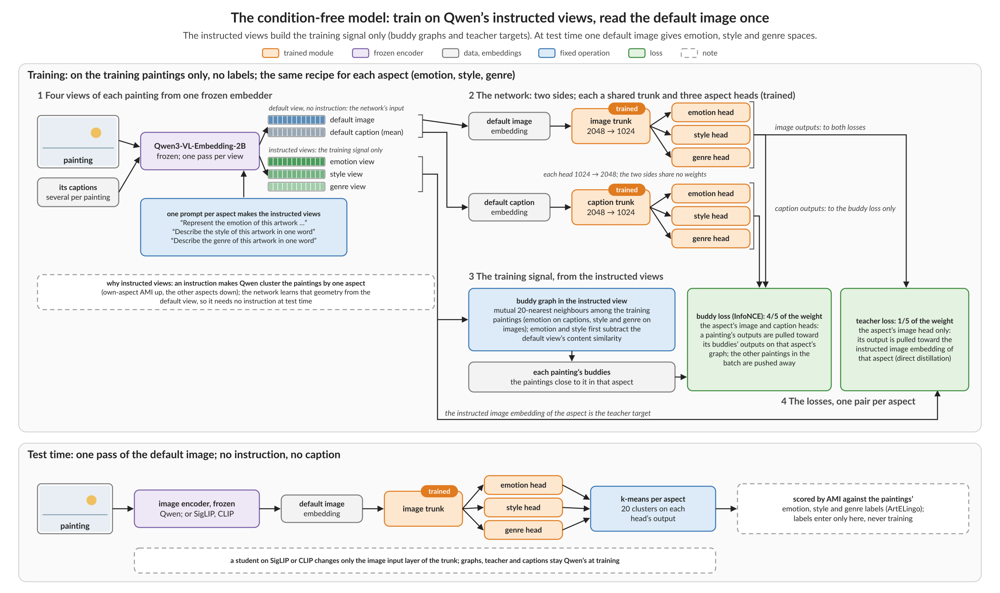
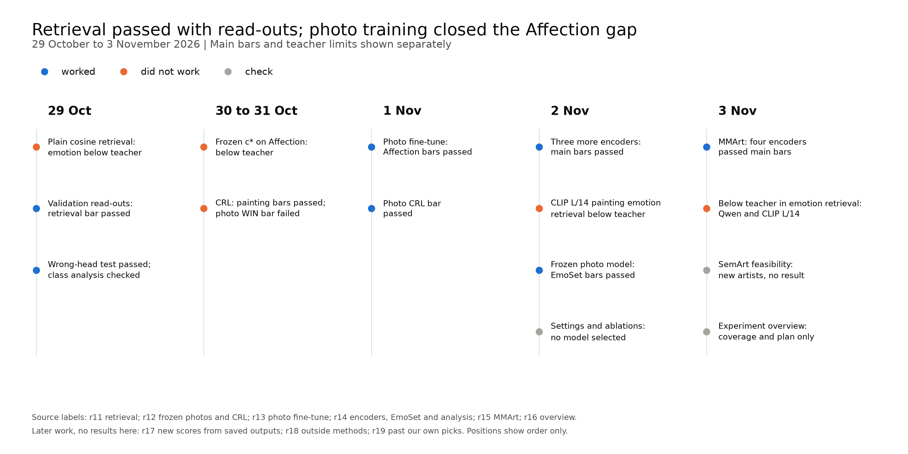
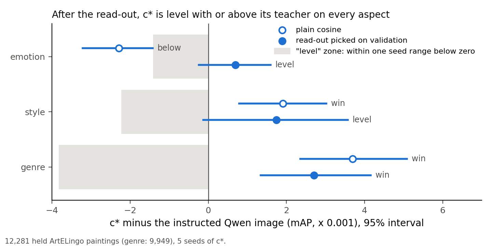
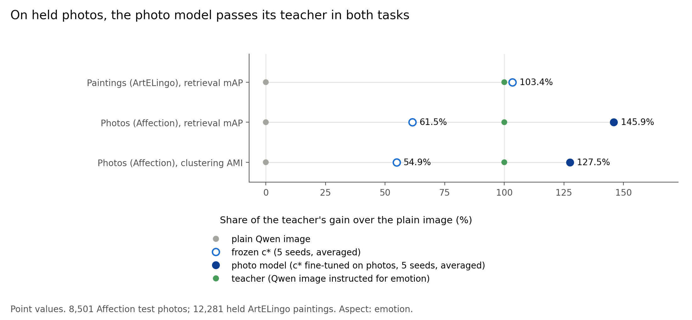
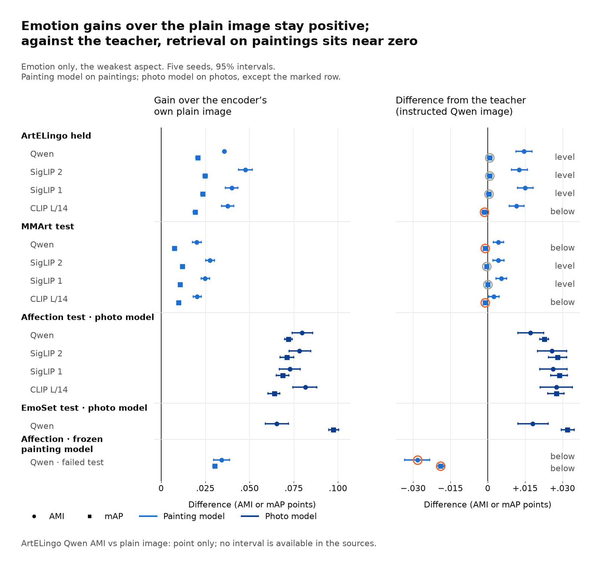
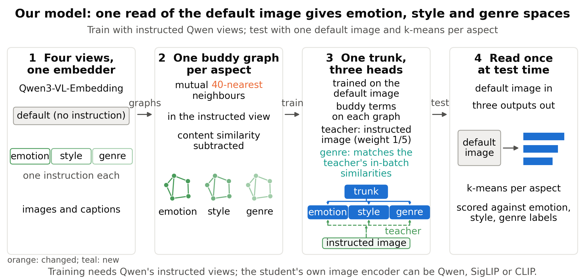
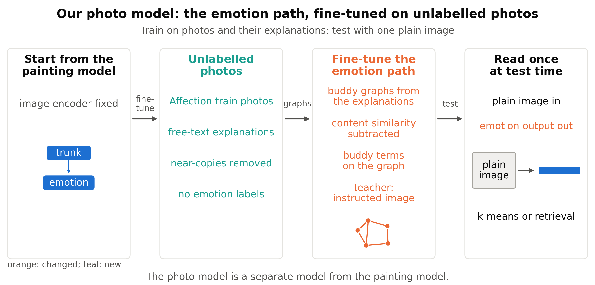
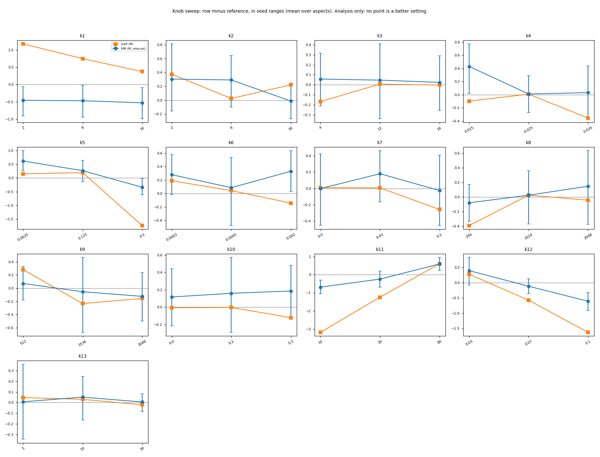
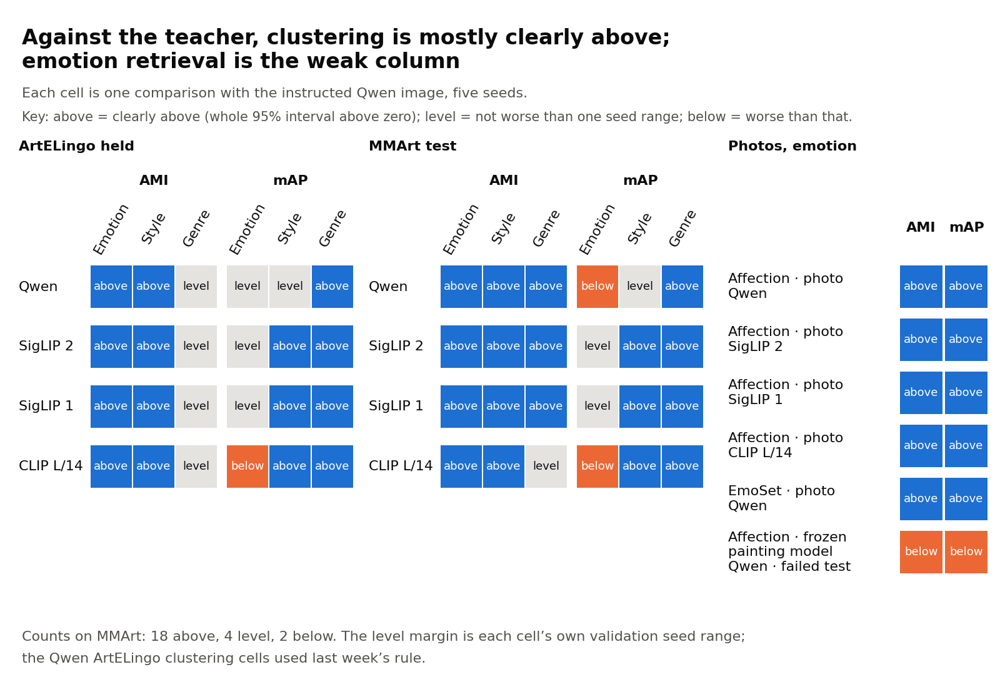
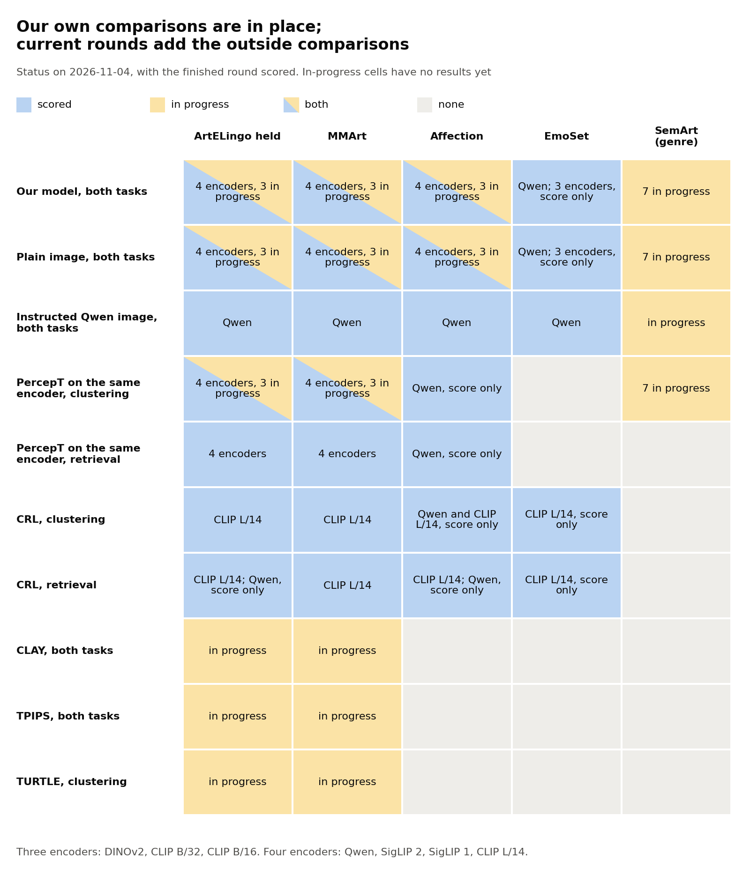

# Weekly report, 29 October to 3 November 2026: the condition-free model retrieves by aspect and holds on new photos and paintings; outside comparisons are the main gap

> Draft v1, written 2026-11-04. CoSiR, main. Covers 2026-10-29 to 2026-11-03 (the [previous weekly report](../2026-10-28_condition_free_line.md)
> ended on 2026-10-28). Every number comes from the report linked in its section. Lines marked **Verdict (reference)** are
> our reading of the results; they decide nothing.

## Summary

- **The painting model retrieved by a named aspect after a read-out picked on validation.** Its emotion mAP was 0.2691
  against 0.2684 for the teacher, the instructed Qwen image (+0.0007 [−0.0002, +0.0016], level). With plain cosine,
  emotion fell below the teacher (§1).
- **The frozen painting model failed on photos, and photo training reversed the gap.** Frozen on Affection, it gave AMI
  0.1384 against the teacher's 0.1666. The photo model, fine-tuned without labels, gave 0.1838 (§2).
- **The strongest new evidence is EmoSet, a test set that shaped nothing.** The frozen photo model gave AMI 0.4571
  against 0.4390 for the teacher (+0.0181 [+0.0121, +0.0242]) (§2.3).
- **The recipe held on three more image encoders.** On CLIP L/14, the smallest painting AMI gain over the plain image was
  +0.0377 [+0.0343, +0.0411], with one retrieval cell below the teacher. We picked these encoders after an earlier test (§3).
- **The model held on 16,384 new paintings with new labels.** Qwen emotion AMI was 0.0609 against 0.0407 for the plain
  image. Two emotion retrieval cells fell below the teacher, and the paintings share most artists with training (§4).
- **The second main message is what is missing.** Our own grid is broad, but outside methods, standard clustering metrics
  and new artists are open. Three rounds are running to fill these gaps; they have no results here (§6).
- **The main limit is emotion retrieval against the teacher.** Across eight painting cells, none won, five were level
  and three were below, by at most 0.0013 mAP. All claims also need Qwen at training (§5.4, §5.5).

## Idea and contributions

### Background

Image-text embedders such as CLIP, SigLIP and Qwen3-VL-Embedding-2B ("Qwen") place an image at one point, with no choice
of aspect. PercepT ("Beyond Semantics") finds perceptual topics in one space. Instructed embedders and outside methods
such as CRL, CLAY and TPIPS make similarity depend on a named aspect, but they need that aspect at test time.

### The problem

We asked whether one read of the plain image can give separate emotion, style and genre spaces. A curator could then
group or search a collection by each aspect, with one image pass and no instruction.

### Our approach

We train a small network on the instructed views of one embedder and test it on the plain image. Labels only score the
results. Each comparison uses a real alternative: the plain image, PercepT on the same encoder, the instructed Qwen image
and CRL.

### The setup at a glance

*Figure 1. The setup as of 2026-10-26. Top: training, with no labels. Bottom: one image pass at test time. Later changes
keep this flow. The model now uses 40 graph neighbours in place of the 20 shown, and it adds a relational genre term.*

Instructed views link each item to its nearest items in one aspect: its buddies. The network learns these links, then
reads only the plain image. §5.2 gives the design.

### Data

*Table 1. The test sets. Training used 42,969 ArtELingo paintings; the photo model also used 69,927 Affection photos.*

| Test set | Items | Labels | Role |
|---|---:|---|---|
| ArtELingo held | 12,281 paintings | emotion, style, genre (9,949) | held, read earlier |
| MMArt test | 16,384 paintings | MMArt's own | new paintings and labels |
| Affection test | 8,501 photos | emotion | read earlier |
| EmoSet test | 17,348 photos | emotion | shaped nothing |
| SemArt new artists | 11,159 paintings | genre | running |

### Our method so far

The painting model reads one plain image through a trunk and three heads. The photo model fine-tunes its emotion pathway
on unlabelled photos. Both beat the plain image in every claim test, on four encoders; emotion retrieval against the
teacher is the main caveat.

### Goal (the plan's target, not yet reached)

The soft target is CVPR 2027: abstract 2026-11-10, paper 2026-11-16, supplementary 2026-11-23. The user's bar is level
with or better than the teacher.

### Novelty

To our knowledge, no prior work distils the aspect-instructed views of one embedder into a small multi-head student on a
frozen image encoder, with no instruction at test. CRL and CLAY project a frozen embedding onto text at test and train
nothing. TPIPS fine-tunes the embedder on human votes. Instructed embedders need one pass per aspect. We do not claim
aspect prompting, neighbour graphs or distillation as new.

> Sources: [related work sources](../../literature/2027-01-03_paper_related_work_sources.md), parts H1 and C; [previous weekly report](../2026-10-28_condition_free_line.md), Novelty.

### Contributions

*Table 2. Contributions: what we have on 2026-11-03, and what a full success would add.*

| Contribution | What we have now | What a full success would add |
|---|---|---|
| Method: one plain-image read gives aspect spaces | Above the plain image and matched PercepT on four encoders and two painting sets; a photo model above the teacher on Affection and EmoSet; retrieval by a named aspect | A result on new artists; encoders that no earlier test picked; a cost result for the one pass |
| Protocol: fair comparators and fixed claim tests | Rules fixed before each read, five seeds, separate re-derivation; the failed tests stay in the record | Outside methods as context rows; standard clustering metrics and cluster counts |
| Analysis: which parts carry each aspect | Eight removals, 13 painting settings and 14 photo rows on Qwen, as analysis only | Reported, not required: head variants and text queries |

> Sources: [stage report](../../stage/2026-11-04_datasets_and_retrieval.md), "The steps, in date order" and "Where we stand"; [direction log](../../../superpowers/direction_log.md), entries 2026-10-31 and 2026-11-03.

## How we got here

Last week ended with one painting model, one held dataset and no retrieval result. The [previous weekly report](../2026-10-28_condition_free_line.md)
has the full story. Its key held AMI numbers, on 12,281 ArtELingo paintings:

- emotion 0.1066 against 0.0921 for the teacher (+0.0145 [+0.0113, +0.0177]);
- emotion 0.0874 for the strongest PercepT entry;
- style narrowly above the teacher, and genre level.

This week tested retrieval, then new data and encoders. Figure 2 shows the steps.

*Figure 2. The steps of the week, by date. Positions show order only. Blue marks a step that met its bar, orange a step
that did not, grey a check. In the figure, c* is the painting model; the r numbers name the source rounds.*

**Terms used throughout** (glossary at the end):

- **AMI** (adjusted mutual information): agreement between clusters and labels, corrected for chance. We used k-means with
  20 clusters.
- **mAP** (mean average precision): how high the items with the same label rank, averaged over queries.
- **Plain image:** an encoder's image embedding with no instruction.
- **Teacher:** the Qwen image embedded under one aspect's instruction. It is used in training and as a comparator, and it
  needs one encoder pass per aspect.
- **Painting model:** a shared trunk with emotion, style and genre heads on a frozen image encoder. A head is the
  network's output for one aspect.
- **Photo model:** the painting model with its emotion pathway fine-tuned on unlabelled Affection photos.
- **Matched PercepT:** our re-implementation of PercepT on the same image encoder as the model.
- **CRL:** an outside method (NeurIPS 2025) that projects frozen features onto texts written for a criterion. We use our
  re-implementation.
- **Read-out:** how saved embeddings are compared at retrieval time, for example after centering or with query expansion.
- **Told retrieval:** a query is an image plus an aspect name. The name picks the head, and a hit has the same label.
- **Win, level, below:** a win has a difference interval above 0. Level has a lower bound above minus one seed range.
  Below is the rest. The seed range is a model's validation spread over seeds, fixed before the test.
- **Claim test, descriptive:** a claim test has a bar fixed before the read. A descriptive result decides nothing.

Comparisons used five model seeds and 95% bootstrap intervals. Differences used unrounded scores, so a shown subtraction
can differ in its last digit.

> Sources: [previous weekly report](../2026-10-28_condition_free_line.md), Summary and §6.1; [stage report](../../stage/2026-11-04_datasets_and_retrieval.md), "Where we started" and "Glossary".

## 1. Does the model also retrieve by a named aspect?

The model did, on paintings, once each model picked its read-out on validation. With plain cosine it failed one bar:
emotion against the teacher. The test used 12,281 held ArtELingo paintings (genre labels on 9,949) and Qwen image queries.
Each labelled query ranked the other labelled paintings.

### 1.1 Plain cosine and its miss on emotion (2026-10-29)

Plain cosine beat the plain image on every aspect, but emotion fell below the teacher. The bar against the teacher was
level or win, so this first form of the claim failed.

*Table 3. Held retrieval with plain cosine (mAP).*

| Aspect | Painting model | Plain image | Teacher | Model minus teacher [95%] | Outcome |
|---|---:|---:|---:|---|---|
| Emotion | 0.2642 | 0.2424 | 0.2665 | −0.0023 [−0.0032, −0.0014] | below |
| Style | 0.3110 | 0.1801 | 0.3091 | +0.0019 [+0.0008, +0.0030] | win |
| Genre | 0.5896 | 0.4760 | 0.5860 | +0.0037 [+0.0024, +0.0051] | win |

One class carried the miss (§1.4). Training did not directly optimise retrieval of the exact majority label. That
explanation is not checked.

### 1.2 The read-out picked on validation (2026-10-29)

A read-out picked on validation brought emotion to level with the teacher and left the gains over the plain image large.
A read-out changes retrieval without any training. Each model chose from centering, PCA whitening and neighbour query
expansion, up to 25 candidates, on 6,152 validation paintings. One pick served all aspects.

*Table 4. Held retrieval with the read-outs picked on validation (mAP).*

| Aspect | Painting model | Plain image | Teacher | Model minus teacher [95%] | Outcome |
|---|---:|---:|---:|---|---|
| Emotion | 0.2691 | 0.2483 | 0.2684 | +0.0007 [−0.0002, +0.0016] | level |
| Style | 0.3235 | 0.1924 | 0.3217 | +0.0017 [−0.0001, +0.0036] | level |
| Genre | 0.6151 | 0.5361 | 0.6124 | +0.0027 [+0.0013, +0.0042] | win |

*Figure 3. The painting model (c* in the figure) minus the teacher, with plain cosine and with the picked read-out. Emotion
moved from below to level, and level supports no claim of superiority. Style moved the other way, from win to level.*

The painting model, the plain image and the teacher all picked centering plus ten-neighbour expansion. No whitening
candidate passed its guard. Every pick used the largest neighbour count offered, so we did not show that this menu
exhausts read-out gains. Emotion's chance mAP from class shares was 0.2007, and caption majority labels are noisy.

### 1.3 The wrong-head test (2026-10-29)

Each named head retrieved its own labels better than either wrong head, and all these differences had intervals above 0.
The teacher and CRL showed the same pattern as point values, so the pattern is not unique to our model. Our model gives it
from one read.

*Table 5. Held plain-cosine mAP for each label set, through the correct head and through each wrong head.*

| Label queried | Correct head | First wrong head | Second wrong head |
|---|---:|---|---|
| Emotion | 0.2642 | style head, 0.2487 | genre head, 0.2539 |
| Style | 0.3110 | emotion head, 0.1529 | genre head, 0.2167 |
| Genre | 0.5896 | emotion head, 0.4520 | style head, 0.3593 |

### 1.4 Emotion per class (2026-10-29)

Contentment explained the plain-cosine deficit. Its AP difference against the teacher was −0.0324 across 4,244 of the 12,281
queries. The other eight classes were above the teacher, by +0.0027 to +0.0340 AP. mAP weights each query equally, so the
largest class weighs most. These are diagnostics, with no per-class claims.

Graded emotion gave a qualified result. It scored overlap between caption-emotion distributions in place of exact labels.
The nDCG was 0.9343 for the model against 0.9341 for the teacher (+0.0002 [+0.0001, +0.0004]) and 0.9292 for the plain
image. The source read this as a hint that the model keeps emotion mixtures but loses exact matches; that is not checked.

### 1.5 CRL on paintings (2026-10-30 to 10-31)

The painting model won against CRL on all three aspects. Validation picked the CRL version: CLIP L/14 with painting wording.
The bars came after we had seen CRL's descriptive held scores, so this evidence is weaker than a comparison fixed earlier.

*Table 6. Held painting retrieval against the CRL version picked on validation (mAP).*

| Aspect | Painting model (Qwen) | CRL (CLIP L/14) | Difference [95%] | Outcome |
|---|---:|---:|---|---|
| Emotion | 0.2691 | 0.2554 | +0.0137 [+0.0124, +0.0149] | win |
| Style | 0.3235 | 0.2816 | +0.0418 [+0.0392, +0.0444] | win |
| Genre | 0.6151 | 0.5033 | +0.1118 [+0.1087, +0.1149] | win |

The two arms use different encoders. On the same encoder, CLIP L/14, emotion mAP was 0.2671 for our model against 0.2554 for
CRL; this is a point comparison only. An unpicked Qwen version of CRL exceeded the picked one on held emotion, which changed
no pick.

> Sources: [retrieval report](../../auto/percept/2026-12-29_retrieval.md), Results and Analysis; [Affection report](../../auto/percept/2026-12-31_affection_confirmation.md), Results; [stage report](../../stage/2026-11-04_datasets_and_retrieval.md), steps of 2026-10-29 to 10-31.

**Verdict (reference).** The claim on paintings rests on picked read-outs for emotion. The large margins are over the plain
image; against the teacher, the model matches.

## 2. Does the model hold on photos?

Trained on paintings alone, it did not. Fine-tuned on unlabelled photos, it did, and that frozen photo model then beat the
teacher on a test set that shaped nothing. Emotion was the only aspect tested on photos.

### 2.1 The failed test: the frozen painting model on Affection (2026-10-30 to 10-31)

**Idea.** We tested whether heads trained on paintings transfer to photos with no photo training.

**Setting and method.** The input was the plain Qwen image of each Affection photo. The heads stayed frozen. The score was
emotion AMI and mAP on 8,501 test photos, with plurality labels; 1,917 of them (22.6%) had ties, broken alphabetically.
Picks used 4,251 validation photos. The teacher tried artwork and photo wording, and artwork won on validation in both
tasks. The bar was a win over the plain image and level or win against the teacher, in both tasks.

*Table 7. The frozen painting model on Affection test.*

| Task | Painting model | Plain image | Teacher | Model minus plain [95%] | Model minus teacher [95%] | Outcome against teacher |
|---|---:|---:|---:|---|---|---|
| AMI | 0.1384 | 0.1041 | 0.1666 | +0.0343 [+0.0298, +0.0387] | −0.0282 [−0.0333, −0.0233] | below |
| mAP | 0.2755 | 0.2452 | 0.2945 | +0.0304 [+0.0293, +0.0315] | −0.0190 [−0.0205, −0.0176] | below |

**Result.** The test failed: the model beat the plain image and fell below the teacher in both tasks. Against CRL it was level
(0.2755 against 0.2739, +0.0016 [−0.0001, +0.0032]), which failed its win bar.

The order stayed the same with ties dropped (6,584 photos), with plain cosine, with graded nDCG and in every photo source.
Contentment, excitement and sadness carried most of the deficit. Painting-only training is a possible cause; this test did
not check it.

The user read this as "above plain is good but lower than teacher is not quite okey" and chose photo training before the
freeze. The failed test stays failed.

### 2.2 The photo fine-tune (2026-11-01)

Photo training reversed the teacher gap in both tasks on Affection. It also won against CRL.

**Design.** We started from the painting model and kept the backbone fixed. We trained its emotion pathway on 69,927 unlabelled
Affection photos and their free-text explanations, with the same kinds of graph, buddy terms and teacher. Validation picked
the settings, in a sweep of nine rows, and the read-out. All picks were frozen before the test. Train labels were never read.

*Table 8. The photo model on Affection test, against the same comparators.*

| Task | Photo model | Plain image | Teacher | Photo minus plain [95%] | Photo minus teacher [95%] |
|---|---:|---:|---:|---|---|
| AMI | 0.1838 | 0.1041 | 0.1666 | +0.0797 [+0.0741, +0.0857] | +0.0172 [+0.0121, +0.0225] |
| mAP | 0.3172 | 0.2452 | 0.2945 | +0.0720 [+0.0699, +0.0742] | +0.0227 [+0.0210, +0.0244] |

Against CRL (0.2739), the mAP difference was +0.0433 [+0.0411, +0.0455], a win. The order held with ties dropped, with plain
cosine and in every source.

*Figure 4. Each model's gain over the plain Qwen image, as a share of the teacher's gain. Photo training moved Affection from
54.9% to 127.5% in AMI and from 61.5% to 145.9% in mAP. In the figure, frozen c* is the frozen painting model. Point values.*

**Limits.**

- We trained after the failure on these same test photos, so this test is not a fresh confirmation. Picks did freeze first.
- The bar against the teacher was level or win, so the licensed sentence is "level with or better than the teacher".
- The result gives no claim of transfer without photo training, and no claim of one model for both domains.
- The exact sweep pick is close to noise. Its lead over the next row was 0.0032 AMI, under half of the photo model's seed
  range (0.00707).
- We removed 2,328 of 72,255 train photos as near-copies of validation or test photos (default-image cosine at least 0.85).
- All five final runs stopped at epoch 1.

The user asked for wider tests after this result: "I would expect more robust and wider test." The bar also limited the
wording, so a "better than" claim needed a new test with a win bar.

### 2.3 EmoSet, the test set that shaped nothing (2026-11-02)

The frozen photo model beat the plain image and the teacher on EmoSet in both tasks, with a win bar set in advance. It never
trained on EmoSet. Only evaluation wording, ranges and read-outs were chosen, on EmoSet validation.

*Table 9. The frozen photo model on 17,348 EmoSet test photos.*

| Task | Photo model | Plain image | Teacher | Photo minus plain [95%] | Photo minus teacher [95%] |
|---|---:|---:|---:|---|---|
| AMI | 0.4571 | 0.3918 | 0.4390 | +0.0653 [+0.0589, +0.0719] | +0.0181 [+0.0121, +0.0242] |
| mAP | 0.4838 | 0.3864 | 0.4519 | +0.0975 [+0.0948, +0.1004] | +0.0320 [+0.0295, +0.0347] |

We removed 368 of 17,716 test photos as near-copies of Affection train photos. With them kept, the AMI gain over the plain
image fell to +0.0390 [+0.0318, +0.0464], still with a positive lower bound.

The gain was uneven: amusement AP was 0.3203
against the teacher's 0.3471, and awe was also below the teacher with plain cosine. The claim covers Qwen and emotion only.
The other photo encoders gave descriptive rows.

> Sources: [Affection report](../../auto/percept/2026-12-31_affection_confirmation.md), Results and Analysis; [photo fine-tune report](../../auto/percept/2027-01-01_photo_finetune.md); [encoders report](../../auto/percept/2027-01-02_backbones_sweep.md), Results and Analysis; [direction log](../../../superpowers/direction_log.md), entries 2026-10-31 and 2026-11-02.

**Verdict (reference).** EmoSet is the strongest photo evidence so far, since it shaped no earlier choice. The Affection win is
weaker evidence, because it follows a failure on the same photos.

## 3. Does the recipe depend on the image encoder?

On the three further encoders tested, the main bars passed; one teacher cell failed. We trained the painting model and its
photo fine-tune on SigLIP 2, SigLIP 1 and CLIP L/14 with the frozen recipe (2026-11-02). These encoders replaced only the image
input. Qwen's instructed graphs, captions and teacher still supplied training. We did not test training without Qwen.

*Table 10. Painting results on 12,281 held ArtELingo paintings. Each entry is the smallest of three aspects; emotion was the
smallest every time.*

| Encoder | AMI gain over own plain image | mAP gain over own plain image | AMI gain over matched PercepT |
|---|---|---|---|
| SigLIP 2 | +0.0477 [+0.0439, +0.0514] | +0.0249 [+0.0238, +0.0260] | +0.0253 [+0.0198, +0.0267] |
| SigLIP 1 | +0.0399 [+0.0363, +0.0434] | +0.0236 [+0.0225, +0.0247] | +0.0250 [+0.0195, +0.0264] |
| CLIP L/14 | +0.0377 [+0.0343, +0.0411] | +0.0192 [+0.0181, +0.0203] | +0.0243 [+0.0192, +0.0252] |

*Table 11. Photo model on 8,501 Affection test photos, against each encoder's own plain image.*

| Encoder | AMI, model / plain | AMI gain [95%] | mAP, model / plain | mAP gain [95%] |
|---|---|---|---|---|
| Qwen | 0.1838 / 0.1041 | +0.0797 [+0.0741, +0.0857] | 0.3172 / 0.2452 | +0.0720 [+0.0699, +0.0742] |
| SigLIP 2 | 0.1924 / 0.1142 | +0.0782 [+0.0724, +0.0845] | 0.3227 / 0.2515 | +0.0711 [+0.0673, +0.0749] |
| SigLIP 1 | 0.1928 / 0.1200 | +0.0728 [+0.0668, +0.0787] | 0.3234 / 0.2545 | +0.0688 [+0.0652, +0.0722] |
| CLIP L/14 | 0.1941 / 0.1127 | +0.0815 [+0.0746, +0.0880] | 0.3221 / 0.2581 | +0.0640 [+0.0605, +0.0671] |

Against the Qwen teacher, the 24 cells of these three encoders gave 18 wins, 5 level and 1 below. All six non-win cells were on
ArtELingo. The failed cell was CLIP L/14 emotion retrieval (Table 12). Its point deficit
was inside the seed range (0.00169), but its lower bound was not, so it gives no teacher claim.

*Table 12. The cells that did not win against the teacher.*

| Encoder, aspect, task | Model / teacher | Difference [95%] | Outcome |
|---|---|---|---|
| SigLIP 2, emotion, mAP | 0.2692 / 0.2684 | +0.0008 [−0.0001, +0.0017] | level |
| SigLIP 2, genre, AMI | 0.5084 / 0.5062 | +0.0022 [−0.0040, +0.0091] | level |
| SigLIP 1, emotion, mAP | 0.2688 / 0.2684 | +0.0004 [−0.0005, +0.0013] | level |
| SigLIP 1, genre, AMI | 0.5065 / 0.5062 | +0.0003 [−0.0049, +0.0057] | level |
| CLIP L/14, emotion, mAP | 0.2671 / 0.2684 | −0.0013 [−0.0023, −0.0003] | below |
| CLIP L/14, genre, AMI | 0.5010 / 0.5062 | −0.0052 [−0.0103, −0.0000] | level |

**The limit on how we picked them.** We chose these three because an older model passed an earlier emotion test on the same held
paintings. In that test DINOv2 failed, and CLIP B/32 and B/16 were unclear. The Affection test photos had also been scored
before. These are fixed-recipe claim tests, and they are not wholly fresh. The round "Past our own picks" (§6) tests the
encoders that the earlier test left out.

> Sources: [encoders report](../../auto/percept/2027-01-02_backbones_sweep.md), Results and "What it does not show"; [photo fine-tune report](../../auto/percept/2027-01-01_photo_finetune.md), Results; [experiment overview](../../../user_read/2026-11-03_experiment_overview.md), "Clustering: what is missing".

**Verdict (reference).** The recipe carried to three encoders of two families, within the limit of the pick. Qwen remains a
training dependency on every encoder.

## 4. Does the model hold on paintings it never saw?

It held on new paintings and new labels, on all four encoders; it did not address new artists. We tested the frozen painting
model on MMArt, WikiArt paintings outside ArtELingo, scored with MMArt's own labels (2026-11-03). Read-outs and seed ranges came
from 5,769 ArtELingo validation paintings with MMArt labels. No MMArt test result selected a model.

### 4.1 The test on four encoders

The model won all nine cells per encoder against the plain image and matched PercepT: AMI and mAP against the plain image, AMI
against matched PercepT, on each of the three aspects.

*Table 13. MMArt emotion on 16,384 paintings. Emotion gave the smallest gain over the plain image in every row.*

| Encoder | AMI: model / plain / matched PercepT | Gain over plain [95%] | mAP: model / plain | Gain over plain [95%] |
|---|---|---|---|---|
| Qwen | 0.0609 / 0.0407 / 0.0514 | +0.0201 [+0.0178, +0.0227] | 0.2011 / 0.1935 | +0.0075 [+0.0070, +0.0082] |
| SigLIP 2 | 0.0608 / 0.0332 / 0.0451 | +0.0276 [+0.0252, +0.0301] | 0.2016 / 0.1897 | +0.0120 [+0.0114, +0.0125] |
| SigLIP 1 | 0.0620 / 0.0370 / 0.0468 | +0.0249 [+0.0226, +0.0274] | 0.2021 / 0.1913 | +0.0108 [+0.0103, +0.0113] |
| CLIP L/14 | 0.0590 / 0.0386 / 0.0454 | +0.0204 [+0.0182, +0.0227] | 0.2010 / 0.1912 | +0.0098 [+0.0093, +0.0103] |

Emotion AMI was low in every arm, near 0.06 for the model. All 16,384 paintings carried style labels; 16,218 carried emotion and
13,420 genre labels. The comparisons had no multiplicity correction.

### 4.2 The near-copy cut

The test set kept paintings with cosine below 0.95 to ArtELingo train and validation, after we removed exact copies. A first cut at
0.85 removed 6,375 of 16,782 paintings, mostly other works by the same artists. The user moved the cut to 0.95 before the test,
and 0.85 became a diagnostic subset of 10,403 paintings.

On that farther subset the gains over the plain image survived. Qwen
style retrieval also fell below the teacher there (−0.0039 [−0.0058, −0.0020]), which changes no claim.

### 4.3 The two emotion retrieval cells below the teacher

Emotion retrieval fell below the teacher on Qwen and CLIP L/14, so these cells give no teacher claim. Across all 24 teacher
cells the result was 18 wins, 4 level and 2 below. All 15 cells set in advance for a "better than" claim won.

*Table 14. The two failed cells.*

| Encoder | Emotion mAP difference against teacher [95%] | Seed range | Outcome |
|---|---|---:|---|
| Qwen | −0.0010 [−0.0015, −0.0004] | 0.0015 | below |
| CLIP L/14 | −0.0011 [−0.0015, −0.0006] | 0.0006 | below |

On Qwen, contentment AP was 0.2413 against the teacher's 0.2547, and amusement was 0.0828 against 0.0710.

With plain cosine, Qwen emotion mAP was 0.1998 for the model, 0.1935 for the plain image and 0.2026 for the teacher. The user had not expected this cell
to fall below: "I think that's good, but Qwen emotion retrieval [below the teacher] is out of my expectation".

### 4.4 The new-artist limit

MMArt and ArtELingo both come from WikiArt and share most artists. Only 15 test paintings, by 12 artists, come from artists with no
ArtELingo train paintings. That is fewer paintings than the 20 clusters, so they have no scores. We therefore claim new paintings
and new labels. We do not claim a new art source or unseen artists.

### 4.5 The shared-paintings analysis

On the same paintings, the emotion gain under MMArt labels was about half the gain under ArtELingo labels, while the style gain did not
change. The analysis used 11,528 paintings present in both held sets, on Qwen, against the plain image.

*Table 15. AMI gain over the plain image on the same 11,528 paintings, under each label set.*

| Comparison | MMArt labels [95%] | ArtELingo labels [95%] |
|---|---|---|
| Emotion | +0.0192 [+0.0166, +0.0220] | +0.0364 [+0.0332, +0.0398] |
| Style | +0.1878 [+0.1810, +0.1927] | +0.1879 [+0.1809, +0.1923] |

The emotion gain on the MMArt test set (+0.0201) sat close to the shared-paintings value under MMArt labels. Our reading is that the
changed labels explain much of the smaller emotion effect. The labelled populations differ, so this analysis does not isolate every
cause.

### 4.6 The SemArt side check (2026-11-03)

SemArt is a possible genre test from another source; this check gave no model result. SemArt comes from the Web Gallery of Art. Of 21,382
paintings, 17,840 stayed at cosine below 0.95, and 11,162 of these came from 2,717 artists with no ArtELingo train paintings. It has 10
type classes, close to genre, and no emotion or style labels. The cut missed copies across scans from different sources, and residual
artist-name misses remain possible. The later spec removed exact duplicates, which left 11,159 paintings.

> Sources: [MMArt report](../../auto/percept/2027-01-03_mmart_test.md), Results and Analysis; [direction log](../../../superpowers/direction_log.md), entries 2026-11-02 and 2026-11-03; [SemArt check](../../../../src/test/20261103_semart_check/20261103_semart_check_log.md); [MMArt spec](../../../superpowers/specs/2026-11-02-mmart-test-design.md), test cut.

**Verdict (reference).** The gains over the plain image and matched PercepT carried to new paintings and labels. Against the teacher the
ArtELingo pattern repeated: wins in clustering, level or slightly below in emotion retrieval.

## 5. The successful line, as one design

One plain-image read, trained on instructed graphs, gave the results below on every test set. This section goes bottom-up: the result, the design, the
evidence for each part, and the limits.

### 5.1 The result across all test sets

The model beat the plain image on every test set; against the teacher it won most clustering cells and matched in retrieval. Table 16 uses
Qwen. The painting rows use the painting model. The EmoSet row and the second Affection row use the photo model.

*Table 16. The result on Qwen. n/a marks a comparison with no result; italic entries are descriptive. Item counts are in Table 1; five seeds.*

| Test set, model | Aspect, task | Our model | Plain image | PercepT | CRL | Model minus teacher [95%] | Outcome |
|---|---|---:|---:|---:|---:|---|---|
| ArtELingo, painting | Emotion AMI | 0.1066 | 0.0708 | 0.0874 | n/a | +0.0145 [+0.0113, +0.0177] | win |
| | Style AMI | 0.4066 | 0.2233 | 0.2297 | n/a | +0.0041 [+0.0004, +0.0081] | win |
| | Genre AMI | 0.5001 | 0.4521 | 0.4269 | n/a | −0.0060 [−0.0103, −0.0015] | level |
| | Emotion mAP | 0.2691 | 0.2483 | *0.2483* | 0.2554 | +0.0007 [−0.0002, +0.0016] | level |
| | Style mAP | 0.3235 | 0.1924 | *0.1523* | 0.2816 | +0.0017 [−0.0001, +0.0036] | level |
| | Genre mAP | 0.6151 | 0.5361 | *0.5049* | 0.5033 | +0.0027 [+0.0013, +0.0042] | win |
| MMArt, painting | Emotion AMI | 0.0609 | 0.0407 | 0.0514 | n/a | +0.0043 [+0.0023, +0.0063] | win |
| | Style AMI | 0.4227 | 0.2314 | 0.1959 | n/a | +0.0069 [+0.0011, +0.0127] | win |
| | Genre AMI | 0.5131 | 0.4498 | 0.4257 | n/a | +0.0060 [+0.0022, +0.0102] | win |
| | Emotion mAP | 0.2011 | 0.1935 | n/a | n/a | −0.0010 [−0.0015, −0.0004] | below |
| | Style mAP | 0.3472 | 0.2046 | n/a | n/a | −0.0004 [−0.0023, +0.0016] | level |
| | Genre mAP | 0.6199 | 0.5151 | n/a | n/a | +0.0027 [+0.0015, +0.0041] | win |
| Affection, frozen painting | Emotion AMI | 0.1384 | 0.1041 | *0.0870* | n/a | −0.0282 [−0.0333, −0.0233] | below |
| | Emotion mAP | 0.2755 | 0.2452 | *0.2386* | 0.2739 | −0.0190 [−0.0205, −0.0176] | below |
| Affection, photo | Emotion AMI | 0.1838 | 0.1041 | *0.0870* | n/a | +0.0172 [+0.0121, +0.0225] | win |
| | Emotion mAP | 0.3172 | 0.2452 | *0.2386* | 0.2739 | +0.0227 [+0.0210, +0.0244] | win |
| EmoSet, photo | Emotion AMI | 0.4571 | 0.3918 | n/a | n/a | +0.0181 [+0.0121, +0.0242] | win |
| | Emotion mAP | 0.4838 | 0.3864 | n/a | n/a | +0.0320 [+0.0295, +0.0347] | win |

The ArtELingo PercepT clustering entries are the strongest eligible entry per aspect on Qwen. The Affection PercepT rows are frozen. CRL is the
CLIP L/14 version picked on validation. Separate re-derivation code matched every checked value: 378 items in the photo fine-tune, 2,768
in the encoder and EmoSet round, and 6,697 on MMArt.

<!-- FIGURE SPEC (new). Builder: write docs/reports/assets/2026-11-04_weekly/build_results_overview.py (matplotlib).
Title (message): "Emotion gains over the plain image stay positive; against the teacher, retrieval on paintings sits near zero".
Subtitle: "Emotion only, the weakest aspect. Five seeds, 95% intervals. Painting model on paintings; photo model on photos, except the marked row".
Layout: two panels side by side sharing the y axis. Left: "Gain over the encoder's own plain image". Right: "Difference from the teacher (instructed
Qwen image)". Rows top to bottom, grouped with group labels: ArtELingo held (Qwen, SigLIP 2, SigLIP 1, CLIP L/14); MMArt test (same four); Affection
test, photo model (same four); EmoSet test, photo model (Qwen); Affection test, frozen painting model, Qwen (failed test, label it). In each row two
markers with interval bars: AMI (circle) and mAP (square). Vertical line at 0 in each panel; x axis in AMI or mAP points. Label the cells that are
below (hollow orange ring) and level (grey ring) on the right panel.
Colours (palette.md, "Condition-free line"): our network #1d6fd1 for painting rows; photo model #0b3d91 for photo rows; below ring #eb6834; level ring
#a6a49e; ink #0b0b0b, secondary #52514e, grid #e4e3df.
Data, left panel:
- ArtELingo AMI: SigLIP 2 +0.0477 [+0.0439, +0.0514]; SigLIP 1 +0.0399 [+0.0363, +0.0434]; CLIP L/14 +0.0377 [+0.0343, +0.0411] (Table 10, encoders report
  SC1). Qwen: point only, 0.1066 minus 0.0708 (overview, headline table); no interval in the sources, so draw no bar and say so in the footnote.
- ArtELingo mAP: Qwen +0.0208 [+0.0198, +0.0217] (retrieval report SC10); SigLIP 2 +0.0249 [+0.0238, +0.0260]; SigLIP 1 +0.0236 [+0.0225, +0.0247]; CLIP L/14
  +0.0192 [+0.0181, +0.0203] (encoders report SC2).
- MMArt, Affection photo: Tables 13 and 11. EmoSet: Table 9. Frozen painting model: Table 7.
Data, right panel:
- ArtELingo AMI: Qwen +0.0145 [+0.0113, +0.0177] (previous weekly report); SigLIP 2, SigLIP 1, CLIP L/14: read the emotion rows of
  /data/SSD2/cosir_r14/20261102_backbones_sweep/outputs/stage3/cells_artelingo_clu.json (teacher comparator), the file behind the encoders report.
- ArtELingo mAP: Qwen +0.0007 [−0.0002, +0.0016] (Table 4); the other three from Table 12.
- MMArt: AMI, mAP: Qwen +0.0043 [+0.0023, +0.0063], −0.0010 [−0.0015, −0.0004]; SigLIP 2 +0.0043 [+0.0021, +0.0065], −0.0005 [−0.0010, +0.0001]; SigLIP 1 +0.0054
  [+0.0033, +0.0076], −0.0000 [−0.0005, +0.0004]; CLIP L/14 +0.0024 [+0.0004, +0.0045], −0.0011 [−0.0015, −0.0006] (MMArt report, teacher cell table).
- Affection photo: Qwen, Table 8; SigLIP 2, SigLIP 1, CLIP L/14: read cells_affection.json in the same folder. EmoSet: Table 9. Frozen painting model: Table 7. -->

*Figure 5. Emotion, the weakest aspect, across test sets and encoders. Left: the gain over each encoder's own plain image. Right: the difference from
the teacher. Rings mark level and below cells.*

### 5.2 The design

The design has two models, and the second starts from the first. Neither uses labels, and neither uses an instruction at test time.

*Figure 6. The painting model as one design: four views from one embedder, one buddy graph per aspect, a trunk with three heads, and one read at test
time. The teacher's 1/5 is its share of the loss weights. Orange and teal mark the last changes of October.*

1. **Views.** Frozen Qwen gives the default image, the default captions and one instructed view per aspect. These train the model.
2. **Buddy graphs.** One graph per aspect links each painting to its mutual top-40 neighbours. Emotion and style first subtract content similarity
   (the content correction).
3. **Network.** A shared trunk feeds three heads, on an image side and a caption side. Other encoders change only the image input.
4. **Losses.** Buddy terms pull buddies together. A direct teacher term pulls each image head toward its teacher. A relational term on the genre head
   copies the teacher's similarity pattern.
5. **Read at test time.** One plain-image pass, then k-means per head, or retrieval through the named head with the picked read-out.

*Figure 7. The photo model. The start is the painting model, the training data are unlabelled Affection photos and their explanations, and the graph uses 80
neighbours.*

The photo model keeps this structure and fine-tunes the emotion pathway only. Its explanation graphs replace the caption graph, with the content
correction on. Its pick changed one setting, 80 graph neighbours against 40. It uses the same teacher weight and learning rate as the painting recipe.

### 5.3 Why each part is there

The instructed graphs, the buddy terms and the content correction carry emotion and style; the relational term carries genre. Table 17 removes one
part at a time, on held paintings. These are saved removals, on Qwen, with five seeds, against the complete model on the same machine. Nothing was
retuned after a removal.

*Table 17. Held AMI change when one part is removed from the painting model.*

| Removed part | Emotion | Style | Genre |
|---|---|---|---|
| Instructed graphs | −0.0327 [−0.0361, −0.0292] | −0.1903 [−0.1959, −0.1822] | +0.0054 [−0.0014, +0.0132] |
| Buddy terms | −0.0277 [−0.0305, −0.0250] | −0.1512 [−0.1547, −0.1451] | −0.0015 [−0.0059, +0.0027] |
| Content correction | −0.0090 [−0.0119, −0.0062] | −0.0752 [−0.0814, −0.0679] | +0.0072 [+0.0030, +0.0113] |
| Relational term | +0.0009 [−0.0013, +0.0032] | 0.0000 [−0.0054, +0.0048] | −0.0440 [−0.0512, −0.0372] |
| Sharper teacher row | +0.0016 [−0.0015, +0.0046] | +0.0008 [−0.0030, +0.0048] | −0.0038 [−0.0074, −0.0002] |
| Direct teacher | +0.0035 [+0.0008, +0.0056] | +0.0041 [+0.0016, +0.0067] | −0.0031 [−0.0080, +0.0014] |
| Caption side of the buddy terms | +0.0009 [−0.0024, +0.0044] | +0.0072 [+0.0015, +0.0121] | −0.0034 [−0.0119, +0.0045] |
| Shared trunk | −0.0001 [−0.0025, +0.0027] | +0.0023 [−0.0022, +0.0069] | −0.0001 [−0.0057, +0.0059] |

Three parts showed no benefit in Table 17. Removing the direct teacher raised held emotion and style, and removing the caption side raised style. The
trunk had no resolved effect. In retrieval the relational term also mattered: its removal changed held genre mAP by −0.1175 [−0.1214, −0.1134].

The settings sheets ran on validation and chose nothing. The painting sheet had 39 rows over 13 settings, with three seeds. A higher buddy temperature
of 0.1, for example, changed style AMI by −0.0163 [−0.0220, −0.0102]. No row was better on all three aspects, and the user approved no broader sweep
before the paper.

*Figure 8. The 13 painting settings on validation, each row minus the same-machine painting model, in seed ranges averaged over aspects. Panels k1 to k13:
emotion, style and genre relational weight; relational teacher temperature; direct teacher weight; learning rate; weight decay; batch size; trunk width;
dropout; graph neighbours; buddy temperature; stopping patience. No point is a better setting.*

The photo sheet had 14 rows with three seeds. Turning off the content correction changed validation emotion AMI by −0.0320 [−0.0391, −0.0247]. In the
pick sweep, it was the only trained row with negative teacher gaps. 

A random start was level with the painting start on one seed (AMI 0.1801 against 0.1769,
mAP 0.3227 for both). On photos the painting start may add little. One seed cannot show it, and the random start never reached a test.

Longer photo training raised some validation scores, although all final runs stopped at epoch 1. Twenty fixed epochs changed AMI by +0.0067 [+0.0014,
+0.0127] and mAP by +0.0056 [+0.0042, +0.0071] against the photo model, seeds 0 to 2. The analysis named no better setting, and both recipes stayed
frozen.

### 5.4 Where the gain sits

The largest gains over the plain image sit on style and genre; emotion is the weak aspect, both in size and against the teacher. On held ArtELingo
retrieval, the gains over the plain image were:

- style: +0.1311 [+0.1282, +0.1340];
- genre: +0.0790 [+0.0764, +0.0817];
- emotion: +0.0208 [+0.0198, +0.0217].

<!-- FIGURE SPEC (new). Builder: write docs/reports/assets/2026-11-04_weekly/build_teacher_cells.py (matplotlib).
Title (message): "Against the teacher, clustering mostly wins; emotion retrieval is the weak column".
Subtitle: "Each cell is one comparison with the instructed Qwen image, five seeds".
Layout: three small heat grids side by side, each cell a coloured square with the word win, level or below. Panel A "ArtELingo held", panel B "MMArt test":
rows Qwen, SigLIP 2, SigLIP 1, CLIP L/14; columns AMI emotion, AMI style, AMI genre, mAP emotion, mAP style, mAP genre, with a small gap between the AMI and mAP
blocks. Panel C "Photos, emotion": rows Affection photo model on the four encoders, EmoSet photo model on Qwen, Affection frozen painting model on Qwen; columns AMI, mAP.
Colours: win #1d6fd1 with white text; level #e4e3df with ink text; below #eb6834 with white text. Ink #0b0b0b, secondary #52514e.
Data (order: AMI E, S, G | mAP E, S, G).
Panel A: Qwen win, win, level | level, level, win (previous weekly report §6.1; Table 4). SigLIP 2 win, win, level | level, win, win. SigLIP 1 win, win, level | level, win,
win. CLIP L/14 win, win, level | below, win, win (encoders report: all level and below cells are listed there; the others are wins; Table 12).
Panel B: Qwen win, win, win | below, level, win. SigLIP 2 win, win, win | level, win, win. SigLIP 1 win, win, win | level, win, win. CLIP L/14 win, win, level | below, win, win
(MMArt report, teacher cell table).
Panel C: photo model, all encoders and both tasks win; EmoSet both win; frozen painting model both below (Tables 7, 8, 9; encoders report: no photo cell is level or below).
Footnote: "Counts on MMArt: 18 win, 4 level, 2 below. The level margin is each cell's own validation seed range; the Qwen ArtELingo clustering cells used last week's rule." -->

*Figure 9. Every comparison with the teacher on Qwen and the three further encoders. Emotion retrieval is the only column with no win among painting cells.*

Against the teacher, the eight painting emotion retrieval cells gave five level and three below, by at most 0.0013 mAP. MMArt shows the same pattern in the share of the teacher's gain over the
plain image: over 100% in every clustering cell, and 88.2% to 99.8% in emotion retrieval.

Per class, contentment is the recurring weak spot in retrieval. It is the largest emotion class on ArtELingo and on Affection, so it weighs most in mAP.
On EmoSet the exception was amusement.

*Table 18. Emotion AP per class where the source reports a teacher gap. Diagnostics; no per-class claims.*

| Test set, model, read-out | Class | Our model | Teacher | Difference |
|---|---|---:|---:|---|
| ArtELingo, painting, plain cosine | Contentment (4,244 queries) | not given | not given | −0.0324 |
| MMArt, painting on Qwen, picked | Contentment | 0.2413 | 0.2547 | not given |
| MMArt, painting on Qwen, picked | Amusement | 0.0828 | 0.0710 | not given |
| Affection, photo, picked | Contentment (2,626 queries) | 0.3718 | 0.3784 | −0.0065 |
| Affection, photo, picked | Awe (1,460 queries) | 0.3321 | 0.2785 | +0.0536 |
| Affection, photo, picked | Disgust (351 queries) | 0.3272 | 0.1975 | +0.1297 |
| EmoSet, photo, picked | Amusement | 0.3203 | 0.3471 | not given |

On Affection, photo training raised sadness AP from 0.1822 to 0.2997 and disgust from 0.1985 to 0.3272, against the frozen painting model. Why emotion is
weaker in retrieval than in clustering is not checked. One unchecked reading from the sources: training did not directly optimise retrieval of exact majority
labels.

### 5.5 What the result covers, and what it does not

The result covers told retrieval and k-means clustering on four test sets, within the rules below.

- **Covered:** paintings on four encoders, emotion, style and genre, on two test sets. Photos: emotion on Affection (four encoders) and EmoSet (Qwen).
- **Not covered: training without Qwen.** Every model needs Qwen's graphs, captions and teacher at training.
- **Not covered: one model for both domains.** The painting and photo models are separate.
- **Not covered: new artists, or an art source other than WikiArt.** §4.4.
- **Not covered: text queries, untold retrieval, a second photo aspect.** All retrieval used image queries with a named aspect.
- **Not covered: emotion retrieval above the teacher on paintings.** Three cells give no teacher claim.
- **Selection.** Earlier work read the ArtELingo held scores and the Affection test photos, and the added encoders passed an earlier test on the same paintings.
  Only EmoSet shaped nothing. Encoder results rest on picks we made ourselves.
- **Metric.** Every claim uses AMI at 20 clusters and mAP.

### 5.6 What is new

To our knowledge, the new part is the combination: one teacher queried under several aspect instructions, one graph per aspect with content removed, and a small
multi-head student with no instruction at test. The parts are known. The literature note found no match in its targeted searches, which is not proof of novelty.

The second point is a finding. Students that exceed their teachers are known (Born-Again Networks, RKD, AM-RADIO). The note found no case of a small student on
frozen features that exceeds the instruction-following embedder on the aspect named in the instruction. Our result holds in clustering on most cells, with retrieval
level, so the claim should not be stated more widely. Why it happens is not checked.

> Sources: [stage report](../../stage/2026-11-04_datasets_and_retrieval.md); [MMArt report](../../auto/percept/2027-01-03_mmart_test.md), Analysis; [encoders report](../../auto/percept/2027-01-02_backbones_sweep.md), Analysis; [photo fine-tune report](../../auto/percept/2027-01-01_photo_finetune.md), "What ran" and Analysis; [Affection report](../../auto/percept/2026-12-31_affection_confirmation.md), Analysis; [retrieval report](../../auto/percept/2026-12-29_retrieval.md), Results and Analysis; [previous weekly report](../2026-10-28_condition_free_line.md), Table 17 (held AMI of all eight removals; the encoders report reuses these saved runs); [related work sources](../../literature/2027-01-03_paper_related_work_sources.md), part C; [experiment overview](../../../user_read/2026-11-03_experiment_overview.md), Retrieval.

**Verdict (reference).** One default-image read gave a gain over the plain image on every test set. The result is strongest on style, genre and photo emotion,
and weakest on painting emotion retrieval against the teacher.

## 6. What is missing, and what fills it?

Our own grid is broad; the gaps are outside comparisons, standard clustering metrics and checks past our own picks. On 2026-11-03 we mapped every method against every
test set, and the user approved six loops to fill selected gaps. Three rounds were running at the status time, 2026-11-04 08:30. They have no results here.

<!-- FIGURE SPEC (new). Builder: write docs/reports/assets/2026-11-04_weekly/build_coverage.py (matplotlib).
Title (message): "Our own grid is filled; outside methods and new artists are running".
Subtitle: "Status at 2026-11-04 08:30. Running cells have no results here".
Layout: two grids stacked, "Clustering" on top, "Retrieval" below. Columns: ArtELingo held, MMArt test, Affection test, EmoSet test, SemArt new artists. Rows: Painting
model, Photo model, Plain image, Teacher, PercepT on the same encoder, CRL, CLAY, TPIPS; plus TURTLE in the clustering grid only. Each cell is one coloured square; a cell
with both a done part and a running part is split diagonally. Short text in the cell: the encoder count ("4", "Qwen", "CLIP L/14", "7").
Colours: done #1d6fd1 (white text); done but failed or descriptive, same colour at 40% with a hatch; running #8fb8ea with dots; not planned #e4e3df (no text).
Data: use Tables 19 and 20 of this report, cell by cell, with these keys: "4" = done on four encoders; "+3" = running on three new encoders; "running" = running only; "not planned" as
written; "failed test" and "descriptive" as written. Source of both tables: the stage report, "What we have and what is missing".
Footnote: "Four encoders: Qwen, SigLIP 2, SigLIP 1, CLIP L/14. Three new encoders: DINOv2, CLIP B/32, CLIP B/16." -->

*Figure 10. Methods against test sets, for clustering and retrieval. Each cell is done, running or not planned at 2026-11-04 08:30.*

In Tables 19 and 20, "4" means Qwen, SigLIP 2, SigLIP 1 and CLIP L/14. "+3" means the running addition of DINOv2, CLIP B/32 and CLIP B/16, and "7" means both groups.
"Not planned" means no addition in these rounds. Done means a claim test or its comparator, and it does not mean a win.

*Table 19. Clustering coverage.*

| Method | ArtELingo held | MMArt test | Affection test | EmoSet test | SemArt new artists |
|---|---|---|---|---|---|
| Painting model | 4 done; +3 running | 4 done; +3 running | Qwen, failed test | Qwen, descriptive | 7 running, genre |
| Photo model | not planned | not planned | 4 done; +3 running | Qwen done; 3 descriptive | not planned |
| Plain image | 4 done; +3 running | 4 done; +3 running | 4 done; +3 running | Qwen done; 3 descriptive | 7 running |
| Teacher (Qwen) | done | done | done | done | genre running |
| PercepT, same encoder | 4 done; +3 running | 4 done; +3 running | Qwen, descriptive | not planned | 7 running |
| CRL | CLIP L/14 running | CLIP L/14 running | Qwen and CLIP L/14, descriptive | CLIP L/14, descriptive | not planned |
| CLAY | CLIP L/14 running | CLIP L/14 running | not planned | not planned | not planned |
| TPIPS (Qwen 8B) | running | running | not planned | not planned | not planned |
| TURTLE | 4 running, plain images and model heads | 4 running, plain images and model heads | not planned | not planned | not planned |

*Table 20. Retrieval coverage.*

| Method | ArtELingo held | MMArt test | Affection test | EmoSet test | SemArt new artists |
|---|---|---|---|---|---|
| Painting model | 4 done, with teacher limits; +3 running | 4 done, with teacher limits; +3 running | Qwen, failed test | Qwen, descriptive | 7 running, genre |
| Photo model | not planned | not planned | 4 done; +3 running | Qwen done; 3 descriptive | not planned |
| Plain image | 4 done; +3 running | 4 done; +3 running | 4 done; +3 running | Qwen done; 3 descriptive | 7 running |
| Teacher (Qwen) | done | done | done | done | genre running |
| PercepT, same encoder | Qwen, descriptive; 4 running | 4 running | Qwen, descriptive | not planned | not planned |
| CRL | CLIP L/14 done, Qwen descriptive; same-encoder test running | CLIP L/14 running | CLIP L/14 done, Qwen descriptive | CLIP L/14, descriptive | not planned |
| CLAY | CLIP L/14 running | CLIP L/14 running | not planned | not planned | not planned |
| TPIPS (Qwen 8B) | running | running | not planned | not planned | not planned |

*Table 21. The gaps and what fills them, at 2026-11-04 08:30.*

| Gap | What fills it | Status |
|---|---|---|
| Standard clustering metrics (NMI, ARI, ACC) | New scores from saved outputs | Scoring and checks done; report pending |
| Cluster-count sensitivity | New scores from saved outputs | Descriptive sweeps running |
| CRL on the same encoder; CRL on MMArt; CRL clustering on paintings | New scores from saved outputs | Claim scoring done; report pending |
| Untold retrieval (joined heads, no aspect name) | New scores from saved outputs | Claim scoring done; report pending |
| PercepT retrieval on other encoders and MMArt | New scores from saved outputs | Four-encoder painting scope included |
| Emotion below the teacher | New scores from saved outputs; paper text | Descriptive look included; failed cells stay |
| Stronger clustering on plain images and on the heads | Outside methods | TURTLE running; TEMI a separate build later |
| TPIPS and CLAY as comparators | Outside methods | TPIPS extraction underway; CLAY build and checks passed, labels pending |
| Encoder selection | Past our own picks | Feature stores extracting; cluster training underway |
| New-artist genre test | Past our own picks | SemArt included; no results here |
| One-pass cost table | Past our own picks | Included; no result here |
| Text queries; MMArt perspective captions | Text queries (later loop) | Small exploration first |
| DEC loss on each head; deeper heads | Head variants (later loop) | Decided |
| Qualitative cluster figure | Qualitative figure (later loop) | Decided; follows cluster-count scoring |
| Second instructed embedder | No scheduled loop | Important; the user deferred its priority |
| Criterion-driven clustering; second photo aspect | Cite and explain only | Not run |

**New scores from saved outputs.** This round asks whether standard metrics, cluster counts and the missing retrieval comparisons support the existing picture. It reuses
saved outputs, with no training or GPU work. It compares the painting model with plain images, matched PercepT, the teacher and same-encoder CRL, and it tests joined-head untold
retrieval. Checks, validation picks and claim scoring were done, and separate re-derivation matched 22,615 values. Descriptive sweeps were running; the report was due 2026-11-04 by
18:00.

**Outside methods.** This round asks how the model compares with text-conditioned outside methods and with stronger clustering of plain images. TPIPS uses its aspect text; CLAY picks a
text set and read-out on validation. TURTLE clusters plain images and model heads. The build and the checks had passed. TPIPS features were extracting, ending about 2026-11-05 23:00,
and labels were expected on 2026-11-06 before 11:00. TEMI follows as a separate build.

**Past our own picks.** This round asks whether results survive the earlier encoder selection, transfer to name-matched new artists, and support a one-pass cost claim. It adds DINOv2, CLIP
B/32 and CLIP B/16. SemArt genre covers seven encoders against plain images, matched PercepT and the teacher. The build had finished; features were extracting and training ran on
the cluster node. The report was expected about 2026-11-10 at the latest.

**Later loops.** The qualitative figure follows the cluster counts, designed with the user; head variants and text queries moved forward to the weekend of 2026-11-06 to 11-08.

> Sources: [stage report](../../stage/2026-11-04_datasets_and_retrieval.md), "What we have and what is missing", "Rounds in progress" and "Next"; [experiment overview](../../../user_read/2026-11-03_experiment_overview.md); specs, Brief only: [New scores](../../../superpowers/specs/2026-11-03-new-scores-design.md), [Outside methods](../../../superpowers/specs/2026-11-03-outside-methods-design.md), [Past our own picks](../../../superpowers/specs/2026-11-03-past-picks-design.md).

## 7. Go/no-go checklist

*Table 22. Go/no-go items and their status on 2026-11-03.*

| Item | Kind | Status | Where |
|---|---|---|---|
| The final recipe on SigLIP 2, SigLIP 1 and CLIP L/14 | required (decision of 2026-10-27) | met, one teacher cell below | §3 |
| Aspect-named retrieval, the second task | required for the 2026-11-10 target | met with picked read-outs; not met with plain cosine | §1 |
| Photos at least level with the teacher | required (user, 2026-10-31) | failed for the frozen model; met by the photo model | §2 |
| "Better than the teacher" on data that shaped nothing | required for that wording (user, 2026-11-02) | met on EmoSet, emotion, Qwen | §2.3 |
| Second painting set | reported | met on four encoders, two cells below the teacher | §4 |
| Standard clustering metrics, cluster counts | reported | in progress | §6 |
| CLAY, TPIPS, TURTLE | reported | in progress | §6 |
| New-artist test | reported | in progress | §6 |
| Encoders past our own picks | reported | in progress | §6 |
| Untold retrieval | reported | in progress | §6 |
| Text queries | reported | not run | §6 |
| PercepT with its own encoders (faithful version) | reported | not built; no loop | previous report |
| Second instructed embedder | reported | not run; priority open | §6 |
| Paper wording for emotion retrieval below the teacher | decision | open | §8 |

*Table 23. The paper options and what each still needs.*

| Option | Source | Still needs |
|---|---|---|
| One read for all aspects: one painting model above the plain image, with the teacher a harder bar | previous weekly report; this report §1, §4 | Standard metrics; the outside context rows; the wording of the emotion retrieval limit |
| Instruction supervision across encoders: Qwen's instructed views train models on other encoders | previous weekly report; this report §3 | The result on the three new encoders |
| A fair comparison table with a "training images from the domain" column | direction log, 2026-11-03 | CLAY and TPIPS rows; the matched PercepT, teacher, MMArt and EmoSet rows exist |

> Sources: [previous weekly report](../2026-10-28_condition_free_line.md), §7; [direction log](../../../superpowers/direction_log.md), entries 2026-10-31 to 2026-11-03.

## 8. Status at the end of the week

- **Current best:** the painting model on paintings and the photo model on photos, both frozen. The final checks of each claim test passed.
- **In progress:** New scores from saved outputs, Outside methods, Past our own picks.
- **Not started:** the qualitative figure, head variants, text queries.
- **Open decisions (the user's):**
  1. the priority of a second instructed embedder;
  2. the wording of the line that the frozen encoder keeps its own retrieval;
  3. the paper's wording for emotion retrieval below the teacher, after the per-class look.

> Sources: [stage report](../../stage/2026-11-04_datasets_and_retrieval.md), "Where we stand" and "Next"; [direction log](../../../superpowers/direction_log.md), "Now".

## Glossary

| Plain name | Meaning | Name in the full reports |
|---|---|---|
| Painting model | trunk with three aspect heads, trained on ArtELingo paintings, 40 graph neighbours | c*, k11=40 |
| Photo model | the painting model's emotion pathway (both trunks and the emotion head) fine-tuned on Affection photos | photo model |
| Teacher | the Qwen image under one aspect's instruction | teacher, instructed image, T |
| Plain image | an encoder's image embedding with no instruction | frozen input, frozen image, plain image |
| Matched PercepT | PercepT re-implementation on the model's encoder | matched arm, M2 to M8 |
| Read-out | the comparison of saved embeddings at retrieval time | read-out, stage 4 pick |
| Win, level, below | outcomes against a bar, as in the terms above | WIN, LEVEL, BELOW |
| Seed range | a score's validation maximum minus minimum over model seeds | r, r' |
| Told, untold retrieval | the aspect name picks the head; or the joined heads give one vector with no name | told, untold |
| Wrong-head test | an aspect's labels queried through another aspect's head | switch test, aspect-switch table |
| Buddy graph, buddy terms | graphs of nearest items per aspect, and the contrastive losses on them | graph, buddy terms |
| Content correction | subtraction of content similarity before the emotion and style graphs | residual graph |
| Relational term | a genre loss that copies the teacher's similarity pattern | relational term, GR-8 |
| Sharper teacher row | the teacher row of the relational term at temperature 0.02 | GS-0.02 |
| New scores from saved outputs | round in progress: metrics, counts, CRL, untold retrieval | r17 |
| Outside methods | round in progress: TPIPS, CLAY, TURTLE, then TEMI | r18 |
| Past our own picks | round in progress: three new encoders, SemArt, cost | r19 |
| CLAY | a training-free projection of a frozen image onto text values of a condition | CLAY |
| TPIPS | an embedder fine-tuned on human votes, under a factor named in text | TPIPS |
| TURTLE, TEMI | label-free clustering methods on frozen features | TURTLE, TEMI |
| NMI, ARI, ACC | normalised mutual information, adjusted Rand index, best one-to-one cluster accuracy | NMI, ARI, ACC |
| DEC | deep embedded clustering, a clustering loss | DEC |
| nDCG, AP | a graded ranking score; average precision per query or class | nDCG, AP |

## Sources

Stage report: [2026-11-04, datasets and retrieval](../../stage/2026-11-04_datasets_and_retrieval.md).

Auto reports (real date of writing, then the sequence date in the file name):
[retrieval, 2026-10-29 (12-29)](../../auto/percept/2026-12-29_retrieval.md) ·
[Affection, 2026-10-31 (12-31)](../../auto/percept/2026-12-31_affection_confirmation.md) ·
[photo fine-tune, 2026-11-01 (2027-01-01)](../../auto/percept/2027-01-01_photo_finetune.md) ·
[encoders and EmoSet, 2026-11-02 (2027-01-02)](../../auto/percept/2027-01-02_backbones_sweep.md) ·
[MMArt, 2026-11-03 (2027-01-03)](../../auto/percept/2027-01-03_mmart_test.md).

Other: [experiment overview](../../../user_read/2026-11-03_experiment_overview.md) ·
[facts inventory](../../../../src/test/20261103_experiment_overview/facts_inventory.md) ·
[direction log](../../../superpowers/direction_log.md) ·
[SemArt check](../../../../src/test/20261103_semart_check/20261103_semart_check_log.md) ·
[related work sources](../../literature/2027-01-03_paper_related_work_sources.md) ·
[previous weekly report](../2026-10-28_condition_free_line.md).

Specs of the rounds in progress, Brief only:
[New scores](../../../superpowers/specs/2026-11-03-new-scores-design.md) ·
[Outside methods](../../../superpowers/specs/2026-11-03-outside-methods-design.md) ·
[Past our own picks](../../../superpowers/specs/2026-11-03-past-picks-design.md).
