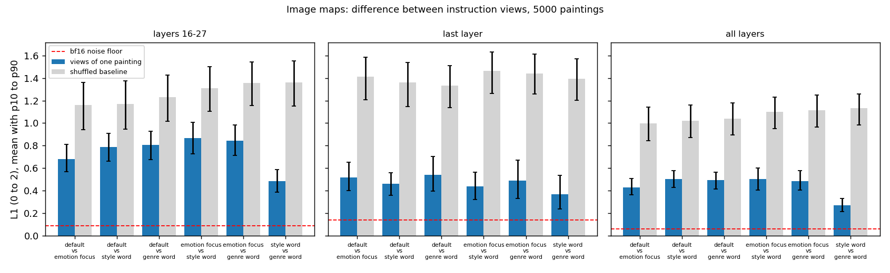
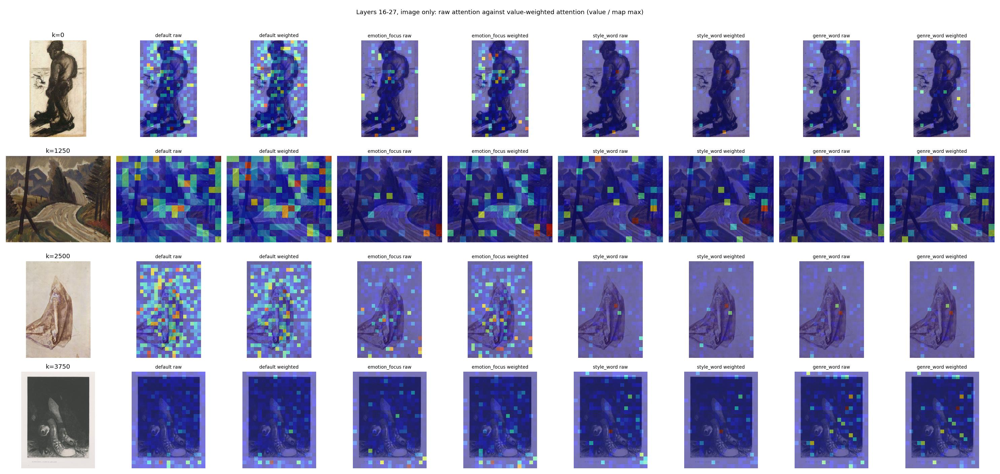
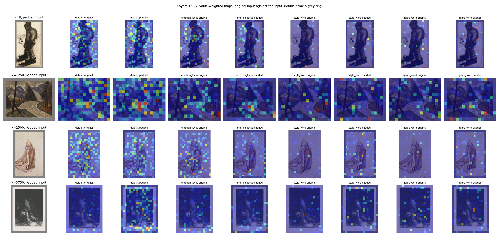

# Each Qwen instruction changes where the model looks; the sharper image focus needs a check

> 2026-10-21 · [Full report](../reports/auto/percept/2026-12-23_attention_maps.md) (its name follows CoSiR's report
> numbering, not the date)

## Summary

- We mapped where Qwen's embedding looks on 5,000 development paintings, under its four instructions.
- Each instruction gives a clearly different image map. Style and genre maps are the most alike.
- With an instruction, the model reads less of the image: about half the share it gives without one.
- On captions, the emotion instruction clearly picks out emotion words. Style and genre do this only in part.
- Instructed image maps put more weight on a few tokens, often on the border. These tokens are scattered, not one region.
- The maps look speckled because the model's attention is speckled. Our checks found no bug (added 2026-10-22).
- The first token is a known "attention sink": it takes about two thirds of the attention but passes on little.
  When we discount it, the results we checked keep their direction (added 2026-10-22).
- The sharper instructed maps stay sharper without the border. A test suggests the emotion view's pull to the
  border comes from the position of the image's edge, not from what the painting shows there (added 2026-10-24).
- A local viewer shows the maps for any painting, instruction and input.

## How we got here

We want one model that finds emotion, style and genre clusters in paintings. Its best signal comes from
Qwen3-VL-Embedding, which gives a different image embedding for each instruction (default, emotion, style, genre).
[Our last ablation](2026-10-21_d2_ablation.md) showed that the graphs built from these instructed embeddings carry most
of our model's gain. In this side step you asked where the instructed model looks, on the image and on the captions.

## Attention maps under the four instructions

**Problem.** We knew that the instructions help, but not what they change inside the model.

**Idea.** Qwen's embedding is the state of its last token, the pooled token. It plays the role of a ViT's class
token. We recorded the pooled token's attention on each image patch and each caption word. We averaged it over the
attention heads and summed it over layers 16 to 27, where the four instructions start to differ.

We first tried rollout, the usual ViT method. On this left-to-right model almost all of its mass goes to the first
token, so you chose the raw attention instead. We ran three inputs: the image alone, each caption alone, and the two
together. The joint input also gives each caption word its own map over the image.

**Did it work.** Yes, as a description. The maps differ far above rounding noise. Attention shows where the model
looks, which is not always what drives the embedding. Development paintings and one model size only.

**Key evidence.** In layers 16 to 27, the image gets 0.22 of the pooled token's attention without an instruction and
0.12 with one. The figure shows how far two instructions' maps are apart (blue bars). The gap is far above rounding
noise (red line) and below a map with the same values at random positions (grey, "shuffled baseline"). Each panel
uses a different set of layers; the bars run from the 10th to the 90th percentile of paintings.

On captions alone, the words with the most weight are:

| Instruction | Top caption words |
|---|---|
| default | horses, statue, beach |
| emotion | bored, anger, lonely |
| style | cartoon, abstract, rainbow |
| genre | portrait, abstract, statue |

The border caveat: in layers 16 to 27 the hottest patch is on the border in 63% of emotion maps, against 29% of
default maps. In the last layer, and over all layers, every map peaks on the border most of the time. Part of this is weight that
passes on little (next paragraphs).

Why the maps look scattered (added 2026-10-22). You saw speckled maps in the viewer and asked whether something was
wrong. Our checks found nothing. A fresh pass gives the same maps up to rounding, and the tokens sit in the right
places: when we paint a square black on six paintings, the tokens that change most are the ones under the square. But
neighbouring tokens get only weakly similar attention, and a plain grey image is speckled too. So the speckle is the
model's own. In the eight examples we looked at, coarse areas such as a frame or the sky still show when the map is
coloured by rank.

Is the first token a problem? (added 2026-10-22). You asked whether its large share is the known attention sink. It
is. In the early layers, that token's inner values are hundreds of times larger than those of other tokens, and what
it passes on is small. Weight on it lets a head do nothing. So we replaced each attention value with the size of what
its token adds to the output (304 paintings, all captions). The image-only and caption-only results keep their
direction, and the maps stay speckled. We did not re-check the image-with-caption input. Fewer maps peak on the
border: the emotion map in 41% of paintings (60% before), the default in 15% (25% before).

Four paintings, layers 16 to 27: each instruction's raw map, then its value-weighted map. The pairs look almost the
same.

Is the border content or position? (added 2026-10-24). You chose a small border check. First, we removed the outer
ring of tokens from every map (5,000 paintings, raw maps, layers 16 to 27). The instructed maps stay more peaked than
the default and nearly as far from it. So these results do not depend on the border. Second, we shrank 304 paintings inside a one-token grey
frame, so the outer ring shows only grey. The emotion map still peaks on that grey ring, even a little more often
(raw maps: 70% of paintings against 60% before; weighted: 54% against 41%), and the painting's own edge does not take over. This
suggests that the emotion view pulls toward the edge of the image grid, whatever the edge shows (one test, 304
paintings). Why it does this is not checked.

Four paintings, layers 16 to 27, value-weighted: each instruction's map on the original painting, then on the
painting inside the grey frame.

> Full report: "Results" and "Analysis".

Our advice (open after giving your reading)

Our view: two results are clear. The instructions move the image map and lower the image's share, and the emotion
instruction moves caption attention to emotion words. The sharper instructed image maps stay sharper without the border,
but what their scattered peaks show is still open. One test suggests the emotion view's border peaks are a pull to the
edge of the image grid. A
paper figure should use value-weighted maps or a gradient method. Otherwise, go back to the main loop.

## Next

The main research loop is at its decision step: choosing the next direction. You gave your reading on 2026-10-24: the
results are very interesting and provide some potential basis for deeper analysis. You chose a small border check, now done. The
viewer now also colours maps by rank and can blur them. On 2026-10-25 you handed four candidate ideas for deeper
analysis to decide 17 (full report, "Candidate ideas for decide 17"). The first asks whether edge tokens carry
image-wide information. The second uses aspect words as a training signal.

The viewer runs at http://localhost:8765/.

## Glossary

- **Pooled token:** Qwen's last token; its state is the embedding.
- **Attention sink:** the first token (`<|im_start|>`), which takes about 60 to 70% of the pooled token's attention
  in every case but passes on little.
- **Value-weighted attention:** for each token, the size of what it adds to the attention output, all heads added
  together (Kobayashi et al. 2020).
- **Instruction (view):** the task text given to Qwen (`default`, `emotion_focus`, `style_word`, `genre_word`).
- **Layers 16 to 27:** the layers we sum over by default; the viewer also offers the last layer and all 28 layers.
- **L1 gap:** the summed absolute difference between two maps, from 0 (same) to 2 (no overlap).
- **Rounding noise:** how much 16-bit arithmetic alone moves a map, against full 32-bit precision.
- **Rollout:** a ViT method that multiplies attention through the layers; it failed here.
