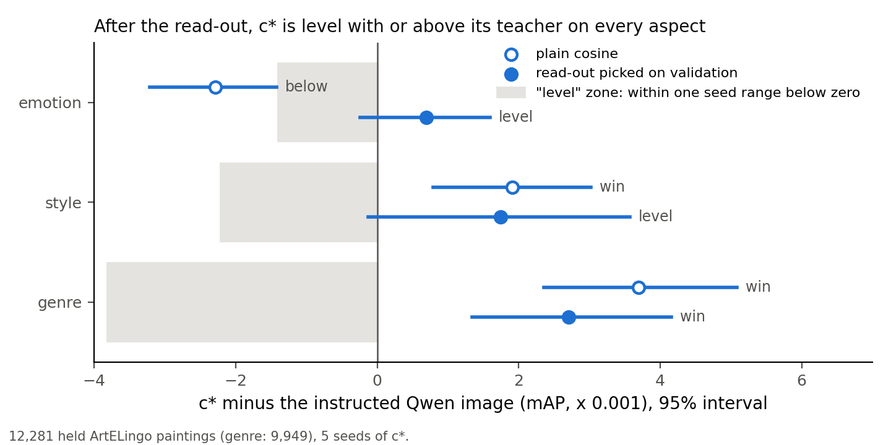

# c* retrieves paintings by a named aspect far better than the plain image, and matches its teacher after a tuned comparison

> 2026-10-29 · [Full report 12-29 (CoSiR numbers its reports in sequence, not by date)](../reports/auto/percept/2026-12-29_retrieval.md) · Previous briefing: [recipe sweep, 2026-10-28](2026-10-28_recipe_sweep.md)

## Summary

- We tested c*, our current model, on a second task beside clustering: find paintings that share an emotion, style or genre.
- c* beats the plain Qwen image on all three aspects by wide margins.
- With plain cosine, c* is narrowly above its teacher on style and genre, and below it on emotion.
- With a comparison method picked on validation paintings, c* is level with its teacher on emotion and style, and above it on genre. This passes the agreed bar.
- Each of c*'s three heads (one output per aspect) retrieves its own aspect best, but the teacher shows the same pattern.
- The results cover one dataset (ArtELingo) and one image encoder (Qwen). An independent re-run of the scoring code agreed on every number.

## How we got here

CoSiR builds one image model that separates aspects such as emotion, style and genre, as an improvement over PercepT.
The CVPR abstract is due on 2026-11-10.
Our model, c*, reads the default image once and gives one output per aspect, called a head.
It learns from its teacher, the Qwen image made with an instruction for each aspect.

On 2026-10-28, c* passed the clustering claims: above the teacher on emotion and style, level on genre.
The paper needs a second task.
This loop (2026-10-29) asks: does the same model also retrieve paintings by a named aspect, at the teacher's level?
Nothing was retrained.

## Retrieval with plain cosine: wide wins over the plain image, emotion below the teacher

**Problem.** c* had clustering results only. Retrieval shows whether its heads also rank single paintings well.

**Idea.** A query is a held painting plus an aspect name. c* uses the head of that aspect.
It ranks the other held paintings by cosine similarity. A painting counts as a hit when it has the query's label for that aspect.
We score the ranking with mAP, mean average precision: how high the hits sit, from 0 to 1.

The bar has two comparators.
The plain Qwen image ignores the aspect name, so it gives one ranking for all aspects.
The instructed Qwen image is c*'s teacher.
c* must beat the plain image on every aspect, and be level with or above the teacher on each.
"Level" means: no win, and the lower end of the 95% interval is less than one seed range below zero.
A seed range is the normal spread of c*'s score between its five training seeds.

**Did it work.** Partly. c* wins over the plain image on every aspect and narrowly over the teacher on style and genre.
On emotion it is below the teacher by more than one seed range, so this untuned table fails the bar.

**Key evidence.** mAP on 12,281 held paintings (genre labels on 9,949), c* averaged over 5 seeds. Chance (the score of a random ranking) is about 0.20 for emotion, 0.08 for style and 0.15 for genre.

| Aspect | c* | Plain Qwen image | Teacher | c* minus teacher | Result |
|---|---|---|---|---|---|
| Emotion | 0.2642 | 0.2424 | 0.2665 | -0.0023 | below |
| Style | 0.3110 | 0.1801 | 0.3091 | +0.0019 | win |
| Genre | 0.5896 | 0.4760 | 0.5860 | +0.0037 | win |

> Full report: Results (stage 1) and Analysis.

## Why emotion falls short: one large class

**Problem.** The emotion loss needed an explanation before any next step.

**Idea.** Split the emotion score by label class, and score emotion a second way.
The second score uses each painting's mix of caption emotions, not only the majority label.
The majority label comes from about five captions per painting, so it is noisy.

**Did it work.** The split explains it. The whole loss sits in contentment, the largest class, with 35% of the queries.
c* is above the teacher on the other eight emotion classes.
The mix-based score puts c* narrowly above the teacher.
The full report calls this check "qualified": it disagrees with the majority-label result, and changes no outcome.
Our reading, not checked: c* follows the mix of caption emotions and misses some exact majority labels.

**Key evidence.** Contentment: c* minus teacher -0.0324. The other eight classes: +0.0027 to +0.0340.

> Full report: Analysis (per-class scores, graded emotion).

## A tuned comparison: c* passes the bar

**Problem.** Plain cosine is only one way to compare saved embeddings.
Retrieval work often subtracts the mean embedding, or adds a query's nearest neighbours to the query.

**Idea.** Every model picks its own comparison method from the same menu, up to 25 options, on validation paintings only.
The full report calls this the read-out. The held paintings are then scored once with each pick.
The picks are frozen before any held score.

**Did it work.** Yes, for the bar. c* now passes every part of it.
Every model except CRL picked the same method: subtract the mean, then add the 10 nearest neighbours.
The caveats:
- The method helped the plain image more than c*, and helped CLIP and SigLIP 2 most.
- Every pick sits at the menu's largest neighbour count, so a larger count may help further.
- c* was picked among about 60 settings on development paintings, and these validation paintings are part of them. So c* may look better on validation than it is. Only the held numbers count as results.
- The held paintings were also scored for clustering in earlier rounds.
- The claim covers ArtELingo, Qwen features and painting-plus-aspect queries only.

**Key evidence.** Against the teacher, emotion goes from below to level, style from win to level, and genre stays a win.
Against the plain image, c* gains +0.0208 (emotion), +0.1311 (style) and +0.0790 (genre).

*Each line is a 95% interval over query paintings and c*'s seeds. The grey zone counts as level; its width is one seed range of that aspect.*

Other models, with their own picks (described only, no test):

| Model | Emotion | Style | Genre |
|---|---|---|---|
| c* | 0.2691 | 0.3235 | 0.6151 |
| Teacher (instructed Qwen image) | 0.2684 | 0.3217 | 0.6124 |
| Our re-implementation of CRL | 0.2554 | 0.2816 | 0.5033 |
| Plain Qwen image | 0.2483 | 0.1924 | 0.5361 |
| CLIP L/14 | 0.2479 | 0.2732 | 0.4981 |
| SigLIP 2 | 0.2443 | 0.2576 | 0.4968 |
| PercepT core | 0.2483 | 0.1523 | 0.5049 |

CRL is a published method that compares CLIP images through a written list of the aspect's values.
Its lists here include some label names, a hint that helps it.

> Full report: Results (stages 4 and 5) and Analysis.

## The switch test: each head retrieves its own aspect best

**Problem.** Three heads could, in theory, all give the same ranking.

**Idea.** Rank with one head and score with another aspect's labels.
In each label column, the head of that aspect should beat c*'s other two heads.

**Did it work.** Yes, in all three columns, by 0.0103 to 0.2304 mAP. The test passes.
Caveat: the teacher and CRL show the same pattern. So this shows that c* keeps the teacher's separation of aspects in one model.

**Key evidence.** c*'s heads, plain cosine (rows: head used; columns: labels scored).

| Head | Emotion labels | Style labels | Genre labels |
|---|---|---|---|
| Emotion | **0.2642** | 0.1529 | 0.4520 |
| Style | 0.2487 | **0.3110** | 0.3593 |
| Genre | 0.2539 | 0.2167 | **0.5896** |

> Full report: Results (stage 2) and Analysis.

## Our advice

Our advice (open after giving your reading)

**Our view.** The planned retrieval claim holds on ArtELingo with Qwen features, but against the teacher it is a match, not a win.
The large margins are over the plain image. We trust those and the switch test most.
"Level with the teacher" is less firm: on emotion and style the interval's lower end sits just below zero.
On emotion it also needs the tuned comparison. The paper should show the plain cosine table beside it.

**What we recommend.**
1. Go on to the next loop as planned: three more art and emotion datasets (Affection, Impressions, PolyArt), c* frozen, clustering and this retrieval test.
2. Keep any retraining for retrieval until after the recipe freezes on 2026-11-10.
3. Claim the switch test as one supporting sentence, and say that the teacher shows the same pattern.
4. Add CRL to the bar in the next spec: one held comparison, minutes of CPU, named as our re-implementation.

## Next

The retrieval round is done and passes its bar with the tuned comparison. Nothing is running.
The next loop starts with your reading of these results. Then you choose the direction:

1. More work on the comparison method: a larger menu, picked on validation again; about an hour of CPU.
2. Retrain c* for emotion retrieval: days on the cluster, new clustering tests, and it collides with the 2026-11-10 freeze.
3. The next loop as planned: the three new datasets, with c* frozen.

Two more decisions are yours:
- Does the paper claim the switch test?
- Does CRL enter the bar, now that its number exists?

## Glossary

| Term | Meaning | Name in the full report |
|---|---|---|
| c* | our current model: one network with an emotion, a style and a genre head | c* (model G with 40 graph neighbours) |
| head | the model's output for one aspect | head |
| teacher | the Qwen image made with an instruction for the aspect | instructed Qwen image |
| plain Qwen image | the Qwen image with no instruction | plain Qwen |
| mAP | mean average precision: how high the same-label paintings sit in a ranking, 0 to 1 | mAP |
| seed range | the spread of c*'s validation mAP over its 5 training seeds; the unit for "level" | retrieval seed range, r |
| level | no win, and the interval's lower end less than one seed range below zero | LEVEL |
| comparison method | how saved embeddings are compared at retrieval time | read-out |
| held paintings | 12,281 test paintings; in this round scored only, never used for a choice | held |
| validation paintings | 6,152 paintings used for choices | validation |
| CRL | a NeurIPS 2025 method that compares CLIP images through a list of the aspect's values; here our re-implementation | CRL |
| PercepT core | our re-implementation of PercepT, the method CoSiR aims to improve | PercepT core |
