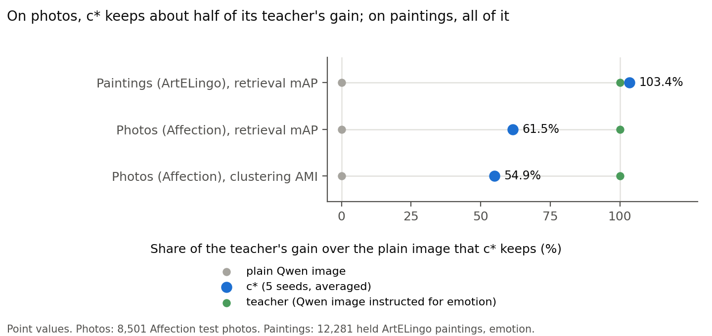

# On photos, frozen c* is above the plain image but below its teacher, so the test fails; on paintings it beats CRL

> 2026-10-31 · [Full report 12-31 (CoSiR numbers its reports in sequence, not by date)](../reports/auto/percept/2026-12-31_affection_confirmation.md) · Previous briefing: [retrieval, 2026-10-29](2026-10-29_retrieval.md)

## Summary

- c*, our current model with outputs called heads, transfers only partly from paintings to Affection, a photo dataset with emotion labels.
- c* beats the plain Qwen image, the image embedding without an instruction, in both photo tasks.
- c* falls below its teacher, the Qwen image embedding instructed for emotion, in both tasks; so the test fails its bar.
- c* beats our re-implementation of CRL, a method that compares images through written aspect values, on ArtELingo paintings. We set that bar after earlier scores were seen.
- c* is level with CRL on photos; the bar asked for a win, so this supports no claim.
- The gap to the teacher holds without tied labels, per photo source and with plain cosine.

## How we got here

c* passed clustering on ArtELingo, the painting dataset, in the report of 2026-10-28.
It passed retrieval on 2026-10-29.
This loop (2026-10-30 to 2026-10-31) asks whether frozen c* holds on new data: Affection photos with emotion labels.
It also adds a bar against CRL.
The CVPR abstract is due on 2026-11-10, when c* freezes.

## Photos: c* is above the plain image and below its teacher

**Problem.** Painting results did not establish whether c* would hold on photos.

**Idea.** We used c* as it is, with heads trained on paintings only and no retraining.
Each head gives an output for one aspect, such as emotion.
We tested emotion clustering with AMI, adjusted mutual information: agreement between clusters and emotion labels, adjusted for chance.
We used 20 clusters.
We tested emotion retrieval with mAP, mean average precision: how high images with the same label sit in a ranking.
A comparison method is how saved embeddings are compared, for example: subtract the mean, then add a query's 10 nearest neighbours.
Each model picked its comparison method on validation photos, which serve only for choices.
The teacher's emotion instruction says "artwork"; a version that says "photo" lost on validation in both tasks.

The bar required a win over the plain Qwen image in both tasks.
It also required c* to be level with or above the teacher in both tasks.
A win means the difference's 95% interval lies above zero.
A seed range is c*'s highest minus lowest validation score across its five training seeds.
"Level" means no win, with the interval's lower end less than one seed range below zero.
"Below" means the lower end reaches at least one seed range below zero.

**Did it work.** No. Both comparisons with the plain image win, but both comparisons with the teacher are below.
The teacher gaps are about eight seed ranges for AMI and nineteen for mAP.
The ArtELingo clustering win over the teacher does not repeat.
We expected wins over the plain image and level or below against the teacher, because c*'s heads never saw a photo.
These results fit that expectation.
This result covers one photo dataset, emotion only, and Qwen3-VL-Embedding-2B features only.

**Key evidence.** We scored 8,501 test photos, reserved for evaluation, with c* averaged over 5 seeds.
Chance mAP is about 0.19.

| Task | c* | Plain Qwen image | Teacher | Result vs plain | Result vs teacher |
|---|---|---|---|---|---|
| Emotion clustering, AMI | 0.1384 | 0.1041 | 0.1666 | win | below |
| Emotion retrieval, picked mAP | 0.2755 | 0.2452 | 0.2945 | win | below |

*Point values: c* keeps 54.9% of the teacher's gain over the plain image for photo AMI, 61.5% for photo mAP, and 103.4% for painting retrieval.*

> Full report: Results and Analysis (teacher gain retained).

## Where the gap sits

The diagnostics decide nothing; the order stays teacher > c* > plain Qwen image.

**Problem.** Tied labels, photo sources or the comparison method could affect the teacher gap.

**Idea.** We checked photos without tied labels, each photo source, plain cosine similarity and each emotion class.

**Did it work.** The untied-photo, source and plain-cosine checks keep the order: teacher > c* > plain Qwen image.
Each photo's label is the most common emotion of its annotations. For 22.6% of the test photos this is a tie, broken alphabetically.
On the 6,584 untied photos, every outcome stays the same.
Affection merges five photo sources. We grouped the queries by source; all of them search the same test gallery.
c* minus teacher is largest for two sources, FI (-0.0360 mAP) and Emotional Machines (-0.0249); the other three are at about -0.011.
Weighted by the number of queries, sadness, contentment and excitement carry most of the loss.
c* is above the teacher on amusement, awe and disgust.

Our reading, **not checked**: painting-only head training could explain the gap.
This run did not test that explanation.

**Key evidence.** AP, average precision, scores a query's ranking; each row averages AP within one emotion class.

| Emotion class | c* AP | Teacher AP | Difference |
|---|---|---|---|
| Sadness | 0.1822 | 0.2872 | -0.1050 |
| Excitement | 0.2656 | 0.2989 | -0.0333 |
| Contentment | 0.3454 | 0.3784 | -0.0330 |
| Amusement | 0.2845 | 0.2732 | +0.0113 |
| Awe | 0.2826 | 0.2785 | +0.0042 |
| Disgust | 0.1985 | 0.1975 | +0.0010 |

> Full report: Analysis (untied photos, sources, per-class scores and plain cosine).

## The CRL bar: c* beats CRL on paintings, level on photos

**Problem.** The previous loop described CRL scores without a claim bar.

**Idea.** CRL compares CLIP images through a written list of an aspect's values; here we use our re-implementation.
Its CLIP L/14 painting version beat its Qwen and photo versions on validation and became the comparator.
The bar required c* to win on each aspect.

**Did it work.** c* wins on emotion, style and genre on 12,281 held ArtELingo paintings; genre labels cover 9,949.
Caveat: we set this bar after the previous loop's held CRL scores were seen.
c* already led by about 10 to 30 seed ranges there.
Only the Qwen version of CRL is new; the c* and CLIP CRL scores repeat the previous loop's.
On photos, c* is level with CRL; this fails the win bar and supports no claim.

**Key evidence.** Retrieval mAP, with each model's comparison method picked on validation.

| Dataset | Aspect | c* | CRL | Result |
|---|---|---|---|---|
| ArtELingo | Emotion | 0.2691 | 0.2554 | win |
| ArtELingo | Style | 0.3235 | 0.2816 | win |
| ArtELingo | Genre | 0.6151 | 0.5033 | win |
| Affection | Emotion | 0.2755 | 0.2739 | level: +0.0016, 95% interval [-0.0001, +0.0032] |

> Full report: Results (CRL bars and selection disclosure); What ran (CRL selection).

## Impressions

Impressions, a third dataset without class labels, gave only an example-retrieval figure; it supports no claim.

> Full report: Analysis (Impressions figure).

## Our advice

Our advice (open after giving your reading)

**Our view.** c* transfers only in part. On photos it keeps about half of the teacher's gain; on paintings, all of it.
The teacher gap is wide and holds without tied labels, per photo source and with plain cosine.
Our confidence is high: an independent re-computation of every number agreed, and the gaps are many seed ranges wide.
Painting-only head training could explain the gap; this run did not test it.

**What we recommend** (the options are under "Next"):
1. Now, for the abstract: keep c* frozen and report Affection as a transfer result (option 2).
2. After the freeze: make photo training (option 1) the first question of the next loop. Before the freeze it would change c*.
3. When the PolyArt link arrives: test frozen c* there (option 3).

## Next

The round is done. Nothing is running.
The next loop starts with your own reading of these results, then your choice of direction:

1. Train c* on photos too. Extract the teacher's emotion features for 72,255 training photos: about one local GPU hour. Then build the graphs, retrain c* on the cluster and repeat this evaluation. This medium loop tests whether painting-only head training explains the gap. Before the freeze it changes c*.
2. Keep c* frozen and report Affection as transfer: above the plain image, below the teacher. Claim the ArtELingo CRL bar, with the note that it was set after earlier scores were seen. Cost: no compute.
3. Test frozen c* on PolyArt, a second painting dataset, when its link arrives. Cost: about three hours once the data is in. This asks whether the gap comes from photos or from any new dataset.

PolyArt waits for your link.

## Glossary

| Term | Meaning | Name in the full report |
|---|---|---|
| c* | current model, with heads trained on paintings | c* |
| head | model output for one aspect, such as emotion | head |
| teacher | Qwen image embedding made with an aspect instruction | instructed Qwen image; teacher |
| plain Qwen image | Qwen image embedding without an instruction | plain Qwen |
| AMI | adjusted mutual information: cluster-label agreement adjusted for chance | AMI |
| mAP | mean average precision: how high same-label images rank | mAP |
| seed range | highest minus lowest c* validation score across model seeds | r |
| level / below | no win: lower interval end above minus one seed range / at or below it | LEVEL / BELOW |
| comparison method | how saved embeddings are compared for retrieval | read-out |
| validation photos | photos used to choose comparison methods, wording and CRL version | validation |
| test photos | photos reserved for final evaluation | Affection test |
| CRL | method that compares images through written aspect values; our re-implementation | CRL; crl_clip_painting |
| Affection | photo dataset with emotion labels | Affection |
| ArtELingo | painting dataset used for training and earlier tests | ArtELingo |
