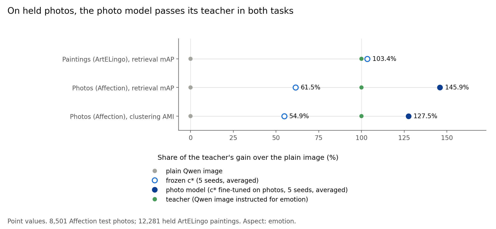

# Fine-tuned on photos, c* moves above its teacher on Affection; the claim test holds

> 2026-11-01 · [Full report](../reports/auto/percept/2027-01-01_photo_finetune.md)

## Summary

- We fine-tuned c*, our network trained on paintings, on Affection photos and their free-text explanations, without emotion labels.
- On 8,501 held test photos, the photo model is above the plain Qwen image and above its teacher in both tasks: a WIN in each.
- The rule's verdict is “holds”. The licensed claim says “level with or better than” the teacher.
- The separate comparison with CRL, an earlier method that we re-implemented, also passes.
- We decided to train on photos after the previous round's test result on these same held photos; the full report says so beside the claim.
- The result covers emotion on Affection only; the photo model is a separate model from the painting model.

## How we got here

The project builds an image-text model that finds aspects of images, such as emotion, style and genre, without aspect labels.
It aims to improve on PercepT, a published method for the same task.
c* is our network trained on ArtELingo paintings.
Affection is a photo dataset with emotion labels and free-text explanations, from five photo sources.
The previous round tested frozen c* on held Affection photos, which no training or choice had used.
It beat the plain Qwen image: the Qwen3-VL embedding of the image, with no instruction.
It fell below its teacher: the same embedding, instructed to focus on emotion.
That failed the rule, which required at least “level” with the teacher in both tasks.
You do not accept a student model below its teacher.

This round asks whether photo training can close that gap.
We fine-tuned c* on Affection's train photos and their free-text explanations, without emotion labels.
We call the result the photo model.

## Photo explanations close the teacher gap

**Problem.** Frozen c* fell below its teacher on emotion clustering and retrieval.
It had been trained on paintings only.

**Idea.** We trained the emotion pathway from c*'s weights, with the backbone features fixed.
This pathway has an image side and an explanation side.
Explanation graphs link photos whose explanations agree, so the model can learn from text without emotion labels.
The graphs include a correction for image content.
The teacher term uses the instructed image features as a training target.

We filtered train photos that were near-copies of validation or test photos, with their explanations.
After this filter, training used 69,927 photos.
A sweep on validation photos compared nine training settings.
It picked the graph with 80 neighbours per photo, instead of 40.

We then trained five fresh seeds, separate from the sweep run.
Validation also chose the read-out, the method that compares saved embeddings for retrieval.
The chosen read-out subtracts the validation mean and adds information from each query's ten nearest neighbours.
All settings, seed ranges and the read-out froze before the test.

We tested emotion clustering with AMI, cluster agreement with emotion labels adjusted for chance.
We tested retrieval with mAP, which measures how high photos with the same emotion label rank.
The rule required wins over the plain image and at least “level” with the teacher in both tasks.
The separate CRL comparison required a retrieval win over our re-implementation of that method.

**Did it work.** Yes. The rule's verdict is **“holds”**.
The photo model wins over both the plain image and the teacher in both tasks.
It also passes the CRL retrieval bar.
The approved claim says “level with or better than” the teacher.

This result has limits:

- We decided to train on photos after the previous round's test result on these same held photos.
- This round's test is a claim test: a new held test whose result is meant for the paper.
  The previous round's failed result stays failed.
- The sweep and the read-out were picked on validation photos, so validation numbers are inflated by that choice.
  Only the test numbers count as results.
- The result covers one photo dataset, emotion only, with the Qwen backbone.
- The exact sweep pick is close to noise: the same setting trained on GPU and on CPU gives slightly different scores.
  Its lead over the next setting is less than half the photo model's validation seed range.
- The photo model is separate from the painting model and was not tested on paintings.
  This result supports no claim for one model across paintings and photos, or transfer without photo training.

**Key evidence.** Photo training takes the model from below the teacher to above it in both tasks.
The figure shows each model's gain over the plain image as a share of the teacher's gain.

*Point values averaged over five seeds; the painting result belongs to frozen c*, and the photo model was not tested on paintings.*

| Task on held photos | Photo model | Teacher | Photo minus teacher, 95% interval |
|---|---|---|---|
| Emotion clustering, AMI | 0.1838 | 0.1666 | +0.0172 [+0.0121, +0.0225] |
| Emotion retrieval, mAP | 0.3172 | 0.2945 | +0.0227 [+0.0210, +0.0244] |

Both intervals stay above zero, so both comparisons count as wins.

> [Full report: Results](../reports/auto/percept/2027-01-01_photo_finetune.md#results), including the licensed claim and selection disclosure; figure values: Analysis.

## Our advice

Our advice (open after giving your reading)

**Our view.** Freeze this photo result and write before the abstract deadline.
Photo training reverses the teacher gap in both tasks, in each of Affection's five photo sources and with tied emotion labels dropped.
Our confidence in this is high; the GPU and CPU difference lowers our confidence only in the exact sweep pick.
Keep c* for paintings and leave the large sweep until after the freeze.

## Next

The claim test is complete and the result holds.
The next loop starts with the decide chat: you give your reading of these results and pick the direction.
The full report gives these options:

1. Freeze this result and write. This needs writing time and no new compute, and fixes the claim for the submissions.
2. Run the large sweep after the freeze. A new compute budget could test sensitivity to the training recipe and validation pick.
3. Test a second photo dataset. Data preparation and a new protocol budget could test reach beyond Affection.

The abstract deadline is 2026-11-10.
The paper deadline is 2026-11-16.

## Glossary

| Term | Meaning | Name in the full report |
|---|---|---|
| c* | Our network trained on ArtELingo paintings | c*; frozen c* |
| Photo model | c*'s emotion pathway fine-tuned on Affection photos and explanations without emotion labels | photo model |
| Teacher | Qwen image embedding instructed for emotion (its wording picked in the previous round) | teacher; instructed Qwen image |
| Plain Qwen image | Image embedding without an aspect instruction | plain Qwen image; Qwen3-VL-Embedding-2B |
| CRL | Our re-implementation of the retrieval comparator, using CLIP L/14 picked on validation | CRL, CLIP L/14, painting |
| AMI | Adjusted mutual information, cluster agreement with labels adjusted for chance | AMI |
| mAP | Mean average precision, how high photos with the same emotion label rank | mAP |
| Read-out | Method that compares saved embeddings for retrieval | read-out |
| Seed range | Highest minus lowest validation score across the photo model's five seeds | r' |
| WIN / LEVEL / BELOW | WIN: interval lower bound above zero. Otherwise LEVEL: above minus one seed range. Otherwise BELOW. | WIN / LEVEL / BELOW |
| Claim test | A new held test whose result is meant for the paper; it cannot rescue an earlier failed result | claim test |
| Held photos | Test photos that no training or choice used | Affection test, held |
