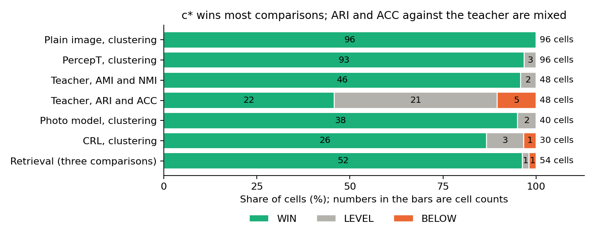

# c* beats plain images across standard metrics; teacher claims depend on the metric

> 2026-11-04 · [Full report](../reports/auto/percept/2027-01-04_new_scores.md)

## Summary

* c*, our small model on a frozen image encoder, beats the plain image across the standard cluster metrics at the class count.
* Against its teacher, c* does better in AMI and NMI than in ARI and ACC.
* c* beats PercepT’s topic probabilities in retrieval and usually beats the plain image when the query names no aspect.
* Against CRL, an outside method, retrieval and AMI support claims on the same encoder; some ARI and ACC comparisons do not.
* Each metric result (a cell) is its own claim: 398 of 412 cells give a claim, with no overall verdict.

## How we got here

We build c*, a small network on a frozen image encoder.
It has one head, a small output layer, each for emotion, style and genre.
We trained it on ArtELingo paintings, and at test it needs only the image.
Four names recur in this report:

* **Plain image:** the encoder's own image embedding, with nothing on top.
* **Teacher:** the Qwen image embedding instructed for one aspect. c* learned from it during training.
* **PercepT:** the published method we improve on. It gives each image topic probabilities.
* **CRL:** an outside method. A language model writes texts for an aspect, and CLIP embeddings are projected onto them.

We test on two painting sets and two photo sets:

* **Paintings:** ArtELingo held paintings and MMArt test paintings.
* **Photos:** Affection and EmoSet test photos, for emotion only. Here we use the photo model, which is c* fine-tuned on unlabeled Affection train photos.

Earlier claims used one number per task: AMI at 20 clusters and mAP for retrieval.
Readers expect the standard metrics and more comparators.
All inputs were saved, so this round only scored them, with no training or GPU work.
The paper deadlines are the abstract on 2026-11-10 and the paper on 2026-11-16.

## Standard metrics narrow the teacher claims

**Problem.** AMI at a fixed cluster count cannot support claims across standard metrics.

**Idea.** We set the cluster count to the number of labelled classes and score AMI, NMI, ARI and ACC.
Each metric compares c* with the plain image, PercepT and teacher.
PercepT uses its k means result at this count.
This is an easier comparison than our earlier test, which took the larger of its own topics and k means.

Each metric result, on one encoder, set and aspect, is a cell. Each cell is its own claim, with no overall verdict.
The rule reads c* minus its comparator through the 95% interval. Here r is the cell's seed range:

* **WIN:** the whole interval is above zero.
* **LEVEL:** not a WIN, and the lower end stays above minus r.
* **BELOW:** the lower end is at or under minus r.

A seed range is the highest minus the lowest validation score across model seeds.
Its size varies by encoder and metric.

A bar is the outcome that a cell must reach to give its claim.
The plain image, PercepT and CRL need a WIN, so a LEVEL there gives no claim.
Teacher cells can also claim at LEVEL, with the words "level with or better than".
A teacher BELOW gives no claim.
So the 398 claims are not all "better than".
The 14 cells with no claim are 7 LEVEL cells against PercepT, CRL or the plain image, and all 7 BELOW cells.

**Did it work.** Yes against plain images; partly against PercepT and the teacher.
All plain image cells WIN.
PercepT has exceptions in emotion ACC.
All teacher BELOW cells are emotion ARI or ACC.
MMArt shares most artists with the training paintings, so these cells do not test new artists.

LEVEL does not mean “no difference”: 8 LEVEL cells have intervals wholly below zero because their seed range is large.
BELOW does not always mean a clear loss: 2 BELOW cells have intervals that reach zero.
The small set of seeds limits how firmly we should read these words.

**Key evidence.** Outcomes by comparison, with cell counts:

*The metric matters most against the teacher; plain image comparisons WIN across the standard metrics.*

WIN cells at the class count, on paintings:

|Metric|Plain image|PercepT|Teacher|
|---|---:|---:|---:|
|AMI|24 of 24|24 of 24|23 of 24|
|NMI|24 of 24|24 of 24|23 of 24|
|ARI|24 of 24|24 of 24|11 of 24|
|ACC|24 of 24|21 of 24|11 of 24|

There is no multiplicity correction over 412 cells, so the paper cites groups of cells rather than isolated near ties.
Independent recomputation matched every cell.

> [Full report: Results and the teacher analysis](../reports/auto/percept/2027-01-04_new_scores.md#results)

## c* beats CRL in retrieval and AMI on the same encoder

**Problem.** We lacked the full CRL comparison on c*'s encoder.

**Idea.** We compare c* and CRL on CLIP L/14, on both painting sets.
We keep AMI at 20 clusters and add the standard metrics at the class count.
For retrieval, each method keeps the read-out, the way to compare embeddings, that it picked on validation data.
Each cell needs a WIN to give a claim against CRL.

We saw some test values before we set these bars, so those cells are weaker evidence:

* AMI at 20 clusters and mAP of the main methods.
* Class-count AMI on MMArt and EmoSet.
* CRL and c* retrieval on ArtELingo with CLIP L/14, and PercepT retrieval on Qwen on ArtELingo.

CRL has no saved cluster results to check against. Only this run and the independent recomputation support its clustering numbers.

**Did it work.** Yes for AMI, NMI and retrieval; partly for ARI and ACC.
The missed bars are ArtELingo emotion ARI, emotion ACC on both sets, and MMArt style ACC.

**Key evidence.** Claims against CRL on the same encoder:

|Task or metric|Claims of all cells|
|---|---:|
|AMI, 20 clusters and class count|12 of 12|
|NMI, class count|6 of 6|
|ARI, class count|5 of 6|
|ACC, class count|3 of 6|
|Retrieval|6 of 6|

On MMArt style the class count is 20, so one pair in the AMI row is the same measurement.

> [Full report: Analysis, “Against CRL on the same encoder”](../reports/auto/percept/2027-01-04_new_scores.md#analysis)

## c* beats PercepT in retrieval; untold queries score below told queries

**Problem.** We lacked PercepT retrieval comparisons and a test where the query names no aspect.

**Idea.** We compare c*'s aspect head with PercepT's topic probabilities in retrieval.
Both use the read-out that they picked on validation data.

We also join c*'s heads into one vector, so the query need not name an aspect.
This is “untold” retrieval; the aspect head gives “told” retrieval.
The untold claim is against the plain image.
Told beside untold shows what c* loses without the aspect.
That comparison is a diagnostic with no claim.

**Did it work.** All comparisons with PercepT WIN.
Untold retrieval usually beats the plain image.
ArtELingo SigLIP 1 style is BELOW; ArtELingo Qwen genre is LEVEL.
Untold mAP is lower than told mAP in every comparison.

**Key evidence.** Retrieval and the cost without an aspect:

|Comparison|WIN of all cells|
|---|---:|
|Told c* against PercepT|24 of 24|
|Untold c* against plain image|22 of 24|

|Aspect|Told mAP minus untold mAP|
|---|---:|
|Emotion|0.0037 to 0.0088|
|Style|0.0513 to 0.0757|
|Genre|0.0732 to 0.0908|

> [Full report: Analysis, “Against PercepT” and “Untold retrieval”](../reports/auto/percept/2027-01-04_new_scores.md#analysis)

## Cluster counts and individual emotions show the limits

**Problem.** A fixed count hides variation across counts and emotions.

**Idea.** We sweep other cluster counts and record mean scores with their seed spreads.
These point values describe the pattern; they give no claims at those other counts.
A smaller score is called a “lower point value”, without an outcome word.

We also compare c* with the teacher through AP for each emotion class.
We show it with the class sizes, because ACC and ARI weigh large classes.
Per class AP does not establish a cause for clustering differences.

**Did it work.** Both diagnostics ran in full.
Contentment, an emotion class, has lower AP than the teacher on every encoder and both painting sets.
Its intervals are below zero throughout.

**Key evidence.** At counts other than the class count. One comparison is one encoder, set, aspect, count and metric (AMI or ARI):

|Comparator|Lower point values of all comparisons|
|---|---:|
|Plain image|0 of 200|
|PercepT|0 of 160|
|Teacher|45 of 200|
|CRL|9 of 160|

All lower point values against CRL are ArtELingo ARI, mostly emotion at small counts.
The CRL row compares c* on each encoder with CRL on CLIP L/14; on the same encoder it is 3 of 40. It gives no claim.
Contentment is a large class, but we did not test whether it explains the ARI or ACC gaps.

> [Full report: Analysis, “Count sweep” and “Emotion per class”](../reports/auto/percept/2027-01-04_new_scores.md#analysis)

## Our advice

Our advice (open after giving your reading)

**Our view.** Put these results into the paper tables now.
Write teacher claims by metric: “better than” where the cell is a WIN, and “level with or better than” where a LEVEL cell allows it.
Avoid a teacher claim across all standard metrics.
Cite groups of cells rather than isolated near ties.
Add intervals at other cluster counts only if the paper needs claims across counts.

## Next

This round is complete. Two other experiment rounds, on outside methods and on more encoders, are still running.
You decide what these results mean and which option to take.

* Put the cells into the paper tables now. This needs no compute and gives the claims their standard metrics.
* Add intervals at other cluster counts, with a new decision rule. This could turn sweep point values into claims across counts.
* Go on with the planned figure, head variants or text queries. Head variants could show whether another head closes the emotion gap to the teacher.

Costs from the report:

|Option|Cost|
|---|---|
|Intervals across counts|About 8 hours in one CPU queue slot, our estimate|
|Qualitative figure|CPU minutes and design work|
|Head variants|About 2 GPU hours|
|Text queries|Under 1 GPU hour|

## Glossary

|Term in the full report|Meaning here|
|---|---|
|Aspect|Emotion, style or genre.|
|c*|Our small model on a frozen image encoder, with one head per aspect.|
|Plain image|The encoder's image embedding before the aspect heads.|
|Teacher|The Qwen image embedding instructed for an aspect.|
|PercepT|The published method we improve on; it gives topic probabilities.|
|CRL|An outside method: CLIP embeddings projected onto texts from a language model. Run here on CLIP L/14.|
|Class count|The number of labelled classes.|
|AMI, NMI, ARI, ACC|The standard cluster metrics.|
|mAP; AP|The retrieval score overall; its per class counterpart.|
|Seed range|Highest minus lowest validation score across model seeds.|
|Told; untold|Use the aspect head; join heads without an aspect.|
|Cell|One metric result on one encoder, set and aspect; it is its own claim.|
|Bar|The outcome a cell must reach to give its claim.|
|Read-out|The way to compare embeddings, picked on validation data.|
|Photo model|c* fine-tuned on unlabeled Affection train photos.|
