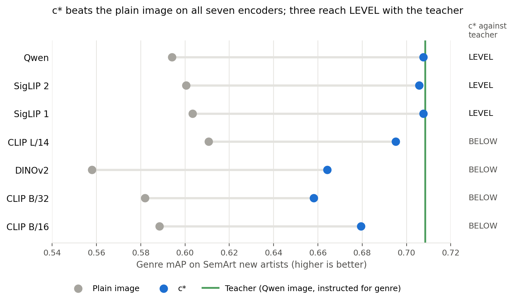

# c* holds on new encoders, new artists and cost; the teacher stays ahead in most new-encoder cells

> 2026-11-04 · [Full report](../reports/auto/percept/2027-01-05_past_picks.md)

## Summary

* We tested c*, our student network, on three questions that reviewers will ask. We changed no setting, and all 23 pass-or-fail verdicts hold.
* On three new encoders, c* beats the encoder's plain image on every test set, and PercepT, a published method, wherever we compare it.
* c* also beats both on artists with no painting in ArtELingo's train set, matched by name. This covers genre only.
* On one RTX 3090, one c* pass takes less model time than the three passes of the teacher, the model that c* learned from. This holds on all seven encoders.
* The teacher is the exception: no cell gives "better than", and the new encoders sit below it in most cells.
* A teacher that encodes the image once would shrink the cost saving. We have arithmetic for this, not a measurement.

## How we got here

We want an image model that separates paintings by emotion, style and genre. We call each of these an aspect.

c*, our student network, is a small network on a frozen image encoder.
It has one small head for each aspect.
We train it on ArtELingo paintings, and at test it needs only the image.
The recipe is our fixed way to train it.

Earlier tests covered four encoders: Qwen, SigLIP 2, SigLIP 1 and CLIP L/14.
Reviewers will ask three questions that those picks leave open:

1. Does c* hold on DINOv2, CLIP B/32 and CLIP B/16, the three encoders that failed or were unclear with an older model?
2. Does c* hold on artists with no painting in ArtELingo's train set, matched by name?
3. Is c*'s one encoder pass cheaper than the teacher's three passes?

Three names recur in this report:

* **Plain image:** the encoder's own embedding, with nothing on top.
* **Teacher:** the Qwen image embedding under a text instruction for one aspect. c* learned from it during training.
* **PercepT:** the published method we improve on. Here it runs on the same encoder as c*.

A cell is one metric result on one encoder, set and aspect.
AMI scores clustering, and mAP scores retrieval.
A cell is a WIN when the 95% interval of c* minus its comparator is wholly above zero.
A verdict is the pass or fail of one encoder on one set, or of its cost test.

## c* holds on the three new encoders

**Problem.** DINOv2, CLIP B/32 and CLIP B/16 failed or were unclear in an earlier emotion test with an older version of our model.
We did not know whether the current recipe would hold on them.

**Idea.** We train c* on each new encoder and change no setting.
This makes the test a fair one, since nothing is tuned for an encoder.
We read validation data for every choice, and we saved those records before any test number.
We use five model seeds on each test set:

* **ArtELingo held paintings,** kept out of training: 12,281 paintings, for emotion, style and genre.
* **MMArt test paintings:** 16,384 paintings, for emotion, style and genre.
* **Affection test photos:** 8,501 photos, for emotion only. Here we use the photo model, which is c* fine-tuned on Affection's unlabeled train photos.

Every cell must be a WIN for a verdict to hold, and one set never makes up for another.
Each verdict compares c* with the plain image on AMI and mAP, and with PercepT on AMI.
Affection has no PercepT cell.

**Did it work.** Yes. All nine verdicts hold: three encoders on three sets.
We thought that a PercepT miss was most likely on DINOv2, and none came.
Beside the older model, c* is above in all nine ArtELingo held AMI cells.
That comparison is descriptive, and DINOv2's older row is a smaller, sample-scale run.

**Key evidence.** The smallest difference per set and comparator is still a WIN. All five are emotion cells.

|Set|Comparator|Smallest difference|Cell|
|---|---|---:|---|
|ArtELingo held|Plain image|+0.0120|CLIP B/32, mAP|
|ArtELingo held|PercepT|+0.0131|DINOv2, AMI|
|Affection test|Plain image|+0.0522|CLIP B/32, mAP|
|MMArt test|Plain image|+0.0049|DINOv2, mAP|
|MMArt test|PercepT|+0.0073|DINOv2, AMI|

The difference is c* minus the comparator. AMI and mAP have different scales.

> [Full report: Results, the verdict table and the tightest cells](../reports/auto/percept/2027-01-05_past_picks.md#results)

## The teacher stays ahead in most new-encoder cells

**Problem.** A WIN against the plain image and PercepT says nothing about the teacher.
c* learned from the teacher, so we read the teacher cells apart.

**Idea.** We score each of the 56 teacher cells on its own. Here r is the cell's seed range, the highest minus the lowest validation score across model seeds:

* **WIN:** the whole interval is above zero.
* **LEVEL:** not a WIN, and the lower end stays above minus r.
* **BELOW:** the lower end is at or under minus r.

A LEVEL cell gives the words "level with or better than", and a BELOW cell gives no claim.
"Better than" needs a WIN in a cell that was set for it.
Only the SemArt genre mAP cells of the earlier four encoders were set for it.
A WIN anywhere else gives only "level with or better than".

**Did it work.** Partly. No cell gives "better than". 15 cells give "level with or better than", and 41 give no claim.

* The new encoders sit below the teacher in most cells, and DINOv2 sits below in all 16.
* On SemArt the earlier four encoders are LEVEL in 7 of 8 cells. CLIP L/14 genre mAP is BELOW.
* Four cells are WINs, all for emotion on CLIP B/32 or CLIP B/16. None was set for "better than".
* These tests do not show why the gap to the teacher depends on the encoder.

We apply no correction for the number of cells. Two caveats change how to read these words:

* SigLIP 2 genre mAP and CLIP L/14 genre AMI on SemArt are LEVEL with their whole interval below zero. The words read stronger than the interval.
* One BELOW cell, CLIP B/16 MMArt genre AMI, has an interval that covers zero.

**Key evidence.** Outcomes of the teacher cells, by encoder group:

|Encoder group|WIN|LEVEL|BELOW|
|---|---:|---:|---:|
|Earlier four, SemArt only|0|7|1|
|DINOv2|0|0|16|
|CLIP B/32|1|2|13|
|CLIP B/16|3|2|11|

On Affection the CLIP B/16 photo model has the higher value. These cells were not set for "better than".

|Metric|Photo model|Teacher|
|---|---:|---:|
|AMI|0.1808|0.1666|
|mAP|0.3125|0.2945|

We also read how much of the teacher's gain over the plain image c* keeps.
On SemArt the earlier four keep 0.76 to 1.04 of it, and the new three keep 0.40 to 0.76.
This share is descriptive and gives no claim.

> [Full report: Results brief, and Analysis on the teacher and the wording flags](../reports/auto/percept/2027-01-05_past_picks.md#analysis)

## c* holds on new artists matched by name, for genre

**Problem.** Our picks leave open whether c* holds on artists outside ArtELingo's train set.
A reviewer can ask whether c* only learned the artists it was trained on.

**Idea.** We use SemArt and keep the paintings by artists with no painting in ArtELingo's train set, matched by name.
We drop images at cosine 0.95 or more to an ArtELingo train or validation painting, and 3 exact image copies inside SemArt.
That leaves 11,159 paintings by 2,717 artists.
c* stays frozen, and we test all seven encoders.

SemArt has 10 types, close to genre, so the test covers genre only.
SemArt uses ArtELingo validation so that SemArt shapes nothing.

**Did it work.** Yes. All seven verdicts hold, against the plain image and PercepT.
This gives no claim on emotion or style, or on SemArt's schools and periods.
Artists are matched by name, so the claim goes no further than that match.
Without 217 further paintings, at nearest cosine 0.93 or more, no verdict changes.
SemArt gives no "better than" against the teacher, as the teacher section says.

**Key evidence.** Each c* dot sits right of its plain image dot, and three reach LEVEL with the teacher:

*The green line is the teacher, the same on every row. The right column gives the teacher outcome. SigLIP 2's LEVEL has its whole interval below zero.*

The figure shows mAP. The smallest difference against the plain image is on AMI: CLIP B/16, 0.4741 against 0.4509.

> [Full report: What ran and the SemArt notes in Analysis](../reports/auto/percept/2027-01-05_past_picks.md#what-ran)

## One c* pass costs less than the teacher's three passes

**Problem.** The paper says that c* needs one encoder pass, and that sentence needs a measured cost beside it.
The teacher runs one Qwen pass for each aspect, so three in all.

**Idea.** We time c* as one encoder pass plus three heads, against three instructed Qwen passes.
We use model time on one RTX 3090 at batch 32, over 2,000 MMArt paintings, in three repeats.
A verdict holds only when c*'s slowest repeat is faster than the teacher's fastest.

**Did it work.** Yes. All seven verdicts hold.
The heads take 0.03 to 0.04 ms per image, so nearly all of c*'s time is the encoder.
The claim covers this GPU and batch size, and it gives no claim on training cost.

**Key evidence.** These are model times. The teacher takes 266.8 ms per image, and the ratio is the teacher's mean over c*'s mean.

|Encoder|c*, model ms per image|Ratio|
|---|---:|---:|
|Qwen|88.6|3.0|
|SigLIP 2|19.4|13.8|
|SigLIP 1|19.5|13.7|
|CLIP L/14|7.9|33.8|
|DINOv2|8.5|31.3|
|CLIP B/32|5.2|51.4|
|CLIP B/16|5.8|46.3|

One further pass with decoding is higher for c* on the four fastest encoders, for example 6.9 ms on CLIP B/32.
That pass had no warm-up batches, and it does not enter the verdict.

**Caveat.** This teacher encodes the image three times.
A teacher that encodes the image once, for its three instructions, would cost less.
We give no claim against such a teacher. Our arithmetic, not measured:

* The image part is 35.7% of one Qwen pass, so such a teacher needs about 2.287 passes.
* At 88.9 ms per pass, that is about 203 ms per image.
* The ratio for c* on Qwen would then be about 2.3.

> [Full report: Results, the cost table, and Analysis on cost](../reports/auto/percept/2027-01-05_past_picks.md#analysis)

## Our advice

Our advice (open after giving your reading)

**Our reading.** The recipe carries past our picks.
With no setting changed, no verdict failed.
The teacher stays ahead in most new-encoder cells, and SemArt adds new artists against the plain image and PercepT only.

We are sure of the verdicts.
Every gate passed, and an independent re-derivation of the scoring from saved outputs matched every item.
That re-derivation covers neither extraction nor training; the gates cover those.

**Our view.** Take option 1, and then option 2 if the paper leads with the cost ratio.
A reviewer will ask about the shared image encoding, and a measured number answers that better than arithmetic.

## Next

This round is complete. The paper gains one test set, three encoders and a cost table.
You decide what these results mean and which option to take.

|Option|Cost|What it gives|
|---|---|---|
|1. Put these rows into the paper's encoder and cost tables.|No compute.|The paper answers all three questions.|
|2. Measure the cost against a teacher that encodes the image once.|A short local probe, about 1 h. This is an estimate.|A number in place of our arithmetic.|
|3. Test emotion and style on new artists.|A data search comes first, since SemArt has neither label. The cost depends on what it finds.|It could extend the new-artist result past genre.|

## Glossary

|Term in the full report|Meaning here|
|---|---|
|Aspect|Emotion, style or genre.|
|c*|Our student network on a frozen image encoder, with one head per aspect.|
|Recipe|Our fixed way to train c*.|
|Encoder|The frozen model that turns an image into an embedding.|
|New three|DINOv2, CLIP B/32 and CLIP B/16.|
|Earlier four|Qwen, SigLIP 2, SigLIP 1 and CLIP L/14.|
|Plain image|The encoder's own embedding, with nothing on top.|
|Teacher|The Qwen image embedding instructed for an aspect.|
|PercepT|The published method we improve on, here on the same encoder as c*.|
|Photo model|c* fine-tuned on Affection's unlabeled train photos.|
|New artists|Artists with no painting in ArtELingo's train set, matched by name.|
|ArtELingo; held|The painting set we train on; its paintings kept out of training.|
|MMArt|A test set of paintings with emotion, style and genre labels.|
|Affection|A photo set with emotion labels and unlabeled train photos.|
|SemArt|A painting set with 10 types, close to genre.|
|AMI; mAP|The clustering score; the retrieval score.|
|Cell|One metric result on one encoder, set and aspect.|
|d|c* minus the comparator.|
|r; seed range|Highest minus lowest validation score across model seeds.|
|WIN, LEVEL, BELOW|The three outcomes of a cell.|
|Verdict|Whether all the cells of one encoder on one set are WINs, or its cost test passes.|
|Gate|A check that must pass before the next stage runs.|
|Re-derivation|A second, independent scoring from the saved outputs.|
|R6-5|The older version of our model.|
|Claim, "licensed"|The words that a cell's outcome allows us to write.|
