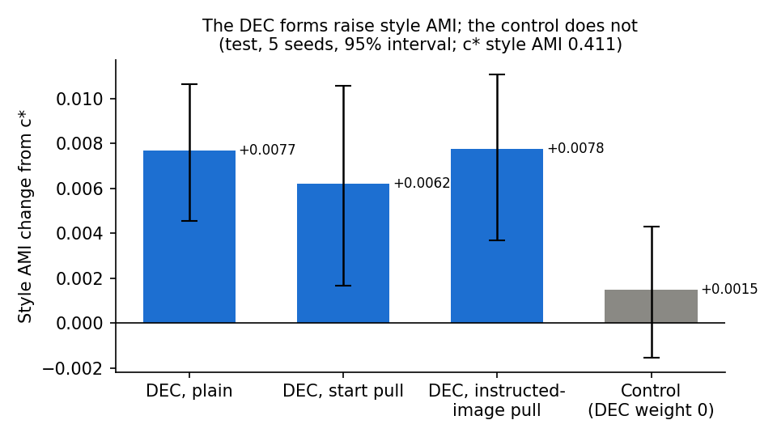

# PercepT's clustering loss raises c*'s style scores a little; a zero-weight control does not

> 2026-11-13 · Full report: [DEC on the heads of c*](../reports/auto/percept/2027-01-17_dec_heads.md)

## Summary

- We added PercepT's clustering loss to c*'s three aspect heads (emotion, style, genre) and compared with the saved c*.
- On style, all three forms of the loss raise clustering agreement and image retrieval a little.
- On genre, retrieval rises in all three forms, but clustering agreement rises only in one form. Emotion shows no clear change.
- A control with the same training and the loss weight at zero shows no clear change in clustering agreement.
- Cluster tightness on test changes little and not in one direction. A much longer run tightens most clusters but lowers agreement.
- The difference between each form and the control has no interval yet. That table cell is your open choice.

## How we got here

CoSiR trains c*, a small model on top of frozen image features. It gives one embedding per aspect (emotion, style,
genre), each from its own head. In training, each head is pulled toward the instructed Qwen3 image: the embedding that
Qwen3-VL-Embedding gives under that aspect's instruction, such as "focus only on the emotion".

PercepT, the earlier method that CoSiR improves on, trains with a clustering loss called DEC. A reviewer can ask whether
that loss would help c*. This round (2026-11-11 to 2026-11-13) answers that question as new rows of the paper's
ablation table.

## Add the clustering loss to each head

**Problem.** The ablation table removes parts of c*. It has no row that adds PercepT's clustering loss.

**Idea.** DEC (deep embedded clustering) gives each painting a soft assignment to cluster centres. It trains that
assignment toward a sharper copy of itself; the aim is tighter clusters. We tried three forms on each head:

- plain DEC;
- DEC with a start pull: each painting's assignment stays close to its assignment when DEC started, which keeps the
  head near c*;
- DEC with an instructed-image pull: each painting's assignment moves toward its cluster under the instructed Qwen3
  image.

We picked each form's settings on validation data with one seed. Then we trained each form on five seeds and scored
the test paintings against the saved c*.

**The control.** c* keeps the epoch with the best validation loss, often an early one (seed 0: epoch 4 for emotion, 1
for style). DEC starts after epoch 5, so a DEC run keeps epoch 6 or later. The control trains the same way with the DEC
weight at zero. So any change in the control comes from the later epoch alone. We ran one control for all three
forms: at weight zero they should train the same, but we did not check this per form.

**Did it work?** Partly.

- Style: all three forms raise AMI (clustering agreement with the labels) and mAP (image retrieval); the control does
  not. The change is small: +0.006 to +0.008 AMI on c*'s style AMI of 0.411.
- Genre: mAP rises in all three forms. AMI rises only with the instructed-image pull.
- Emotion: no clear change in the three forms. The control lowers emotion mAP a little (−0.0012 on 0.264).
- On style AMI, the intervals of two forms overlap the control's interval. The difference between a form and the
  control has no interval of its own yet.

**Key evidence.** Change from the saved c* on the test paintings, five seeds. "Raises" means the 95% interval lies above
zero. There is no correction for the many cells.

*Style AMI change from the saved c*. Blue: the three DEC forms. Grey: the control with the DEC weight at zero.*

| Change from saved c* | Emotion AMI | Style AMI | Genre AMI | Emotion mAP | Style mAP | Genre mAP |
|---|---|---|---|---|---|---|
| Plain DEC | no clear change | raises | no clear change | no clear change | raises | raises |
| Start pull | no clear change | raises | no clear change | no clear change | raises | raises |
| Instructed-image pull | no clear change | raises | raises | no clear change | raises | raises |
| Control (DEC weight 0) | no clear change | no clear change | no clear change | lowers | no clear change | no clear change |

> Full report: [results](../reports/auto/percept/2027-01-17_dec_heads.md#results).

## Do the clusters get tighter?

**Problem.** PercepT reports very tight clusters with DEC. We wanted to know whether DEC also tightens c*'s clusters,
and whether tighter clusters go with higher AMI.

**Idea.** We measured three standard tightness scores on the test paintings, beside AMI: the silhouette, the
Davies-Bouldin index and the Calinski-Harabasz index (see the glossary). We also checked one much longer DEC run (50
DEC epochs, one seed) on validation data.

**Did it work?** Tightness on test changes little, and not in one direction:

- Genre: tighter in all three forms by the Calinski-Harabasz index, in every seed. The other two scores agree for plain
  DEC and the start pull.
- Style: mixed. The instructed-image pull is looser by two of the three scores.
- Emotion: plain DEC stays level. Both pulls are looser by all three scores.
- The control is looser than c* on all three aspects.

The long run is tighter on emotion and genre and mixed on style, but its AMI falls on all three. It also trains much
longer, so it mixes DEC with extra training. All three scores partly measure the goal of DEC itself.

**Key evidence.** Validation data, seed 0: the long DEC run against c*. No interval (one seed).

| Aspect | Mean silhouette, c* | Mean silhouette, long DEC run | AMI change from c* |
|---|---|---|---|
| Emotion | 0.094 | 0.131 | −0.0074 |
| Style | 0.170 | 0.139 | −0.0183 |
| Genre | 0.175 | 0.226 | −0.0157 |

> Full report: [analysis](../reports/auto/percept/2027-01-17_dec_heads.md#analysis).

Our advice (open after giving your reading)

Our view: close the DEC line (option b below). Keep DEC out of the main recipe and report it as an ablation row with a
small style gain. Add the direct contrast (option a) only if the paper will cite the size of the DEC effect. A search
for a better DEC setting (option c) costs new GPU runs. The long run already shows tighter clusters with lower AMI.

## Next

The round is complete: test scores, the control, the tightness scores and the figures. The next step is your reading
of these results. Then you choose one of three options:

a. Add the direct contrast "DEC form minus control" to the table: each form against the control of the same seed, with
   an interval. It costs a small code change and about one hour of CPU. You have not decided this yet.
b. Close the DEC line: keep DEC out of the main recipe and report it as an ablation row.
c. Look for a DEC setting that keeps AMI while it tightens the clusters. It needs new GPU runs and a new validation
   sweep.

## Glossary

- **AMI:** adjusted mutual information, the agreement between clusters and labels; here at the class count (emotion 9,
  style 27, genre 10).
- **mAP:** mean average precision of image-to-image retrieval, where a hit shares the query's label.
- **c\*:** the current CoSiR model: one shared trunk with an emotion, a style and a genre head.
- **PercepT:** the earlier method that CoSiR improves on; it trains with DEC.
- **DEC:** deep embedded clustering, PercepT's clustering loss.
- **Plain DEC, start pull, instructed-image pull:** the three forms; the full report calls them the plain, start and
  teacher forms.
- **Control (DEC weight 0):** the same training with the DEC term at weight zero; the full report calls it the λ = 0
  control.
- **Instructed Qwen3 image:** the image embedded by Qwen3-VL-Embedding under one aspect's instruction.
- **Silhouette:** per painting, how much closer it is to its own cluster than to the nearest other cluster; higher is
  tighter.
- **Davies-Bouldin index:** the mean ratio of cluster spread to the distance between clusters; lower is tighter.
- **Calinski-Harabasz index:** the spread between clusters over the spread within them; higher is tighter.
