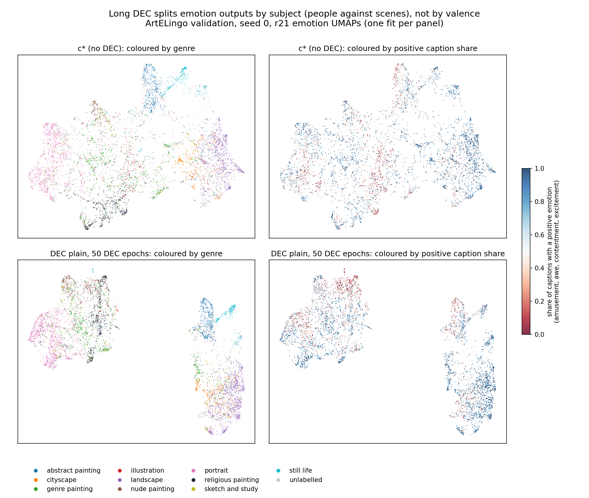

# Long DEC splits the emotion head mainly by subject; emotion follows only in part

> 2026-11-14 · Full report: [Long DEC's two emotion groups split paintings by subject](../reports/auto/percept/2027-01-20_dec_emotion_split.md)

## Summary

- Long DEC is our model c* trained much longer with PercepT's clustering loss. Its emotion head forms two big groups.
- These groups split paintings mainly by subject: people against landscapes, abstracts, cities and objects.
- They match genre much better than a positive, negative or other label from the captions.
- Both groups are mostly positive. Paintings of people carry more negative captions, so emotion follows the split in part.
- c* already has the same subject split; long DEC pulls the two halves apart.
- The evidence is one seed on validation, with no intervals.

## How we got here

CoSiR's model c* gives one embedding per aspect (emotion, style, genre), each from its own head.
PercepT is the earlier method that CoSiR improves on; its clustering loss is called DEC.
In the last round (2026-11-11 to 13) we added DEC to c*'s heads.
A long DEC run on validation showed two big, separate groups in its emotion map.
You asked: are these groups positive against negative emotions? This small round (2026-11-14) answers that.

## Are the two groups positive against negative?

**Problem.** A map shows that two groups exist, but not what separates them.
The old maps also had one fit per model, so two models' maps did not line up.

**Idea.** Four steps:

1. Split each model's emotion head into two groups with k-means.
2. Measure how well the two groups match each label: the nine emotions, style, genre, and a valence label.
   A painting's valence label is positive, negative or other: the one its captions name most often.
3. Check that these two groups are the two islands (separate regions) of long DEC's map.
4. Fit one map on c* and place every other model in it, so the maps line up.

**Did it work?** The check worked. The answer to your question is mostly no.
The groups follow genre far more than the valence label.
Emotion follows the split in part: the people group has more negative captions.

Caveats: one seed on validation, no intervals.
The shared map can make a large change look smaller. So the group check uses the head itself.

**Key evidence.** Agreement is measured as AMI (0 = chance, 1 = the same grouping).

| Two groups of | Match with valence label | Match with genre |
|---|---:|---:|
| Long DEC | 0.046 | 0.326 |
| c* (no DEC) | 0.040 | 0.314 |

| Group | Main genres | Positive / negative caption share |
|---|---|---|
| People | portraits, genre and religious paintings | 0.56 / 0.33 |
| Other subjects | landscapes, abstracts, cities, still lifes | 0.70 / 0.18 |

*Left: colour by genre. Right: colour by positive caption share. Long DEC (bottom) pulls c*'s subject halves into two islands.
Positive and negative paintings mix in both.*

> Full report: [Results](../reports/auto/percept/2027-01-20_dec_emotion_split.md#results).

Our advice (open after giving your reading)

Our view: option a, leave the DEC line closed.
Add option b if the paper's ablation text discusses DEC on emotion.
The subject split helps explain why DEC does not help emotion.

## Next

The choice is yours.

a. Nothing more. The DEC line stays closed.

b. One sentence in the paper's ablation text: long DEC splits the emotion head by subject. Cost: a sentence.

c. The same two-group check on two inputs: plain Qwen3 images, and the instructed embedding (Qwen3's image embedding under the emotion instruction).
Cost: a few CPU minutes. It tells whether the subject split comes from the instructed embedding.

## Glossary

- **c*:** CoSiR's trained model: one shared trunk with emotion, style and genre heads on frozen Qwen3 image features.
- **DEC, long DEC:** deep embedded clustering, PercepT's clustering loss. Long DEC: 50 DEC epochs, on validation.
- **AMI:** adjusted mutual information; agreement between two groupings after a correction for chance.
- **Positive caption share:** the share of a painting's captions with amusement, awe, contentment or excitement. Negative: anger, disgust, fear or sadness.
- **Valence label:** positive, negative or other, whichever a painting's captions name most often; ties are left out.
- **k = 2 groups:** the two groups that k-means finds in a model's emotion head.
- **Instructed embedding:** Qwen3's image embedding under one aspect's instruction, such as "focus only on the emotion".
